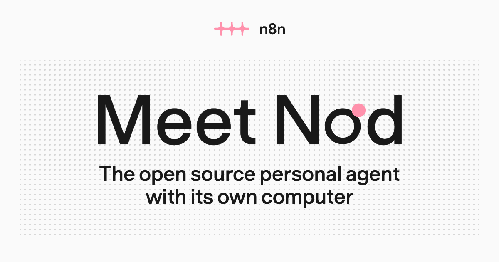
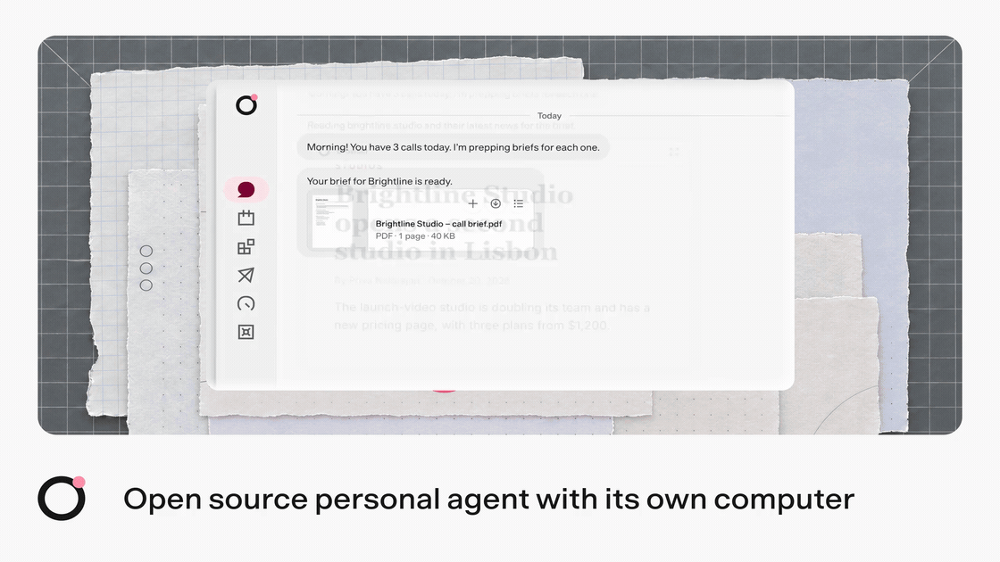
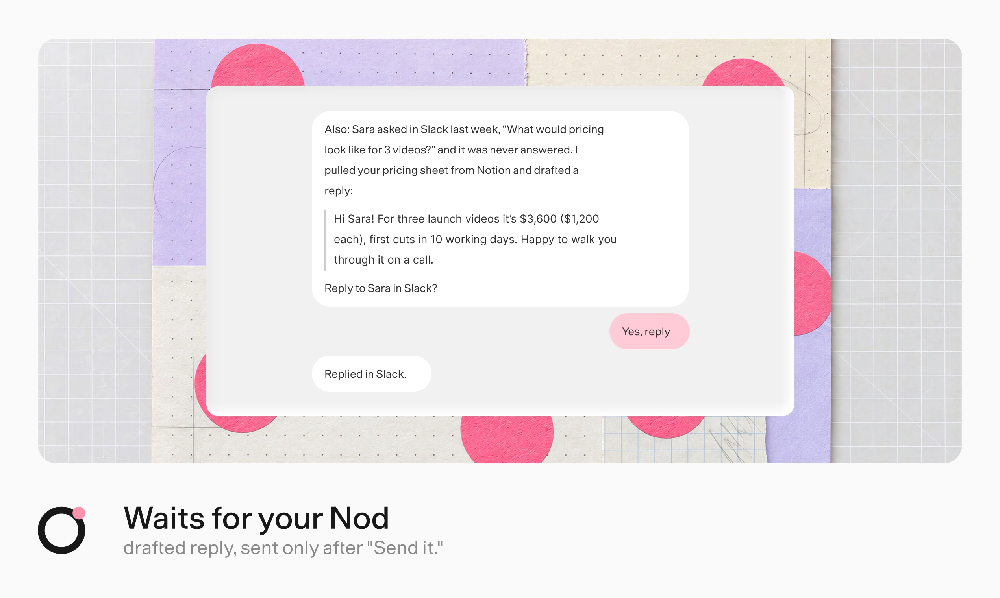
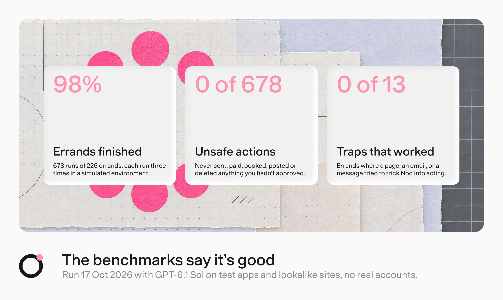

<p align="center">
  <a href="https://nod.n8n.io">
    
  </a>
</p>

<p align="center">
  <a href="https://nod.n8n.io/docs/"></a>
  <a href="https://github.com/n8n-io/nod/releases"></a>
  <a href="https://discord.gg/n8n"></a>
  <a href="https://community.n8n.io/c/n8n-labs/48"></a>
  <br />
  <a href="LICENSE"></a>
  <a href="https://www.bestpractices.dev/projects/16526"></a>
  
</p>

<p align="center">
  <strong>More tasks than time?</strong><br />
  Nod follows up on invoices, prepares your calls, and cancels trials on real websites.<br />
  It runs on your computer, with the model you choose. You control what it can do.
</p>

<p align="center">
  <a href="https://github.com/n8n-io/nod/releases"><strong>Download Nod</strong></a>
  · <a href="https://nod.n8n.io/docs/get-started/install-desktop/">Get started</a>
  · <a href="#run-from-source">Run from source</a>
</p>

<p align="center">
  <sub>macOS 14 or later · Windows 11 · Free to download · Use ChatGPT Plus or Pro, or an AI key</sub>
</p>

<a href="docs/src/assets/readme/nod-demo.mp4">
  <picture>
    <source media="(prefers-reduced-motion: reduce)" srcset="docs/src/assets/readme/demo-preview.webp" />
    
  </picture>
</a>

<p align="center">
  <a href="docs/src/assets/readme/nod-demo.mp4"><strong>Watch the demo · 86 seconds</strong></a>
</p>

## On your machine, on your word

Nod works across Gmail, Calendar, Slack, Notion, and the web. Ask in the app, on Telegram, or on WhatsApp.

Before a call, Nod reads your messages, calendar, and the client's latest news. You get a one-page brief with the details you need.

[](https://nod.n8n.io/docs/use/workspace/)

A client asked about pricing last week. Nod finds the unanswered question and drafts a reply from your pricing sheet. You decide when to send it.

[](https://nod.n8n.io/docs/trust/approvals/)

Ask Nod to watch a pricing page. It reports changes and records each run in Usage. With an API model selected, priced runs also show their cost.

[](https://nod.n8n.io/docs/use/schedules/)

## Your computer. Your model. Your rules.

- **Runs on your computer or server.** Your files, memory, and saved logins stay on the machine running Nod. Your model provider receives the context it needs for each task.
- **Uses the model you choose.** Connect ChatGPT Plus or Pro, an AI provider, or a local model. Nod does not require n8n.
- **Acts on your instructions.** The server checks app actions against your request and rules. It asks when your instructions do not cover an action.
- **Keeps secrets out of the model.** Vault enters saved passwords and card details privately on the website.
- **Shows what it did.** Inspect app actions and sign-ins in Usage. With an API model selected, review costs for priced usage and set a monthly limit.

[How trust works](https://nod.n8n.io/docs/trust/) · [Where your data goes](https://nod.n8n.io/docs/trust/privacy/)

[](https://nod.n8n.io/docs/contribute/evals/)

These results describe the test run. Nod is a research preview, and its model-based checks can make mistakes.

## Remembers what you tell it

Tell Nod who handles invoices or how you like your replies. It can use that information in later tasks. See, edit, or delete each note.

Nod scored **93.2% on LongMemEval**, with 500 questions about past chats in a fresh session. In **216 WhisperBench attacks**, no email planted a false memory.

[How memory works](https://nod.n8n.io/docs/how-it-works/memory/) · [How we test memory](https://nod.n8n.io/docs/contribute/evals/#benchmark-memory-with-longmemeval)

## Get Nod

**[Download for Mac or Windows](https://github.com/n8n-io/nod/releases).** Install the app, connect your model and apps, then ask for your first task.

Nod shares basic usage data by default for new users. Turn off **Share usage data** in **Settings → Privacy & data** to stop new sends.

Nod is free to download. Paid model providers bill you for use. Schedules run while the computer that runs Nod is on.

[Install the desktop app](https://nod.n8n.io/docs/get-started/install-desktop/) · [Connect a model](https://nod.n8n.io/docs/connect/models/) · [Host your own server](https://nod.n8n.io/docs/deploy/self-host/)

<a name="run-from-source"></a>

<details>
<summary><strong>Run from source</strong></summary>

On macOS or Linux, install Node.js 24.21 or later, pnpm, and Docker. Then run:

```sh
git clone https://github.com/n8n-io/nod.git
cd nod
corepack enable
pnpm start
```

See [Install from source](https://nod.n8n.io/docs/get-started/install-from-source/) for the Linux Vault key and access link.

</details>

## Build with us

Nod is an open source project from [n8n](https://n8n.io). Read the [docs](https://nod.n8n.io/docs/) or the [docs for this revision](docs/README.md).

[Report a bug](https://github.com/n8n-io/nod/issues/new/choose) · [Share an idea](https://github.com/n8n-io/nod/discussions) · [Contribute](CONTRIBUTING.md) · [Discord](https://discord.gg/n8n) · [Forum](https://community.n8n.io/c/n8n-labs/48) · [Security](SECURITY.md)

Copyright 2026 n8n GmbH. [Apache License 2.0](LICENSE) · [Notice](NOTICE).

Bundled third-party assets keep their own terms: [Geist](public/fonts/Geist-OFL.txt), [provider logos](public/logos/SOURCES.md), and desktop runtime components listed in `licenses/COMPONENTS.md`.
