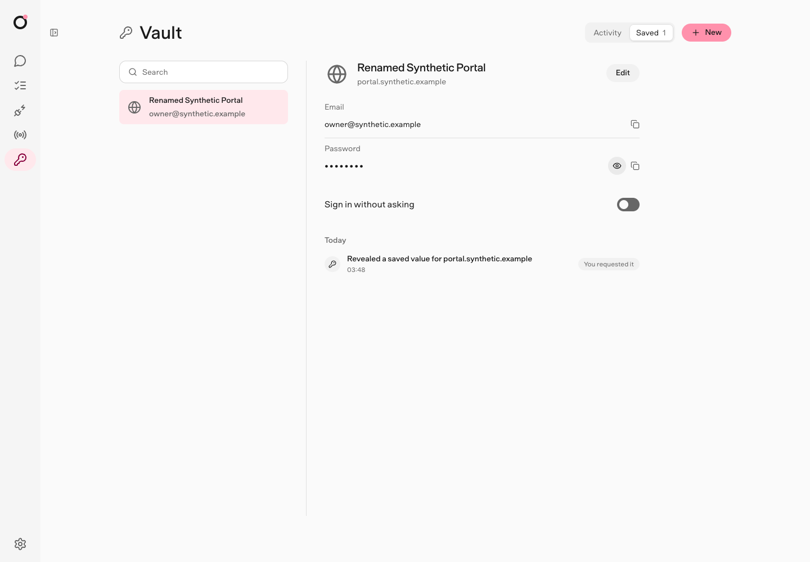
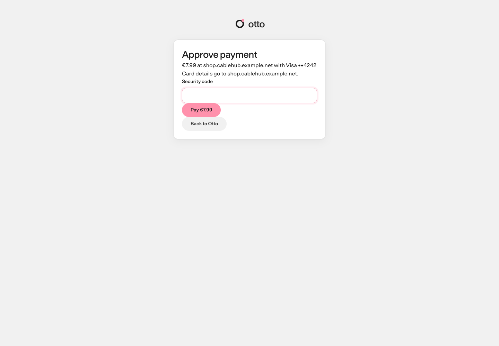

<picture>
  <source media="(prefers-color-scheme: dark)" srcset="docs/src/assets/banner-dark.png" />
  
</picture>

<p align="center">
  <a href="https://n8n-io.github.io/otto/"><b>Docs</b></a> ·
  <a href="https://github.com/n8n-io/otto/releases">Download</a> ·
  <a href="https://n8n-io.github.io/otto/trust/principles/">Why you can trust it</a> ·
  <a href="https://github.com/n8n-io/otto/discussions">Discussions</a>
</p>

**Give Otto the task, not the steps.** It researches the web, writes files in its own Linux workspace, signs in to websites, works in Gmail, Calendar, Slack and Notion, and keeps watch on a schedule. Then it reports back in the app, on Telegram or on WhatsApp.

> "Compare these three suppliers and put price and delivery in a table."
>
> "Download last month's invoice from my billing portal."
>
> "Every Friday at 5 pm, recap what we shipped this week."

## Powerful, and under your control

|                                                                                                                                                                                  |                                                                                                                                              |
| -------------------------------------------------------------------------------------------------------------------------------------------------------------------------------- | -------------------------------------------------------------------------------------------------------------------------------------------- |
| **Authority comes from you.** A web page or an email can never give Otto permission. The server checks every app action against what you asked, and asks you when it isn't sure. | **Your secrets never reach the model.** Vault types saved logins and cards into the exact website, privately. Otto only sees that it worked. |
|                                                       |                                  |
| **Every action on the record.** Every use of a saved login, every app action and every model cost, visible to you, with a monthly spending limit.                                | **Your computer, your model.** Runs on your machine with the provider you choose. Open source, so you can read every rule.                   |

[Read the trust principles →](https://n8n-io.github.io/otto/trust/principles/) · [See how Otto compares →](https://n8n-io.github.io/otto/trust/compare/)

## Get Otto

**Desktop app.** Download the newest **Otto** release for Mac (Apple silicon or Intel) or Windows (preview) from the [releases page](https://github.com/n8n-io/otto/releases), then follow the [install guide](https://n8n-io.github.io/otto/get-started/install-desktop/).

**From source**, on macOS or Linux with Node.js 24.21+, pnpm and Docker:

```sh
git clone https://github.com/n8n-io/otto.git && cd otto
corepack enable && pnpm start
```

You need a model connection: an OpenAI, Anthropic or OpenRouter API key, or a ChatGPT plan. See [Install from source](https://n8n-io.github.io/otto/get-started/install-from-source/) for the Linux Vault key and the access link.

> [!NOTE]
> Otto is an early preview. Expect rough edges and breaking changes.

## Learn more

|                                                                            |                                                         |
| -------------------------------------------------------------------------- | ------------------------------------------------------- |
| [Get started](https://n8n-io.github.io/otto/get-started/what-is-otto/)     | What Otto is, installing it and your first conversation |
| [Use Otto](https://n8n-io.github.io/otto/use/chat/)                        | Chat, tasks, schedules, files, the browser and memory   |
| [Trust and Vault](https://n8n-io.github.io/otto/trust/)                    | Approvals, saved logins, payments and your data         |
| [How Otto works](https://n8n-io.github.io/otto/how-it-works/architecture/) | Threads, turns, the sandbox and hosted mode             |
| [Contribute](https://n8n-io.github.io/otto/contribute/)                    | Development setup, checks, evals and writing docs       |

## Community

Report bugs with the [bug report form](https://github.com/n8n-io/otto/issues/new/choose), share ideas in [Discussions](https://github.com/n8n-io/otto/discussions), and report vulnerabilities privately through the [security policy](SECURITY.md). To contribute, read [CONTRIBUTING](CONTRIBUTING.md). Coding agents follow [AGENTS.md](AGENTS.md).

## License

Copyright 2026 n8n GmbH. Otto uses the [Apache License 2.0](LICENSE), and [NOTICE](NOTICE) holds its attribution notice. Bundled third-party assets keep their own terms and are not covered by it: Inter uses the [SIL Open Font License](public/fonts/Inter-LICENSE.txt), the n8n Baumer fonts are [proprietary](public/fonts/Baumer-SOURCE.md), provider logos belong to [their owners](desktop/ui/logos/SOURCES.md), and the desktop runtime lists its components and their licenses in `licenses/COMPONENTS.md`.
