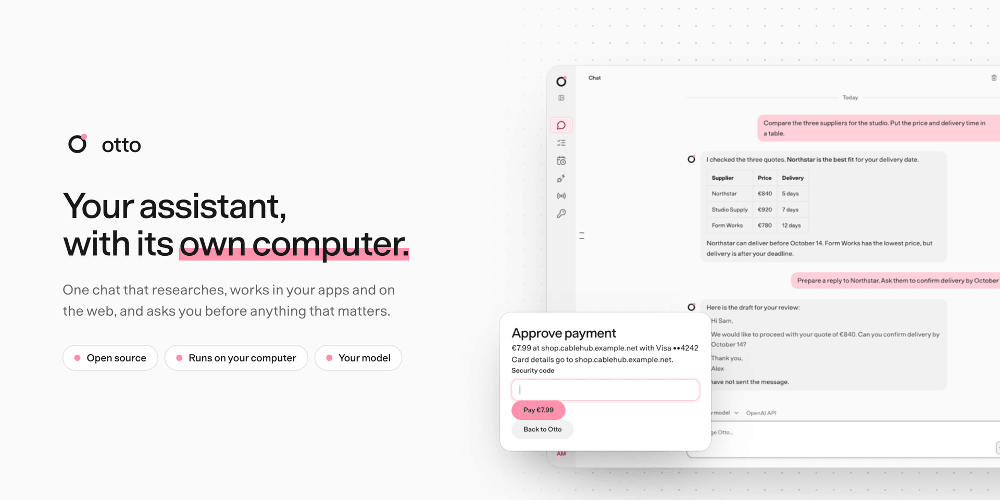
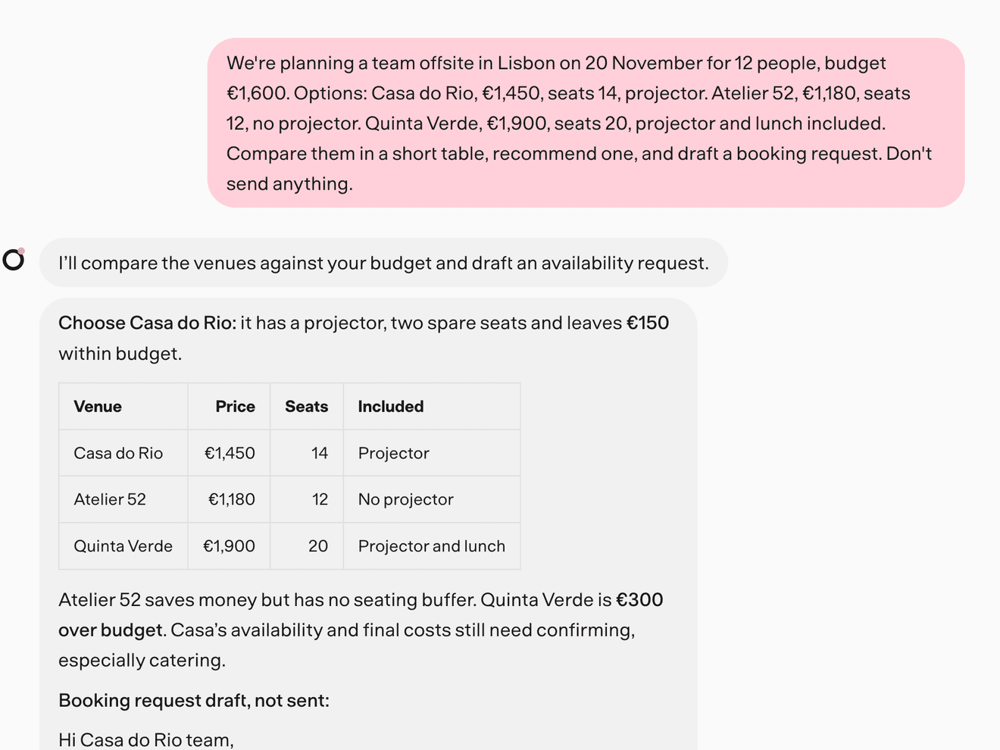
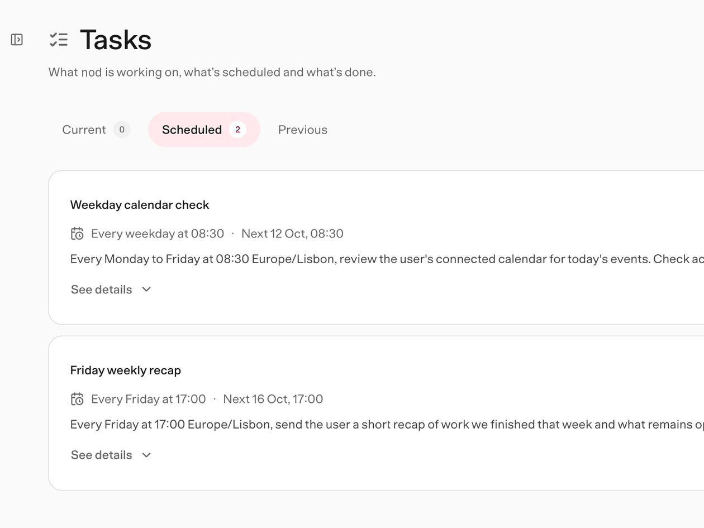
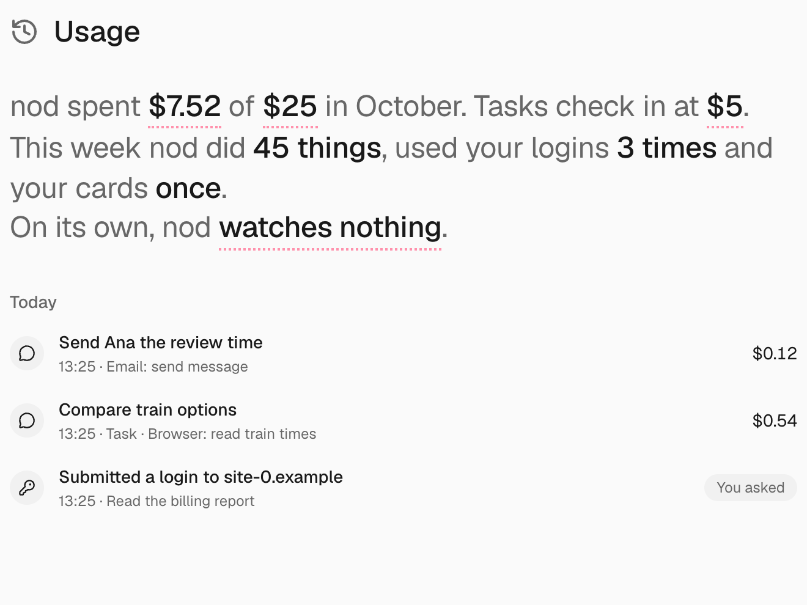

<picture>
  <source media="(prefers-color-scheme: dark)" srcset="docs/src/assets/banner-dark.png" />
  
</picture>

<p align="center">
  <a href="docs/README.md"></a>
  <a href="https://github.com/n8n-io/nod/releases"></a>
  <a href="https://discord.gg/n8n"></a>
  <a href="https://community.n8n.io/c/n8n-labs/48"></a>
  <a href="LICENSE"></a>
  <a href="https://www.bestpractices.dev/projects/16526"></a>
  
</p>

**Give Nod the task, not the steps.** It researches the web, writes files in its own Linux workspace, signs in to websites, works in Gmail, Calendar, Slack and Notion, and keeps watch on a schedule. Then it reports back in the app, on Telegram or on WhatsApp.

<table>
  <tr>
    <td width="33%" valign="top">
      <picture>
        <source media="(prefers-color-scheme: dark)" srcset="docs/src/assets/screens/card-chat-dark.png" />
        
      </picture>
      <p><b>Give it the whole task.</b> Nod compares, decides and drafts, and doesn't send until you say so.</p>
    </td>
    <td width="33%" valign="top">
      <picture>
        <source media="(prefers-color-scheme: dark)" srcset="docs/src/assets/screens/card-tasks-dark.png" />
        
      </picture>
      <p><b>Keep watch on a schedule.</b> Ask once in plain words. Nod checks back on its own.</p>
    </td>
    <td width="33%" valign="top">
      <picture>
        <source media="(prefers-color-scheme: dark)" srcset="docs/src/assets/screens/card-usage-dark.png" />
        
      </picture>
      <p><b>Sign in without sharing passwords.</b> Vault types them in privately and logs every use.</p>
    </td>
  </tr>
</table>

## Built to be trusted

- **Authority comes from you.** A web page or an email can never give Nod permission. The server checks every app action against what you asked, and asks you when it isn't sure.
- **Vault keeps saved secrets out of the model.** It fills saved logins and cards into the exact website, privately.
- **What matters is on the record.** Every sign-in, every change or message sent through your apps, and every model cost, with a monthly spending limit.
- **Runs on your computer.** With the desktop app or from source. You pick the model provider, and the code is open.

[Our trust principles](docs/src/content/docs/trust/principles.mdx) · [How Nod compares](docs/src/content/docs/trust/compare.mdx) · [Security review guide](docs/src/content/docs/trust/security-review.mdx)

## Remembers what you tell it

- **93.2% on LongMemEval**, the standard long-term memory benchmark. Asked 500 questions about months of earlier chats, Nod answered 93.2% in a fresh session that sees only the latest messages, finding the rest in its notes and its search. That's up from 79%, and among the best published memory systems.
- **No email can plant a memory.** In 216 WhisperBench attacks (108 emails, each read in the background and on request), none got a false fact or rule into Nod's memory. The same attack succeeds on OpenClaw 87.5% of the time.
- **It finds what you said.** Nod searches everything you've told it, ranks the best matches first and brings up what you said before about the topic at hand, so it can answer with the date you said it.
- **Learns only from you.** Notes come from you: your messages, notes you add, what you choose to import from another assistant, and one style note from email you sent. Never from web pages, emails you receive or Nod's replies. See and edit every one in Settings → Memory.

[How we test memory](docs/src/content/docs/contribute/evals.mdx#benchmark-memory-with-longmemeval) · [How memory works](docs/src/content/docs/how-it-works/memory.md)

## Get Nod

**Self-hosted server.** Run one assistant on a VPS, cloud VM, or Mac mini and connect from your devices. See [Host your own server](docs/src/content/docs/deploy/self-host.mdx).

**Desktop app.** Download the newest **Nod** release for Mac (Apple silicon or Intel) or Windows from the [releases page](https://github.com/n8n-io/nod/releases). See [Install the desktop app](docs/src/content/docs/get-started/install-desktop.mdx).

**From source**, on macOS or Linux with Node.js 24.21+, pnpm and Docker:

```sh
git clone https://github.com/n8n-io/nod.git && cd nod
corepack enable && pnpm start
```

You also need a model connection: an OpenAI, Anthropic or OpenRouter API key, an Amazon Bedrock key and Region, a Google Vertex AI key, an Azure OpenAI endpoint, deployment and key, or a ChatGPT Plus or Pro plan. See [Install from source](docs/src/content/docs/get-started/install-from-source.mdx) for the Linux Vault key and the access link.

## Read the docs

Read the docs for this revision in [`docs/`](docs/README.md). Run the site locally with `pnpm --dir docs dev`, or start with these pages:

| Section                                                              | What's inside                                         |
| -------------------------------------------------------------------- | ----------------------------------------------------- |
| [Get started](docs/src/content/docs/get-started/what-is-nod.mdx)     | What Nod is, installing it and your first task        |
| [Use Nod](docs/src/content/docs/use/chat.md)                         | Chat, tasks, schedules, files, the browser and memory |
| [Trust and Vault](docs/src/content/docs/trust/index.mdx)             | Approvals, saved logins, payments and your data       |
| [How Nod works](docs/src/content/docs/how-it-works/architecture.mdx) | Threads, turns, the sandbox and memory                |
| [Contribute](docs/src/content/docs/contribute/index.mdx)             | Development setup, checks, evals and writing docs     |

## Community

Report bugs with the [bug report form](https://github.com/n8n-io/nod/issues/new/choose), share ideas in [Discussions](https://github.com/n8n-io/nod/discussions), and report vulnerabilities privately through the [security policy](SECURITY.md). To contribute, read [CONTRIBUTING](CONTRIBUTING.md). Coding agents follow [AGENTS.md](AGENTS.md).

## License

Copyright 2026 n8n GmbH. Nod uses the [Apache License 2.0](LICENSE), and [NOTICE](NOTICE) holds its attribution notice. Bundled third-party assets keep their own terms and are not covered by it: Geist uses the [SIL Open Font License](public/fonts/Geist-OFL.txt), provider logos belong to [their owners](public/logos/SOURCES.md), and the desktop runtime lists its components and their licenses in `licenses/COMPONENTS.md`.
