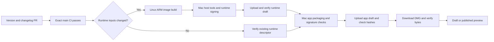

# Desktop releases

The current distribution target is an internal, self-signed Apple Silicon preview. The workflows prepare a version/changelog PR, require CI on the exact main revision, build a signed DMG and application ZIP, and verify the uploaded bytes before publishing. The app and any new runtime release stay drafts unless the workflow's publish option is enabled. Both are marked as prereleases, including the first `0.1.0` alpha. Published runtime packs are immutable and can be reused by subsequent app releases.

Self-signing does not satisfy Gatekeeper's Developer ID and notarization requirements. A new Mac may require **System Settings → Privacy & Security → Open Anyway**. Otto explains its separate Keychain prompt before accessing saved API keys. Keeping the same certificate across builds gives the app a stable signing identity; it does not guarantee that macOS will never ask for Keychain approval. See [Electron signing guidance](https://www.electronjs.org/docs/latest/tutorial/code-signing) and [Apple distribution signing](https://developer.apple.com/documentation/xcode/creating-distribution-signed-code-for-the-mac/).

## One-time repository configuration

Create a GitHub environment named `mac-release`. The source repository and runtime destination must remain private for self-signed previews. App releases stay in the source repository so version tags and changelog history have one authority. Runtime packs also use the source repository by default; no additional token or repository is required.

| Kind              | Name                             | Value                                                                                                            |
| ----------------- | -------------------------------- | ---------------------------------------------------------------------------------------------------------------- |
| Secret            | `APPLE_CERTIFICATE`              | Base64-encoded PKCS#12 certificate and private key                                                               |
| Secret            | `APPLE_CERTIFICATE_PASSWORD`     | PKCS#12 export password                                                                                          |
| Variable          | `APPLE_SIGNING_IDENTITY`         | Exact certificate common name, for example `Otto Internal`                                                       |
| Variable          | `APPLE_CERTIFICATE_SHA256`       | Lowercase SHA-256 of the public certificate in DER format                                                        |
| Variable          | `OTTO_SIGNING_MODE`              | `self-signed`, also the default                                                                                  |
| Optional variable | `OTTO_RUNTIME_REPO`              | `owner/repository` for runtime releases; defaults to this repository                                             |
| Optional variable | `OTTO_DESKTOP_UPDATE_SOURCE_URL` | Private update broker base: `https://internal.users.n8n.cloud/webhook/otto-desktop`; unset for public GitHub API |
| Optional secret   | `RELEASE_TOKEN`                  | Token with Contents read/write for a separate runtime repository                                                 |

Use the existing Otto certificate from the reference project if its original PKCS#12 export is available. GitHub cannot reveal an existing secret's value. Otherwise, generate a dedicated Otto code-signing certificate in Keychain Access, export it with its private key and a password, and keep the original securely for later builds. Do not commit certificate keys or passwords. For a public DER certificate, `shasum -a 256 signing.cer` gives the required fingerprint.

Repository Actions settings must permit GitHub Actions to create pull requests. The preparation workflow explicitly dispatches CI for its bot-created release branch; the normal push/PR events are not sufficient for changes made with `GITHUB_TOKEN`.

Before distributing private updater-enabled builds, publish and verify the [n8n release workflow](../deployment/n8n/README.md) with the saved **Otto Releases** credential approved for this repository's **Contents: read**. Set the update-source variable above; no token enters the app. When the repository becomes public, distribute a build with that variable unset through the existing workflow, and keep the workflow available until older clients migrate.

## Release sequence

1. Merge the reviewed desktop implementation into main and let normal CI pass.
2. Run **Prepare desktop release** from main with a stable version such as `0.1.0`. It opens or updates `release/desktop`, changing only the desktop package, lockfile, release manifest, and changelog. Review the generated commit summaries and edit them into user-facing release notes as needed.
3. Merge that release PR after its CI passes. Wait for CI on the resulting exact main commit. If other source changes landed after the changelog was generated, regenerate the release PR before packaging; only the four release metadata files may differ from the recorded source.
4. Run **Build desktop release** from main. Leave **publish** disabled for the first inspection. The workflow verifies the committed version/notes, the exact successful CI revision, signing configuration, destination access, and any reusable runtime before starting Mac jobs.
5. Inspect the app and runtime drafts and complete the physical-Mac acceptance checks below. The app draft includes the DMG, signed application ZIP, exact-version update feed, checksums, public signing certificate, app/runtime metadata, and the current changelog section. Its notes link to the matching runtime draft's release page. Draft access requires repository write access. Download draft assets from their GitHub release pages or with `gh release download <tag> --repo <owner/repository>`.
6. When approved, publish the verified runtime draft first, then the app draft through GitHub. Future runs can enable **publish** to publish both previews after the uploaded runtime and downloaded DMG/ZIP pass verification. The final job publishes the runtime, checks public download access when applicable, then publishes the app. Published versions are never overwritten; prepare a new version for changes. Draft runtimes are rebuilt on a new workflow run; only published runtime packs qualify for reuse.

Private releases use the configured n8n download service for automatic first-run setup and updates. The GitHub credential stays in n8n; testers need the DMG link and a supported provider API key or ChatGPT plan. Publish the matching runtime before distributing the app. A previously verified local runtime is reused without network access. Builds without a release source or public immutable runtime URL retain manual import as a fallback.

## Private-alpha installation and recovery

Testers need an Apple Silicon Mac and a supported provider API key or ChatGPT plan. Share the published DMG asset through the n8n download service. Copy Otto to Applications before opening it. Follow macOS's Open Anyway and Keychain prompts if shown; managed Macs may require IT approval. Onboarding downloads and verifies the matching runtime automatically. First provisioning needs an internet connection.

Installation checks available storage against the runtime's extracted file sizes plus 512 MiB of working headroom. Automatic downloads also reserve the archive size, then check space again before extraction. Importing an archive already on disk does not reserve a second copy. The error reports the additional free space needed; free space and retry with the same matching pack. Otto keeps existing caches, conversations and settings. This check covers runtime installation, not the computer's later working storage. Minimum RAM, total working disk space and macOS 14 hardware acceptance remain unmeasured; the VM currently reserves 3–6 GiB RAM and a 24 GiB virtual disk that grows as used.

Version 0.1.2 introduces the Otto application identity and a fresh local profile. Install it manually when moving from Otto Preview; there is no profile migration or update bridge. Earlier data is left untouched. Subsequent Otto releases prepare the matching runtime and signed application, then offer **Restart** or **Later**; unfinished work or input defers restart. An unchanged runtime is reused. A supported downgrade or complete backup-and-restore workflow is not implemented. Do not delete the profile, VM, database or runtime cache as a routine recovery step. Retry interrupted setup; if it still fails, open **Send feedback** in Chat to review and send the diagnostic report. In development, use **Copy trace** inside that modal to copy the same report without submitting it. If Chat cannot open, send the visible setup error instead. Never send API keys, passwords, or the settings file.

Feedback goes directly to the anonymous n8n webhook at `https://internal.users.n8n.cloud/webhook/otto/feedback`; no feedback relay or shared client credential is required. `OTTO_FEEDBACK_URL` overrides this destination, and an explicitly empty value disables submission while keeping local trace copying available. Confirm the workflow is published with its Linear credential before distributing a build.

The runtime includes `licenses/COMPONENTS.md` and the pinned Docker CLI/Engine licenses and notices. Build preparation verifies their downloaded checksums; packaging verifies them again and includes them in the runtime's hashed file manifest. Electron/Chromium, Lima and npm dependency notices remain alongside their bundled components. The component inventory does not replace a complete redistribution review.

## Build time and cost

- The shared server, UI and desktop contracts run on Linux. Desktop pull requests also run the [native update acceptance](evals/automatic-updates.md) on macOS with disposable apps and signing identities; production signing credentials are not used.
- Packaging runs only on manual release dispatches. It consumes successful main CI instead of rerunning the full database/browser suite on Mac.
- A runtime fingerprint covers the shared Dockerfiles, root package and lockfile, complete `src` tree, pinned downloads, runtime preparation/signing code, build dependencies, and permanent certificate identity. The root browser image copies all `src`, so changes there require a new runtime, including web source changes. Desktop shell changes and desktop version bumps reuse a published runtime when those inputs are unchanged.
- New container images build natively on Linux ARM with separate BuildKit caches. Mac runners prepare only the Mac host tools and sign/package artifacts. Lima is rebuilt from pinned source with a macOS 14 deployment target; prebuilt upstream tools are not assumed to match the app's minimum OS.
- npm, Electron downloads, verified runtime downloads, and Go compilation have separate caches. Already-compressed runtime images and DMGs use artifact compression level zero. Runtime transfer artifacts expire after one day, app artifacts after three; published release assets remain available.
- Every GitHub release asset is checked against the service's reported SHA-256 and byte count. The DMG and application ZIP are also downloaded again and checked. A reused runtime archive is checked through its immutable descriptor and GitHub digest; it is not repeatedly downloaded to each CI job. The app verifies the runtime archive and extracted files before staging an update; the native updater verifies the application signature.

GitHub's listed standard rates currently make Linux ARM materially cheaper than macOS; actual cost depends on the organization's plan and included minutes. No new-pipeline timing or billing result is claimed until it runs in GitHub. Sources: [runner specifications and limitations](https://docs.github.com/en/actions/reference/runners/github-hosted-runners), [runner pricing](https://docs.github.com/en/billing/reference/actions-runner-pricing), [release asset limits](https://docs.github.com/en/repositories/releasing-projects-on-github/about-releases), [asset digests](https://docs.github.com/en/rest/releases/assets).

## Signing and verification boundaries

The signing wrapper imports the certificate into an isolated temporary keychain, verifies its public fingerprint, identity and validity, and supplies only keychain handles and public metadata to packaging. It removes raw Apple secrets from child environments. Each signing command waits until its process group is recorded. Cleanup verifies and stops surviving groups before restoring the previous keychain search list and deleting its own temporary material, including after a failed command. It never changes the user's certificate trust settings. An `always()` workflow step provides an additional cleanup attempt.

Self-signed Electron builds retain hardened runtime but use the `disable-library-validation` entitlement: internal certificates have no Apple Team ID, so the normal library validation rejects Electron’s own framework. This exception applies only to self-signed app processes; Developer ID keeps the default Electron role entitlements. See [Apple library validation](https://developer.apple.com/documentation/bundleresources/entitlements/com.apple.security.cs.disable-library-validation).

Container images and JavaScript dependencies are built before certificate secrets enter the signing step. The app is signed only after all resources and nested native binaries are in place. Runtime host binaries are separately signed; the Lima binary retains its virtualization entitlement. App, DMG, minimum OS, architecture, signature identity, and runtime descriptor checks fail the build on mismatches. A lean release does not rebuild or silently replace a published runtime.

GitHub-hosted Mac runners do not support nested virtualization. These workflows can verify native binaries and packaging, but cannot prove that Otto's private computer boots on a user's Mac. Before wider distribution, test the downloaded assets on a physical Apple Silicon Mac:

- Fresh profile: drag to Applications, handle the self-signed first-launch gate, connect a supported provider API key or ChatGPT plan, complete onboarding, and verify automatic runtime preparation and actual workspace/browser operation.
- Upgrade: start from the previous signed release, let it discover and prepare the update, exercise Later and Restart, and verify the new version opens with existing encrypted settings, conversations, workspace and browser state intact. Verify an unchanged runtime is reused. Start this check from 0.1.2 or later; the Otto Preview identity is intentionally not migrated.
- Confirm login startup, notification text/click behavior, app quit, and explicit retry after interrupted installation.
- Exercise the oldest advertised macOS version. A binary's minimum-OS load command is a compatibility check, not a physical macOS 14 acceptance result.

Use disposable test profiles and synthetic content for automated checks. Actual model/account acceptance is a separately authorized manual check.

## Later Developer ID distribution

An Apple Developer Program account is not required for this internal preview. For public installation with Apple's normal trust checks, replace the certificate with a Developer ID Application identity and set `OTTO_SIGNING_MODE=developer-id`, `APPLE_TEAM_ID`, and the `APPLE_ID` / `APPLE_APP_SPECIFIC_PASSWORD` secrets. Use a public runtime distribution repository. A separate runtime destination needs `RELEASE_TOKEN`. App releases currently remain in the source repository; supporting a separate public app-download repository also requires synchronizing its release tags back to the source before enabling that destination.

That path signs hardened binaries, submits the runtime host tools and application to Apple's notary service, staples the app and DMG tickets, and checks Gatekeeper assessment. Raw runtime executables have no stapled bundle ticket; their signatures and accepted notarization are verified separately. The path is implemented but cannot be accepted against Apple's service without that account and certificate. See [Apple's notarization workflow](https://developer.apple.com/documentation/security/customizing-the-notarization-workflow).

New public runtime drafts use manual import when **publish** is disabled. With **publish** enabled, the app includes the intended public runtime URL; Mac packaging defers its anonymous download check only for the exact runtime descriptor already verified by CI. Distribute that app after the final job has published and checked the runtime. Reusing an already published public runtime keeps automatic first-launch downloading, including when the new app remains a draft.

## Reference and current evidence

The reference was [otto-grokbot-experiment](https://github.com/n8n-io/otto-grokbot-experiment) at `aa1df9901c5e0e9bb05580f417f1a02dee5be4d3`. Its internal release used a self-signed `Otto Internal` certificate. Its terminal installer verified the download and then removed quarantine from the installed app; that is separate from Apple's notarized installation flow. This pipeline does not strip quarantine or add a globally trusted certificate.

Reused ideas: a reviewable version/changelog PR, pinned actions, native ARM image builds, temporary signing keychains, cached tool downloads, cheap artifact transfer, and verification of downloaded release assets. The Electron experiment retains its own packaging and resource-signing requirements. It does not copy the reference's Tauri updater keys or multi-architecture build matrix.

Local checks and installed-app observations are recorded in [VALIDATION.md](VALIDATION.md). Hosted workflow execution and physical-Mac installation of a CI-produced self-signed release remain distinct acceptance gates.
