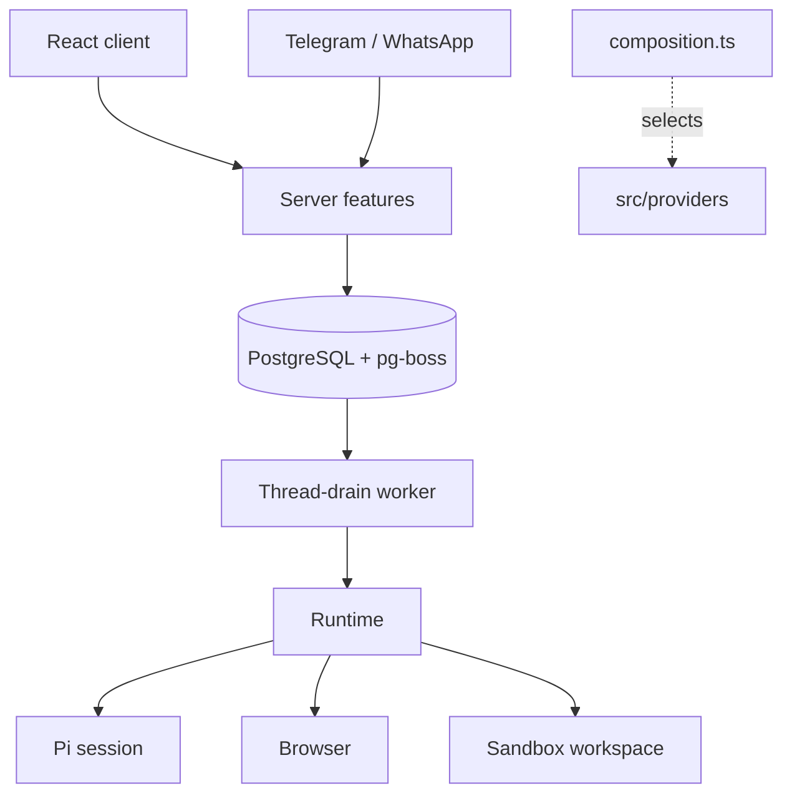

# Architecture

Local mode is one Node process (React client, Fastify API, agent runtime, thread-drain worker, schedulers) plus Docker containers for PostgreSQL, the workspace and the browser. Hosted mode runs the same feature graph once per user behind a gateway. `OTTO_MODE` selects `local`, `gateway` or `tenant`.

Code layout: `src/ports` defines capabilities without vendor types, `src/providers` holds SDKs and protocols, `src/runtime` owns tools, prompts and turns, `src/server` owns policy, persistence and HTTP, `src/shared` holds browser-safe types, and `src/web` is the client. `src/server/composition.ts` is the only place that selects implementations; `scripts/check-architecture.mjs` enforces import directions.

## Thread and turns

Each owner has one active `threads` row, shared by every channel. Its ID keys one persistent Pi session, one workspace and one browser computer.

Every user message, schedule fire, event wake, reaction and resume inserts a `turns` row (`source`: `user`, `schedule`, `event`, `resume`) and a `thread-drain` job in one transaction. The worker fetches up to 20 drain jobs at once and drains each thread in the batch once, so redundant drain jobs do not delay later turns. It locks the thread, starts every queued background turn at once and, while no conversation turn is running, the oldest queued conversation turn; it does not wait for them. A finished conversation turn queues the next drain. Turn status moves `queued` → `running` → `succeeded`, `waiting`, `failed` or `cancelled`. Each turn records its reply channel, so a Telegram message is answered on Telegram.

- `withTurnLock(turnId, op)` fences every write: the turn must be `running` on the active thread.
- The composer never blocks. After each Pi turn, a running foreground turn takes the oldest queued plain user messages from its channel and steers them into Pi (`session.steer`, all at once) before the next model request. Their messages move to the running turn and their turns close. The first message with attachments, a reply target or another channel, and anything sent during background, read-only or waiting turns, stays queued for its own turn.
- A question, approval or credential request ends the turn `waiting`. The next user message is simply the next turn in the same Pi session. Completed forms, app connections and approvals queue a `resume` turn.
- Conversation turns (user messages and their resumes) run one at a time on the thread's Pi session. Background turns (schedules, events) start when they fire, in parallel with the conversation and each other, each in its own in-memory Pi session. Their context includes only conversation turns that had finished before the background trigger was created; active, queued, waiting and newer requests remain with the conversation run. Explicit background credential and connection resumes retain their own origin chain, including waiting progress and artifact references. A conversation turn that resumes the Pi session receives the messages background turns sent since the previous conversation turn started. Turns share the workspace. The browser has one holder at a time: a turn takes it with its first browser call or browser handoff question, and other turns wait in order. A background turn gives it back when it ends. The conversation keeps it while it waits for the user, who uses it through the handoff, and gives it back when a conversation turn ends without waiting, or after 30 minutes in which the user has not used the handoff.
- Stop aborts running turns and cancels queued and waiting turns. It cannot undo an external action that has already started. There is no turn timeout.
- Turns and tool calls are never retried. Pi retries a model request that fails with a temporary provider error up to three times with backoff, leaving the failed attempt out of the model context. Any other error or a restart ends the turn `failed` with one fixed message asking the user to check outside effects or say continue.
- Reset (Get started) archives the thread and cancels its turns; the next turn starts a new Pi session, workspace and computer. The old thread's browser is closed and its throwaway profile, downloads and screens are deleted; saved browser sessions stay. Messages, accounts, Vault, tasks and schedules are kept. The client's `threadId` fences late writes after a reset.
- Background turns (schedules, events) stream nothing and deliver only explicit `send_message` calls.

There is no migration from the earlier task model; existing databases must be reset.

## Runtime

`src/runtime` runs any number of turns per thread at once, each in its own Pi session: conversation turns share the thread's saved session, which the server gives one at a time; background turns get an in-memory one. Pi keeps the transcript and handles compaction, at 256k tokens or the model's context window, whichever is smaller, so a 1M-token model does not carry a nearly full window on every request. Provider errors reach Pi with only the connection key redacted, so Pi's context-overflow recovery and retry rules see the real error. Each model request keeps at most the newest few screenshots: once a thread holds more than twelve, Pi's context hook replaces the oldest in steps of eight with a note to take a new one, so the prompt cache breaks only at those steps; the saved session keeps every screenshot. Recent history is sent only when Pi has no saved session; a resumed session gets only the messages background turns sent since the previous conversation turn started. Hosted transcripts are checkpointed to object storage before each tool, at turn boundaries and before completion. The session key holds a small manifest written with compare-and-swap, so a stale writer cannot overwrite a newer session, and each checkpoint uploads only new entries as an immutable part; every 64 parts the session is rewritten as chunks of at most 8 MiB, up to 64 MiB in total. A restored session over 8 MiB is rebased on load to the model-visible context (the latest compaction plus later messages), keeping only the newest screenshots. When a loaded session ends with tool calls lacking results, each call gets an "interrupted, outcome unknown" result.

Owner memory is one private `memory/MEMORY.md` JSON document outside the thread workspace; it stays available after a thread reset. It is a virtual tree of five areas (`about`, `preferences`, `people`, `routines`, `lessons`) holding entries addressed as `area/slug`, in three tiers: the owner context carries a budgeted JSON index of one-line abstracts (L0), `memory_read` opens an area (a model-written overview, L1) or an entry in full (L2), and `memory_find` matches words first. When that finds fewer than three entries, a cheap model from the main agent's provider picks relevant entries by meaning from the abstracts of all saved entries, including tentative ones and ones left out of the prompt index, and only paths that exist are kept; without a model key search uses words alone. There are no embeddings. An entry inferred from a single message is tentative and stays out of the index until a second distinct user message repeats it. The server binds each Pi save to the current owned user message and keeps its ID as evidence. Memory saves are silent: the server posts no notice or receipt in chat or connected channels, and memory controls remain in Settings. Each proposed `memory_save` note goes through a server-side review using only owned user messages and the proposed note, never assistant messages or fetched content. The review respects sensitive-topic controls and rejects guesses, third-party claims and one-off tasks. Supported notes save automatically. Unsupported notes and unavailable or malformed reviews return a skipped result without saving, creating an approval or interrupting the conversation. `memory_learn` is a separate verbatim path: the server requires the complete current owned user message, including after outside content, rather than reviewing a synthesized note. Both tools are instructed to exclude sensitive topics unless the owner enables them or explicitly asks to remember the information. A correction (`replace`) archives the old entry. Pi can forget an entry without a confirmation; that deletes it and its archived versions. Saved notes are context, never permission to act.

The hourly `memory-maintenance` job keeps memory current without a chat line. Reflection reads only the owner's own user messages: never assistant text or tool results, and no attachments, messages over 1000 characters, secrets, or messages that have a memory-save approval. Web content reaches it only if the user pasted it into a short message. A cheap model of the main agent's provider (`gpt-6-luna` on OpenAI, `claude-haiku-4-5` on Anthropic, or `MEMORY_MODEL`) proposes at most six operations; each add must quote a cited message verbatim, only messages containing the quote count as evidence, and an add confirms an existing inferred entry only when its text matches after normalizing case, accents and punctuation. Each add also says whether it is about a sensitive topic. Entries start inferred and the learner never changes a stated entry. A model error or invalid answer is retried on the next two ticks and then the batch is skipped. Its progress is a watermark in the same file, written by the same compare-and-swap write as its operations, so a batch is applied once. Deterministic repair runs first on every tick, whatever the model does, and archives expired entries, inferred entries unconfirmed for 60 days and entries whose text is identical after normalizing case, accents and punctuation. Active entries are archived, never deleted; the archive itself is bounded and drops its oldest records beyond the last 40. An area overview is kept only while it still matches the area's entries, so any change to the area drops it. Consolidation runs per area, at most daily and only when the area has five or more entries and no current overview: the model can merge duplicates, archive an entry in favour of a newer one of equal or higher origin, tighten abstracts and write the area overview, but it never writes entry text, and the server computes the merged evidence. Without a provider key only repair runs. Unless the owner turns on sensitive topics (health, religion, politics, sexuality, gender identity, ethnicity, immigration status and criminal history), the server drops every reflection add the model marks sensitive, and an add without the mark is invalid; Pi is told to learn them only when the owner explicitly asks. With the setting on, the owner context carries `sensitiveTopics: allowed`.

The Memory tab in Settings lists notes grouped by area, with status cards that filter them: mentioned once (tentative), learned (inferred from two or more messages), confirmed (stated) and let go (archived). Each note shows the owner's quoted source messages with channel and time, its earlier versions and whether it is outside the prompt index; the saved profile is listed with the notes. `GET /api/memory` returns that view; quotes come only from the owner's own user messages. The owner can add, edit, confirm, set an end date or forget a note, bring back or forget an archived version, and switch saving and sensitive topics. Page changes never post a chat line and work while saving is off. Every change marks the note `edited`; a new text or a confirm also makes it stated; a note added on the page has no source messages, so `edited` is its evidence. Editing text archives the previous version, and bringing one back archives the current one. `GET /api/memory/export` returns the same view as one Markdown file that explains each status; the Memory tab and the Preferences tab offer it. On Telegram or WhatsApp, `/memory` or `/context` from the paired sender gets a short digest through the outbox, without a turn or a model call; the export file is attached as a private artifact, which Telegram receives as a document.

Pi-native tools (read, bash, edit, write, find, ls) are built in `providers/pi/sandbox.ts` on top of `WorkspaceSession.exec`. These tools run in the workspace. Bash receives no host environment; it sets the owner's `TZ` when known and disables RTK telemetry, and no workspace file is loaded as instructions. Output is written in the sandbox; up to 1 MiB reaches Pi, which shows the model the tail and gives codemode scripts the whole output and exit code. Larger output keeps its head and tail and names the complete log in the workspace. Pi writes truncated output, codemode spills and images, and extracted web PDFs to the server's temp directory; the sandbox tools and the extension wrappers move each file into the workspace's `.otto/outputs` and rewrite its path before the guard records the result. The workspace image includes `save-video`, a yt-dlp wrapper that saves a link's video as a fast-start H.264/AAC MP4 within the 15 MB share limit; it refuses live streams and videos too long to fit at a watchable bitrate. It also has headless LibreOffice for converting, rendering and recalculating office files, Noto fonts for other scripts and emoji, qpdf, Ghostscript and pypdf for PDF forms and repair, and `LANG=C.UTF-8`; the model can `pip install` further libraries into `~/.local`. `pnpm run check` fails if the local, Cloudflare and E2B workspace images stop sharing the root image's packages. Workspace images include pinned [RTK](https://github.com/rtk-ai/rtk). Supported simple Bash commands automatically use RTK's command mapping for compact Git, file, search, test and build output. The agent is guided to use `rtk ls`, `rtk read`, `rtk grep` and `rtk find` for exploration; native read/edit/write keep their exact-data contracts. Compaction can omit detail or enlarge short outputs. Rewriting runs inside the workspace before execution; unsupported commands and unavailable RTK fall back before the command runs, and executed commands are never retried. Shell data flows and explicit machine-output modes stay unfiltered. Rewrites of package scripts and interpreter invocations must preserve the original runner and arguments; `rtk test` or `rtk err` can wrap them explicitly. Bare `git log` also stays raw because this pinned RTK version omits merge commits; counted logs use RTK. Use `rtk proxy <command>` for exact output. The Pi session runs on the server and loads the pinned `pi-web-access` extension there. Extension code has the server process permissions. It does not get direct access to workspace files; Pi uses its workspace tools for those files.

Otto tools: `skills`, `send_message`, `ask_user`, `react_to_message`, `browser`, `browser_flow`, `sign_in`, `pay`, `payment_setting`, `browser_session`, `apps`, `manage_apps`, `manage_personal_context`, `share_file` and `create_audio`. Pi loads `web_search`, `source_check`, `fetch_content` and `get_search_content` from `pi-web-access`. `web_search` returns direct source results without a curator or a separate summary. Otto pins `PI_CODING_AGENT_DIR` to `OTTO_DATA_ROOT/pi` and writes `web-search.json` there: every web tool from the first request, the curator off and no server-side GitHub clone. Other keys in that file, such as a search provider key, are kept. Pi's `codemode` tool runs model-written JavaScript in a QuickJS sandbox with no network, files or timers. Scripts can call only the workspace tools and the `pi-web-access` tools, in parallel, plus Pi's image and classifier models available to the session's credentials, whose spend is recorded in the usage ledger; only their output reaches the model; every Otto tool is `model-only`, so scripts cannot reach apps, the browser, credentials, messages or shared files. Each model tool call, including every call a script makes, goes through the turn guard, which checks cancellation, restricts non-app tools in read-only turns and records observations. App, browser, browser-flow, web and codemode results that the model receives directly reach Pi inside one `untrusted_tool_result` block, images included, that starts with a data-not-instructions notice, with any tag inside the content neutralised. The server frames a confirmed action's result, connected-app event data, activity-check findings and saved updates the same way before they enter a turn prompt. Calls made by codemode scripts (nested call IDs) stay raw so scripts can parse them; their output is wrapped when codemode returns it. Workspace tool results are not wrapped. Errors reach Pi unwrapped. Every untrusted result, error or block the model receives also passes an injection tripwire over its full text: a short list of patterns aimed at AI assistants (ignore previous instructions, notes to AI assistants, hidden HTML comments with instructions, hide-from-the-user and jailbreak phrasing). A hit records a flag for the thread and, in a wrapped result, adds a warning to the block. Extension event handlers run in the Pi process. Otto's custom system prompt would drop Pi's tool guidelines (such as batching independent calls through codemode), so they are appended to it. `skills`, `apps` and `manage_personal_context` run in parallel with other parallel calls; app and memory changes still run one at a time in call order, using the trust check's action classifier.

Core guides in `src/runtime/skills` (connected-apps, schedules-and-watches, artifacts and video-links) are part of the static system prompt. The task skill catalog contains names and descriptions. The model reads a task guide or a linked Markdown reference through `skills`. Composition selects the server library; the Pi provider uses its native metadata loader with default discovery disabled. Every read checks the real path, file type and size. Workspace and user skill folders are not searched. Trusted skill reads do not mark the thread as exposed to outside content. Read-only turns can use the library; scoped activity checks still allow only app reads and their record tool. See [skill library](skill-library.md). The rules for background runs and activity checks are in the static prompt, keyed by the turn mode. The owner's time zone is saved once from the browser and can be changed in settings; until one exists the turn message says it is unknown and Pi asks. Per-turn values (mode, time, channel, message ID, reply target, activity-check limits and observation) go in the turn message. Owner context (account, profile, memory) is a separate system prompt section, so Pi sends the static prompt once per session and re-sends the owner context only when it changes.

## Sandbox and browser

The workspace runs arbitrary commands as an unprivileged user with dropped capabilities and resource limits. Commands go through a supervisor that owns the command's session (it signals every process in it, even ones that left the process group), enforces timeouts and acknowledges completion; a lost acknowledgement fences the workspace. Local startup mounts the same `OTTO_DATA_ROOT/workspaces` directory that the server uses, including when a checkout uses an existing data directory. It never receives provider keys, the local access key, the Docker socket or browser profiles. Network access follows Docker routing; there is no egress firewall.

The browser is a separate trusted container. The host drives Vercel Labs agent-browser over a fixed stdin bridge to a private Unix socket. The workspace does not share its mounts or network namespace. Chromium runs headed on a private 1920x1080 virtual display per session with a 1440x900 page viewport, Noto fonts for non-Latin scripts, emoji and symbols, and software WebGL. A new browser starts in the owner's saved IANA time zone (UTC when unknown or invalid) and sends their formatting locale, such as en-GB, as Accept-Language. Its HTTP cache lives under `/tmp` per session, outside saved profiles. Pi uses browser actions for navigation, forms, keystroke typing, keys and shortcuts, confirm and prompt dialogs, waits for text, URL or load state, history, screenshots, downloads and page JavaScript (`evaluate`). `type` passes the same credential-field and secret checks as `fill`, and read-only turns cannot use it. It can click, hold and drag at visible screenshot coordinates when page references or selectors do not identify a control. Observations are agent-browser's accessibility snapshot with `@eN` refs, returned to Pi as plain text after the page URL; Otto does not run its own page-parsing scripts. While a dialog is open, the observation is the dialog and every action except open is refused until Pi accepts or dismisses it. After an interrupted action closes a session, the human viewer can retain its last-known image, but Pi's screenshot tool refuses it and requires a fresh page observation. Output replaces known secret values. It can use saved browser profiles through `browser_session`; it does not read their files directly.

Pi is instructed to attempt CAPTCHA and human-verification challenges by reading their instructions, inspecting fresh screenshots and interacting with the visible controls. It checks page feedback, makes further attempts informed by changed challenges or failures, and treats completion as unconfirmed until the page confirms it. It hands control to the user only on request, an actual blocker or unsuccessful attempts, explaining what it tried. For a handoff, Pi asks with an `[Open browser](/browser)` link. Otto web shows the live tab under that message and forwards the user's clicks, typing and scrolling through `/api/browser-handoff`, only while the latest foreground turn waits on a question and holds the browser; Done hands control back.

A browser handoff shows agent-browser's live screencast. One bridge call carries JPEG frames out, newest first, and the user's pointer, wheel, keys and text in. The server sends each JPEG with a four-byte length prefix while the user holds the browser. Chat reads the stream directly, so connection loss disables input and triggers bounded reconnection with an explicit retry after repeated failure. Each provider connection has a first-frame deadline. Back and Reload run as browser actions. Frames pause during credential entry, and passwords typed in the handoff join the known secrets. Native WebAuthn remains enabled. A passkey flow still needs an available authenticator; Otto does not supply one.

Browser flows are JSON files in `/workspace/.otto/browser-flows`, which belongs to one owner and stays available after a thread reset. `browser_flow list` scans the files as a registry and ranks their titles, descriptions and origins for the current task. Pi can inspect the file paths and save or run a flow through the tool. A run uses the current browser profile, checks each saved page condition and stops on a mismatch. Fill text uses named inputs supplied at run time. A flow file can hold static URLs and selected option labels. Saved URLs cannot contain a username or password. Pi uses Vault for credentials.

Providers: Docker locally, Cloudflare containers (separate browser and workspace roles per owner) in hosted mode, and an optional E2B combined sandbox.

## Hosted mode

The public Worker serves the web app and sends `/api/*` to a private Node gateway. The gateway authenticates Google sessions, provisions a tenant SQL role with private app and jobs schemas, and forwards signed requests to that user's tenant container. Each tenant has an immutable owner, its own process, SQL login and schemas, and a leased generation; a replacement requires confirmed stop of the previous generation. Browser and workspace containers start on first use and checkpoint to private R2: the browser when idle, the workspace shortly after its commands finish and before it sleeps or stops. While a foreground turn waits on the user, a running browser is held for up to 30 minutes so its pages survive; the next turn releases it. A workspace too large to save keeps running, every command still runs, and the next bash output starts with what to delete. Connected CLI commands run there as `otto-connected` from sealed installs that are not checkpointed and are installed again after a restart, and every workspace process drops its capabilities first, because deployed containers grant root's capabilities to every user. Admission defaults to eight users. Operations are in [deployment/cloudflare/README.md](../deployment/cloudflare/README.md).

## Features

**Approvals.** `action-policy.ts` handles personal plans and memory changes. Some of these actions need an owned yes/no confirmation. A yes queues a `resume` turn that executes the saved action once. Failed or interrupted confirmed actions become uncertain and are not run again.

**Tasks.** The Tasks page has three views: current cards, schedules, and previous work, which merges finished cards with past schedule runs by time. A task watcher in the server follows every user, schedule and resume turn (never event turns): once a turn has run for 30 seconds it makes sure the turn has a card, then refreshes the card's `now` line every 30 seconds while new steps or messages appear. The watcher asks the memory model for the title and `now` line from the user's messages in and just before the turn, Otto's own messages and the names of the tools used, never tool results; without a model it uses the request and Otto's latest message. Pi also reports through the `task` tool (`start`, `update`, `finish`, `list`): a title, a done-when line, a one-line `now`, who it is waiting on and the time of a check it scheduled. Each turn works on at most one card (`turns.task_id`), and the card records the latest turn that worked on it. A resumed or confirmed turn continues its parent's card. When the user writes after a card that asked a question, failed or was stopped, the model decides whether the message continues that card; automatic cards it does not continue close as stopped. At its first check a turn without a card can join an open card it continues instead of creating a new one. Pi's `start` in a turn fills in that turn's automatic card, and a Pi write to another card merges the automatic card into it. Watcher progress writes go through the turn lock, so nothing is written after the turn ends. An automatic card closes as done when its turn succeeds, with the first sentence of Otto's last reply as the result; Pi's own cards close only through `finish`. The card's status is computed on read: working while its latest turn is queued or running, needs you while it waits on the user, failed or was stopped and the user has not written since, then waiting, scheduled (next check in the future) or stalled from Pi's own fields; done and cancelled are stored. A closed automatic card that no user turn worked on is left out of the list, because its schedule runs already show it. Tasks do not drive the harness: they schedule nothing, grant no permission, are not added to prompts and post nothing to chat. Follow-up checks are ordinary schedules.

**Trust check.** Every connected app action passes `trust.ts` before it runs. It classifies the action from its name (the first verb such as LIST, CREATE, SEND or DELETE), or for a discovered connection from the request as sent: the HTTP method and the resolved path without query or fragment, the MCP tool name, or the CLI subcommand words (never option values) and any explicit HTTP method option. A GraphQL request without a mutation or subscription is a read. Recipient fields come from what the request sends (the HTTP body and query, MCP input or app arguments): `read`, `change` (the owner's own data, including drafts and events without guests), `outbound` (reaches other people: send, reply, forward, post, invite, share, pay, or a change that names recipients), `destructive` or `unknown`. Work Otto starts on its own (event turns) only reads and drafts directly; every other action asks. In conversation and scheduled turns, reads and changes run directly. Outbound and unknown actions run directly in a conversation turn when every recipient is one of the owner's addresses, appears in one of the owner's own messages of at most 1000 characters or was the recipient of an app action the owner confirmed before. Otherwise, and for every destructive action, the review model (the memory model of the main provider) gets the owner's last five messages from the past day, leaving out first tasks the owner tapped because Otto wrote them, the assistant message the latest one answered, and every field of the request as sent, with long values shortened, and answers whether the owner asked for it. Tool results never reach it. A scheduled run is reviewed against the instruction that created its schedule. Any such action also asks while the thread has a tripwire flag newer than the owner's latest message. Anything not matched becomes an owned yes/no confirmation showing the exact action, every field of the request as sent with short identifiers before long content, the account and saved path that will run it, and why it was held, and the confirmed snapshot runs once on the selected account. A bare yes or no answers the newest question the owner's web client had shown, not one that arrived after it. Read-only and onboarding turns refuse classified writes. Without a provider key every unmatched action asks.

**Vault and sign-in.** Pi chooses login methods, accounts, fields and submit controls from the browser page and saved metadata. `sign_in` returns no saved value. The server authorizes the current task, selected item and exact origin from owner messages or an exact approval. A domain mention is not consent. Secure forms bind owner, turn, origin and expiry. Encrypted selection data supports identifier-first and passwordless flows. Private email verification checks the owned mailbox, recipient, sender and time; split OTP input uses selected fields, never global secret keystrokes.

One executor in `vault-use.ts` serves sign-in and payments. A short transaction checks the active task, consumes any pending request and claims the operation in `vault_uses`. Browser work runs outside SQL transactions. A short completion transaction saves account state and the submitted outcome with one database connection. Secure forms and payments save activity in that transaction. Direct saved-login, staged-login and email-code tools record activity after the operation returns. The provider verifies actual frame origins and document IDs, enters values and submits privately, then keeps the live page. Known secret values are removed from tool output and masked in screenshots. Native side-effect checks permit read-only JavaScript; a document changed by Pi JavaScript requires a reload first. Normal scripts, browser controls, downloads, uploads and screenshots remain available after the operation. Native WebAuthn remains enabled. Failed or interrupted operations are uncertain and never run again under the same ID. Pi checks the current website result without submitting again. The destination website receives the value and can disclose it later; this is not formal information-flow isolation.

Saved browser profiles require item-bound permission for every exact network origin. `browser_session` accepts extra `destinations` for assets, APIs and sign-in redirects. The profile proxy blocks other origins, including requests made by page scripts. A new browser task rechecks every used origin and item or starts signed out. Standing site permission is an explicit owner setting. Activity records distinct uses, questions, held attempts, owner reveals and permission changes for 90 days. Shared AES-GCM code preserves existing ciphertext formats. A legacy Vault authenticates old data before it creates a key check; a wrong key cannot replace the old check.

**Payments.** Local `pay` binds the card, shop, checkout document, actual field origins, submit control, amount and currency to one expiring approval. The owner uses a code or an explicit Do it for me permission in Otto web or desktop. `payment_setting` requires confirmation for the exact card and setting. Hosted mode refuses new PAN storage, card updates and payment use; legacy items remain readable and removable. Private entry uses the same durable claim and document boundary. Activity says card submitted or uncertain. Pi checks the shop's result before it reports a completed payment. A stored card cannot enforce the amount at the issuer. See [Vault](vault/README.md) for the implemented design, tests and limits.

When a step needs user action outside Pi's browser, such as sign-in or approval on another device, Pi gives the page's instructions and watches the page in the current turn. Pi reads up to eight snapshots, with a 15-second wait before each read, and continues when the page confirms completion. A denied or expired request stops the wait. If the result remains unknown, Pi asks the user. Pi does not watch or resume while the user controls its browser; the user must hand control back first. This is model guidance; the server does not interpret the page.

**Channels.** Telegram and WhatsApp settings are encrypted per owner. Inbound messages are saved to an inbox and become turns on the same thread; replies go through a durable outbox that rechecks owner and sender. Uncertain sends are not replayed.

**Schedules and triage.** Schedules store a one-off time or cron with timezone and queue each occurrence as a delayed pg-boss job; dispatch creates the turn and the next job atomically. A run can save one observation for comparison with later runs. Verified new Gmail inbox messages queue quiet agent inspection so the agent can read the full item before deciding what work is useful. Other connected-app events and internal reviews every five minutes pass a cheap classifier. All dispatch retains quiet-hours and opt-out checks. Reviews without unprocessed saved updates skip the classifier. Background turns load passive, owner-scoped connected-app metadata and discover the tools needed for the work.

The internal heartbeat can also check one eligible API, HTTP or MCP account without an available update feed, with a thirty-minute cooldown per account and a limit of eight tool calls and ninety seconds. These silent, read-only turns save a verified observation only after an actual app read. At most one finding, deduplicated by account, item and optional source revision, enters the existing background preparation flow. Account replacement invalidates its observation and pending check. Browser-only and CLI-only accounts are not automatically checked. This uses no user schedule. Research downloads and screenshots stay in the workspace until explicitly shared; resumes retain background visibility. Background work has no hourly turn quota, and only useful outcomes and necessary decisions reach chat. New verified drafts are presented with their complete content. Drafting uses applicable channel-specific preferences or a few verified examples of the user's own writing. Explicit durable feedback can update the saved profile through its existing review flow; writing samples do not grant authority for future outside actions.

**Integrations.** Composio supplies a cached catalog of integrations with managed authentication or dynamic OAuth registration, including supported native MCP toolkits. The Apps page and `manage_apps discover` share that catalog; the featured app list does not restrict connection or execution. Existing custom auth-config overrides and saved account providers are preserved. Notion and Linear prefer direct MCP OAuth. Discovered connections let the agent propose a public HTTPS MCP, HTTP API or CLI path; grants live in Vault. App actions run on the selected owned account after the trust check. Pi still decides when to ask before a destructive action.

**Connected CLIs.** A CLI path declares its install source: an npm package spec, a PyPI package spec (installed with pipx) or an HTTPS download of a release binary or archive with an optional sha256. Validation rejects only malformed, local or non-HTTPS specs. The private setup page shows that source next to the token field. Before each run the workspace supervisor, as `otto-connected`, installs the source into `/home/otto-connected/cli/<path id>` when that prefix is missing (a rebuilt container, a Cloudflare restart), using system npm, pipx, curl, tar and unzip with a clean environment and checking the sha256 when given. A download may be a program, a compressed program, or a tar or zip archive in which the file named like the command, or else the only executable, is used. The supervisor refuses a prefix, or an executable whose real path has an ancestor, that another user can write. It then runs the sealed executable by absolute path with an environment built from scratch: `PATH` of the sealed bin directory and system directories, a private temporary `HOME` and `XDG_CONFIG_HOME`, `LANG` and the one token variable. Nothing comes from the sandbox user's environment or files, so a program the model plants or replaces in `/home/node` never receives the token. Workspace files can still be passed as arguments. A path saved without a source must be proposed again.

Composio file inputs accept `{workspaceFile, mimeType, name?}`. The server reads and validates the complete file set through the guarded workspace reader before it uploads any file. Files in one action must total at most 15 MB. The app receives a storage reference. A pending confirmation stores this reference, so later workspace changes cannot change the attachment. A failed upload or changed account stops the action. Other connections use the upload methods that their API, MCP server or CLI provides.

Files that come back from an app action never reach Pi as provider links. Each provider turns its own file shape into bytes: Composio objects with an `s3url` (fetched server-side over HTTPS from public addresses, up to ten files of 15 MB per result), MCP image, audio and blob blocks, and non-text discovered HTTP bodies. The thread saves them privately in the workspace and replaces each with `{workspaceFile, name, mimeType, size}`; up to four PNG, JPEG, GIF or WebP images up to 5 MB are also returned to Pi inside the same untrusted block. Nothing is posted to chat until Pi uses `share_file`. Activity checks and confirmed actions keep only the name, type and size. A discovered file that contains the connection token is withheld. Images are not scanned by the injection tripwire, which reads text only; the trust check still governs every send or deletion. CLI connections run as a separate user and return only text.

Gmail also checks for inbox changes every five minutes using a persisted history cursor. These internal reads establish a baseline without replaying old mail, queue owned events atomically with the cursor, and deduplicate webhook and polling delivery by message identity. Empty checks create no agent turn or visible schedule. Expired history stops polling and raises one reconnection notice through normal triage; reconnecting resumes future updates without claiming to recover the missing interval.

**Trust and spending.** `src/server/ledger.ts` is the only usage record. It wraps the Pi agent and the side models and stores the cost of every model response in `model_usage`, priced as Pi reports it (ChatGPT plan usage stays unpriced). Where a connected-app action runs, directly or after a confirmation, it stores the action and its effect in `app_actions`; reads are not stored. Both tables are permanent. Settings › Trust (⌘I) reads them: the last seven days in one line, this month's spend with a forecast, an optional monthly limit, and a statement of the runs that cost money or acted on a connected app. When the month's priced spend reaches the limit, new chat, schedule, event, activity-check and resume turns end as failed with a limit notice before calling the model. Running turns can finish. Confirmed actions run once before the model limit check. Failed usage writes stay pending and block new model calls until they can be saved. Raise or remove the limit to start new turns again. In web chat, the final assistant reply shows the turn's estimated model cost beside the time and actions on hover or keyboard focus. On Telegram or WhatsApp, `/usage` from the paired sender gets the same summary through the outbox, without a turn or a model call, with this month's statement attached as a private PDF artifact. Pi reads the same view through the read-only `usage_get` action of `manage_personal_context`, so the owner can ask Otto about its own spending, limit and app actions. Evals capture tool and prompt observations in memory through optional `observe` and `inspectPrompt` adapters; nothing else stores them.

## Capability evals

`evals/` is a separate package that measures how often the real harness completes real tasks. Each attempt boots an isolated Otto (own database schema, workspace and browser containers, real Pi and model) against a fake outside world: stateful connected-app fakes behind the integration port and lookalike websites served to the real browser. Graders read the end state of that world and the workspace, a trace-based product layer checks honesty, permission discipline and Otto's own voice rules, and an independent judge model scores what needs judgement. Runs report pass rate with an interval, pass@k, pass^k, latency and cost, and can be compared across models, revisions and judges. It calls live models and is run by hand, never from tests. See [evals/README.md](../evals/README.md).

## Security boundaries

- Local mode binds to loopback with one fixed owner; it is not public authentication. Public hosting uses the gateway. Loopback is not proof of identity, because containers reach host listeners through `host.docker.internal`: every `/api` request needs the owner key from `OTTO_DATA_ROOT/access-key` (32 random bytes, mode 0600, created on first start, outside every container mount). The server prints a `#access=` link; the web client exchanges the fragment at `POST /api/access`, which sets an HttpOnly, SameSite=Strict cookie named for the port. The desktop app sends its launch token in a header instead. Only the Composio, Telegram and WhatsApp webhooks (their own verification), OAuth callbacks with one well-formed state, the exchange and the public privacy notice go without the key. Host, Origin and Sec-Fetch checks remain as DNS-rebinding and CSRF defence.
- Provider keys stay in the trusted server: never in prompts, the client, workspace, browser, artifacts or logs.
- Hosted: `OTTO_MASTER_KEY` stays in the gateway and derives per-user database passwords, runtime signing secrets and Vault keys. Tenants receive only their own derived values and cannot read another tenant's schema or assume its role. Public owner or account headers never select a tenant.
- Gateway-to-tenant HMAC envelopes bind owner, environment, generation, method, target, body hash, nonce, expiry and developer capability; replays and altered bodies are rejected.
- Uploads are limited to 15 MB. Artifacts are read inside the sandbox with no-follow descriptors and served from private storage; active files download as attachments.
- Prompt instructions are not a secrecy boundary. Write authority for personal data is checked against the current owned turn and server policy, not model output. Connected app actions that reach other people or delete data need a matching owner request or a confirmation, so injected content cannot send or delete on its own; changes to the owner's own documents, data sent to recipients the owner already trusts and links Pi opens or fetches are not checked. The review model is a best-effort judge, and Pi itself is not immune to prompt injection.
- The infrastructure operator can decrypt stored data; there is no KMS or externally controlled key release.
