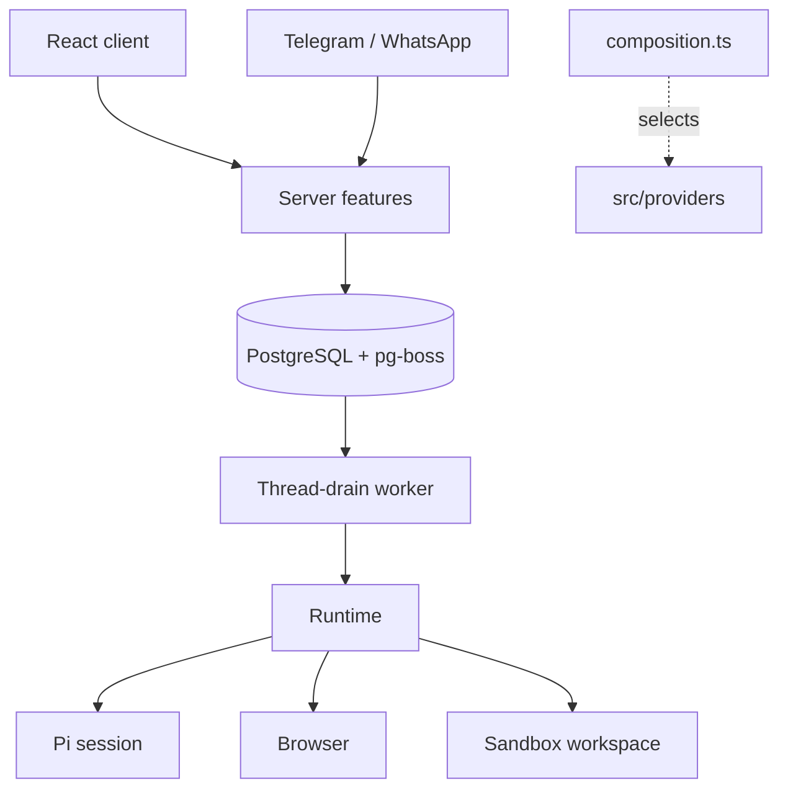

# Architecture

Local mode is one Node process (React client, Fastify API, agent runtime, thread-drain worker, schedulers) plus Docker containers for PostgreSQL, the workspace and the browser. Hosted mode runs the same feature graph once per user behind a gateway. `OTTO_MODE` selects `local`, `gateway` or `tenant`.

Code layout: `src/ports` defines capabilities without vendor types, `src/providers` holds SDKs and protocols, `src/runtime` owns tools, prompts and turns, `src/server` owns policy, persistence and HTTP, `src/shared` holds browser-safe types, and `src/web` is the client. `src/server/composition.ts` is the only place that selects implementations; `scripts/check-architecture.mjs` enforces import directions.

## Thread and turns

Each owner has one active `threads` row (`idle` or `running`), shared by every channel. Its ID keys one persistent Pi session, one workspace and one browser computer.

Every user message, schedule fire, event wake, reaction and resume inserts a `turns` row (`source`: `user`, `schedule`, `event`, `resume`) and a `thread-drain` job in one transaction. A user message sent while the thread is running adds no job; releasing the thread queues the next one. The worker locks the thread and, while it is idle, claims the oldest queued turn. Turn status moves `queued` → `running` → `succeeded`, `waiting`, `failed` or `cancelled`. Each turn records its reply channel, so a Telegram message is answered on Telegram.

- `withTurnLock(turnId, op)` fences every write: the turn must be `running` on the active thread.
- The composer never blocks. After each Pi turn, a running foreground turn takes the oldest queued plain user messages from its channel and steers them into Pi (`session.steer`, all at once) before the next model request. Their messages move to the running turn and their turns close. The first message with attachments, a reply target or another channel, and anything sent during background, read-only or waiting turns, stays queued for its own turn.
- A question, approval or credential request ends the turn `waiting`. The next user message is simply the next turn in the same Pi session. Completed forms, app connections and approvals queue a `resume` turn.
- Stop aborts the running turn and cancels queued ones. There is no turn timeout.
- Nothing is retried. An error or restart ends the turn `failed` with one fixed message asking the user to check outside effects or say continue.
- Reset (Get started) archives the thread and cancels its turns; the next turn starts a new Pi session, workspace and computer. The old thread's browser is closed and its throwaway profile, downloads and screens are deleted; saved browser sessions stay. Messages, accounts, Vault, goals and schedules are kept. The client's `threadId` fences late writes after a reset.
- Background turns (schedules, events) stream nothing and deliver only explicit `send_message` calls.

There is no migration from the earlier task model; existing databases must be reset.

## Runtime

`src/runtime` runs one turn at a time per thread. Pi keeps the transcript and handles compaction; recent history is sent only when Pi has no saved session. Hosted transcripts are checkpointed to object storage before each tool, at turn boundaries and before completion. A restored checkpoint over 8 MiB is rebased on load to the model-visible context (the latest compaction plus later messages). When a loaded session ends with tool calls lacking results, each call gets an "interrupted, outcome unknown" result.

Owner memory is one private `memory/MEMORY.md` JSON document outside the thread workspace; it stays available after a thread reset. It is a virtual tree of five areas (`about`, `preferences`, `people`, `routines`, `lessons`) holding entries addressed as `area/slug`, in three tiers: the owner context carries a budgeted JSON index of one-line abstracts (L0), `memory_read` opens an area (a model-written overview, L1) or an entry in full (L2), and `memory_find` matches words first. When that finds fewer than three entries, a cheap model from the main agent's provider picks relevant entries by meaning from the abstracts of all saved entries, including tentative ones and ones left out of the prompt index, and only paths that exist are kept; without a model key search uses words alone. There are no embeddings. An entry inferred from a single message is tentative and stays out of the index until a second distinct user message repeats it. The server binds each Pi save to the current owned user message and keeps its ID as evidence. Each direct save posts a "Remembered" line in chat. The runtime marks the thread before Pi first receives web, file, app, credential or earlier-conversation content, or a user attachment. Threads that existed before this mark was added are marked once. After that mark, a note goes through the normal action confirmation with its exact text. The exception is one note per message in which the user explicitly asks Otto to remember something. The mark lasts until the thread is reset because the content stays in the Pi session. A correction (`replace`) archives the old entry. Pi can forget an entry without a confirmation; that deletes it and its archived versions. Saved notes are context, never permission to act.

The hourly `memory-maintenance` job keeps memory current without a chat line. Reflection reads only the owner's own user messages: never assistant text or tool results, and no attachments, messages over 1000 characters, secrets, or messages that have a memory-save approval. Web content reaches it only if the user pasted it into a short message. A cheap model of the main agent's provider (`gpt-6-luna` on OpenAI, `claude-haiku-4-5` on Anthropic, or `MEMORY_MODEL`) proposes at most six operations; each add must quote a cited message verbatim, only messages containing the quote count as evidence, and an add confirms an existing inferred entry only when its text is identical. Entries start inferred and the learner never changes a stated entry. A model error or invalid answer is retried on the next two ticks and then the batch is skipped. Its progress is a watermark in the same file, written by the same compare-and-swap write as its operations, so a batch is applied once. Deterministic repair runs first on every tick, whatever the model does, and archives expired entries, inferred entries unconfirmed for 60 days and entries whose text is identical after normalizing case, accents and punctuation. Active entries are archived, never deleted; the archive itself is bounded and drops its oldest records beyond the last 40. An area overview is kept only while it still matches the area's entries, so any change to the area drops it. Consolidation runs per area, at most daily and only when the area has five or more entries and no current overview: the model can merge duplicates, archive an entry in favour of a newer one of equal or higher origin, tighten abstracts and write the area overview, but it never writes entry text, and the server computes the merged evidence. Without a provider key only repair runs. `GET /api/memory` returns the tree and the archive.

Pi-native tools (read, bash, edit, write, find, ls) are built in `providers/pi/sandbox.ts` on top of `WorkspaceSession.exec`. These tools run in the workspace. Bash gets an empty environment except `TZ`, set to the owner's time zone, output is written in the sandbox and only a tail reaches Pi, and no workspace file is loaded as instructions. The workspace image includes `save-video`, a yt-dlp wrapper that saves a link's video as a fast-start H.264/AAC MP4 within the 15 MB share limit; it refuses live streams and videos too long to fit at a watchable bitrate. The Pi session runs on the server and loads the pinned `pi-web-access` extension there. Extension code has the server process permissions. It does not get direct access to workspace files; Pi uses its workspace tools for those files.

Otto tools: `send_message`, `ask_user`, `react_to_message`, `browser`, `browser_flow`, `get_credential`, `browser_session`, `apps`, `manage_apps`, `manage_personal_context`, `share_file` and `create_audio`. Pi loads `web_search`, `source_check`, `fetch_content` and `get_search_content` from `pi-web-access`. `web_search` returns direct source results without a curator or a separate summary. Pi's `codemode` tool runs model-written JavaScript in a QuickJS sandbox with no network, files or timers. Scripts can call only the workspace tools and the `pi-web-access` tools, in parallel, and only their output reaches the model; every Otto tool is `model-only`, so scripts cannot reach apps, the browser, credentials, messages or shared files. Each model tool call, including every call a script makes, goes through the turn guard, which checks cancellation, restricts non-app tools in read-only turns and records observations. Pi follows read-only instructions for app actions; the server does not classify them. Extension event handlers run in the Pi process.

Workflow guides in `src/runtime/skills` (connected-apps, schedules-and-watches, artifacts) are part of the static system prompt. The rules for background runs and activity checks are in the static prompt, keyed by the turn mode. The owner's time zone is saved once from the browser and can be changed in settings; until one exists the turn message says it is unknown and Pi asks. Per-turn values (mode, time, channel, message ID, reply target, activity-check limits and observation) go in the turn message. Owner context (account, profile, goals, memory) is a separate system prompt section, so Pi sends the static prompt once per session and re-sends the owner context only when it changes.

## Sandbox and browser

The workspace runs arbitrary commands as an unprivileged user with dropped capabilities and resource limits. Commands go through a supervisor that owns the command's session (it signals every process in it, even ones that left the process group), enforces timeouts and acknowledges completion; a lost acknowledgement fences the workspace. Local startup mounts the same `OTTO_DATA_ROOT/workspaces` directory that the server uses, including when a checkout uses an existing data directory. It never receives provider keys, the Docker socket or browser profiles. Network access follows Docker routing; there is no egress firewall.

The browser is a separate trusted container. The host drives Vercel Labs agent-browser over a fixed stdin bridge to a private Unix socket. The workspace does not share its mounts or network namespace. Pi uses browser actions for navigation, forms, history, screenshots, downloads and page JavaScript (`evaluate`). It can click, hold and drag at visible screenshot coordinates when page references or selectors do not identify a control. Observations are agent-browser's accessibility snapshot with `@eN` refs; Otto does not run its own page-parsing scripts. After an interrupted action closes a session, the human viewer can retain its last-known image, but Pi's screenshot tool refuses it and requires a fresh page observation. Output replaces known secret values. It can use saved browser profiles through `browser_session`; it does not read their files directly.

Pi is instructed to attempt CAPTCHA and human-verification challenges by reading their instructions, inspecting fresh screenshots and interacting with the visible controls. It checks page feedback, makes further attempts informed by changed challenges or failures, and treats completion as unconfirmed until the page confirms it. It hands control to the user only on request, an actual blocker or unsuccessful attempts, explaining what it tried. For a handoff, Pi asks with an `[Open browser](/browser)` link. Otto web shows the live tab under that message and forwards the user's clicks, typing and scrolling through `/api/browser-handoff`, only while the latest foreground turn waits on a question and nothing is running; Done hands control back.

Browser flows are JSON files in `/workspace/.otto/browser-flows`, which belongs to one owner and stays available after a thread reset. `browser_flow list` scans the files as a registry and ranks their titles, descriptions and origins for the current task. Pi can inspect the file paths and save or run a flow through the tool. A run uses the current browser profile, checks each saved page condition and stops on a mismatch. Fill text uses named inputs supplied at run time. A flow file can hold static URLs and selected option labels. Saved URLs cannot contain a username or password. Pi uses Vault for credentials.

Providers: Docker locally, Cloudflare containers (separate browser and workspace roles per owner) in hosted mode, and an optional E2B combined sandbox.

## Hosted mode

The public Worker serves the web app and sends `/api/*` to a private Node gateway. The gateway authenticates Google sessions, provisions a tenant SQL role with private app and jobs schemas, and forwards signed requests to that user's tenant container. Each tenant has an immutable owner, its own process, SQL login and schemas, and a leased generation; a replacement requires confirmed stop of the previous generation. Browser and workspace containers start on first use and checkpoint to private R2 when idle. Admission defaults to eight users. Operations are in [deployment/cloudflare/README.md](../deployment/cloudflare/README.md).

## Features

**Approvals.** `action-policy.ts` handles personal plans and memory changes. Some of these actions need an owned yes/no confirmation. A yes queues a `resume` turn that executes the saved action once. Failed or interrupted confirmed actions become uncertain and are not run again. Connected app actions run directly on the selected owned account. Pi decides when to ask the user before a destructive app action.

**Vault and sign-in.** AES-GCM encrypted logins and cards use a key outside PostgreSQL (Keychain, `OTTO_VAULT_KEY`, or a per-user derived key in hosted mode). Secure identifier-only forms save the username or email for that exact website, so passwordless logins can be reused after recovery or on a later turn. They cannot fill passwords or verification codes; a subsequently supplied password upgrades the matching saved identifier. Pi interprets the current browser page, checks saved account metadata and chooses the login method and field roles. It reuses a uniquely applicable login. When several methods are available without a matching saved login, it asks the user unless they already chose; account or method ambiguity also requires a question. Website defaults do not establish a user preference.

`get_credential` can read one saved login by its ID and exact origin. The value enters the Pi model context and saved session. Otto omits the value from separate tool observations. To fill protected browser fields, Pi calls the tool without an ID. It can fill a selected saved login or open a secure form for missing values. The server binds each request to its owner, turn, exact origin and expiry. Pi passes the field it chose (an `@eN` ref or CSS selector). The server checks only that the current page is on the request's exact origin, then types the value with agent-browser `fill`; codes are typed as keystrokes so split code boxes work. Pi submits the website form and checks the result. Registered code replies are intercepted before they reach chat history. For an email challenge, Pi passes the recipient the page shows. The server verifies the exact owned mailbox, sender, time and account before entering a code once. Saved website sessions keep a private browser profile. Opening one does not verify authentication; saving requires Pi to confirm a successful sign-in from the current page.

When a step needs user action outside Pi's browser, such as sign-in or approval on another device, Pi gives the page's instructions and watches the page in the current turn. Pi reads up to eight snapshots, with a 15-second wait before each read, and continues when the page confirms completion. A denied or expired request stops the wait. If the result remains unknown, Pi asks the user. Pi does not watch or resume while the user controls its browser; the user must hand control back first. This is model guidance; the server does not interpret the page.

**Channels.** Telegram and WhatsApp settings are encrypted per owner. Inbound messages are saved to an inbox and become turns on the same thread; replies go through a durable outbox that rechecks owner and sender. Uncertain sends are not replayed.

**Schedules and triage.** Schedules store a one-off time or cron with timezone and queue each occurrence as a delayed pg-boss job; dispatch creates the turn and the next job atomically. A run can save one observation for comparison with later runs. Verified new Gmail inbox messages queue quiet agent inspection so the agent can read the full item before deciding what work is useful. Other connected-app events and internal reviews every five minutes pass a cheap classifier. All dispatch retains quiet-hours and opt-out checks. Reviews with no active goals or unprocessed saved updates skip the classifier. Background turns load passive, owner-scoped connected-app metadata and discover the tools needed for the work.

The internal heartbeat can also check one eligible API, HTTP or MCP account without an available update feed, with a thirty-minute cooldown per account and a limit of eight tool calls and ninety seconds. These silent, read-only turns save a verified observation only after an actual app read. At most one finding, deduplicated by account, item and optional source revision, enters the existing background preparation flow. Account replacement invalidates its observation and pending check. Browser-only and CLI-only accounts are not automatically checked. This uses no user schedule. Research downloads and screenshots stay in the workspace until explicitly shared; resumes retain background visibility. Background work has no hourly turn quota, and only useful outcomes and necessary decisions reach chat. New verified drafts are presented with their complete content. Drafting uses applicable channel-specific preferences or a few verified examples of the user's own writing. Explicit durable feedback can update the saved profile through its existing review flow; writing samples do not grant authority for future outside actions.

**Integrations.** Composio handles Google and Slack accounts; Notion and Linear use direct MCP OAuth. Discovered connections let the agent propose a public HTTPS MCP, HTTP API or installed CLI path; grants live in Vault. Pi decides when to ask before a destructive action. App actions run directly on the selected owned account. There is no second tool catalog check or server review for app actions.

Gmail also checks for inbox changes every five minutes using a persisted history cursor. These internal reads establish a baseline without replaying old mail, queue owned events atomically with the cursor, and deduplicate webhook and polling delivery by message identity. Empty checks create no agent turn or visible schedule. Expired history stops polling and raises one reconnection notice through normal triage; reconnecting resumes future updates without claiming to recover the missing interval.

**Inspector and usage.** A private developer view (Screen, Activity, Tools, Models, Costs, Prompts) backed by masked, bounded records kept seven days. Gated by `DEV_INSPECTOR` and, in hosted mode, `OTTO_DEVELOPER_IDS`. Unknown prices stay null. Chat answers omit elapsed time and cost; provider costs remain recorded in the ledger and visible in the Inspector Costs tab.

## Capability evals

`evals/` is a separate package that measures how often the real harness completes real tasks. Each attempt boots an isolated Otto (own database schema, workspace and browser containers, real Pi and model) against a fake outside world: stateful connected-app fakes behind the integration port and lookalike websites served to the real browser. Graders read the end state of that world and the workspace, a trace-based product layer checks honesty, permission discipline and Otto's own voice rules, and an independent judge model scores what needs judgement. Runs report pass rate with an interval, pass@k, pass^k, latency and cost, and can be compared across models, revisions and judges. It calls live models and is run by hand, never from tests. See [evals/README.md](../evals/README.md).

## Security boundaries

- Local mode binds to loopback with one fixed owner; it is not public authentication. Public hosting uses the gateway.
- Provider keys stay in the trusted server: never in prompts, the client, workspace, browser, artifacts or logs.
- Hosted: `OTTO_MASTER_KEY` stays in the gateway and derives per-user database passwords, runtime signing secrets and Vault keys. Tenants receive only their own derived values and cannot read another tenant's schema or assume its role. Public owner or account headers never select a tenant.
- Gateway-to-tenant HMAC envelopes bind owner, environment, generation, method, target, body hash, nonce, expiry and developer capability; replays and altered bodies are rejected.
- Uploads are limited to 15 MB. Artifacts are read inside the sandbox with no-follow descriptors and served from private storage; active files download as attachments.
- Prompt instructions are not a secrecy boundary. Write authority for personal data is checked against the current owned turn and server policy, not model output. Connected app actions have no server review: Pi asks before destructive ones, and read-only and onboarding turns rely on that instruction. Prompt-injection resistance is not claimed.
- The infrastructure operator can decrypt stored data; there is no KMS or externally controlled key release.
