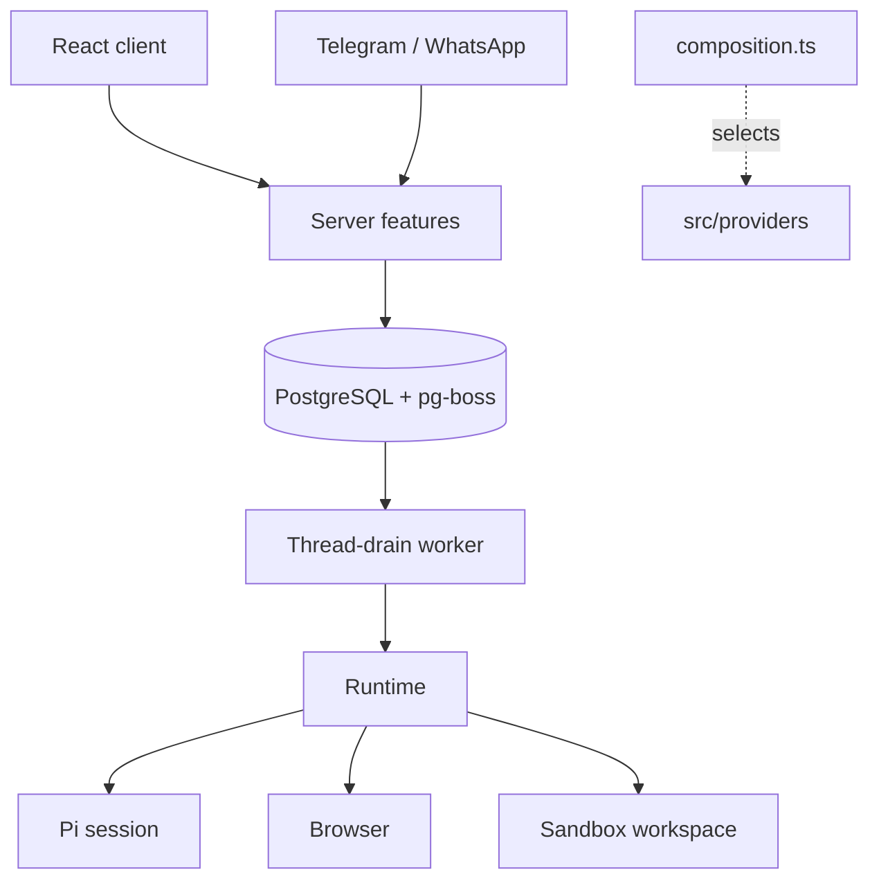

# Architecture

Local mode is one Node process (React client, Fastify API, agent runtime, thread-drain worker, schedulers) plus Docker containers for PostgreSQL, the workspace and the browser. Hosted mode runs the same feature graph once per user behind a gateway. `OTTO_MODE` selects `local`, `gateway` or `tenant`.

Code layout: `src/ports` defines capabilities without vendor types, `src/providers` holds SDKs and protocols, `src/runtime` owns tools, prompts and turns, `src/server` owns policy, persistence and HTTP, `src/shared` holds browser-safe types, and `src/web` is the client. `src/server/composition.ts` is the only place that selects implementations; `scripts/check-architecture.mjs` enforces import directions.

## Thread and turns

Each owner has one active `threads` row (`idle` or `running`), shared by every channel. Its ID keys one persistent Pi session, one workspace and one browser computer.

Every user message, schedule fire, event wake, reaction and resume inserts a `turns` row (`source`: `user`, `schedule`, `event`, `resume`) and a `thread-drain` job in one transaction. The worker locks the thread and, while it is idle, claims the oldest queued turn. Turn status moves `queued` → `running` → `succeeded`, `waiting`, `failed` or `cancelled`. Each turn records its reply channel, so a Telegram message is answered on Telegram.

- `withTurnLock(turnId, op)` fences every write: the turn must be `running` on the active thread.
- A question, approval or credential request ends the turn `waiting`. The next user message is simply the next turn in the same Pi session. Completed forms, app connections and approvals queue a `resume` turn.
- Stop aborts the running turn and cancels queued ones. There is no turn timeout.
- Nothing is retried. An error or restart ends the turn `failed` with one fixed message asking the user to check outside effects or say continue.
- Reset (Get started) archives the thread and cancels its turns; the next turn starts a new Pi session, workspace and computer. Messages, accounts, Vault, goals and schedules are kept. The client's `threadId` fences late writes after a reset.
- Background turns (schedules, events) stream nothing and deliver only explicit `send_message` calls.

There is no migration from the earlier task model; existing databases must be reset.

## Runtime

`src/runtime` runs one turn at a time per thread. Pi keeps the transcript and handles compaction; recent history is sent only when Pi has no saved session. Hosted transcripts are checkpointed to object storage before each tool, at turn boundaries and before completion. A restored checkpoint over 8 MiB is rebased on load to the model-visible context (the latest compaction plus later messages). When a loaded session ends with tool calls lacking results, each call gets an "interrupted, outcome unknown" result.

Owner memory is a small private `memory/MEMORY.md` object outside the thread workspace. It stays available after a thread reset. The server binds each new note to the current owned user message and keeps its ID as evidence. Each direct save posts a "Remembered" line in chat. The runtime marks the thread before Pi first receives web, file, app, credential or earlier-conversation content, or a user attachment. Threads that existed before this mark was added are marked once. After that mark, a note goes through the normal action confirmation with its exact text. The exception is one note per message in which the user explicitly asks Otto to remember something. The mark lasts until the thread is reset because the content stays in the Pi session. A correction replaces the old note. A pattern stays tentative until separate user messages support it. Memory holds at most 50 notes, and every turn receives all of them. Invalid entries are skipped when read and dropped on the next write. Saved notes are context, never permission to act. Pi can forget a note without a confirmation.

Pi-native tools (read, bash, edit, write, find, ls) are built in `providers/pi/sandbox.ts` on top of `WorkspaceSession.exec`. These tools run in the workspace. Bash gets an empty environment, output is written in the sandbox and only a tail reaches Pi, and no workspace file is loaded as instructions. The Pi session runs on the server and loads the pinned `pi-web-access` extension there. Extension code has the server process permissions. It does not get direct access to workspace files; Pi uses its workspace tools for those files.

Otto tools: `send_message`, `ask_user`, `react_to_message`, `browser`, `browser_flow`, `get_credential`, `browser_session`, `apps`, `manage_apps`, `manage_personal_context`, `share_file` and `create_audio`. Pi loads `web_search`, `source_check`, `fetch_content` and `get_search_content` from `pi-web-access`. `web_search` returns direct source results without a curator or a separate summary. Each model tool call goes through the turn guard, which checks cancellation, enforces read-only turns and records observations. Extension event handlers run in the Pi process.

Skills in `src/runtime/skills` (careful-research, schedules-and-watches, connected-apps) are staged into the sandbox on each session open and hold workflow guidance.

## Sandbox and browser

The workspace runs arbitrary commands as an unprivileged user with dropped capabilities and resource limits. Commands go through a supervisor that owns the process group, enforces timeouts and acknowledges completion; a lost acknowledgement fences the workspace. It never receives provider keys, the Docker socket or browser profiles. Network access follows Docker routing; there is no egress firewall.

The browser is a separate trusted container. The host drives Vercel Labs agent-browser over a fixed stdin bridge to a private Unix socket. The workspace does not share its mounts or network namespace. Pi uses browser actions for navigation, forms, history, screenshots and downloads. It can use saved browser profiles through `browser_session`; it does not read their files directly.

Browser flows are JSON files in `/workspace/.otto/browser-flows`, which belongs to one owner and stays available after a thread reset. `browser_flow list` scans the files as a registry and ranks their titles, descriptions and origins for the current task. Pi can inspect the file paths and save or run a flow through the tool. A run uses the current browser profile, checks each saved page condition and stops on a mismatch. Fill text uses named inputs supplied at run time. A flow file can hold static URLs and selected option labels. Saved URLs cannot contain a username or password. Pi uses Vault for credentials.

Providers: Docker locally, Cloudflare containers (separate browser and workspace roles per owner) in hosted mode, and an optional E2B combined sandbox.

## Hosted mode

The public Worker serves the web app and sends `/api/*` to a private Node gateway. The gateway authenticates Google sessions, provisions a tenant SQL role with private app and jobs schemas, and forwards signed requests to that user's tenant container. Each tenant has an immutable owner, its own process, SQL login and schemas, and a leased generation; a replacement requires confirmed stop of the previous generation. Browser and workspace containers start on first use and checkpoint to private R2 when idle. Admission defaults to eight users. Operations are in [deployment/cloudflare/README.md](../deployment/cloudflare/README.md).

## Features

**Approvals.** `action-policy.ts` lets clear ordinary requests and five reversible plan actions (goal create/update, schedule create/update/cancel) from the current owned user message run directly. Unknown, destructive or ambiguous actions persist a specific yes/no question bound to the action, account and arguments. Background preparation can propose an exact action for review, but only its narrow unsent-draft capability executes directly. A yes queues a `resume` turn that executes the saved snapshot once; failure or interruption marks it uncertain and it is never re-run. User revisions invalidate the previous proposal and require a fresh confirmation. Read-only checks and onboarding cannot propose outside actions. Existing Calendar events must be read in the selected account before a confirmation can name them.

**Vault and sign-in.** AES-GCM encrypted logins and cards use a key outside PostgreSQL (Keychain, `OTTO_VAULT_KEY`, or a per-user derived key in hosted mode). Pi interprets the current browser page, checks saved account metadata and chooses the login method and field roles. It reuses a uniquely applicable login. When several methods are available without a matching saved login, it asks the user unless they already chose; account or method ambiguity also requires a question. Website defaults do not establish a user preference.

`get_credential` can read one saved login by its ID and exact origin. The value enters the Pi model context and saved session. Otto omits the value from separate tool observations. To fill protected browser fields, Pi calls the tool without an ID. It can fill a selected saved login or open a secure form for missing values. The server binds each request to its owner, turn, exact origin and expiry. The browser broker validates the selected current elements and origin without requiring familiar field labels. On pages without HTML forms, Pi's selected fields define the login pair. Pi submits the website form and checks the result. Registered code replies are intercepted before they reach chat history. When Pi identifies an email challenge, the browser broker extracts the current page recipient. The server verifies the exact owned mailbox, sender, time and account before entering a code once. Saved website sessions keep a private browser profile. Opening one does not verify authentication; saving requires Pi to confirm a successful sign-in from the current page.

**Channels.** Telegram and WhatsApp settings are encrypted per owner. Inbound messages are saved to an inbox and become turns on the same thread; replies go through a durable outbox that rechecks owner and sender. Uncertain sends are not replayed.

**Schedules and triage.** Schedules store a one-off time or cron with timezone and queue each occurrence as a delayed pg-boss job; dispatch creates the turn and the next job atomically. A run can save one observation for comparison with later runs. Verified new Gmail inbox messages queue quiet agent inspection so the agent can read the full item before deciding what work is useful. Other connected-app events and internal reviews every five minutes pass a cheap classifier. All dispatch retains quiet-hours and opt-out checks. Reviews with no active goals or unprocessed saved updates skip the classifier. Background turns load passive, owner-scoped connected-app metadata and discover the tools needed for the work.

The internal heartbeat can also check one eligible API, HTTP or MCP account without an available update feed, with a thirty-minute cooldown per account and a limit of eight tool calls and ninety seconds. These silent, read-only turns save a verified observation only after an actual app read. At most one finding, deduplicated by account, item and optional source revision, enters the existing background preparation flow. Account replacement invalidates its observation and pending check. Browser-only and CLI-only accounts are not automatically checked. This uses no user schedule. Research downloads and screenshots stay in the workspace until explicitly shared; resumes retain background visibility. Background work has no hourly turn quota, and only useful outcomes and necessary decisions reach chat. New verified drafts are presented with their complete content and exact proposed action for approval, unless the user opted out of draft reviews. Drafting uses applicable channel-specific preferences or a few verified examples of the user's own writing. Explicit durable feedback can update the saved profile through its existing review flow; writing samples and previous approvals never grant authority for future outside actions.

**Integrations.** Composio handles Google and Slack accounts; Notion and Linear use direct MCP OAuth. Discovered connections let the agent propose a public HTTPS MCP, HTTP API or installed CLI path; grants live in Vault and non-read calls go through approvals. Every write binds to an owned `connectionId`.

Gmail also checks for inbox changes every five minutes using a persisted history cursor. These internal reads establish a baseline without replaying old mail, queue owned events atomically with the cursor, and deduplicate webhook and polling delivery by message identity. Empty checks create no agent turn or visible schedule. Expired history stops polling and raises one reconnection notice through normal triage; reconnecting resumes future updates without claiming to recover the missing interval.

**Inspector and usage.** A private developer view (Screen, Activity, Tools, Models, Costs, Prompts) backed by masked, bounded records kept seven days. Gated by `DEV_INSPECTOR` and, in hosted mode, `OTTO_DEVELOPER_IDS`. Unknown prices stay null. Chat answers omit elapsed time and cost; provider costs remain recorded in the ledger and visible in the Inspector Costs tab.

## Security boundaries

- Local mode binds to loopback with one fixed owner; it is not public authentication. Public hosting uses the gateway.
- Provider keys stay in the trusted server: never in prompts, the client, workspace, browser, artifacts or logs.
- Hosted: `OTTO_MASTER_KEY` stays in the gateway and derives per-user database passwords, runtime signing secrets and Vault keys. Tenants receive only their own derived values and cannot read another tenant's schema or assume its role. Public owner or account headers never select a tenant.
- Gateway-to-tenant HMAC envelopes bind owner, environment, generation, method, target, body hash, nonce, expiry and developer capability; replays and altered bodies are rejected.
- Uploads are limited to 15 MB. Artifacts are read inside the sandbox with no-follow descriptors and served from private storage; active files download as attachments.
- Prompt instructions are not a secrecy boundary. Write authority is checked against the current owned turn and server policy, not model output. A narrow capability permits unsent Gmail drafts through `GMAIL_CREATE_EMAIL_DRAFT`; sending and destructive actions retain their user-authorization requirements. Read-only and onboarding turns cannot create drafts. Prompt-injection resistance is not claimed.
- The infrastructure operator can decrypt stored data; there is no KMS or externally controlled key release.
