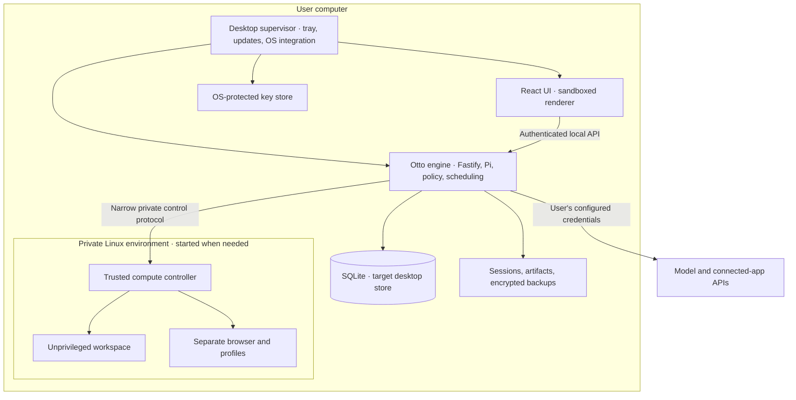
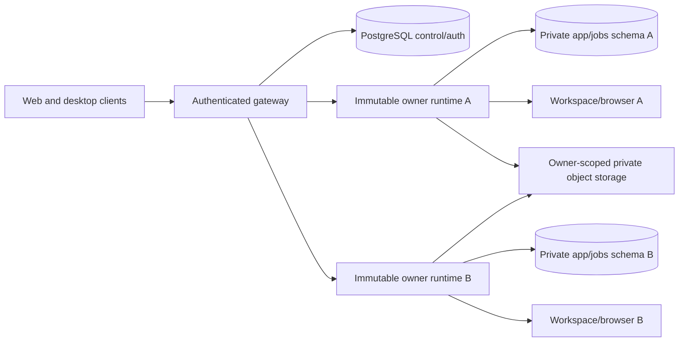

# Otto as a local desktop app, with an optional hosted service

Research and implementation proposal · 2026-10-01

Code reviewed: commit **85ad559e93b8d275e3307f9428d4bb522b84e890** in this checkout. This document combines current source inspection with official platform documentation. Recommendations and performance budgets are proposals; no packaged application, benchmark, installation, migration, or live provider workflow was tested during this research.

After this research stage, a bounded macOS experiment was implemented in this checkout. The [experiment guide](../../desktop/README.md) and [validation record](../../desktop/VALIDATION.md) distinguish the working PostgreSQL-backed preview from the future SQLite, cross-platform, and organization work proposed here. The installed preview completed a real model/browser/file-download task. Its first startup also exposed a guest login-service delay, reinforcing the need to qualify the managed computer before public distribution.

## 1. Recommendation

Build **one Otto engine with a desktop distribution and a headless server distribution**.

For the desktop product, use:

- **Electron** for the application window, menu bar/tray, notifications, updates, and process supervision.
- The existing **TypeScript/Node/Fastify/Pi engine**, running in a separate local process.
- **SQLite as the preferred desktop storage target**, subject to a focused transaction/recovery prototype.
- An **Otto-managed Linux environment** for the isolated workspace and browser. On macOS, first evaluate bundling Lima with Apple's Virtualization framework.
- **Provider keys entered through secure in-app settings**. No Otto account, paid broker, terminal, Docker Desktop, Node installation, or database configuration should be required.
- **PostgreSQL for organization hosting and Otto-hosted SaaS**, retaining the existing gateway and immutable-owner runtime design.

The largest engineering task is making the sandbox install, start, update, sleep, and recover like part of a normal application. A desktop wrapper alone does not solve that.

SQLite is worthwhile primarily because it lets the lightweight native engine remain available while the entire Linux environment is stopped. It also removes local database-service maintenance. It does **not** eliminate the Linux environment needed for Otto's command and browser tools.

Do not begin with a full database rewrite. First build a bounded feasibility prototype using the current PostgreSQL-backed engine as a working baseline, alongside a small SQLite implementation of the critical turn/schedule transactions. Choose the shipping database after measuring that difference and proving recovery semantics. If the SQLite migration proves disproportionately expensive, Otto-managed PostgreSQL inside the Linux environment is an acceptable first-release fallback: equally simple for users, but with a heavier always-ready runtime.

This is a recommendation for the best product architecture, not a claim that a framework or database change automatically improves performance.

### Deployment choices

| Product                       | Where Otto executes                                | Storage                                     | User setup                                                          |
| ----------------------------- | -------------------------------------------------- | ------------------------------------------- | ------------------------------------------------------------------- |
| Personal desktop, default     | Native engine plus private local workspace/browser | SQLite target; managed PostgreSQL fallback  | Install app, enter model key, optionally connect apps               |
| Desktop connected to a server | Organization or Otto server                        | Server PostgreSQL                           | Install app, enter server address or choose hosted service, sign in |
| Organization self-hosting     | Organization infrastructure                        | PostgreSQL plus private file/object storage | Administrator deploys a supported server package; members sign in   |
| Otto-hosted SaaS              | Infrastructure we operate                          | PostgreSQL plus private object storage      | Sign in through web or desktop                                      |

Local execution means the engine, files, workspace, and browser run on the computer. The chosen OpenAI/Anthropic model still receives model requests over the network, as it does today. Fully offline model inference is a separate optional capability, with separate hardware and quality requirements.

## 2. What Otto already has

The architecture is a useful foundation. This is packaging and selective refactoring, not a reason to rebuild the product.

| Existing implementation                                                                                   | Evidence                                                                                                                                  | Implication                                                                                              |
| --------------------------------------------------------------------------------------------------------- | ----------------------------------------------------------------------------------------------------------------------------------------- | -------------------------------------------------------------------------------------------------------- |
| React frontend, Fastify server, persistent Pi session                                                     | [package.json](../../package.json), [architecture](../architecture.md)                                                                    | Reuse the product UI and engine on desktop and server.                                                   |
| Local launcher installs dependencies and starts PostgreSQL, browser, and workspace through Docker Compose | [scripts/start.mjs](../../scripts/start.mjs), [compose.yaml](../../compose.yaml)                                                          | Current setup is for developers. Replace it with a signed, prebuilt application and managed runtime.     |
| Node minimum is 24.21.0                                                                                   | [package.json](../../package.json)                                                                                                        | Bundle a compatible runtime; never depend on the user's Node installation.                               |
| Build currently typechecks and builds the web client; server starts through tsx                           | [package.json](../../package.json), [server/index.ts](../../src/server/index.ts)                                                          | Add an explicit production engine distribution and runtime-asset manifest.                               |
| Computer, workspace, model, keys, objects, and runtime transport have ports                               | [src/ports](../../src/ports), [composition.ts](../../src/server/composition.ts)                                                           | Add providers at existing boundaries instead of embedding OS logic in product policy.                    |
| One active thread per owner, transactional turn admission, fenced writes                                  | [thread.ts](../../src/server/thread.ts)                                                                                                   | Preserve these semantics across storage implementations.                                                 |
| Queues and scheduling use pg-boss; messaging uses PostgreSQL state                                        | [thread.ts](../../src/server/thread.ts), [schedules.ts](../../src/server/schedules.ts), [chat-sdk](../../src/providers/chat-sdk/index.ts) | SQLite is a storage-and-queue project, not a connection-string change.                                   |
| Local HTTP validates Host, Origin, and fetch metadata                                                     | [access.ts](../../src/server/access.ts)                                                                                                   | Retain these protections and add authentication between desktop and engine.                              |
| Vault uses Keychain on macOS and an environment key elsewhere                                             | [composition.ts](../../src/server/composition.ts), [keychain provider](../../src/providers/keychain/key-store.ts)                         | Add Windows/Linux OS key protection and in-app provider settings.                                        |
| Local data defaults to a working-directory-relative .local directory; local owner is local-development    | [config.ts](../../src/server/config.ts)                                                                                                   | Introduce OS application-data paths and a stable local profile UUID.                                     |
| Telegram already supports polling                                                                         | [chat transport](../../src/providers/chat-sdk/index.ts), [channel setup](../../src/providers/chat-sdk/settings.ts)                        | Local Telegram does not need a tunnel or router setup.                                                   |
| Hosted gateway authenticates users and provisions private SQL roles/schemas and owner runtimes            | [tenants.ts](../../src/server/tenants.ts), [gateway.ts](../../src/server/gateway.ts)                                                      | Preserve this work. Organization policy and portable self-hosting are additional capabilities.           |
| Current hosted distribution is tied to Cloudflare; default admission is eight users                       | [deployment guide](../../deployment/cloudflare/README.md)                                                                                 | Existing tenancy is groundwork, not evidence of arbitrary SaaS capacity or turnkey organization hosting. |

The current database initialization is distributed across feature modules, and existing documentation permits a reset for the earlier task-model transition. A consumer application needs versioned, non-destructive upgrades and recovery before its first public release.

## 3. The installation and everyday experience

### First run

1. Download Otto and install it using the normal OS installer.
2. Open the app. The window appears promptly, independently of Linux initialization.
3. Otto prepares its private runtime automatically. Show actual download progress, disk requirement, and a direct retry that preserves completed work.
4. Choose OpenAI or Anthropic and enter a provider key in a dedicated secure settings form. Explain the required permission and link to the provider's key page.
5. Validate configuration. If validation requires a billable request, make that clear and use the smallest suitable operation.
6. Offer optional app connections and background/login settings.
7. Open the chat. Prepare the workspace/browser only when first needed.

The user should never choose a database, allocate SQL roles, install Homebrew, run npm, edit an environment file, build an image, or configure ports.

First-run preparation can use a versioned download of the Linux appliance instead of placing everything inside the initial installer. The installer must still own that operation: resumable download, verified artifact, progress, repair, and cleanup. An organization can later use a complete offline distribution.

### Provider configuration

BYOK is the default for this plan, following the user's clarification. There is no need to build billing, an Otto account, or a model proxy before releasing a local app.

Store provider configuration by capability:

| Capability                | Initial configuration                                                                  |
| ------------------------- | -------------------------------------------------------------------------------------- |
| Main assistant            | OpenAI or Anthropic key and a sensible model default                                   |
| Speech                    | Separately optional; the current implementation uses OpenAI                            |
| Classification/triage     | Explicit capability status; do not assume a main-model key configures every classifier |
| Google/Slack integrations | Current Composio configuration plus account connection                                 |
| Notion/Linear             | Existing direct MCP authorization where supported                                      |
| Telegram                  | Bot token and guided pairing                                                           |
| WhatsApp                  | Optional advanced channel; depends on provider setup and inbound HTTPS delivery        |

A missing optional key disables that capability gracefully. Saving a key should reconfigure the relevant provider safely, without restarting onboarding or losing successful app connections. A settings change affecting active work takes effect at an explicit safe boundary.

Keys go directly from the dedicated entry form to the privileged process and OS-backed storage. Never return stored plaintext values to the UI, put them in chat, pass them as command-line arguments, or include them in logs and diagnostics. The transient entry field is distinct from persistent frontend configuration.

### Background behavior

| Event                   | Product behavior                                                                                  |
| ----------------------- | ------------------------------------------------------------------------------------------------- |
| Close window            | Keep enabled work running; retain a menu-bar/tray indicator; release the renderer when practical. |
| Open Otto again         | Reuse the existing engine and restore the window.                                                 |
| Pause background work   | Stop admitting automatic work; show the paused state and retain scheduled records.                |
| Quit Otto               | Stop the engine and private compute cleanly; explain that local schedules stop.                   |
| Start at login          | A normal per-user setting.                                                                        |
| Laptop sleeps or is off | Local execution stops. No promise of always-on delivery.                                          |
| Wake or restart         | Reconcile durable state and missed schedules; never replay an uncertain outside action.           |
| Update ready            | Install at a safe boundary; active work may defer the restart.                                    |

Keep the initial app as one per-user background application rather than adding a privileged system daemon. Running before login or after logout is a separate server/service requirement.

## 4. Desktop framework decision

| Option                                   | Advantages for Otto                                                                                                            | Costs                                                                                    | Recommendation                                            |
| ---------------------------------------- | ------------------------------------------------------------------------------------------------------------------------------ | ---------------------------------------------------------------------------------------- | --------------------------------------------------------- |
| Electron                                 | Existing TS/React/Node stack; bundled consistent browser; Node utility process; established lifecycle and distribution tooling | Larger shell; Chromium updates; native dependency packaging                              | Preferred first implementation                            |
| Tauri v2 with Node sidecar               | Smaller UI shell using system WebViews; native capability controls                                                             | Still ships Node and local compute; Rust/sidecar lifecycle; platform WebView differences | Benchmark alternative if whole-product savings justify it |
| Browser/PWA plus daemon                  | Reuses the web frontend                                                                                                        | Still needs a native installer and daemon to run Otto and its sandbox                    | Useful remote client, incomplete local distribution       |
| Separate Swift/Windows/Linux native apps | Maximum platform-specific UI control                                                                                           | Three frontends plus current web app and integration work                                | Unnecessary for the requested outcome                     |

Electron has a Node-enabled utility-process API suitable for isolating Otto's engine from the window supervisor. Electron 44.5.0 includes Node 24.21.0, matching this checkout's declared floor; actual Pi, extension, and native-module compatibility still needs a packaged test. [Electron utility processes](https://www.electronjs.org/docs/latest/api/utility-process), [44.5.0 release](https://releases.electronjs.org/release/v44.5.0).

Tauri supports Node sidecars, but it does not make the existing Node engine disappear. Its UI uses WKWebView, WebView2, or WebKitGTK depending on OS. The separate agent browser remains necessary under either shell. Compare installed Otto, not empty-template benchmark numbers. [Tauri Node sidecar](https://v2.tauri.app/learn/sidecar-nodejs/), [WebView versions](https://v2.tauri.app/reference/webview-versions/).

Choose one shell after the prototype. Maintaining two production desktop shells would undermine the simplicity goal.

## 5. Process and security architecture



Keep the existing server boundaries:

- React imports only web/shared code.
- Product policy remains in the server/runtime.
- Composition selects implementations.
- Pi command tools execute through the workspace port, never host bash.
- The browser profile and credential broker remain separate from arbitrary workspace commands.
- Provider secrets remain outside the workspace and agent browser.
- The pinned Pi web extension remains trusted engine code with engine permissions; it is not made safe by the desktop renderer sandbox.

Use Electron renderer sandboxing, context isolation, no renderer Node integration, and narrowly typed desktop IPC. A Node utility process has host privileges; it is an engine process, not an agent command sandbox. [Electron security guidance](https://www.electronjs.org/docs/latest/tutorial/security).

For the first version, preserve Fastify and the relative HTTP/SSE client:

1. Bind only to a loopback address and select an available port.
2. Pass a random per-launch credential over private parent/child IPC.
3. Authenticate application requests, including streams and downloads.
4. Restrict credential injection to Otto's trusted renderer session and exact engine origin; never forward it on redirects or to external pages.
5. Retain Host/Origin checks and adapt them to the actual bound port.
6. Keep OAuth callbacks as narrow, state-bound endpoints rather than opening unauthenticated application access.
7. Give untrusted artifact HTML and agent-browser content separate origins/views without a desktop bridge.

These are implementation requirements to validate. Loopback alone does not authenticate local callers, and no local design promises protection against arbitrary malware already executing as the same OS user.

Use the system browser for OAuth, with PKCE where applicable, state/expiry checks, and one-time completion. Provider registrations determine which redirect forms are supported. A secret embedded in a desktop application is not a confidential OAuth client secret. Existing same-origin BroadcastChannel completion must be replaced or supplemented with an authenticated desktop handoff. [OAuth for native applications, RFC 8252](https://www.rfc-editor.org/rfc/rfc8252.html).

## 6. Running the workspace and browser locally

### Recommended macOS candidate

Bundle a pinned Lima distribution and use its VZ driver to manage an Otto-private Linux VM. Run the workspace and browser as separate locked-down OCI workloads inside it. Retain the existing command supervisor and browser bridge wherever possible.

Lima supplies VM lifecycle and container-engine integration; this avoids building a hypervisor product from scratch. Its VZ driver supports native-architecture guests on macOS 13 and newer. App-private binary distribution is plausible from its documented binary installation path, but signed-bundle embedding remains a prototype gate. [Lima installation](https://lima-vm.io/docs/installation/), [VZ driver](https://lima-vm.io/docs/config/vmtype/vz/).

Lima is developer-oriented software, so use an explicit Otto configuration:

- No default home-directory sharing, including read-only sharing.
- No broad host filesystem mounts; import/export selected files through bounded operations.
- No shared user Docker daemon or global Docker configuration changes.
- No container-management socket inside the workspace or browser.
- No automatically forwarded development ports.
- Block workspace access to host/control endpoints and private management networks.
- Keep commands unprivileged even if the VM management user has administrative rights.
- Separate persistent browser state, workspace state, and controller credentials.
- Scope names and resources to the local profile; never reuse the fixed development container names.

Lima documents home mounts, port forwarding, sudo, and host connectivity defaults that need review. Packaging those defaults unchanged would weaken Otto's existing isolation. [Lima filesystem mounts](https://lima-vm.io/docs/config/mount/), [networking](https://lima-vm.io/docs/config/network/user/), [sudo](https://lima-vm.io/docs/config/sudo/).

The controller should expose only lifecycle, command execution, browser operations, and bounded file transfer needed by Otto. Do not create a general privileged RPC surface.

### Alternatives

| Approach                                                  | When it makes sense                              | Why it is not the initial default                                                         |
| --------------------------------------------------------- | ------------------------------------------------ | ----------------------------------------------------------------------------------------- |
| Otto-owned helper using Virtualization.framework directly | Lima embedding or lifecycle proves unsuitable    | We must own more networking, disk, boot, image, and recovery code                         |
| Apple's container project                                 | A deliberately recent Apple Silicon-only product | Current support requires Apple Silicon and macOS 26; it is not the Windows/Linux solution |
| Require Docker Desktop                                    | Developer preview or existing power users        | Adds external installation, background resource management, and troubleshooting           |
| Native host commands/browser                              | A different product security model               | Breaks the current separation from personal files and browser credentials                 |
| Remote sandbox                                            | Explicit optional cloud mode                     | Does not satisfy the local default                                                        |

Apple's virtualization entitlement and container project are useful primary references for those alternatives. [Virtualization entitlement](https://developer.apple.com/documentation/virtualization/adding-the-virtualization-entitlement-to-your-project), [Apple container](https://github.com/apple/container).

### Cross-platform strategy

| Target                               | Local compute approach                                                 | Installation reality                                                 |
| ------------------------------------ | ---------------------------------------------------------------------- | -------------------------------------------------------------------- |
| macOS Apple Silicon                  | Otto-managed Lima/VZ candidate; native arm64 images                    | Prove standard-user installation, helper signing, and sleep/recovery |
| macOS Intel                          | Separate native x64 app/guest/images if included                       | Separate qualification; do not rely on emulation                     |
| Windows 11 x64                       | Dedicated Otto-managed WSL2 distribution with the same workload images | Feature enablement may require administrator approval and reboot     |
| Linux desktop                        | Initially qualify a managed KVM/QEMU VM on one distribution            | KVM permissions and kernel support need guided detection/setup       |
| Linux rootless-container alternative | Optional later low-overhead backend after boundary validation          | Shares the host kernel and has user-namespace/cgroup prerequisites   |

On Windows, import a private Otto distribution; never modify a user's existing Ubuntu distribution or global WSL limits. Disable host-drive automount, Windows interop, and Windows PATH injection, while keeping workloads unprivileged. WSL installation can require elevation and reboot, so preserve installer progress across that interruption. [WSL installation](https://learn.microsoft.com/en-us/windows/wsl/install), [WSL settings](https://learn.microsoft.com/en-us/windows/wsl/wsl-config).

For Linux, prefer a VM as the initial security-parity candidate and evaluate rootless containers only deliberately. Lack of hardware virtualization must produce a clear unsupported-configuration result or an explicit remote option, never an unrestricted host fallback. [Lima QEMU](https://lima-vm.io/docs/config/vmtype/qemu/), [Docker rootless mode](https://docs.docker.com/engine/security/rootless/).

Proposed qualification targets are macOS 14+ on Apple Silicon, Windows 11 x64, and Ubuntu 24.04 LTS x64. These are product support proposals, not claims that every release/hardware combination already works. Test Intel Mac and Windows ARM separately before advertising them.

## 7. Should Otto move to SQLite?

**For the desktop application, yes, as the preferred target. For the hosted service, keep PostgreSQL.**

The reason is deployment and lifecycle fit. One local owner and one sequential agent turn are compatible with an embedded database. The native engine can read history, accept messages, and schedule work without keeping a Linux VM and database server running. Hosted concurrent tenants, provisioning, control-plane state, and operations already have a suitable PostgreSQL foundation.

SQLite supports application-local storage well. WAL permits concurrent readers with a single writer; its same-host constraints rule out using a shared database file as a multi-machine service. This does not mean SQLite cannot serve a small web application; it means the current hosted PostgreSQL architecture has no compelling reason to switch. [Appropriate SQLite uses](https://www.sqlite.org/whentouse.html), [SQLite WAL](https://www.sqlite.org/wal.html).

### Options compared

| Choice                            | Installation experience                             | Engineering implications                                                                      | Decision                                            |
| --------------------------------- | --------------------------------------------------- | --------------------------------------------------------------------------------------------- | --------------------------------------------------- |
| SQLite desktop, PostgreSQL hosted | No user database setup                              | Two tested storage implementations; local queue/state work                                    | Preferred end state                                 |
| PostgreSQL inside the managed VM  | Also no user database setup                         | Lowest application rewrite; database upgrades/backups; VM needed whenever DB access is needed | Prototype baseline and valid first-release fallback |
| Native bundled PostgreSQL         | No manual setup if well packaged                    | Three-platform database process, binaries, upgrades, paths, and supervision                   | Avoid unless measurements defeat both options above |
| PGlite desktop, PostgreSQL hosted | Embedded PostgreSQL-compatible API                  | Fewer SQL changes but adapter, durability, directory-locking, and resource questions          | Research candidate, not the default durable store   |
| SQLite for every tenant/server    | Simple for a tightly constrained single-node design | New persistence, failover, tenancy, backup, and control-plane model                           | Do not combine with the desktop project             |

The PostgreSQL-in-VM option is genuinely simple for the user. SQLite's extra work is justified only if the product benefits from removing that service and sleeping the complete VM. Measure those effects explicitly.

### What must change for SQLite

Current persistence uses PostgreSQL-specific types and operations, transaction-scoped advisory locks, row locks, JSONB, time expressions, schemas/roles, pg-boss, and the Chat SDK PostgreSQL adapter. Core examples are [db.ts](../../src/server/db.ts), [thread.ts](../../src/server/thread.ts), [schedules.ts](../../src/server/schedules.ts), and [chat transport](../../src/providers/chat-sdk/index.ts).

Do not scatter database-condition branches across feature modules or write a regex translator for SQL. Use:

1. One explicit application-storage boundary with transaction support.
2. Shared domain operations and value codecs.
3. PostgreSQL and SQLite implementations only where SQL or locking semantics differ.
4. A narrow durable-work interface that keeps turn admission and work admission in the same database transaction.
5. Separate, ordered schema migrations per backend.
6. The same behavioral regression suite against both backends.

A query builder such as Kysely can reduce routine SQL duplication; it supports both dialects. Adopt it only if the critical-slice prototype shows simpler code. It does not make PostgreSQL locks, schemas, queues, or type semantics portable by itself. Avoid a generic repository class for every table. [Kysely dialects](https://kysely.dev/docs/getting-started).

The gateway's authentication/control/provisioning database can remain PostgreSQL-specific. Do not force desktop support into hosted-only provisioning code.

### Desktop storage rules

- Keep authoritative SQLite state on the host's local application-data filesystem, outside the VM, its shared mounts, and cloud-sync folders.
- One owning engine process; use an OS-backed single-instance lock and reject a competing engine.
- Serialize writes through a small database execution boundary.
- Use short transactions; never hold a write transaction open across model inference, browser operations, or provider requests.
- Recheck owner/turn/generation when committing results after external work.
- Enable and verify foreign keys on each connection.
- Start with WAL, a bounded busy timeout, and durability suitable for receipts/approvals, such as synchronous FULL. Tune only with a stated durability tradeoff.
- Use explicit encodings for UUIDs, UTC timestamps, booleans, JSON, binary values, and large integers.
- Retain uniqueness constraints for active owner threads, inbound events, schedule occurrences, and sends.
- Keep large artifacts, Pi session files, browser profiles, and VM disks outside relational rows.
- SQLite is not encrypted merely because it is embedded. Keep Vault/provider secrets encrypted and protect exports; decide separately whether whole-database encryption is required.

Foreign-key enforcement and supported backup mechanisms need explicit configuration and tests. Use the backup API or a supported snapshot mechanism, rather than copying a live database file and ignoring WAL state. [SQLite foreign keys](https://www.sqlite.org/foreignkeys.html), [SQLite backup API](https://www.sqlite.org/backup.html).

Evaluate Node's built-in SQLite first to avoid an extra native addon, but test the exact bundled Node/Electron build and API stability. Its synchronous API must not stall desktop UI or cancellation; heavy database work belongs on a controlled execution thread/process. A mature addon is a fallback if compatibility or required APIs justify the packaging cost. [Node 24 SQLite documentation](https://nodejs.org/download/release/latest-v24.x/docs/api/sqlite.html).

### Queue and transaction parity

The SQLite queue must cover Otto's actual work, not become a general job platform:

| Operation              | Required invariant                                                                                    |
| ---------------------- | ----------------------------------------------------------------------------------------------------- |
| Accept a message/event | Message/turn and durable wake record commit together                                                  |
| Claim a turn           | Only one running turn for an active owner thread                                                      |
| Commit tool results    | Stale, stopped, reset, or replaced work cannot write                                                  |
| Fire a schedule        | Occurrence identity, queued turn, and next due time commit together                                   |
| Accept channel input   | Durable inbox dedupe and provider cursor advancement are correctly ordered                            |
| Send externally        | Persist intent and outcome; ambiguous delivery becomes uncertain and is not replayed                  |
| Recover after death    | Queued work remains discoverable; previously running external work is reconciled rather than repeated |
| Complete approval      | Owned confirmation applies once to the exact saved action/account/arguments                           |

Use a database transaction to claim work and short conditional updates to fence it. An in-memory mutex alone is insufficient across crashes or duplicate starts.

For PostgreSQL, retain pg-boss behind the work interface. For SQLite, store due work locally, wake the engine at the next due time, and reconcile on startup/resume. The queue notification is an optimization; durable rows remain authoritative. Cover cancellation, stale schedule revisions, occurrence dedupe, and heartbeat behavior.

Do not promise exactly-once external effects from a database transaction. A provider may accept an action before the local receipt is saved. Preserve Otto's uncertain-action state and use provider idempotency/reconciliation only where supported. Internal scheduling or transient model-request retries are distinct from replaying an external action.

### Migration procedure

1. Inventory every persistent table and module initialization path, including vendor queue/channel state.
2. Introduce a migration ledger and canonical export format without changing the current database.
3. Prove the critical SQLite transaction slice with synthetic data.
4. Port features in bounded groups, running both backend contract suites.
5. Stop admission and quiesce a source profile before conversion.
6. Back up the database, sessions, artifacts, workspace, and relevant browser state.
7. Export logical records; import into a new SQLite file with stable IDs and normalized values.
8. Verify counts, references, settings, schedule occurrence identities, encrypted data readability, and artifact checksums.
9. Rebuild runnable queue state from durable domain records; never blindly copy internal pg-boss execution state.
10. Mark source execution disabled before activating the destination profile.
11. Retain the old data for recovery. Never delete it automatically on migration failure.

The currently documented reset-only transition is not an acceptable consumer update path. Migration fixtures must include older schemas and optional features that were never initialized.

Two easy-to-miss migration details:

- Approval reuse currently depends on structural JSONB equality. Comparing serialized JSON strings would change behavior when object keys are reordered. Preserve canonical action identity, exact account binding, and expiry semantics.
- Vault, app-grant, and channel ciphertext includes owner identity in authenticated encryption. Changing local-development into a UUID requires a trusted decrypt/re-encrypt migration or reconnect flow, not just updating an owner column. See [approvals.ts](../../src/server/approvals.ts), [vault.ts](../../src/server/vault.ts), [vault-app-grants.ts](../../src/server/vault-app-grants.ts), and [channel-settings.ts](../../src/server/channel-settings.ts).

### Why PGlite is not the default recommendation

PGlite is more compatible than a superficial dependency review suggests: the pinned pg-boss 12.34.0 package already exports a PGlite adapter. That could preserve much of the current queue/SQL code. However, Otto's pooled transaction assumptions would need a single-connection transaction adapter, and background queries must not enter another operation's transaction. [pg-boss embedded backend](https://pgboss.io/database-backends#pglite-embedded), [PGlite transaction API](https://pglite.dev/docs/api).

The inspected PGlite 0.5.8 filesystem/startup source also leaves durability and directory-ownership questions that should be resolved before making it the authoritative store for approvals and receipts. Startup defaults include fsync-disabled parameters, and the Node filesystem path does not itself establish a proven ordered-persistence contract. This research did not reproduce corruption or a power-loss failure. Owning a custom database filesystem would be excessive for Otto. [Pinned startup source](https://github.com/electric-sql/pglite/blob/ae182ff8bd5ba4acb887d6c925d607a1498aa0b5/packages/pglite/src/pglite.ts), [Node filesystem](https://github.com/electric-sql/pglite/blob/ae182ff8bd5ba4acb887d6c925d607a1498aa0b5/packages/pglite/src/fs/nodefs.ts), [base filesystem](https://github.com/electric-sql/pglite/blob/ae182ff8bd5ba4acb887d6c925d607a1498aa0b5/packages/pglite/src/fs/base.ts).

Revisit PGlite if its supported durability/ownership contract becomes clear and a bounded prototype passes. Do not make that investigation a launch dependency.

## 8. Background schedules, channels, and availability

### Schedules

Persist due times, timezone, schedule revision, occurrence identity, and lateness policy. OS timers are wake hints, not the source of truth.

Recommended initial behavior:

- A queued user message survives app restart.
- A turn that had already started is interrupted, with uncertain outside effects preserved.
- A recurring informational check may coalesce missed occurrences into one useful catch-up.
- A time-sensitive action that is substantially late should be reported as missed or request a decision, rather than executing unexpectedly.
- Calculate the next occurrence in its original timezone after wake; test DST and wall-clock changes.
- Approval resumes remain bound to their original action and current validity.

Preserve the current behavior until any deliberate change is specified. Today's schedule-dispatch code already combines occurrence handling with enqueue and next-run updates, and distinguishes dispatch retries from turn replay. [Schedule implementation](../../src/server/schedules.ts).

Do not claim a laptop app keeps working while the machine is powered off. An OS power assertion can affect some sleep behavior but should not become a blanket battery-draining workaround. Always-on operation is the reason to offer the explicit server mode.

### Telegram

Keep local polling. Improve the current short-poll loop to cancellable long polling with an independent intake task, so waiting for inbound messages does not block outbound delivery. Preserve durable offsets and inbox deduplication.

Telegram supports either polling or webhooks, and retains unreceived updates for at most 24 hours. A laptop offline for several days cannot promise lossless channel receipt without an additional relay. [Telegram update delivery](https://core.telegram.org/bots/api#getting-updates).

### Other integrations and WhatsApp

Use existing polling where the provider supports it. Where inbound HTTPS webhooks are required, support one of:

1. The optional hosted runtime.
2. An opt-in owner-scoped relay that stores incoming events until the local engine reconnects.
3. An organization-operated equivalent.

The relay must authenticate events, deduplicate, enforce owner/account binding, and have explicit retention. It receives events; it does not silently take over local execution. No tunnels, router configuration, or exposed unauthenticated localhost API in the default consumer flow.

Do not make WhatsApp a first-release gate for local chat, research, files, and Telegram. Its current Cloud API configuration is an independent onboarding problem. Provider eligibility and policy require a separate current check when productizing that channel.

## 9. Data, keys, backup, and repair

### Data layout

Use the OS application-data directory, with distinct logical areas:

```text
Otto/
  profiles/<profile-id>/
    profile.json
    state.sqlite
    sessions/
    artifacts/
    encrypted-secrets/
    backups/
    logs/
  runtime/
    manifests/
    verified-images/
    machines/<profile-id>/
```

This is a proposed layout. Keys protecting encrypted secrets stay in OS-backed storage. Runtime binaries/images are replaceable; profile data is not.

On macOS use Application Support, on Windows the appropriate per-user application-data location, and on Linux XDG locations. Do not put databases in the signed app bundle, current working directory, temporary directories, or a cloud-synchronized Documents folder.

### Key storage

Use the existing key-store port. A desktop provider can use Electron safeStorage to protect generated encryption keys with macOS Keychain, Windows DPAPI, or the available Linux secret backend. Detect Linux's insecure basic_text fallback and offer a clear keyring/passphrase recovery path rather than silently persisting secrets without protection. [Electron safeStorage](https://www.electronjs.org/docs/latest/api/safe-storage).

The headless server keeps its separate operator-managed secret/KMS mechanism. Desktop encryption is not a reason to introduce Electron into the server.

Test key access after signed updates, account changes, locked keyrings, restore, and application rename/path changes. Do not silently regenerate a key when doing so would make existing Vault content unreadable.

### Backup contents

A database-only backup is incomplete. Include:

- Relational state: messages, turns, schedules, approvals, receipts, settings, identities, app/channel metadata.
- Pi session transcripts/checkpoints.
- Published artifacts and workspace documents.
- Browser profile data when supported and explicitly included.
- A manifest of installed workspace tools and architecture requirements.
- Schema, image, app, and encryption-key versions.
- Portable encrypted recovery material only through an explicit recovery/export design.

The Vault redesign removes the `get_credential` exception. Vault tools now submit values privately and return no saved password, code or card to Pi. Older Pi sessions may still contain values returned before that change. Treat session backups as private data that can contain secrets. See the current [Vault security model](../vault/security-model.md).

Use a quiesced checkpoint for cross-file consistency, authenticated encryption for portable archives, checksums, bounded import sizes, path containment, and a restore verification pass. A successful “Export” notification is insufficient until the backup can be restored.

Repair replaces verified application/runtime assets while preserving data. Uninstall removes launch items and owned runtime processes; erasing personal data is a separate explicit operation. Neither repair nor failed migration should delete the normal database.

## 10. Performance plan

The current Compose limits are 6 GiB for the browser and 8 GiB for the workspace. They are resource ceilings, **not measured consumption or proposed minimum requirements**. The current launcher starts everything eagerly. [compose.yaml](../../compose.yaml).

Optimize lifecycle before rewriting frameworks:

1. Render the window before provisioning or starting the VM.
2. Keep chat/history/storage native when SQLite is selected.
3. Make workspace/browser preparation genuinely lazy. Today's Pi session setup opens a workspace and stages skills; remove that eager dependency so a plain model/chat turn can run without booting Linux.
4. Start only the required workload. A text conversation need not start Chromium.
5. Destroy/recreate an inactive UI renderer if that substantially reduces background memory.
6. Replace tight polling with due-time scheduling and cancellable channel long polling.
7. Bound logs, screenshots, session/checkpoint retention, browser cache, and artifact disk use.
8. Split the browser image's production dependencies; it currently installs the root dependency set.
9. Use native arm64/x64 images rather than architecture emulation.
10. Stop idle workloads and then the VM only when no active work, secure-form hold, download, or required checkpoint remains.

Lazy workspace preparation is load-bearing for the SQLite recommendation. Merely moving the database while continuing to start the workspace on every turn would miss much of the expected benefit.

### Proposed budgets

These are starting acceptance targets for a feasibility prototype, not measured results or promises. Adjust them once a baseline is recorded.

| Metric                               | Initial target                                       | Measurement                                          |
| ------------------------------------ | ---------------------------------------------------- | ---------------------------------------------------- |
| Reopen existing window               | p95 under 1 second                                   | Background engine already running                    |
| Cold app window usable               | p95 under 3 seconds                                  | Installed app; excludes first appliance download     |
| Local message durably acknowledged   | p95 under 150 ms                                     | Excludes model/network response                      |
| Stop acknowledged locally            | p95 under 250 ms                                     | Separate from confirming remote/tool termination     |
| Background idle CPU                  | Under 1% of one CPU core on average                  | 15-minute settled run; report wakeups too            |
| Background footprint with VM stopped | Aim below 400 MiB across Otto processes              | Full process tree; UI closed; no local model         |
| First local computer ready           | Aim under 20 seconds cold and 5 seconds warm         | After verified images already exist                  |
| Basic active computer workload       | Initial budget around 2–4 GiB                        | Browser plus representative file task; measure peaks |
| Whole installation                   | Measure before committing a download/storage promise | Include images, update staging, backup headroom      |

Test an 8 GiB Apple Silicon machine as a stress target and a 16 GiB machine as a reference. Decide the advertised RAM minimum from measured usability; do not equate a container memory limit with required physical memory.

Record p50/p95 over repeated cold/warm runs, CPU, energy impact, resident/private memory, disk writes, network use, download size, and peak update space. Attribute shell, engine, database, VM, browser, and optional model separately.

Use the same synthetic workloads for each candidate: empty profile; approximately 10,000 messages; a larger history stress case; active streaming plus inspector writes; many pending schedule records; one representative document-generation task; browser navigation and downloads. Measure the critical SQLite slice with the VM **actually stopped**.

If Electron misses the background budget after removing avoidable work, run a minimal Tauri comparison with the same Node engine and compute images. Switch only for a material measured whole-product improvement.

## 11. Signing, releases, and updates

### macOS

Distribute a Developer ID-signed application in a notarized DMG. Sign nested executables/helpers, use the required entitlements/hardened runtime, notarize, and staple. Validate the artifact after download with quarantine intact on a clean machine. Start with direct distribution; assess Mac App Store restrictions separately. [Apple notarization](https://developer.apple.com/documentation/security/notarizing-macos-software-before-distribution), [Electron Forge DMG](https://www.electronforge.io/config/makers/dmg).

### Windows and Linux

Use a signed Windows installer and test update-in-place, standard-user operation, WSL prerequisite recovery, antivirus interaction, and executable locking. Signing does not guarantee eliminating SmartScreen warnings; Microsoft's current guidance distinguishes valid signing from download reputation. [Microsoft SmartScreen](https://learn.microsoft.com/en-us/windows/apps/package-and-deploy/smartscreen-reputation).

For Linux, start with one qualified package/distro combination, such as a Debian package for the selected Ubuntu target. Test both Wayland and X11 as supported, keyring availability, desktop integration, and operation without a tray. A portable package format does not guarantee compatibility with every Linux environment.

Electron's built-in updater supports macOS/Windows; Linux update ownership must be handled explicitly, typically by the package manager. [Electron updater](https://www.electronjs.org/docs/latest/api/auto-updater).

### Release pipeline

1. Build pinned frontend, engine, native modules, helpers, and native-architecture workload images.
2. Produce a compatibility manifest tying app, engine, schema, controller, guest image, and browser protocol versions together.
3. Generate dependency/license notices and an SBOM, including distributed guest tools.
4. Package separately on qualified OS/architecture runners.
5. Sign/notarize as applicable.
6. Verify packaged runtime resources and dynamic Pi/extension/native-module loading.
7. Run clean-install and previous-version-upgrade acceptance on actual distributables.
8. Publish only through the authorized release workflow.
9. Stage rollout, watch crash/update failure rates, and retain recoverable compatible artifacts.

The native dependency inventory matters: bundling JavaScript alone is insufficient. Electron native addons may require target-specific rebuilding. [Electron native modules](https://www.electronjs.org/docs/latest/tutorial/using-native-node-modules).

Download updates in the background, but activate only after admission is paused and active work reaches a safe boundary. Stage assets separately and retain a working version. Block old binaries from opening unsupported newer schemas.

Database rollback, image rollback, and application rollback are different operations. An old executable is not a recovery plan for data already migrated and written by a new version. For the managed PostgreSQL fallback, handle major upgrades explicitly rather than pointing a new major binary at the old data directory. [PostgreSQL upgrades](https://www.postgresql.org/docs/current/upgrading.html).

## 12. Server deployment and organizations

### Keep one engine

Retain the current local, gateway, and tenant runtime distinction. Desktop is a distribution/host, not a new copy of product behavior.



Reuse signed request envelopes, leases, replay protection, per-owner SQL roles/schemas, and confirmed old-generation shutdown. PostgreSQL schemas are namespaces; actual privileges and safe search paths must continue enforcing isolation. [PostgreSQL schemas](https://www.postgresql.org/docs/current/ddl-schemas.html).

Do not move live SQLite files into R2, a network share, or ephemeral tenant container disks. Cloudflare documents container disks as ephemeral by default; an object snapshot is not a live transactional database or automatic failover mechanism. [Cloudflare container lifecycle](https://developers.cloudflare.com/containers/concepts/architecture/).

### Portable organization server

Provide a prebuilt, versioned server distribution consisting of:

- TLS ingress and authenticated gateway.
- PostgreSQL for auth/control and private owner app/job schemas.
- A runtime manager enforcing one generation per owner.
- Isolated owner runtimes and separate browser/workspace workloads.
- Private persistent filesystem storage for a supported single-node installation, or an object-storage provider.
- Backup, health, upgrade, and restore commands/admin UI.

A supported single Linux host is enough for the first self-hosted distribution. Kubernetes, a custom distributed scheduler, and active-active execution are unnecessary initially.

The current development process-fork transport is not a hardened organization host. Add a container/VM runtime transport with resource quotas, private networks, and exact-owner/generation lifecycle. Only the trusted controller receives container management authority. Tenant workloads never receive the host Docker socket, master keys, or auth/control database credentials.

Likewise, current composition explicitly disallows the local Docker computer provider in tenant mode. General self-hosting needs a supported server compute adapter; changing an environment variable is insufficient. See [composition.ts](../../src/server/composition.ts) and [runtime transport](../../src/providers/runtime-host/local.ts).

An administrator may use a guided bootstrap command or web setup to enter the public URL, identity-provider configuration, model/app keys, and storage choice. Generate private internal keys automatically and verify persistent volumes/TLS/backups. Ordinary organization members need only sign in.

Our SaaS should use the same engine and contracts with our operational adapters. Self-hosted operation must not require our model relay, license server, update endpoint, or Composio project merely to boot; provider-specific features can have explicit configuration dependencies.

### Organization identity and authorization

Keep these concepts distinct:

| Concept            | Meaning                                                  |
| ------------------ | -------------------------------------------------------- |
| User               | Human identity                                           |
| Organization       | Membership, policy, administration, and billing boundary |
| Assistant owner    | Immutable private execution/data boundary                |
| Thread             | Persistent conversation within one assistant owner       |
| Actor              | Human or event responsible for a requested action        |
| Runtime generation | The currently authorized executor for that owner         |

Initially, each organization member gets a private assistant. A person using personal Otto and an organization's Otto has distinct owner contexts. Map the authenticated user and organization membership to a stable assistant-owner ID; do not change an existing runtime's owner when a user switches organizations.

Add a control-plane owner mapping, organization records, membership, invitations, roles, allowed providers/apps, quotas, retention, and audit events. Separate organization-admin settings from access to a member's private chats, credentials, files, and browser.

Better Auth has an organization plugin for membership and access-control primitives; evaluate it against the pinned version instead of recreating those basics. It does not automatically scope Otto's queues, secrets, objects, or runtimes. [Better Auth organization plugin](https://better-auth.com/docs/plugins/organization).

Shared assistants, shared browser accounts, cross-user memory, SSO/SCIM, and enterprise audit export should follow explicit requirements. A shared assistant is a new owner/authorization model, not “everyone uses the same owner ID.”

### SaaS capacity

The existing default eight-user admission setting is not a load-test result. Before increasing it, measure:

- Idle and active cost per owner runtime.
- Database connections across app, inspector, queue, and gateway pools.
- Computer cold start and checkpoint restore time.
- Many users scheduling work at the same instant.
- Fair admission, quotas, backpressure, and cancellation.
- Resume after host loss without duplicate generations or external actions.
- Storage growth, backup restore time, tenant deletion, and provider limits.

Keep independent owners parallel while preserving one turn at a time within an owner. Avoid one tenant's long task blocking other tenants. Scale the existing model from evidence rather than weakening ownership to share a mutable global runtime.

## 13. Moving from a computer to a server

Offer two separate actions:

- **Connect to a server:** use an existing remote assistant. Does not upload local data.
- **Move this assistant:** explicit transfer of local state and execution ownership.

Do not build general bidirectional sync for the first version. Two clients can connect to one authoritative engine without synchronizing databases, browser profiles, and outside actions between two live engines.

Proposed move protocol:

1. Authenticate the destination and show what will transfer.
2. Pause source admissions, schedules, and channel intake.
3. Finish or explicitly interrupt running work; preserve uncertainty.
4. Create an encrypted, versioned, consistent export.
5. Provision a fresh destination owner with execution disabled.
6. Import and validate records, sessions, files, checksums, and owner mappings.
7. Reconnect apps/browser sessions by default; offer explicit credential transfer only through trusted re-encryption.
8. Reinstall architecture-specific workspace tools rather than copying executable binaries blindly.
9. Record the source as durably inactive and rebind channel intake.
10. Activate the destination only after source authority is fenced.
11. Retain the source as an inactive recovery copy.

Browser cookies, passkeys, and OAuth grants may not be portable across devices/providers; do not promise uninterrupted sign-in. Approval/sign-in requests in flight should expire or be reconciled, not become fresh executable work on import.

Rollback after destination activation requires confirming that destination execution is stopped and reconciling any later effects. Restoring an old archive is not permission to replay old schedules or sends.

## 14. Implementation sequence

The following is a proposed work plan, not authorization to begin changing production behavior.

### Phase 0 — Prove the architecture

Run three independent investigations in parallel:

**Desktop/runtime spike**

- Package the existing engine and UI in a minimal Electron app.
- Bundle the selected VM manager and a pinned appliance containing the current PostgreSQL plus separate workspace/browser.
- Prove download/prepare/start/stop from a standard macOS account.
- Execute a synthetic workspace command, browse a synthetic page, and round-trip an artifact.
- Exercise first-run interruption, paths containing spaces, quarantine, and second launch.
- Collect a complete process/resource baseline.

**SQLite correctness slice**

- Implement disposable schema/operations for owner thread, message, turn, wake, approval, and schedule occurrence.
- Test atomic admission, stop/write races, structural action identity, crash recovery, duplicate events, and occurrence/next-run atomicity.
- Compare the native core with the VM actually stopped against the PostgreSQL baseline.
- Verify the bundled SQLite version includes upstream's documented WAL-reset fix. [SQLite WAL version guidance](https://www.sqlite.org/wal.html#walreset).

**Distribution and platform probe**

- Validate helper signing/notarization and the candidate OS support floor.
- Identify native/WASM/extension assets.
- Prove Windows WSL detection/import/reboot recovery and Linux virtualization detection with minimal test harnesses.
- Do not complete all platform UIs yet.

**Gate:** select one shell, one Mac compute strategy, and one initial desktop database. Record measured budgets, failure cases, and maintenance cost. Proceed with SQLite only if the critical slice is correct and its VM-independent lifecycle benefit is worth the port. The PostgreSQL fallback must remain a conscious decision with known idle cost.

### Phase 1 — Extract a distributable engine

Primary files: [index.ts](../../src/server/index.ts), [config.ts](../../src/server/config.ts), [composition.ts](../../src/server/composition.ts), [db.ts](../../src/server/db.ts), [package.json](../../package.json).

Deliver:

- Explicit start, readiness, drain, and stop lifecycle.
- Validated configuration passed in at startup rather than hidden cwd/import side effects.
- Absolute resource/data paths and stable local profile identity.
- Database/queue initialization owned by composition.
- Compiled production engine plus an explicit asset manifest.
- An ordinary headless Node entrypoint and a desktop entrypoint using the same engine.

**Gate:** current PostgreSQL behavior passes existing checks; packaged engine runs without source checkout, tsx watch, Vite dev server, npm, or a user-installed Node.

### Phase 2 — Implement desktop storage and upgrades

Depends on the database decision and explicit composition lifecycle.

Deliver:

- Storage/transaction/value-codec boundary.
- Versioned migration ledger, SQLite implementation, and retained PostgreSQL implementation.
- Local durable wake/schedule implementation; retain pg-boss for PostgreSQL.
- Durable Chat SDK state adapter for local SQLite, including TTL, locks, ordering, and subscriptions required by its actual interface.
- Feature ports in bounded groups; serialize changes that share safety/transaction paths.
- Automatic backup-before-upgrade and import/restore validation.
- Non-destructive existing-local-data conversion.

**Gate:** real disposable SQLite and PostgreSQL contract tests prove turn, approval, Vault, schedule, channel, and migration semantics. No public beta with reset-only upgrades.

### Phase 3 — Productize the managed computer

Can proceed alongside storage after the lifecycle/compute contract is fixed.

Primary extension points: [computer port](../../src/ports/computer.ts), [Docker provider](../../src/providers/docker/index.ts), [container browser](../../src/providers/container-browser/index.ts), [composition](../../src/server/composition.ts).

Deliver:

- Small lifecycle capability for inspect, prepare, start, idle stop, repair, and version.
- Profile-scoped resources and signed, resumable image preparation.
- Hardened guest configuration and host/control-network isolation.
- Preserved workspace supervisor, broker, and contained file operations.
- Lazy workspace/session preparation and browser startup.
- Quotas, checkpointing, disk cleanup, and resumable upgrades.

**Gate:** workload cannot read host home, provider keys, database, browser profile, or management sockets. No fallback to host execution. VM-off chat/scheduler path works if SQLite was selected.

### Phase 4 — Application shell and guided setup

Proposed additions: a small desktop source directory, desktop release configuration, and an OS-backed key-store provider. Keep desktop APIs out of runtime/domain modules.

Deliver:

- Window, single-instance behavior, menu/tray, notifications, login preference.
- Authenticated loopback/IPC and isolated external content.
- Secure BYOK settings and capability status.
- First-run runtime preparation with direct repair/retry.
- System-browser OAuth handoff replacing browser-only completion assumptions.
- Pause, quit, recovery, and update states.

**Gate:** a nontechnical person installs and reaches their first task without terminal use or developer tools. Successful setup steps survive unrelated failures.

### Phase 5 — Reliability, performance, and Mac beta

Deliver:

- Suspend/resume, sudden-exit, disk-full, and network-loss reconciliation.
- Cancellable Telegram long polling and event-driven scheduling.
- Verified backup restore and compatible update rollback/recovery.
- Performance work against the measured budgets.
- Signed installer/update pipeline and redacted diagnostics.
- Manual acceptance using a real user's configured provider only outside automated tests.

**Gate:** clean-machine installation, close/reopen/login/sleep tests, previous-version upgrades, and uncertain-action recovery pass on the advertised Mac matrix.

### Phase 6 — Windows and Linux

Reuse engine, UI, database, workload images, and behavioral suites. Implement only platform lifecycle, key store, installer, and compute-control differences.

Deliver:

- Windows signed installer, dedicated WSL distribution, prerequisite/reboot recovery, DPAPI storage, safe interop settings.
- Linux supported package, keyring handling, virtualization permissions, autostart, and a no-tray fallback.
- Native x64/arm64 artifacts only for qualified targets.

**Gate:** the same installed-app acceptance scenarios pass on each platform. Build success alone does not establish support.

### Phase 7 — Optional remote connection and state transfer

Deliver authenticated remote endpoint selection, secure session handling, clear local/remote status, and the controlled move protocol.

**Gate:** connecting does not upload local state, and moving never leaves two active schedulers/senders. Remote content receives no privileged local bridge.

### Phase 8 — Portable server and organization product

Separate workstreams can proceed after engine/provider boundaries are stable:

- Portable runtime and computer adapters.
- Versioned server images and guided administrator bootstrap.
- PostgreSQL/private-object backups and deployment drain/recovery.
- Organization identity mapping, membership, roles, policy, quotas, and audit.
- Managed SaaS enrollment and operational capacity testing.

**Gate:** real authenticated two-user/two-organization isolation, restore, upgrade, and revocation acceptance. Existing public health checks or fixtures do not establish these outcomes.

### Planning estimate

For **two engineers familiar with Otto**, with design/QA support and signing access:

| Scope                                                           | Indicative elapsed time                             |
| --------------------------------------------------------------- | --------------------------------------------------- |
| Phase 0 feasibility and decisions                               | 1–2 weeks                                           |
| Credible macOS beta, including SQLite if selected               | Roughly 10–16 weeks including Phase 0               |
| Windows plus one Linux target                                   | Roughly 4–8 additional weeks; some work can overlap |
| Portable organization hosting and initial organization controls | Roughly 6–12 additional weeks as a separate stream  |

These are planning ranges, not delivery commitments. The principal uncertainty is packaged virtualization and storage/scheduler parity, followed by installation/update recovery. If the current PostgreSQL appliance is acceptable for a first pilot, that pilot can arrive earlier. Full enterprise SSO/SCIM, shared assistants, offline local models, and broad distro support are excluded.

## 15. Validation and release acceptance

Use synthetic data and disposable databases/machines. Automated tests must not call live models, connected accounts, or real recipients. Extend existing tests for each area rather than adding tests of copy, CSS, or configuration constants.

| Area                | Acceptance evidence                                                                                                                |
| ------------------- | ---------------------------------------------------------------------------------------------------------------------------------- |
| Installation        | Actual signed artifact on a clean machine without Node, npm, Docker Desktop, PostgreSQL, or dev tools                              |
| Runtime preparation | Interrupted/corrupt download, insufficient disk, repair, and retry preserve completed work and user data                           |
| Process ownership   | Double launch, crash, login restart, and update cannot create two executors for one owner                                          |
| Turn safety         | UI/channel/schedule races remain sequential; stop/reset fences late writes                                                         |
| Approvals           | Exact action/account/arguments binding, single use, expiry, structural JSON identity, uncertainty after interrupted effect         |
| Storage             | Real transactional rollback/crash cases, foreign keys, busy handling, old-schema and partial-feature upgrades                      |
| Scheduling          | DST, missed work, clock changes, cancellation/revision during dispatch, restart without replay storms                              |
| Channels            | Durable cursor/inbox/outbox behavior, token ownership, ambiguous send recovery, independent intake/output                          |
| Sandbox             | No host files, provider keys, engine database, browser profiles, host services, or control sockets accessible from workspace       |
| Desktop API         | Foreign webpage/local unauthenticated caller rejected; redirects cannot leak authentication; untrusted views have no native bridge |
| Secrets             | Normal update preserves access; missing/locked keyring has recovery; logs/export diagnostics contain no credentials                |
| Backup              | Restore into a fresh profile verifies sessions, records, ownership, checksums, and reconnect requirements                          |
| Updates             | Actual previous-version installation upgrades safely; interrupted update and incompatible schema rollback are recoverable          |
| Hosted              | Cross-owner/org data, streams, callbacks, channels, objects, SQL roles, and compute isolation verified                             |
| Performance         | Full process-tree measurements on minimum/reference hardware, including idle battery behavior                                      |

Relevant existing suites include thread, schedules, approvals, channels/delivery, Vault/sign-in, integrations, tenant-runtime, and stream-isolation tests. Add distribution-level acceptance where no existing area covers real installers or OS lifecycle.

During implementation, run focused tests while editing, then the repository-required checks:

```sh
npm run check
npm run test:integration
npm run build
```

Deployment changes additionally require Cloudflare package checks/tests and both Wrangler dry runs documented in the [deployment guide](../../deployment/cloudflare/README.md). SQLite adds a disposable-file integration suite; it does not replace hosted PostgreSQL testing.

Report three evidence levels separately:

1. Deterministic regression/contract tests.
2. Packaged UI, installer, and OS lifecycle acceptance.
3. Authorized live model, OAuth, channel, and hosted-user acceptance.

## 16. Scope boundaries and first implementation decision

Build now: a normal local application, secure BYOK configuration, a managed private computer, durable background behavior, migrations/backups, and a reusable engine.

Defer until specifically needed:

- Multiple desktop frameworks.
- Kubernetes or a new distributed workflow platform.
- Shared organization assistants or cross-user memory.
- Bidirectional local/cloud data synchronization.
- Per-tenant SQLite infrastructure in SaaS.
- A local model bundled by default.
- A mandatory Otto account/model relay.
- App-store distribution and enterprise device-management packaging.
- An unrestricted host-command fallback.

The first implementation milestone should be a **signed, installable feasibility app plus a SQLite correctness slice and measured decision record**. That resolves the largest risks before a broad rewrite and leaves a clear fallback.

The preferred final architecture remains: **Electron, the existing local Node engine, host-local SQLite, and an automatically managed isolated Linux workspace/browser; PostgreSQL and the same engine for hosted deployments.**

## 17. Desktop experiment update — 2026-10-02

The original repository audit in this document used local commit `85ad559`. During desktop review, that local `main` was found to be behind the remote UI and runtime changes. The experiment now uses `origin/main` at `95c8d3f`; the previous branch and experiment patch were preserved. The web interface, browser worker, migrations and recommended model defaults come from that updated base.

The native experiment has one Settings window with General, Providers and Preferences. The menu bar, application menu, keyboard shortcut and in-app button share that window. Local mode omits account/profile presentation. Provider credentials are masked by default; an explicit, short-lived reveal is available only in the trusted settings renderer. The chat renderer cannot request provider keys. Model names are read-only because this experiment chooses the recommended model rather than offering model selection.

Onboarding has three guided steps: OpenAI or Anthropic plus optional Composio keys; login/notifications; then actual computer readiness. Appearance and date/time use detected defaults and remain customizable in Settings. The workspace and browser prepare in the background before credentials are submitted, while the assistant engine waits for completed setup. The opening explanation distinguishes local storage and execution from AI-provider, browsing, and connected-service communication. Settings navigation cannot bypass unfinished setup. The preview app menu can replay the sequence without erasing the profile, and a development-only data-directory override supports an independent fresh profile. Explicit preference patches are saved locally and synchronized with the engine before Chat opens. Defaults do not overwrite existing preferences; an unset time zone is resolved to the user's system zone during setup. An opted-in user who leaves during setup receives one readiness notification outside quiet hours, without the app stealing focus; normal background launches do not send that notice.

The installer now separates the application from a reusable, versioned runtime pack. The DMG is 405,068,330 bytes, down 83.9% from the original 2.52 GB installer. The runtime archive is 1,756,609,403 bytes, so a fresh installation still downloads about 2.16 GB in total. A trusted release descriptor binds its exact hash, size and allowed regular files; extraction rejects unexpected paths, links and expanded content. The application can fetch a configured real HTTPS release or import the matching local pack through its file picker. This experiment does not publish a download endpoint, so a fresh Mac needs the companion pack; the development Mac has a verified cache. A full installer remains available as a build option.

The earlier experiment reduced size by scanning server imports and building a minimal browser image. The implementation now prioritizes parity: desktop copies the full root npm installation, retains the root lockfile and builds the unchanged root browser/workspace Dockerfiles. Only private local files and incompatible native variants are excluded. There is no desktop browser dependency manifest or inferred server dependency list. The historical size measurements above must be repeated for this packaging. The managed computer retains its database and workspace/browser volumes when replacing stale container images. A disposable real-container check verified this upgrade behavior.

These changes improve installation and iteration without changing the storage recommendation: PostgreSQL remains in this feasibility build; SQLite still requires the separately scoped correctness and scheduler work above. Public distribution still requires a real runtime release endpoint, Developer ID signing/notarization and clean-machine acceptance. See [desktop validation](../../desktop/VALIDATION.md) for measured artifact sizes and the distinction between automated, native UI and live acceptance.

The next acceptance loop is frozen in the [desktop evaluation matrix](../../desktop/evals/README.md). It includes installed Settings consistency, preference persistence, replayable onboarding, current-page research delivered as downloadable files, exact CSV transformation, and normally dispatched reminders with a closed window. Red attempts and hypotheses are retained. Synthetic green results do not pass installed-app or live-provider gates.

## 18. Windows and Linux next steps — 2026-10-02

**Build the next full proof of concept on Linux x64, with a small Windows feasibility probe in parallel.** Reuse the Electron interface, native settings and Node engine. Keep PostgreSQL inside the managed environment for these ports; a SQLite migration is a separate decision and must not block platform validation. This section audits the current experiment on `f187ac8` plus its desktop changes. No Windows or Linux desktop installation has been built or tested here.

Linux is the smaller engineering step because it retains Unix process and filesystem behavior, and Lima already supports Linux with QEMU as its default driver. Windows adds prerequisite installation, a different host filesystem/security model and a runtime-isolation decision. This is an implementation-order recommendation, not a claim about market demand. [Lima host support](https://lima-vm.io/docs/installation/), [Lima QEMU driver](https://lima-vm.io/docs/config/vmtype/qemu/).

### Proposed initial targets and installation experience

| Target                       | Managed environment                                                                             | What the user does                                                                                   | Qualification limit                                                                            |
| ---------------------------- | ----------------------------------------------------------------------------------------------- | ---------------------------------------------------------------------------------------------------- | ---------------------------------------------------------------------------------------------- |
| Ubuntu 24.04 LTS x64, GNOME  | App-owned Lima/QEMU VM with KVM acceleration                                                    | Install one `.deb`, approve prerequisite setup if needed, open Otto and complete the existing wizard | Test Wayland and X11; require usable hardware virtualization and an unlocked supported keyring |
| Windows 11 x64, Home and Pro | Evaluate an Otto-owned WSL2 distribution; choose a dedicated VM if its boundary is insufficient | Install Otto; if needed, approve a Windows feature installation, restart, and resume the same wizard | No WSL1 fallback; managed-device policy can block prerequisites                                |
| Later                        | Windows ARM64, Linux ARM64, KDE/other distributions                                             | Same product flow after independent qualification                                                    | Separate assets and acceptance; do not infer support from Electron availability                |

Neither route asks users to install Docker Desktop, Node, PostgreSQL, a Linux distribution manually, or developer tools. Otto owns its private container engine, guest image, lifecycle and repair. An unavailable prerequisite produces an actionable state without losing entered settings or replacing existing data.

On Linux, detect `/dev/kvm` access and actual acceleration before downloading the large runtime. Firmware settings or device permissions can prevent KVM even on supported hardware; any required administrative change belongs in the installer with explicit OS approval. Do not run Otto as root or silently fall back to slow CPU emulation. QEMU documents that acceleration must be selected; its default is TCG emulation. [Ubuntu virtualization prerequisites](https://ubuntu.com/server/docs/how-to/virtualisation/libvirt/), [QEMU accelerators](https://www.qemu.org/docs/master/system/introduction.html).

On Windows, detect the installed WSL version and virtualization readiness first. If missing, the guided prerequisite step can install WSL without a default distribution, preserve setup state and resume after reboot. Microsoft documents administrator-mode installation and restart; WSL2 is available on Home as well as Pro. A corporate policy or disabled firmware virtualization cannot be hidden by an app wrapper. Keep provider keys out of the elevated helper. [WSL installation](https://learn.microsoft.com/en-us/windows/wsl/install), [WSL command options](https://learn.microsoft.com/en-us/windows/wsl/basic-commands), [WSL Home support](https://learn.microsoft.com/en-us/windows/wsl/faq).

### The Windows runtime decision must be proved

| Candidate                                                      | Benefit                                                                              | Material limitation                                                                                                                    | Decision                                                                                                                   |
| -------------------------------------------------------------- | ------------------------------------------------------------------------------------ | -------------------------------------------------------------------------------------------------------------------------------------- | -------------------------------------------------------------------------------------------------------------------------- |
| Dedicated Otto WSL2 distribution, controlled through `wsl.exe` | Microsoft supplies the virtualization/kernel lifecycle; no Docker Desktop dependency | WSL distributions run as isolated containers inside a managed VM, sharing its kernel; a distribution is not an independent VM boundary | First bounded Windows probe; accept only after workload-to-host, management-service and other-distribution isolation tests |
| Bundled QEMU with Windows Hypervisor Platform                  | A distinct Otto VM and reuse of a conventional Linux guest image                     | Otto must own more networking, guest transport, image and shutdown behavior; WHP must be enabled                                       | Fallback if WSL cannot meet the intended boundary or lifecycle constraints                                                 |
| Lima WSL2 driver                                               | Potential reuse of current runtime orchestration                                     | Officially experimental, many Lima options unsupported, and requires a rootfs archive instead of the existing VM image                 | Evaluate briefly, never assume changing `vmType` ports the current configuration                                           |
| Lima HCS driver                                                | A Windows-native VM route                                                            | Currently experimental, admin execution required, plain mode only, no dynamic forwarding, and a one-instance limitation                | Defer for this consumer PoC                                                                                                |

These are current documented constraints, not observed Windows benchmarks. Pin a tested release rather than relying on rolling documentation: the existing app bundles Lima 2.2.0, while the HCS documentation requires 2.3 or newer. [Microsoft WSL architecture](https://learn.microsoft.com/en-us/windows/wsl/compare-versions), [QEMU WHP prerequisites](https://www.qemu.org/docs/master/system/whpx.html), [Lima WSL2 caveats](https://lima-vm.io/docs/config/vmtype/wsl2/), [Lima HCS caveats](https://lima-vm.io/docs/config/vmtype/hcs/).

For a WSL probe, import a uniquely named Otto distribution and always target it explicitly. Never alter the user's default distribution, overwrite global `.wslconfig`, use global `wsl --shutdown`, or unregister an existing distribution as repair. Disable drive automount, `fstab` mounts, Windows process interop and Windows PATH injection within Otto's distribution. Keep workspace/database/browser data on its Linux filesystem, with brokered file import/export. Per-distribution settings do not prevent a privileged guest process from undoing its own restrictions; workloads must remain unprivileged, without mount capabilities or the container-control socket. [WSL per-distribution configuration](https://learn.microsoft.com/en-us/windows/wsl/wsl-config), [WSL import and termination commands](https://learn.microsoft.com/en-us/windows/wsl/basic-commands).

Preserve the user's existing NAT or mirrored networking configuration. Test both: mirrored mode can expose WSL to the LAN and changes host reachability. Do not introduce broad firewall exceptions or unauthenticated Docker TCP listeners. The Windows engine needs an authenticated, private guest transport and an authenticated database connection; workload traffic must not reach either or the host's private services. [WSL networking and firewall behavior](https://learn.microsoft.com/en-us/windows/wsl/networking).

### Concrete changes in this checkout

Keep platform branching at the desktop runtime/build boundaries and provider launchers. Reuse the existing `prepareRuntime`/`close` lifecycle, progress and cancellation contract; add prerequisite probing and one implementation per platform. Keep product policy, approvals, tenant ownership and scheduling shared.

| Existing assumption                                                                                                                                                                                                                                                                          | Required change                                                                                                                                                                                                    |
| -------------------------------------------------------------------------------------------------------------------------------------------------------------------------------------------------------------------------------------------------------------------------------------------- | ------------------------------------------------------------------------------------------------------------------------------------------------------------------------------------------------------------------ |
| [build-app.mjs](../../desktop/scripts/build-app.mjs) rejects every platform except `darwin-arm64`, invokes Apple icon/signing/DMG tools and writes `.app/Contents/Resources`                                                                                                                 | Parameterize target and resource layout; separate Mac, Windows installer and Linux package steps; produce artifacts on native target CI                                                                            |
| [downloads.json](../../desktop/runtime/downloads.json), [prepare-runtime.mjs](../../desktop/scripts/prepare-runtime.mjs), [runtime-pack.mjs](../../desktop/scripts/runtime-pack.mjs), [assets.mjs](../../desktop/runtime/assets.mjs) pin Mac/ARM binaries, image architecture and file names | Version artifacts by host OS, host architecture and guest architecture; build `linux/amd64` workloads; retain exact hashes, extraction allowlists, size limits and atomic cache activation                         |
| [guest-config.mjs](../../desktop/runtime/guest-config.mjs) fixes VZ, aarch64 and virtiofs; [runtime/index.mjs](../../desktop/runtime/index.mjs) uses Unix sockets and a generated shell wrapper                                                                                              | Linux QEMU/KVM configuration; Windows guest transport without a host shell-script dependency. Use existing command-launcher boundaries rather than exposing guest management to the renderer                       |
| [engine-dependencies.mjs](../../desktop/scripts/engine-dependencies.mjs) copies the root npm installation with Darwin/ARM native filtering                                                                                                                                                   | Install from the shared root lockfile on the target OS, select that platform's native variants and preserve npm-generated executable links/shims. Smoke-test a staged engine outside checkout ancestry on every OS |
| [docker/index.ts](../../src/providers/docker/index.ts) uses host `path.resolve`/`relative` for guest `/workspace` paths                                                                                                                                                                      | Use explicit POSIX operations for guest paths and native operations for host paths; Windows drive, UNC and backslash inputs must not weaken containment                                                            |
| [Pi output transfer](../../src/providers/pi/index.ts) uses POSIX file-open flags and optional UID checks                                                                                                                                                                                     | Prove an equivalent Windows owned-temporary-file boundary before supporting codemode overflow; do not simply remove the checks                                                                                     |
| [main.mjs](../../desktop/main/main.mjs) assumes Mac window controls, a Unix environment allowlist and universal login-item APIs                                                                                                                                                              | Platform window controls/shortcuts; narrowly allow necessary Windows system/profile/temp variables; OS-specific autostart; termination, logout, notification-click and single-instance tests                       |
| [settings.mjs](../../desktop/main/settings.mjs) uses private POSIX file modes and already rejects `basic_text`                                                                                                                                                                               | Retain fail-closed key handling; verify Windows profile ACLs and Linux locked/missing-keyring recovery; never claim `0600` provides Windows access control                                                         |

Node documents that Windows does not implement Unix owner/group permission distinctions and lacks the POSIX flags used by the current spill-file check. Electron's login-item methods are macOS/Windows APIs; Linux should use a narrowly owned XDG autostart entry. Windows logout/restart also does not guarantee Electron's normal quit events, so durable recovery cannot depend solely on graceful cleanup. [Node filesystem differences](https://nodejs.org/docs/latest-v24.x/api/fs.html), [Electron app lifecycle and login items](https://www.electronjs.org/docs/latest/api/app), [XDG autostart](https://specifications.freedesktop.org/autostart/latest/).

### Isolation, secrets and distribution

- Keep workspace and browser in separate restricted containers inside the managed Linux environment. Neither receives provider keys, host-home mounts, engine storage, another browser profile or management sockets. Retain the existing egress restrictions and test them on each backend. Linux rootless containers directly on the host remain a separate, weaker-boundary option, not the default shortcut.
- Treat QEMU itself as trusted host software that needs confinement and updates. A VM does not make a guest escape impossible. Ubuntu documents that a user-session QEMU process lacks the automatic per-guest AppArmor confinement of system libvirt; qualify a narrow packaging policy instead of granting broad home access by assumption. [Ubuntu isolation differences](https://ubuntu.com/server/docs/how-to/virtualisation/libvirt/).
- Keep keys in native main and the trusted engine. `safeStorage` uses Windows DPAPI and supported Linux secret stores, but DPAPI does not isolate against other programs running as the same Windows user. Linux `basic_text` is not acceptable secret protection; the existing rejection should lead to an unlock/setup action. [Electron secret-storage boundaries](https://www.electronjs.org/docs/latest/api/safe-storage).
- Preserve sandboxed renderers, context isolation, exact IPC sender checks, authenticated loopback requests and unprivileged OAuth/browser content. Never ship `--no-sandbox` to bypass Linux packaging problems. [Electron security guidance](https://www.electronjs.org/docs/latest/tutorial/security).
- For an external Windows beta, sign the installer and executable helpers with a stable publisher identity. Signing does not guarantee no SmartScreen prompt; test the actual downloaded artifact and managed-device policy. For Linux, start with one package/repository path and authenticated updates rather than promising every portable format. [Microsoft signing and reputation](https://learn.microsoft.com/en-us/windows/apps/package-and-deploy/smartscreen-reputation).
- Keep app and runtime releases independently versioned, with compatibility checks and non-destructive data migration. Apply updates only after turn admission is drained; preserve profiles and guest data through interruption. Electron's built-in updater supports macOS/Windows, not Linux; Linux needs an explicit package-manager update path. [Electron updater support](https://www.electronjs.org/docs/latest/api/auto-updater).

### Incremental delivery and decision gates

These are rough engineering estimates in person-days for an experienced owner with the current Mac experiment available, target machines ready and no SQLite or SaaS work. They are not delivery commitments; signing enrollment, downloads, device access and organizational approvals add calendar time.

| Milestone                                                 | Estimate                      | Reviewable result and gate                                                                                                                                                                          |
| --------------------------------------------------------- | ----------------------------- | --------------------------------------------------------------------------------------------------------------------------------------------------------------------------------------------------- |
| Shared platform boundary and packaging inputs             | 2–4                           | Target-aware manifest/build inputs, guest/host path separation and unchanged Mac acceptance; no general plugin framework                                                                            |
| Linux x64 PoC                                             | 5–8 additional                | Installable Ubuntu package, app-owned KVM guest, same synthetic browser/file/Pi task, restart with data retained; a clean user needs no developer setup                                             |
| Windows prerequisite/isolation probe, parallel with Linux | 2–4                           | On clean Home/Pro devices, detect/install/resume prerequisites, import only Otto's distribution, verify host/other-distro denial, stop without disturbing existing WSL; choose WSL or a distinct VM |
| Windows x64 full PoC after the gate                       | 8–15 additional               | Native engine with actual Pi worker/WASM and overflow transfer, private guest transport, encrypted keys, guided recovery and installer; if WSL fails the gate, re-estimate the dedicated-VM work    |
| External beta hardening                                   | 10–20 additional per platform | Signing/update/rollback, keyring/ACL recovery, low-disk/corrupt-download/reboot acceptance and measured performance on the declared support matrix                                                  |

The next authorized implementation scope should be the shared boundary plus Linux PoC and the bounded Windows probe. Do not start two public release programs or expand the database project from this research request.

### Acceptance matrix and performance evidence

| Dimension             | Minimum evidence before claiming support                                                                                                                                                                                            |
| --------------------- | ----------------------------------------------------------------------------------------------------------------------------------------------------------------------------------------------------------------------------------- |
| Linux                 | Ubuntu 24.04 x64 GNOME on Wayland and X11; KVM ready/denied, locked keyring, absent tray, standard user and login restart                                                                                                           |
| Windows               | Supported Windows 11 x64 Home and Pro builds; WSL absent/ready/old, existing unrelated distribution, reboot required, UAC denied, virtualization unavailable, NAT/mirrored networking and VPN                                       |
| Engine                | Packaged Electron utility process, Pi worker/WASM, bounded oversized output transfer, concurrent inputs, cancellation, approval uncertainty, download bytes and owner/thread isolation; synthetic providers only in automated tests |
| Storage and lifecycle | First install, app/runtime update, interrupted download, low disk, crash during turn, sleep/resume, forced logout, multiple launches and uninstall/reinstall retaining data                                                         |
| Host boundary         | Workloads cannot read host files/keys, reach host control services, mount host drives, launch Windows processes or access another distribution/profile; no plaintext control socket on LAN                                          |
| Desktop               | Correct theme/window controls, settings and shortcuts, real OS notification visibility/click, autostart setting respected and no dependency on tray availability                                                                    |
| Distribution          | Actual installed artifacts on machines without development tools, previous-version update, signature verification and blocked-policy recovery; CI compilation alone does not pass                                                   |

Measure cold/warm readiness, idle CPU, full process-tree memory, guest memory/cache, peak disk during extraction/update and the same document/browser workload on real target hardware. Use native-architecture guest images; emulation is not a performance baseline. On WSL, keep active files in the Linux filesystem and measure Otto's incremental cost separately from already-running user distributions. Do not borrow the current Mac measurements as Windows/Linux guarantees. [Microsoft filesystem-performance guidance](https://learn.microsoft.com/en-us/windows/wsl/compare-versions).

The PoC still keeps PostgreSQL running in the guest, so it cannot promise VM-off chat/scheduling or minimal laptop idle cost. Revisit SQLite plus lazy workspace initialization after platform correctness and these measurements. Remaining unknowns are Windows guest transport/isolation, Linux sandbox/keyring behavior on clean machines, signed installer behavior, and target-machine resource usage; the proposed gates are designed to resolve them.
