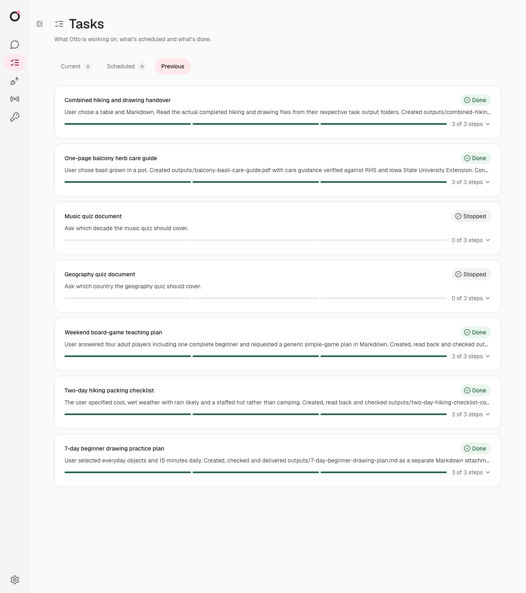

# Task session live checks

All 22 checks passed with `openai/gpt-6.1-sol` on 15 October 2026.

The tested code was `2a143d42b92f88ca1a0402a16565edf1871f382d`, from [PR #272](https://github.com/n8n-io/otto/pull/272). The run used the normal app, model, task workers, API, database and browser UI. It used a separate database schema and workspace. All requests and document content were made for this check.

## Cases and results

| Case                         | Expected result                                                          | Evidence                                                                                                                                            | Result        |
| ---------------------------- | ------------------------------------------------------------------------ | --------------------------------------------------------------------------------------------------------------------------------------------------- | ------------- |
| Create tasks                 | Each independent goal gets a saved task and session.                     | Seven records had seven distinct sessions. Each retained its original owner message.                                                                | Pass          |
| Reply to a question          | Only the selected task receives the answer.                              | The hiking task resumed with cool, wet weather and a staffed hut. Its revision changed from 1 to 2 in the same session.                             | Pass          |
| Reply to a task message      | The reply reaches that task without a coordinator decision.              | The herb task resumed with basil in a pot. Its revision changed from 1 to 2 in the same session.                                                    | Pass          |
| Send an ordinary follow-up   | The coordinator selects the existing task from the request.              | Unquoted drawing and board-game updates reached only their respective sessions. Both applied revision 2.                                            | Pass, 2 cases |
| Send an unclear follow-up    | Otto asks which task the owner means.                                    | “Make it shorter” and “Make the document shorter” each caused a clarification question. Neither created a task update.                              | Pass, 2 cases |
| Keep ordinary chat available | Short questions stay in the main session.                                | Two arithmetic answers and a French translation used the main session. The translation completed while document tasks ran.                          | Pass, 3 cases |
| Stop through the card        | Only the selected task stops.                                            | The geography quiz stopped. The handover stayed open and the herb task continued.                                                                   | Pass          |
| Stop through chat            | The coordinator stops the named task.                                    | “Stop only the music quiz document” stopped that quiz. Other tasks kept their state.                                                                | Pass          |
| Deliver documents            | Files contain the task's own requested details and reply to its message. | Five completed tasks delivered four Markdown files and one PDF. The basil PDF had one A4 page.                                                      | Pass          |
| Resume after restart         | A saved question continues the same task and session.                    | The handover's question, task and message stayed the same. Its answer completed the existing task without creating another task.                    | Pass          |
| Share workspace context      | A task can read outputs from other tasks.                                | The handover read the hiking and drawing files from their task folders. Its tables retained the hut, weather, everyday objects and 15-minute limit. | Pass          |

The first two task pairs were hiking/drawing and herbs/board games. Each pair waited for separate answers. One answer used a direct reply; the other used ordinary chat. The checks used saved records and actual files, with UI inspection. No model judge scored the results.

The run made 85 model requests. The usage ledger recorded $0.8967739, with no unpriced requests. Five tasks completed and two were stopped. The app made no connected app actions.

## UI evidence

The screenshot shows the actual final task records from this run. The Markdown preview opened the generated drawing file. The final task list also fit a 390-pixel mobile viewport without horizontal overflow.

## Environment issue

The first server shutdown reported a cleanup error. A separate browser cleanup check reproduced it with the older local browser image. Its bridge source did not match the tested branch. After a build from `Dockerfile.browser`, both the separate cleanup check and server shutdown passed. This required no source change. The task session and its saved question survived the restart.

## Limits

These were real model calls with controlled input data. This run did not test delivery through a live Telegram or WhatsApp account, connected account actions, or payment approval. Those paths still have separate deterministic integration checks. The two task pairs check different subjects; this run does not establish a general model success rate.
