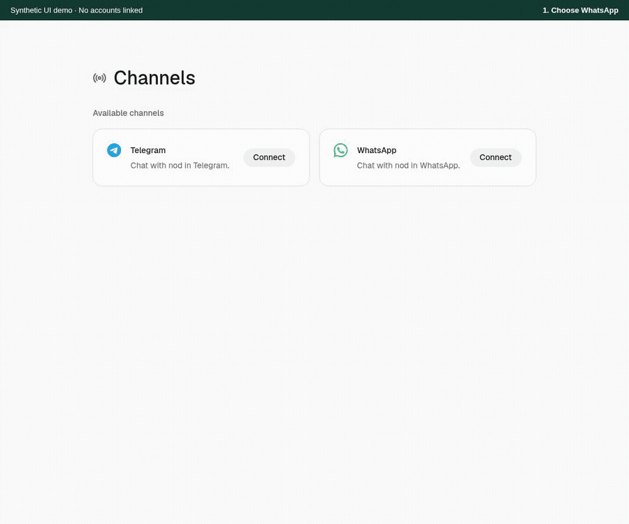

# WhatsApp and Telegram review

PR: [n8n-io/nod#423](https://github.com/n8n-io/nod/pull/423).

See the [security review and finite load checks](security.md).

## Setup demo

[Download the MP4 demo](channels-demo.mp4).

The demo uses the real setup components with synthetic API responses. No account is linked. All names, numbers, tokens and QR data are synthetic. The demo proves setup rendering and interaction only. It does not prove a live provider connection or message delivery.

| Screen              | Capture                                                                                                                                         |
| ------------------- | ----------------------------------------------------------------------------------------------------------------------------------------------- |
| Channels            | [Overview](channels-overview.png)                                                                                                               |
| WhatsApp bot number | [Setup](whatsapp-bot-setup.png), [QR](whatsapp-qr.png), [connected](whatsapp-connected.png)                                                     |
| WhatsApp self-chat  | [Mobile setup](whatsapp-self-mobile.png)                                                                                                        |
| Telegram            | [Create bot](telegram-create-bot.png), [pair](telegram-pairing.png), [confirm owner](telegram-confirm.png), [connected](telegram-connected.png) |

The Chromium fixture checks both WhatsApp modes, Telegram owner confirmation, cancellation, QR recording exclusion and no WhatsApp status requests after the setup panel closes. The mobile capture uses a 390-pixel viewport.

## Media demo

[Watch the media demo](channel-media-demo.mp4).

The media fixture uses the real message components, a synthetic Ogg recording, animated WebP, TGS and WebM stickers, a contact and a location. It checks waveform decoding, play, pause, seek, keyboard seek, playback speed and one active player. It also checks moving TGS frames, reduced motion, frame isolation, video sticker playback, hidden model-only thumbnails, mobile layout, cleanup after unmount and map loading only after a click. The fixture blocks external map requests.

| Screen                               | Capture                                                                                                                |
| ------------------------------------ | ---------------------------------------------------------------------------------------------------------------------- |
| Voice, location, contact and sticker | [Ready](channel-media-ready.png), [playing](channel-media-playing.png), [mobile stickers](channel-stickers-mobile.png) |
| Mobile                               | [390-pixel view](channel-media-mobile.png)                                                                             |

The setup fixture also checks copying the Telegram pairing command, clipboard failure and private manual copy. The fixture checks the stated browser behavior. The captures illustrate it. The fixture and captures do not prove live media delivery, speech transcription or map tile loading.

A later development-mode Chromium check runs the media components under React StrictMode. It checks video effect replay, replacement of a video source and cleanup after unmount. It also checks that a stalled TGS request is aborted when the preview times out. Local TGS previews wait for the uploaded artifact.

## Manual live check

The owner confirmed incoming Telegram photos in the isolated test app. The remaining live checks are below. Use accounts that you control and disposable test content. Keep tokens and QR codes in the private setup UI. Do not attach them to the PR.

1. Start this branch with a disposable database and data root. Follow the [source setup](../../src/content/docs/get-started/install-from-source.mdx) and [channel setup](../../src/content/docs/use/channels.mdx). Use the source setup page's current commands. For voice input, connect an OpenAI or OpenRouter API key in **Settings → Models**, or set server `OPENAI_API_KEY` or `OPENROUTER_API_KEY` in a source install. Voice replies need OpenAI. Check voice input with only an OpenRouter key, with only an OpenAI key and with both keys. With both keys, only OpenAI must receive the audio.
2. In **Channels**, connect Telegram. Create a bot with BotFather, enter its token in the private panel, press **Start** in Telegram, then confirm your account in nod. Check both the desktop app link and the QR code. If Start loses its payload, copy the private pairing command. A plain `/start` must not pair an account. Check that a different Telegram account cannot start work.
3. Connect WhatsApp with a separate bot number. Register that number in WhatsApp first. Enter your personal number in nod. On the bot account's phone, open **Linked Devices → Link a Device**, then scan the QR shown in nod. Check that your personal number can start work and another number cannot.
4. Repeat WhatsApp setup with **Use my own number**. Send a request in **Message yourself**. Check that an outgoing message in another direct chat does not start a nod turn or receive a nod reply. Check that nod's own reply causes no loop.
5. For each channel, send text, an image with a caption, a document, a video, a voice note, a sticker, a location and a shared contact. Check the shared web conversation and returned files. In web, play and seek the voice note, change its speed, open the map and download the original contact. Check Telegram static WebP, TGS and WebM stickers, and WhatsApp animated WebP. Check vCard 2.1 quoted-printable names, grouped contacts and venue details. With a text-only chat model, check image analysis from another connected image model and confirm that the chat selection stays the same. A sticker must reach the model as its own message. Ask for a voice reply and check that it arrives as a native voice note. Ask for a contact and a location reply. Telegram sends grouped or oversized contact cards as files.
6. Before a model is connected, send a voice note and check the Models setup notice. With a model but no speech API key, check the speech setup notice. Use a separate disposable profile for this check.
7. Start two tasks. Answer each task's question with a native reply to its message or file. Check `/tasks`, `/status` and `/stop`. A reply to one task must continue only that task. A file, voice note or reaction must not approve an action.
8. With a disposable sign-in, answer the current code question by native reply. Check that the raw code and source voice note do not enter normal chat storage. A reply to a closed sign-in question must not fill another pending sign-in.
9. Restart nod. Check that the WhatsApp link returns. Interrupt the network, restore it, then check a new message. Stop work during an upload. Check that stopped work does not save a late file or send a late result. An uncertain send must not repeat automatically.
10. Disconnect WhatsApp, confirm that its saved keys are removed, then make a new link. Close unfinished setup and check that its old QR cannot finish setup. Check Telegram disconnect and reconnect.

Record the platform, provider mode, results and any error. Keep private content out of screenshots. The Meta Cloud API remains a separate text path with its existing reply window and file notice.
