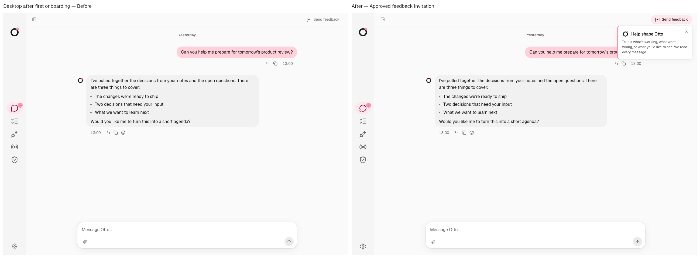
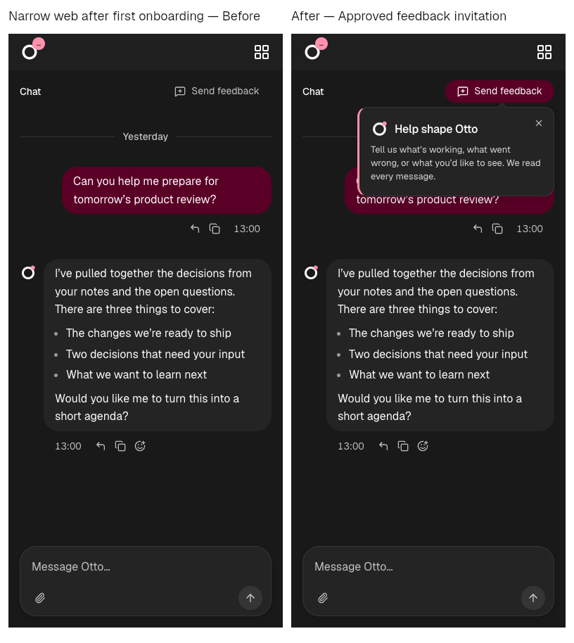
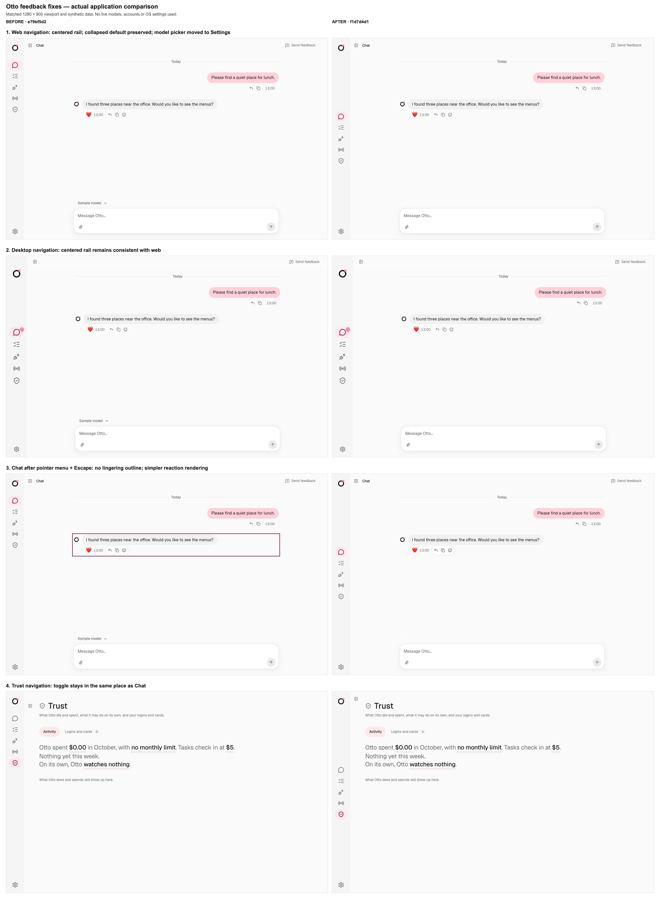
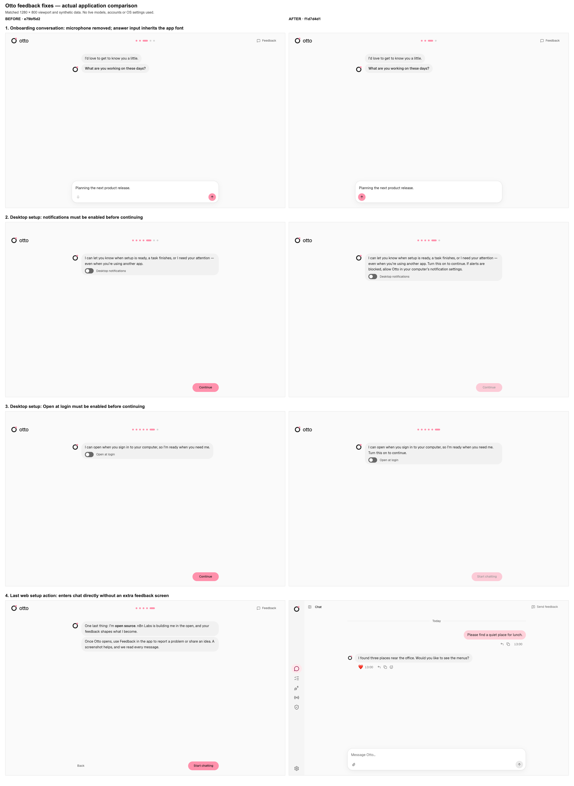
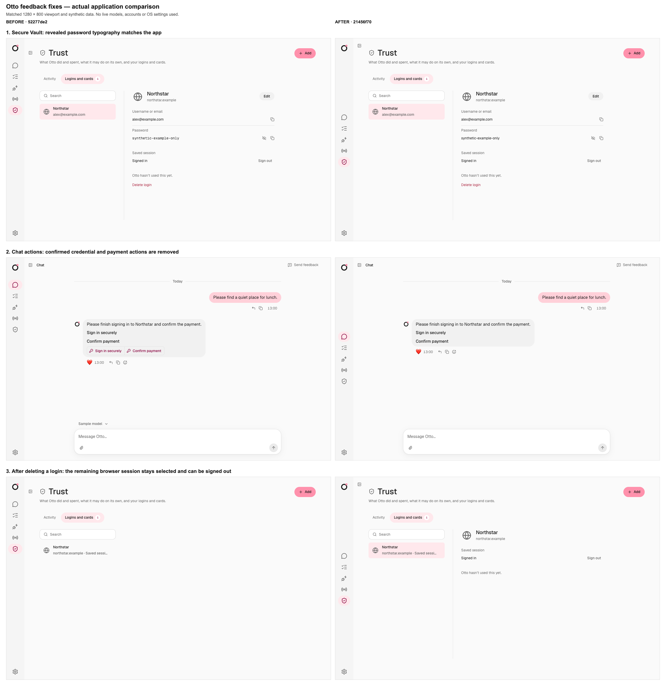
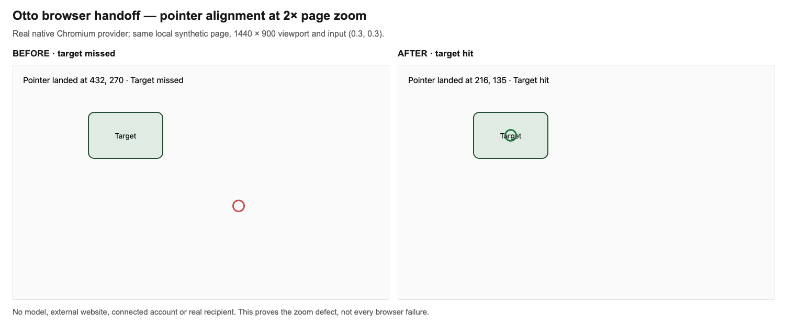
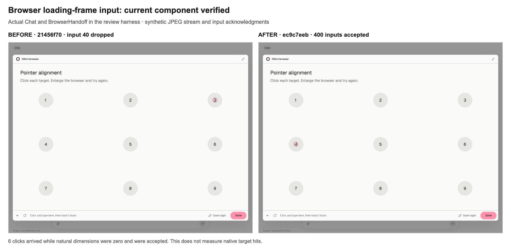
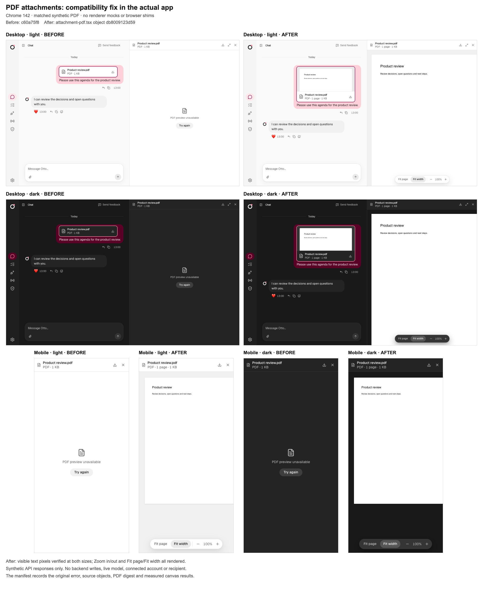

# Feedback fixes: before and after

These captures preserve the original branding and UI from the revisions listed below.

## Approved implementation

These comparisons show the approved changes in actual application components, with the previous branch head `aad7d5c2` as the baseline. Each side uses synthetic content; external requests are intercepted. The desktop bridge is simulated.

| Area                                       | Before and after                                                                                        |
| ------------------------------------------ | ------------------------------------------------------------------------------------------------------- |
| Message interactions and branded picker    | [Desktop](approved/messages-before-after.png), [narrow dark](approved/messages-mobile-before-after.png) |
| Inline composer files and upload state     | [Composer](approved/composer-before-after.png)                                                          |
| Settings page and desktop shortcuts        | [Settings and navigation](approved/settings-navigation-before-after.png)                                |
| Compact cards and MCP OAuth/API key        | [App connections](approved/connections-before-after.png)                                                |
| Simplified paired Telegram link            | [Telegram](approved/telegram-before-after.png)                                                          |
| Sign-in, payment and add-card beside chat  | [Private forms](approved/private-forms-before-after.png)                                                |
| Observed website sign-in methods           | [Method selection](approved/sign-in-methods-before-after.png)                                           |
| Getting-started actions and enabled states | [Desktop preferences](approved/getting-started-before-after.png)                                        |

[Raw captures](approved/raw) and the [capture manifest](approved/manifest.json) retain image hashes and source attribution. The captures were made at successive implementation checkpoints, including uncommitted working source; they are not presented as captures of the final commit. Later safety and lifecycle fixes are verified separately by tests. The method comparison uses the prior chat-choice interaction on the left and the newly supported private method response on the right.

The original MCP baseline was invalid because full navigation dropped the fixture's revision selector. It was preserved locally and replaced with a matched baseline that retains fixture selectors across navigation. Getting-started images use pointer modality; the original keyboard-focus captures remain preserved locally.

These images establish presentation and fixture behavior, not live OAuth, payment, native OS permissions or installed-app acceptance. The [coverage report](feedback-coverage.md) distinguishes implemented scope, deferred work and the local-only channel handoff limit.

## Earlier fixes

The first eleven comparisons use read-only snapshots of the branch base and captured application source at a matched 1280 × 800 viewport, with the same synthetic product state and interactions. The baseline captures were preserved; all eleven after captures were refreshed on 2026-10-21 against the corrected source revision.

- Before: `e79bf5d2fcfcadb093102c31f1e240b44cd210ce`
- After: `117af4eb53958261b352c905c6bb91e451d42749`
- Eleven scenarios, 22 screenshots. The three full-resolution comparison sheets preserve the original screenshots; the overview scales them to half width.
- Every API request was intercepted. No live model, connected account, recipient, backend write, or OS setting was used. Desktop screenshots simulate the renderer bridge and do not demonstrate installed Electron or OS permission behavior.
- Capture completed with no page errors, unexpected API requests, or external requests. Measured states and source revisions are in [the manifest](manifest.json).

## Approved feedback invitation

The selected Brand invitation is implemented at `23cd4db96e767cf7ba26a267b40ef6564b0b7e84`. These additional comparisons use the same synthetic state and real app onboarding controls before (`3edcdb19`) and after (`23cd4db9`), at 1280 × 900 in desktop light mode and 390 × 844 in web dark mode. The four original captures are retained in `feedback-discovery/`. These are new captures; the earlier eleven comparisons keep their original source attribution.

Successful first-time onboarding shows an informational invitation beside Send feedback. It welcomes problems and ideas, says every message is read, and contains only a dismiss control. Dismissal persists per owner; existing users and replayed setup do not receive a new invitation. Opening the existing feedback form also dismisses it. A full-width file viewer temporarily hides it without consuming the invitation.





[Source, screenshot hashes and validation](feedback-discovery.json). The actual-app fixture exercised completion and retry, owner isolation, persistence, routing, focus restoration, feedback form opening, file-viewer positioning and reduced motion. No feedback was submitted, no real account or model was used, and the simulated desktop bridge does not prove native OS behavior.

## Navigation and chat

The web rail is vertically centered. The sidebar toggle stays at the same position between Chat and Trust. The chat model picker is removed. Closing a pointer-opened context menu no longer leaves an outline around the message, and the reaction no longer has the duplicate shadow. The collapsed default and centered desktop rail were already present and remain unchanged.



## Onboarding

The conversation composer has no microphone, and Send stays on the right. Desktop notifications and Open at login must be enabled before Continue becomes available. After the last web setup action, onboarding enters the chat without the extra final feedback screen.



The [earlier after capture](history/onboarding-answer-after-be9595b9.png) from `be9595b9` is preserved because removing the microphone had moved Send to the left. The refreshed `117af4eb` capture includes the correction. Four additional web/desktop fixture checks at 1280 px and 390 px found zero gap between the right edges of Send and its tools row; their bounds are recorded in the manifest.

## Vault and completed actions

The revealed synthetic Vault password uses the app font. Credential and payment action buttons disappear only after the mocked server reports `filled` and `submitted`, respectively. Deleting a login keeps its remaining browser session selected, with Sign out visible.

For the completed-action scenario, both revision fixtures represent the semantic state `filled` for credentials and `submitted` for payments. The credential transport differs: the baseline fixture makes full synthetic request metadata available at `/api/credential-requests/:token`; the after fixture serves `{ status: "filled" }` at `/api/credential-requests/:token/status`. This comparison verifies the UI outcome for completed requests, not identical response bytes or the server endpoint contract.

These screenshots demonstrate frontend behavior. They do not establish live credential entry, payment submission, native settings persistence, or server-side browser-session release.



[Overview of all eleven comparisons](overview.png)

## Browser input

The native pointer comparison was recaptured from frozen source snapshots `e79bf5d2` and `4b5bee4a` using the same [capture harness at `5aa801d3`](https://github.com/n8n-io/nod/blob/5aa801d3d38d9e03a88bb47ab808aab5b6acf28b/docs/review/feedback-media/capture-browser-pointer.mjs) for both. Both runs use the same local synthetic page, 1440 × 900 viewport, 2× page zoom, normalized input, decoded magenta JPEG readiness check, and background restoration before screenshots. The baseline still misses at CSS (432, 270); the fixed provider hits the center at (216, 135).

The marker in this screenshot harness is magenta, RGB (255, 0, 255). Both runs measured decoded pixel (255, 0, 254, 255), then verified that the HTML and body backgrounds were restored to RGB (250, 250, 250) before their screenshot. This capture procedure is separate from the multi-scenario integration test’s marker colors. The branch base `e79bf5d2` is reachable from the PR history and has the identical provider source object as original baseline `21456f70`; the new before image was captured from `e79bf5d2`, and the original image keeps its original provenance. [Pointer measurements](browser-pointer-results.json) record each revision, source object, readiness procedure, marker pixel, and screenshot digest. The [original red capture](browser-screenshots/pointer-before-original.png), which used the first two frames without a marker check, is preserved separately and is no longer the official before image.



To reproduce from the repository root with installed dependencies and Node 26:

```sh
node --import tsx docs/review/feedback-media/capture-browser-pointer.mjs \
  e79bf5d2fcfcadb093102c31f1e240b44cd210ce \
  4b5bee4ab7a47d51f7a7226010a8edb80c492983 \
  .local/feedback-review/pointer-recapture
```

The current [reproduction harness](capture-browser-pointer.mjs) adds bounded CDP failure cleanup and descriptive marker timeout/EOF errors. The comparison PNGs remain from the original capture, whose harness revision and hash are recorded separately from the current reproduction script.

Set `NOD_TEST_BROWSER_EXECUTABLE` when Chrome is installed elsewhere. The harness uses read-only Git archives, the same installed dependencies for both revisions, and disposable browser profiles. It removes its snapshots and profiles after capture and does not start Vite.

The loading-frame evidence remains the separate `ec9c7eeb` run against `browser-handoff.tsx` object `861a4f983fda119f6e6171bec86e7c1fdca8380e`, including the later `onLoad` update; it has not been relabelled as a new capture.

The separate loading-frame check uses the actual Chat and BrowserHandoff in the review harness with a synthetic JPEG stream. All 400 rapid click inputs were accepted, with 400 down and 400 up events posted. 6 mouse-downs arrived while natural image dimensions were zero and were still accepted, exercising the changed loading path. The [detailed measurements](browser-loading-frame.json) preserve the original failure at input 40 and the new per-input results. These acknowledgments do not prove 400 native target hits or live provider delivery.



## PDF attachments

The same one-page synthetic PDF failed to render on Chrome 142 with `pdfjs-dist` 6.4.299’s modern build: `getOrInsertComputed` was unavailable during rendering. The app now loads the documented compatibility build and its matching worker. The installed package’s `README.md` (lines 10–12) recommends `legacy/` for environments missing newer JavaScript features; see the [PDF.js browser support documentation](https://github.com/mozilla/pdf.js/wiki/Frequently-Asked-Questions#faq-support).



These are actual application screenshots at 1280 × 800 and 390 × 800 in light and dark themes. The baseline is `c60a75f8`; the fixed component source object is `db8009123d59a18788b5c114c796ca60738e9504`. All four baseline previews failed; all four fixed previews rendered visible text pixels. Text extraction, Zoom in/out, Fit page, and Fit width also passed against the real renderer. The browser was unmodified, with no compatibility shim or renderer mock.

The [detailed measurements](pdf-rendering.json) retain the original failure, source objects, canvas dimensions, screenshot digests, and the hash of the [synthetic PDF](pdf-fixture.pdf). All eight [per-run PNGs](pdf-screenshots/) are committed at the relative paths recorded in the JSON, so each digest can be verified. Every API request was intercepted; this verifies frontend rendering, not live upload storage or account access.
