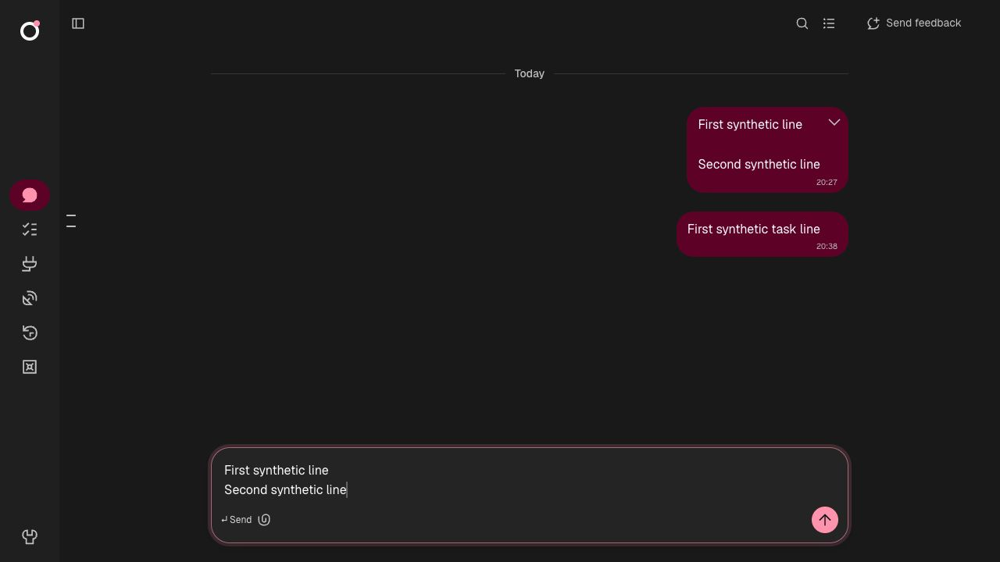
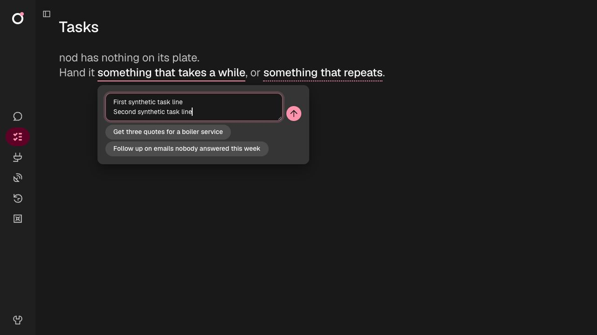
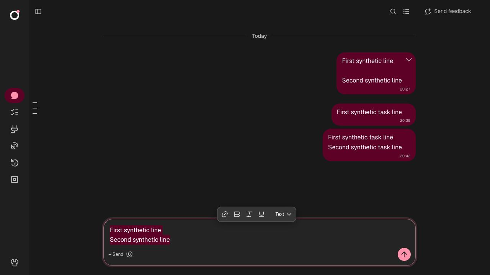
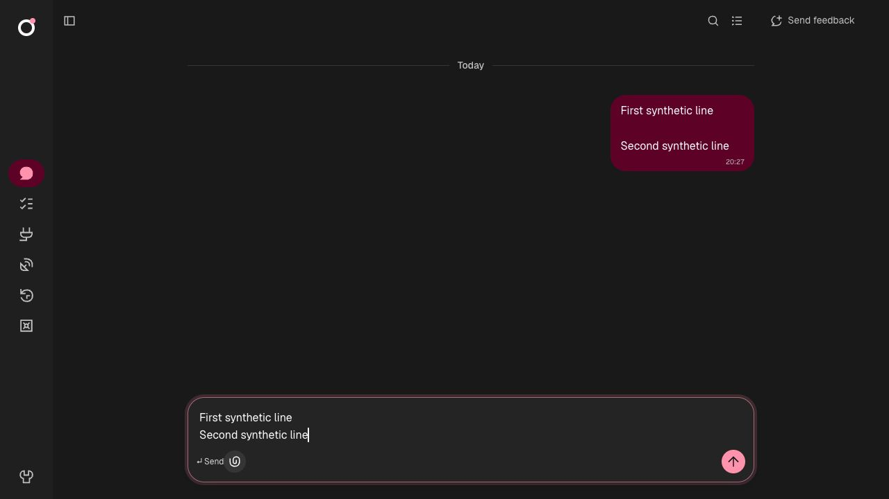
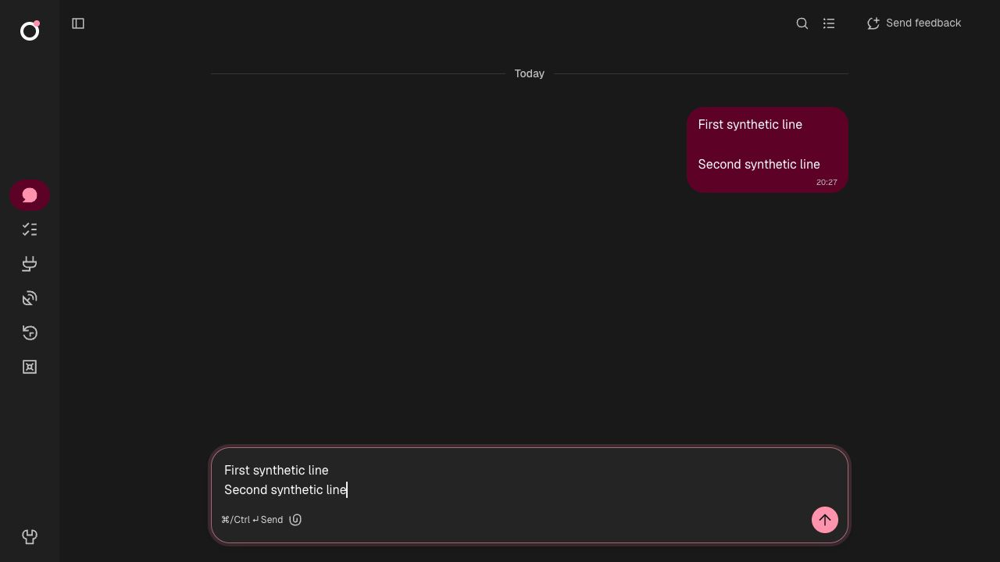

# LAB-646 keyboard verification

Reproduced on main at `4d10edd83708220e1cf14c09b06440b94285777f`: open **Tasks**, select **something that takes a while**, type a line, then press Shift+Return. The task field submits that line and opens chat. Its single-line input uses the browser's implicit form submission. The same shared field also handles schedule requests and exists in the reported release, `f808573b94fba529ff82e8d0f23536267fd1ffff`.

After the fix, Shift+Return keeps the task request open and inserts a newline. Enter then sends the full two-line request once. The field grows with its content. IME Enter does not send, and Escape still closes it.

| Before: Shift+Return sent the first line                                  | After: Shift+Return keeps both lines in the draft                             |
| ------------------------------------------------------------------------- | ----------------------------------------------------------------------------- |
|  |  |

The main rich-text chat composer already handled Shift+Return correctly. Its regression checks cover both send settings, exact multiline send content, IME Enter and rich-text blocks.

| Enter sends                                                                   | Enter inserts a line                                                                |
| ----------------------------------------------------------------------------- | ----------------------------------------------------------------------------------- |
|  |  |

All screenshots use the real web app in `scripts/analytics-fixture.ts`, synthetic messages and no live model or connected accounts. The fixture API confirmed the message count stayed unchanged after Shift+Return, then increased by one with the exact multiline text after Enter. The mounted task-field regression failed before the fix because its native input discarded newlines, then passed afterward for task and schedule requests.

The issue has no attached image, video or diagnostic file. It does not identify which message field the reporter used; this reproduces the symptom in a task/schedule request, without claiming that the original packaged macOS session has been replayed.
