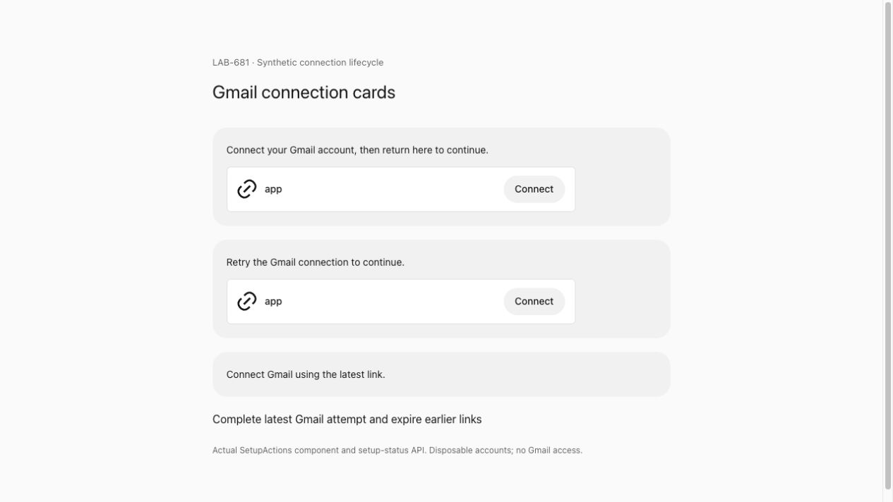
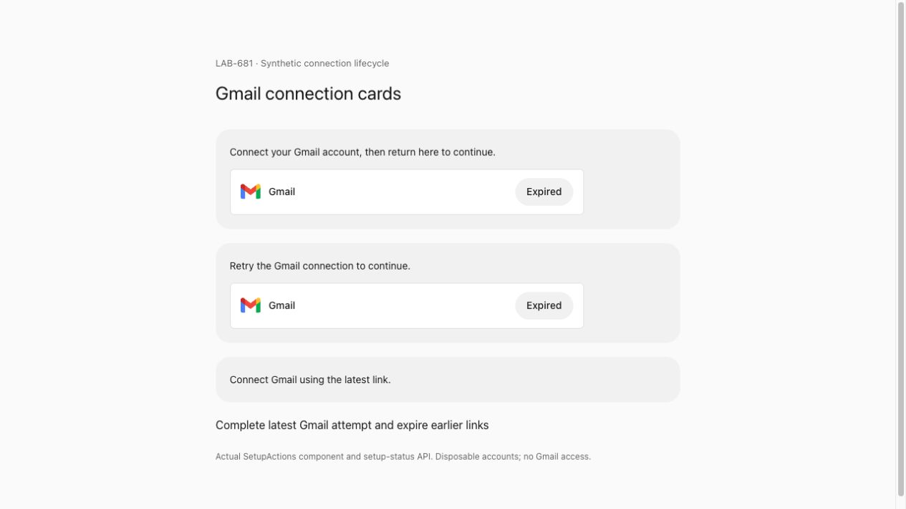

# LAB-681: Gmail connection cards

Earlier Gmail connection cards lost their name and icon when their sign-in links expired. `/api/apps/setup-status` read display metadata only from unexpired pending connections, so revisiting chat replaced Gmail with a generic app card.

App identity now persists by owner and link hash. An expired or replaced attempt retains its name and logo with a disabled **Expired** action. Only a successful link appears in `completed`; it still removes its own card. Expired links cannot invoke provider pairing checks or reopen sign-in.

| Before                                           | After                                             |
| ------------------------------------------------ | ------------------------------------------------- |
|  |  |

Both captures use the real `SetupActions` component, the real integrations API and disposable PostgreSQL, with synthetic accounts. Three Gmail attempts start; the last completes and the earlier two expire. The after capture follows a full page reload. No live Gmail account or model was used.

## Regression evidence

Run against a disposable PostgreSQL database:

```sh
pnpm exec tsx --test --test-name-pattern='expired Gmail setup cards|native setup completion' tests/integrations.test.ts
```

The new lifecycle test failed before the fix: `apps: []` instead of the expired Gmail metadata. It now checks expiry, another attempt's completion, pending-record deletion, service recreation, upgrade backfill, owner isolation and refusal to check pairing for expired links.

The additive schema backfill recovers identities from remaining pending connection records. Historical links whose records were already deleted before upgrading cannot be reconstructed.
