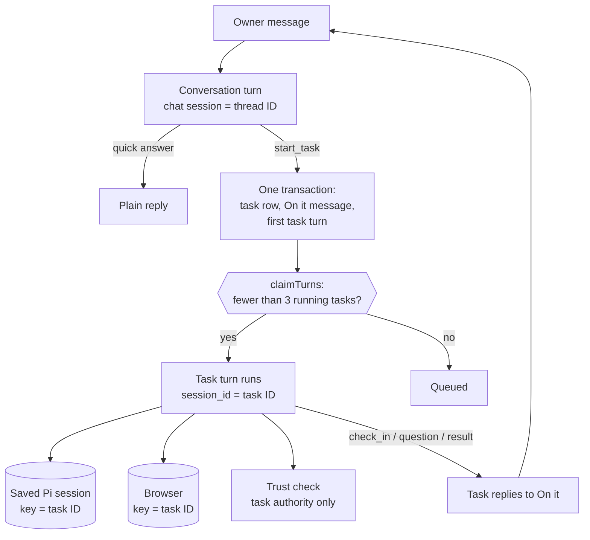
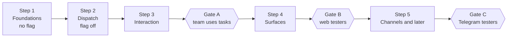

# Otto tasks: specification

| Item       | Value                                                                                                   |
| ---------- | ------------------------------------------------------------------------------------------------------- |
| Status     | Approved for build on 13 October 2026                                                                   |
| Product    | Johan Cutych (LAB-507). Related: LAB-523, LAB-508                                                       |
| Branch     | `parallel-tasks`, from `origin/main` at `022b9960`                                                      |
| Base       | PR #253 (sessions, a browser for each session, `delegate`) and PR #252 (one trust checker, no tripwire) |
| Flag       | `OTTO_TASKS`. When it is off, the `start_task` tool is not bound and no task session exists             |
| Companions | System description, build map and clickable mock (links in [References](#17-references))                |

This document is the single source of truth for the build. It is written in ASD-STE100 Simplified Technical English: short sentences, one word for one meaning, active voice. Code names keep their code spelling. The docs pages that this work changes follow [`write-docs.mdx`](../src/content/docs/contribute/write-docs.mdx) instead.

The terms in [section 3](#3-terms) have one meaning each. "Owner" is the person who uses Otto. "Task" always has the meaning in section 3. It is never a schedule, a delegate subagent or an old report card.

## 1. Summary

Today, Otto does long work in the chat session, and the owner sees little of it. This change makes long work a **task**: a separate session that runs in parallel, keeps its own memory and acts under the authority of the owner message that started it.

1. The chat stays free. A quick answer stays plain text. Longer work becomes a task.
2. A task is a session. `tasks.id` is the `turns.session_id` of every turn of the task. The browser ID, the saved Pi session key and the trust origin all come from that one ID.
3. Each task has one "On it" message. A **task preview** card is inside that message bubble. Otto edits the preview silently. A click opens it in place.
4. Every later message of the task is a **task reply** to the "On it" message: check-ins, questions, confirmations, the result, and stop or failure notes.
5. An owner reply to any message of a task goes to that task. If the task is closed, the reply opens it again.
6. The trust check sees only the words of the owner for that task. Answers bind to a question by reply target or by button, never by "the newest message".
7. Stop works for one task. Stop all stays.
8. A maximum of 3 tasks run at the same time for each owner. More tasks wait in a queue.
9. Progress mode **Check-ins** (default) sends at most 3 short check-ins for each task. **Quiet** sends none. The server enforces the limits.

## 2. Decisions

| #   | Decision                                                                                                          | Date       | By                  |
| --- | ----------------------------------------------------------------------------------------------------------------- | ---------- | ------------------- |
| D1  | One chat. No more threads, no bot for each task, no inline widgets in the answer                                  | 2026-10-13 | Johan               |
| D2  | Three layers: quick answer, task, artifact. An artifact only when the result is a deliverable                     | 2026-10-13 | Johan               |
| D3  | Engine path 3: full parallel tasks. Each task is its own session and can act                                      | 2026-10-13 | Johan               |
| D4  | Progress modes Check-ins (default) and Quiet. No play-by-play mode                                                | 2026-10-13 | Johan               |
| D5  | Check-in limits: at most 3 for each task, at least 2 minutes apart, none in quiet hours                           | 2026-10-13 | Johan (recommended) |
| D6  | The task preview is a card inside the "On it" bubble. A click opens it in place. There is no separate task page   | 2026-10-13 | Johan               |
| D7  | The side panel is only for artifacts                                                                              | 2026-10-13 | Johan               |
| D8  | The card uses the app's styles: neutral card, `.task-status` pill, round buttons. Inner corners follow the bubble | 2026-10-13 | Johan               |
| D9  | The Tasks strip shows only when 2 or more tasks are open or a task needs the owner                                | 2026-10-13 | Johan (recommended) |
| D10 | A reply to a done result continues the same task                                                                  | 2026-10-13 | Johan (recommended) |
| D11 | Start a task when the work takes more than approximately 30 seconds, uses the browser or waits for other people   | 2026-10-13 | Johan (recommended) |
| D12 | Self-hosted Telegram gets document artifacts as PDF files                                                         | 2026-10-13 | Johan               |
| D13 | The defaults in [section 16](#16-open-questions-and-defaults) apply until product changes them                    | 2026-10-13 | Build team          |

## 3. Terms

| Term              | Meaning                                                                                                                         |
| ----------------- | ------------------------------------------------------------------------------------------------------------------------------- |
| Chat              | The one conversation between the owner and Otto. Its session ID is the thread ID.                                               |
| Conversation turn | A turn in the chat session. It answers, starts a task or routes a message to a task.                                            |
| Quick answer      | An answer that a conversation turn gives without a task.                                                                        |
| Task              | Work that runs in its own session (`tasks.id` = `turns.session_id`), started by `start_task` from a conversation turn.          |
| Task session      | All turns whose `session_id` is a task ID. One turn runs at a time.                                                             |
| Task turn         | One turn of a task session: the first turn, a resume, a routed owner reply or a scheduled check.                                |
| "On it" message   | The first message of a task, posted by the server in the dispatch transaction, as a reply in the chat.                          |
| Task preview      | The card inside the "On it" message bubble. Closed, it shows title, status, current step and the step bar. Open, it shows more. |
| Task reply        | An Otto message with `reply_to_message_id` = the task's `on_it_message_id`.                                                     |
| Check-in          | A task reply about a milestone, sent only through the `check_in` tool and only in Check-ins mode.                               |
| Question          | A task reply that asks the owner for a decision. A confirmation is a question bound to one exact action.                        |
| Result            | The last task reply of a run. In task mode, the final text of Pi becomes the result.                                            |
| Artifact          | A document or page that Otto makes as a deliverable. It is attached to the result.                                              |
| Progress mode     | The owner preference `check_ins` or `quiet`.                                                                                    |
| Task authority    | The owner words that the trust check may use for a task: the frozen instruction and the owner messages routed to that task.     |

## 4. Behaviour

### 4.1 Quick answer or task

A conversation turn calls `start_task` when one of these conditions is true:

1. The work takes more than approximately 30 seconds.
2. The work uses the browser.
3. The work waits for other people.

Otherwise, the conversation turn gives a quick answer. A conversation turn can start more than one task. After `start_task`, the conversation turn writes nothing more about that task.

### 4.2 Task statuses

| Status    | When                                                    | Pill colour (`.task-status`) |
| --------- | ------------------------------------------------------- | ---------------------------- |
| Queued    | The task waits for a free slot (limit of 3)             | Neutral                      |
| Working   | The latest task turn is queued or running               | Info                         |
| Needs you | The latest task turn waits for the owner                | Accent                       |
| Waiting   | The task waits for other people and has a planned check | Neutral                      |
| Done      | The task gave its result                                | Success                      |
| Stopped   | The owner stopped the task, or reset closed it          | Neutral                      |
| Failed    | An error or a restart ended the task                    | Error                        |

A plain chat message never changes the status of a task. Only the task's own turns, Stop and reset change it.

### 4.3 Messages of a task

| Message      | Sent by                                   | Reply target        | New message | Edit |
| ------------ | ----------------------------------------- | ------------------- | ----------- | ---- |
| "On it"      | Server, in the `start_task` transaction   | The owner's message | Yes         | No   |
| Preview      | Server, from the task record              | Inside "On it"      | No          | Yes  |
| Check-in     | `check_in` tool, server-limited           | "On it"             | Yes         | No   |
| Question     | `ask_user`, a confirmation, a secure form | "On it"             | Yes         | No   |
| Result       | Final Pi text in task mode                | "On it"             | Yes         | No   |
| Stop note    | Server, from Stop                         | "On it"             | Yes         | No   |
| Failure note | Server, from a failure or a restart       | "On it"             | Yes         | No   |

Rule: a new message makes a notification. An edit does not. The rule is the same on all channels.

### 4.4 Progress modes and the check-in rule

Both modes send the "On it" message, the questions, the result and the stop and failure notes. Only Check-ins mode sends check-ins.

The `check_in` tool refuses (result `skipped`, not an error) when one of these conditions is true:

1. The progress mode is `quiet`.
2. The task sent 3 check-ins in this run.
3. The last check-in was less than 2 minutes before.
4. The time is in the owner's quiet hours. A refused check-in is dropped, not deferred.

The task prompt tells Pi to send a check-in only in these conditions:

1. A first finding can change the plan.
2. The plan, the cost or the time changed, and the owner does not have to decide.
3. A phase that takes more than approximately 2 minutes starts.

If the owner must decide, Pi asks a question instead. The progress mode governs check-ins. The free-text notification rule governs only event and schedule sessions.

### 4.5 The task preview

Closed preview (in the chat and on the Tasks page):

- Title, and a status pill from section 4.2.
- One line: the current step, the question in short form, "Finished in N min", "Stopped after N min" or the error in short form.
- A step bar with one segment for each step, coloured by status, and "N of M steps" with a chevron.

Open preview (a click on the closed preview):

- The step list, with status icons.
- **Stop task** while the task is open.
- When done: the result text and the artifact card. The artifact opens in the side panel.
- On the Tasks page only: the open question with its answer buttons, and **Show in chat**.

In the chat, the open preview does not repeat the question, because the question is a task reply below it. The card sits inside the message bubble on the `--embed` surface with no border. The bubble keeps its radius, the inset is 6 px and the card radius is the bubble radius minus the inset.

The preview reads `state.tasks`, not the message row. Thus, a preview outside the 150-message window stays live.

### 4.6 Tasks strip

The strip is above the composer. It shows when 2 or more tasks are open, or when one task needs the owner. Each chip shows the title and the status. A click scrolls the chat to the "On it" message and opens its preview. The strip has **Stop all**.

### 4.7 Tasks page

The page keeps its tabs **Current**, **Scheduled** and **Previous**. **Current** groups open tasks as Needs you, Working, Waiting and Queued, in that order. **Previous** shows Done, Stopped and Failed tasks and the past schedule runs. Each task uses the same preview card as the chat. A done task keeps **Schedule task**.

### 4.8 Artifacts

A deliverable result carries one artifact card inside the result bubble. On web, the card opens the side panel (`<aside>` in `.workspace-body`). Documents (Markdown, PDF, images) render in the panel. HTML pages render later, in a sandboxed frame. On Telegram, document artifacts go as a PDF file that replies to the result. On WhatsApp, Otto sends no files: the result text tells the owner to open the artifact in Otto.

### 4.9 Owner messages and routing

| Owner message                                                        | Goes to                                                                         |
| -------------------------------------------------------------------- | ------------------------------------------------------------------------------- |
| A reply to the "On it" message or to any message of a task           | That task session. If the task is closed, the task opens again                  |
| A button press on a question                                         | That approval only, by approval ID                                              |
| A bare "yes" or "no" with exactly one open question, the newest seen | That question                                                                   |
| A bare "yes" or "no" with two or more open questions                 | The chat. The conversation turn asks which task                                 |
| Any other message                                                    | The chat. The conversation turn answers, starts a task or calls `route_to_task` |

`route_to_task {taskId}` moves the current owner message, with its exact text, into the task session. The model never rewrites owner words for a task. A message routed to a running task is steered into it at the next Pi step.

### 4.10 Stop

- **Stop task** (open preview, Tasks page, strip menu) stops one task session.
- The composer Stop stops only the chat session.
- **Stop all** (strip and Tasks page) stops every session, as `/api/thread/stop` does today, and closes every task as Stopped.
- On Telegram and WhatsApp before buttons exist, a reply "stop" to a task message is routed to the task. The task prompt tells Pi to end the task as stopped.

Stop declines the task's pending confirmations, supersedes its pending Vault and payment requests, discards its browser and posts the stop note.

### 4.11 Limits

- At most 3 task sessions run at the same time for each owner. Only tasks with a running turn count. Waiting tasks and schedule or event sessions do not count.
- A dispatch over the limit is queued. Its preview shows Queued.
- `delegate` inside a task keeps its limit of 2 subagents for each turn. Subagent browsers count in the browser budget (section 5.7).

### 4.12 Channels

| Part          | Web                      | Telegram                                      | WhatsApp                                   |
| ------------- | ------------------------ | --------------------------------------------- | ------------------------------------------ |
| Preview       | Card in the bubble, live | Edit of the "On it" message (WP-25)           | None: WhatsApp cannot edit a sent message  |
| Task reply    | Quote line               | Native reply (`reply_parameters`)             | Native reply (`context.message_id`)        |
| Owner reply   | `replyToMessageId`       | `reply_to_message` mapped to the Otto message | `context.id` mapped to the Otto message    |
| Question      | Buttons and replies      | Inline buttons (WP-25); until then, a reply   | Reply buttons (WP-25); until then, a reply |
| Artifact      | Side panel               | PDF file (WP-26)                              | Text only                                  |
| Late messages | Always                   | Always                                        | Blocked after 24 h; shown only in Otto     |

On WhatsApp the owner sees no progress between "On it" and a question or result in Quiet mode. Check-ins is the default for this reason.

## 5. Engine design

### 5.1 A task is a session

Main already gives each session one running turn, its own browser and a resume into the session that asked (PR #253). This change adds the task record, the dispatch, the task runtime mode, task authority, saved Pi sessions for tasks, routing of owner replies and the limits.

Task sessions keep `background = true`. Thus, chat-only staleness rules and chat-only routes skip them. A runtime mode `task`, which comes from the `tasks` row, replaces the event rules for these sessions. In task mode, the final text is delivered, steering is on, the Pi session is saved and the prompt is the task prompt.

### 5.2 Task record

The `tasks` table becomes the task record (WP-01, WP-19). `tasks.id` is the session ID.

| Column                                  | Meaning                                                               |
| --------------------------------------- | --------------------------------------------------------------------- |
| `id`                                    | Task ID and session ID                                                |
| `owner_id`, `thread_id`                 | Owner and thread scope                                                |
| `title`                                 | At most 120 characters                                                |
| `instruction`                           | Frozen copy of the owner words that started the task (task authority) |
| `source_message_id`                     | The owner message that started the task (can be a steered message)    |
| `on_it_message_id`                      | The "On it" message                                                   |
| `result_message_id`                     | The latest result message                                             |
| `channel`, `channel_source_id`          | Delivery route, copied like `schedules.deliveryRoute`                 |
| `read_only`                             | Copied from the dispatching chain                                     |
| `steps`, `step_index`                   | Step list (2 to 8 items) and the current step                         |
| `now_text`                              | The current step line, written by `task_progress`                     |
| `waiting_for`, `next_check`             | Who the task waits for, and the planned check (WP-29)                 |
| `check_ins`, `last_check_in_at`         | Check-in counter for the current run                                  |
| `state`                                 | `queued`, `open`, `waiting`, `done`, `stopped` or `failed`            |
| `created_at`, `updated_at`, `closed_at` | Times                                                                 |

The old columns `auto`, `turn_id`, `done_when` and `turns.task_id` go (WP-19). A migration closes open auto cards first.

### 5.3 Tools

| Tool                                                                     | Bound in                                                   | What it does                                                                                          |
| ------------------------------------------------------------------------ | ---------------------------------------------------------- | ----------------------------------------------------------------------------------------------------- |
| `start_task {title, ack, instruction, steps?}`                           | Conversation turns, flag on, not read-only, not onboarding | Creates the task, posts `ack` as the "On it" message (fallback "On it."), queues the first task turn  |
| `route_to_task {taskId}`                                                 | Conversation turns, flag on                                | Moves the current owner message, with its exact text, into that task session                          |
| `task_progress {steps?, current?, now?, waitingFor?, nextCheck?, stop?}` | Task sessions only                                         | Silent edit of its own task row. `stop` ends the task as Stopped when the owner asks                  |
| `check_in {text}`                                                        | Task sessions only                                         | A task reply, limited by the server (section 4.4)                                                     |
| `send_message`                                                           | Not in task sessions or their subagents                    | Unchanged for event and schedule sessions                                                             |
| `delegate`                                                               | Task sessions, as today                                    | Subagents of a task lose `send_message`, `check_in`, `task_progress` and the browser handoff question |

The old report-only `task` tool and the curator watcher go (WP-19).

### 5.4 Task authority and the trust check

- `turnOrigin` resolves a task session to origin `task`. The author is the current turn's owner message when the turn is a routed reply. Otherwise it is `tasks.source_message_id`. Read-only stays read-only (WP-03).
- For an action in a task, the checker gets `taskInstruction` (frozen, outside the 24-hour and 5-message window), the newest 5 owner messages routed to that task, and the task's own last assistant message before them. It never gets chat words or another task's words (WP-04).
- For a chat action, the checker gets only chat-session words. Task replies are not chat words.
- A chat message that is not routed never extends a task's authority.
- An `OTTO_vault_allow` grant covers the turns of the same task session (WP-03).

### 5.5 Pi sessions

- Pi storage keys by session ID. The chat keeps the thread key. Each task gets its own saved session in a sibling directory, so the chat's `continueRecent`, the legacy cleanup and the feedback report never read task files. In hosted mode, the checkpoint key is the task ID (WP-02).
- Schedule, event and subagent sessions stay in memory.
- Task resumes do not append "The request was:", because the transcript carries the context.
- Reset deletes task transcripts. A closed task's transcript is deleted 30 days after it closes (WP-20).

### 5.6 Answers and approvals

- Every task question and confirmation is a reply to "On it".
- A reply to any message of a task resolves to that task's one pending approval.
- A button press carries the approval ID. It is owner-bound and pending-only. A stale press is a no-op and creates no turn.
- A bare yes or no answers only when exactly one approval is pending and it is the newest message the owner saw. Otherwise, the conversation turn asks which task.
- An untargeted message never expires a task confirmation. A targeted non-answer expires it and goes to the task session as an owner reply.
- Pending reuse is scoped by session. Two tasks with the same action get two approvals.
- An answer from another channel uses the approval ID. The resume keeps `tasks.channel`.
- A pending task confirmation expires after 24 hours. Closing or stopping a task declines its pending approvals (WP-06).

### 5.7 Browser, Vault and payments

- Every session already has its own browser. The live cap rises from 2 to cover the chat plus 3 tasks (target 4; measure on E2B with 2 CPU and 3 GB). At the cap, an open waits in an abortable queue instead of failing. A session with a running turn is never evicted (WP-07).
- A paused task keeps its browser for 30 minutes when it has an open page, even when the paused segment did not browse.
- A reopened task gets a new browser generation. Its saved logins still work. Its old page state is gone (WP-22).
- Only a later turn in the same session supersedes a Vault, OTP or payment-code wait. A chat message never expires a task's sign-in (WP-18).
- The browser view and the handoff routes take a session. A waiting task can hand its browser to the owner. **Done** resumes the task (WP-21).
- Payments stay local-only. Hosted mode refuses saved-card payments, as today.

### 5.8 Workspace

Each task gets a working folder `/workspace/<threadId>/tasks/<taskId>`. Only Pi's working directory changes. `WorkspaceSession.path` stays the thread root, so the provider checks, browser flows and `.otto/outputs` keep working. Relative paths for `share_file`, publish and reads resolve against the task folder (WP-09).

### 5.9 History and context

- A task's context is its source message, the messages of its own session and the owner replies routed to it. It does not see other sessions' messages (WP-17).
- The chat's context leaves out task-internal messages but keeps the "On it" and result messages, plus a list of open tasks: title, status and `onItMessageId`.
- Schedule and event sessions get the same session scope.

### 5.10 Web state and events

- `/api/state` gets `state.tasks`: open tasks and recent closed tasks, keyed by `onItMessageId`, with title, status, steps, step index, now line, question, approval ID, result message ID, artifact and cost.
- The client no longer aborts an in-flight `/api/state`. It marks the state dirty and fetches once more. The server throttles tool-event refreshes for each session and sends a targeted `task` event for silent preview changes (WP-23).

### 5.11 Failure, restart, reset and retention

- An interrupted or failed task turn closes the task as Failed and posts a failure note as a reply. Nothing reruns automatically. A reply opens the task again (WP-20).
- Reset stops every task, closes them as Stopped, and deletes their saved sessions, folders, browser profiles and checkpoints.
- Closed task transcripts and browser profiles are deleted 30 days after the task closes.

### 5.12 Waiting for other people

A task that waits for other people calls `task_progress {waitingFor, nextCheck}`. The task turn ends with state `waiting`. At `nextCheck` the server queues a task turn (`source = 'task'`, `source_id = task-check:<taskId>:<time>`) in the same session. The status shows Waiting with the next check time. In this version, an incoming email or app event does not wake the task; the planned check does (WP-29).

### 5.13 Feature flag and rollout

`OTTO_TASKS` is an environment flag for the deployment. When it is off, `start_task` and `route_to_task` are not bound, and no new task session can start. Existing task sessions finish. Step 1 of the build order ships with no flag because it changes no behaviour that the owner sees.

## 6. Work packages

A Gate A package must be complete before parallel tasks run at all, also for the team. A Gate B package must be complete before testers get tasks. Sizes are rough estimates from the code. WP-05 is obsolete: PR #252 removed the injection tripwire.

| ID              | Title                                                                    | Gate             | Size | Needs                             |
| --------------- | ------------------------------------------------------------------------ | ---------------- | ---- | --------------------------------- |
| [WP-01](#wp-01) | Task record and start_task dispatch                                      | Gate A (blocker) | L    | WP-24                             |
| [WP-02](#wp-02) | Saved Pi session for each task, keyed by session ID                      | Gate A (blocker) | M    | —                                 |
| [WP-03](#wp-03) | Task authority link                                                      | Gate A (blocker) | M    | WP-01, WP-24                      |
| [WP-04](#wp-04) | Trust review for each task                                               | Gate A (blocker) | M    | WP-03                             |
| [WP-06](#wp-06) | Answers and approvals for each task                                      | Gate A (blocker) | M    | WP-03, WP-16                      |
| [WP-07](#wp-07) | Browser capacity for parallel tasks                                      | Gate A (blocker) | M    | —                                 |
| [WP-08](#wp-08) | Stop for each task                                                       | Gate A (blocker) | M    | WP-01                             |
| [WP-09](#wp-09) | Folder for each task                                                     | Gate B           | M    | WP-01                             |
| [WP-10](#wp-10) | Steer replies into a running task                                        | Gate B           | S    | WP-16, WP-02                      |
| [WP-11](#wp-11) | Channel reply targets, inbound and outbound                              | Gate B           | M    | WP-16                             |
| [WP-12](#wp-12) | Limit of 3 tasks, cost and load                                          | Gate A (blocker) | M    | WP-01                             |
| [WP-13](#wp-13) | Check-ins and progress mode                                              | Gate B           | M    | WP-15                             |
| [WP-14](#wp-14) | Web: task preview in the bubble, Tasks strip, Tasks page, artifact panel | Gate B           | L    | WP-01, WP-06, WP-08, WP-19, WP-23 |
| [WP-15](#wp-15) | Task runtime mode, delivery and the dispatch prompt rule                 | Gate A (blocker) | M    | WP-01                             |
| [WP-16](#wp-16) | Route owner replies to their task (queue, resume, reopen)                | Gate A (blocker) | M    | WP-01, WP-02                      |
| [WP-17](#wp-17) | History and context for each session (bot h)                             | Gate A (blocker) | S    | WP-01                             |
| [WP-18](#wp-18) | Vault, OTP and payment-code waits scoped to the session                  | Gate A (blocker) | S    | —                                 |
| [WP-19](#wp-19) | Retire the auto-card watcher and the report-only task tool               | Gate A (blocker) | M    | WP-01                             |
| [WP-20](#wp-20) | Task lifecycle: failure, restart, reset and retention                    | Gate B           | S    | WP-02, WP-08                      |
| [WP-21](#wp-21) | Hand a task's browser to the owner                                       | Gate B           | M    | WP-01, WP-16                      |
| [WP-22](#wp-22) | Browser reopen and isolation between sessions                            | Gate B           | M    | WP-07                             |
| [WP-23](#wp-23) | Coalesce web state refreshes                                             | Gate B           | S    | —                                 |
| [WP-24](#wp-24) | One turn-chain resolver and dead code removal                            | Gate A (blocker) | S    | —                                 |
| [WP-25](#wp-25) | Telegram live preview, inline buttons and WhatsApp interactive buttons   | Later            | L    | WP-11, WP-06                      |
| [WP-26](#wp-26) | Deliverable artifacts to channels as PDF                                 | Later            | M    | WP-11, WP-15                      |
| [WP-27](#wp-27) | Docs and AGENTS.md                                                       | Gate B           | M    | —                                 |
| [WP-28](#wp-28) | Leftover open review items from PR #253                                  | Later            | S    | —                                 |
| [WP-29](#wp-29) | Waiting for other people and planned checks                              | Gate B           | M    | WP-01, WP-15, WP-19               |
| [WP-30](#wp-30) | Capability evals for tasks                                               | Later            | S    | WP-15, WP-16                      |

### WP-01

**Task record and start_task dispatch** · Gate A (blocker) · size L · needs WP-24

Status on main: partial (session-capable enqueueTurn, session trigger and per-session claim exist; tasks table is report-only; no dispatch path).

**Change.** Turn the tasks table into the task record and add a conversation-only start_task tool. In one transaction it creates the task, posts the 'On it' message and enqueues the first task turn in a new session whose ID is the task ID.

**Design.**

Columns (initialize() in src/server/tasks.ts):

- thread_id uuid
- source_message_id uuid
- instruction text (frozen owner words)
- on_it_message_id uuid
- channel text, channel_source_id text
- read_only bool
- steps jsonb default '[]', step_index int
- check_ins int default 0, last_check_in_at timestamptz
- result_message_id uuid
- state: queued|open|done|stopped|failed
  WP-19 drops auto, turn_id, done_when, waiting_for, next_check and turns.task_id. session_id equals id (no extra column).

TurnSource gets a new value 'task' (src/server/thread.ts:43, EnqueueTurnOptions.source, contracts Turn.source, ledger and analytics labels).

Tool start_task {title<=120, ack<=200, instruction<=4000, steps?: string[] (2 to 8)}:

- Bound only in conversation mode when OTTO_TASKS is on.
- Not bound in read-only or onboarding turns, subagents or task sessions.

Server handler tasks.dispatch(turn, input):

1. Call lockThread FIRST, then check the chat turn is still running, as agent-reactions.ts:27-36 does. Never call it from inside withTurnLock (deadlock).
2. The authority is the executeTurn sourceMessageId (turn.message_id or the last steered message, src/server/thread.ts:1145-1155) plus its text. Refuse when readOnlyChain is true.
3. Copy channel and channel_source_id the way schedules.deliveryRoute does (src/server/schedules.ts:551-594).
4. Insert the task, then the 'On it' assistant message with the `ack` text (fallback 'On it.') on the chat turn through insertAssistantMessage, as a reply to the source message, and store its ID.
5. Call enqueueTurn(instruction, {source:'task', sourceId:`task:<id>`, background:true, sessionId:id, channel, channelSourceId, client}).
6. Return {taskId, onItMessageId}.
   The cap check happens in claimTurns (WP-12), not here.

**Files.** `src/server/tasks.ts`, `src/server/thread.ts`, `src/server/db.ts`, `src/server/composition.ts`, `src/runtime/tools.ts`, `src/runtime/index.ts`, `src/shared/contracts.ts`, `src/server/ledger.ts`

**Keep.** Every write from a turn goes through withTurnLock. Turns and tool calls are never retried automatically. Read-only and onboarding turns refuse writes. Every query is owner-scoped.

**Tests.**

- tests/thread.test.ts, extend 'each session runs one turn at a time while sessions run in parallel' (~912): dispatch from a running chat turn creates exactly one source='task' background turn with session_id = task id. A repeated call with the same source_id is idempotent. The chat turn settles while the task runs.
- tests/thread.test.ts: dispatch is refused from a read-only or onboarding chat, and after the chat turn was stopped.
- tests/thread.test.ts: running stopThread at the same time as a dispatch completes both without a 40P01 deadlock.

### WP-02

**Saved Pi session for each task, keyed by session ID** · Gate A (blocker) · size M · needs nothing

Status on main: missing.

**Change.** Key Pi storage by session ID instead of thread ID, and save task sessions the way the chat is saved. Schedule, event and subagent sessions stay in-memory.

**Design.**

- AgentSessionOptions (src/ports/agent.ts:204) gets sessionKey: string and saved: boolean. The runtime passes turn.session_id (add RuntimeContext.sessionId; src/runtime/index.ts:671-711).
- In src/providers/pi/index.ts:167-211:
  - directory = sessionRoot/threadIdentity(sessionKey), a sibling directory, so the chat's continueRecent, legacy cleanup and readPiSessionEntries never see task files.
  - durable = createPiCheckpoint(store, sessionKey).
  - Only the key changes in src/providers/pi/checkpoint.ts:317 and 354; the chat key stays the thread ID. Obsolete parts are removed by explicit ID, not by prefix.
  - manager = saved ? (durable?.manager ?? openLocalSession(directory)) : SessionManager.inMemory.
- Task sessions get rebaseSession, closeInterruptedCalls and compaction.
- For task sessions only, stop appending 'The request was:' (src/server/thread.ts:574, src/server/approvals.ts:405); the transcript carries the context. Keep the turn.prompt overwrite at thread.ts:975 for schedule and event.
- Deletion on reset and retention are in WP-20.

**Files.** `src/ports/agent.ts`, `src/providers/pi/index.ts`, `src/providers/pi/checkpoint.ts`, `src/runtime/index.ts`, `src/server/thread.ts`, `src/server/approvals.ts`

**Keep.** One persistent Pi session per conversation session. No tool returns a saved password, code or card to Pi, and the legacy credential scrub runs on task transcripts too. Provider keys never enter the sandbox.

**Tests.**

- tests/pi.test.ts, extend 'the Pi transcript keeps model changes for the next turn and leaves background turns out' (~3736): open with sessionKey = task id, prompt, dispose and reopen. resumed is true and the history is the task's own. The chat history excludes the task, and the chat's continueRecent does not pick the newer task file. Schedule and event sessions are still not resumed.
- tests/pi.test.ts, extend 'a stale Pi writer cannot overwrite a newer session checkpoint' (~1138): chat and task checkpoint concurrently to separate keys without a version conflict. A legacy rebase of the chat leaves task files alone.
- tests/pi.test.ts (~1156): the bug report reads the chat session, not a newer task session.

### WP-03

**Task authority link** · Gate A (blocker) · size M · needs WP-01, WP-24

Status on main: missing.

**Change.** Give every turn of a task session a 'task' origin whose author is the owner message that started the task, or a later owner message addressed to the task. Read-only origins stay read-only. A task is never an event.

**Design.**

- turnOrigin (src/server/approvals.ts:68-104): after the chain resolves, look up tasks WHERE id = turn.session_id AND owner_id. If one exists, return {source:'task', taskId, readOnly: task.read_only || readOnlyChain, authorMessageId}. authorMessageId is the current turn's message_id when its source is 'user' (a routed reply); otherwise it is tasks.source_message_id.
- approvals.request (227-253): a task origin uses that author. Dedupe on session_id + author + action + args, and remove the cross-session pending reuse for tasks.
- The steering check (216-226) also accepts task sessions.
- Provenance checks (src/server/schedules.ts:603-607, src/server/personal.ts:65-80, 199-203) accept the task's authority message. memory_forget is allowed only when that message asked for it.
- TrustReason gets 'task'.
- vault-access (src/server/vault-access.ts:97-104): an OTTO_vault_allow grant covers turns with the same session_id, resolved through the WP-24 resolver.

**Files.** `src/server/approvals.ts`, `src/server/turn-chain.ts`, `src/server/trust.ts`, `src/server/vault-access.ts`, `src/server/schedules.ts`, `src/server/personal.ts`

**Keep.** The trust check invariant. Only a turn started by an owner message can forget a note. Read-only and onboarding turns never sign in, pay or write. Event turns carry no owner words, and tasks must not be classified as events.

**Tests.**

- tests/approvals.test.ts, extend ~1460 and ~1558: the author of a task approval is the dispatching message, including a steered one. A task dispatched from a read-only chain refuses classified writes and sign-in. A schedule created inside a task passes the provenance check, and memory_forget is refused unless the authority message asked.
- tests/vault.test.ts: a vault-allow yes given in task A covers A's resume, routed reply and reopen turns, and never task B or the chat.

### WP-04

**Trust review for each task** · Gate A (blocker) · size M · needs WP-03

Status on main: missing.

**Change.** The checker sees only the task's own owner words for a task action, and only chat-session words for a chat action.

**Design.**

Add a task branch in trust.check (src/server/trust.ts:66-72): taskWords(task) = {taskInstruction: tasks.instruction (frozen, outside the 24 h and 5-message window), userMessages: the newest 5 owner messages whose turn has session_id = task.id, assistantMessageBeforeLatestUserMessage: from the same session}. Restrict conversation() (trust.ts:29-57) to messages whose turn is in the chat session (session_id = thread_id). Chat messages sent after dispatch do not extend a task's authority. checkInstructions describes taskInstruction the way it describes scheduledTaskInstruction.

**Files.** `src/server/trust.ts`, `docs/src/content/docs/trust/approvals.mdx`

**Keep.** The checker sees only owner words plus the message they answered and the action, never tool results. It fails closed. A tapped first task never counts as the owner's message.

**Tests.**

- tests/approvals.test.ts, extend the checker-visibility test (~427): with two tasks and later unrelated chat messages, task A's review input contains only A's instruction and replies. A chat message naming a recipient does not let task B send without confirmation. Chat reviews never contain task replies.
- tests/approvals-application.test.ts: a task integration send runs directly when its own instruction asks for it. It asks for confirmation when only a chat message asked.

### WP-06

**Answers and approvals for each task** · Gate A (blocker) · size M · needs WP-03, WP-16

Status on main: partial (a yes or no resumes the asking session; target selection, expiry and reuse are still thread-wide).

**Change.** Resolve answers by reply target or button to the task that owns the message. A bare message never consumes or expires another task's confirmation.

**Design.**

In src/server/approvals.ts:

1. confirmationFor (344-368): a replyToMessageId pointing at any message of a task session, or at its on_it_message_id, resolves to that task's one pending approval. Without a target, only chat-session confirmations are candidates.
2. acceptChat (379-395): when a non-answer targets a task approval, expire it and hand the message to WP-16 routing, so it lands in the task session. Untargeted messages never expire task approvals.
3. Scope pending reuse (275-292) by session_id.
4. Add answer({approvalId, approved}) for buttons. It is owner-bound and pending-only, skips trust.answer, and a stale press is a no-op that never creates a chat turn.
5. Allow a cross-channel answer by approvalId. The resume uses tasks.channel, not input.channel (410).
6. Insert the task confirmation message with reply_to_message_id = on_it_message_id (313-317).
7. Closing or stopping a task declines its pending approvals.
   A pending task confirmation expires after 24 hours (D13). A late yes gets a short 'that question expired' reply and runs nothing.

**Files.** `src/server/approvals.ts`, `src/server/thread.ts`, `src/server/app.ts`, `src/server/composition.ts`, `src/server/action-presentation.ts`

**Keep.** Owned yes/no confirmations are bound to the exact action and arguments. Only an unconditional yes approves. A reply to a confirmation that is no longer pending is an ordinary message. Confirmed actions run once, and interrupted ones become uncertain.

**Tests.**

- tests/approvals.test.ts, extend ~2153, ~2243 and ~1491:
  - Two tasks are pending: a reply-targeted yes resumes only the targeted session, and a bare yes approves neither.
  - A bare yes after a task check-in does not consume an older question.
  - An unrelated chat message does not expire a task approval.
  - A non-yes reply targeted at a task approval becomes a turn in that task session.
  - An approvalId answer for X cannot confirm Y, and a stale press creates no turn.
  - Two tasks with the same action and arguments get separate approvals.
- tests/channel-application.test.ts: on WhatsApp, a bare yes with two open task questions executes neither.

### WP-07

**Browser capacity for parallel tasks** · Gate A (blocker) · size M · needs nothing

Status on main: partial (a browser per session exists; cap of 2 live browsers; LRU eviction between actions).

**Change.** Size the live browser cap for the chat plus 3 tasks. Never evict the browser of a session with a running turn. Wait for a slot instead of throwing.

**Design.**

- Raise maxLiveSessions in src/providers/container-browser/config.ts:16 and the clamp in src/providers/agent-browser/index.ts:339. The target is 4 (chat plus 3 tasks) for each provider. Measure memory on E2B (2 CPU / 3 GB) before you raise it further.
- Add computer.pin(id)/unpin(id), called by the runtime at turn start and end. reserveBrowser (447-480) skips pinned browsers when evicting. At the cap it waits in an abortable FIFO for a free slot instead of throwing 'The browser sessions are busy'.
- pause (src/runtime/index.ts:316) holds the session browser when the session has an open page, not only when this turn browsed.
- After an eviction, re-register redaction secrets for the session, or refuse to reopen without them (closeBrowser clears them, 1752).

**Files.** `src/providers/container-browser/config.ts`, `src/providers/agent-browser/index.ts`, `src/ports/computer.ts`, `src/runtime/index.ts`, `docs/src/content/docs/how-it-works/threads-and-turns.md`

**Keep.** Every session has its own browser. The browser reaches only public addresses. Known secret values are removed from output.

**Tests.**

- tests/browser.test.ts, with the real createAgentBrowserComputer and a fake daemon:
  - At the cap, a pinned session with no in-flight operation is not evicted.
  - A new open waits and proceeds when a slot frees.
  - An abort rejects the wait.
  - A resumed task turn that pauses without browsing still holds its browser.

### WP-08

**Stop for each task** · Gate A (blocker) · size M · needs WP-01

Status on main: missing.

**Change.** Add stopSession, used by a per-task Stop and by the chat-only Stop. Stop all stays.

**Design.**

- thread.ts stopSession(sessionId): lockThread, then cancel the queued, running and waiting turns WHERE session_id = $1 (cancelTurns, ~449, gets a session filter) and abort their controllers.
- In the same transaction: decline that session's pending approvals, supersede pending vault and payment requests WHERE browser_id = sessionId, set tasks.state = 'stopped' and insert the stop note as a reply to on_it_message_id.
- Discard only that browser.
- Routes: POST /api/tasks/:id/stop (owner-scoped, 404 for another owner); POST /api/thread/stop {scope:'chat'} for the composer Stop while the chat runs. Plain /api/thread/stop stays Stop all and closes every task as stopped.

**Files.** `src/server/thread.ts`, `src/server/app.ts`, `src/server/tasks.ts`, `src/server/approvals.ts`, `src/server/vault.ts`, `src/server/payments.ts`, `src/web/pages/chat.tsx`

**Keep.** The core harness for stop and interruption. Interrupted confirmed actions become uncertain and never re-run. A background session's browser is deleted when it is stopped.

**Tests.**

- tests/thread.test.ts, extend the stop subtest (~1856): stopping one task cancels only its turns and discards only its browser, while the chat and another task keep running. Stop all still cancels every session and closes every task. A stopped task's approval can no longer be accepted.
- tests/approvals.test.ts (~2505): the per-task stop route rejects another owner's task ID.

### WP-09

**Folder for each task** · Gate B · size M · needs WP-01

Status on main: missing.

**Change.** Give each task its own working directory inside the thread workspace without changing WorkspaceSession.path.

**Design.**

- RuntimeContext.cwd = /workspace/<threadId>/tasks/<taskId> for task sessions. It is created inside the sandbox through exec; the host mkdir at src/runtime/index.ts:524 covers only the local mount.
- Pi's createSandbox and createAgentSession use cwd (src/providers/pi/index.ts:251, 340; src/providers/pi/sandbox.ts:295).
- WorkspaceSession.path stays the thread root, so the provider open() check (src/providers/docker/index.ts:236), the browser-flow root (src/runtime/browser-flows.ts:213) and .otto/outputs keep working.
- share_file, publish, readWorkspaceFile and attachment reads resolve relative paths against cwd, contained in the thread workspace (src/server/thread.ts:1164-1173; src/runtime/index.ts:730-745).
- Owner attachments on a task reply are staged into the task folder.
- The prompt names the folder and says shared files live at the root.

**Files.** `src/runtime/index.ts`, `src/providers/pi/index.ts`, `src/providers/pi/sandbox.ts`, `src/server/thread.ts`, `src/runtime/prompt.ts`, `src/providers/docker/index.ts`

**Keep.** Sandbox isolation: paths stay contained and nothing lands on the host. Pi-native tools run inside the sandbox through WorkspaceSession.exec.

**Tests.**

- tests/pi.test.ts, extend ~440: captured cwd is the task folder, bash and ls cd into it, and the browser-flow root is unchanged.
- tests/sandbox.test.ts, extend ~125: a task folder path stays inside /workspace/<threadId>, 'tasks/../../other' is rejected, and open() still rejects a thread mismatch.
- tests/thread.test.ts: two tasks writing the same file name don't collide, and a relative share_file from a task publishes the task's file.

### WP-10

**Steer replies into a running task** · Gate B · size S · needs WP-16, WP-02

Status on main: missing.

**Change.** Let a running task turn take the owner messages already routed to its session at Pi step boundaries.

**Design.**

- executeTurn (src/server/thread.ts:1147-1159) sets takeMessages for task sessions that are not read-only.
- takeQueuedMessages (746-779) accepts messages with a reply target when the queued turn's session_id equals the running session. The take still stops at attachments and at a channel change.
- A task-mode steeredInstruction (src/runtime/prompt.ts:134-136) treats the message as a correction or addition to this task.
- The approvals steering check allows task sessions (WP-03).
- Steering does not reach running subagents; document it.

**Files.** `src/server/thread.ts`, `src/runtime/prompt.ts`, `src/server/approvals.ts`

**Keep.** A session runs one turn at a time. Steering takes only queued messages from the running turn's session.

**Tests.**

- tests/thread.test.ts: a reply routed to a running task is taken by that task's turn and never by the chat. A chat message never steers a task.
- tests/pi.test.ts, extend ~307: nothing is steered after a pause in a task session.

### WP-11

**Channel reply targets, inbound and outbound** · Gate B · size M · needs WP-16

Status on main: missing.

**Change.** Carry Telegram and WhatsApp reply targets into routing, answers and codes, and send task replies as native replies.

**Design.**

- ports/messaging.ts: InboundMessage.replyTo?: string; post({..., replyTo}) returns every provider ID.
- chat-sdk schemas (src/providers/chat-sdk/index.ts:18-40): add Telegram reply_to_message.message_id and WhatsApp context.id.
- Add channel_inbox.reply_provider_id. drainInbox resolves it through channel_outbox.provider_message_id, scoped to provider, account, sender and owner (new index; keep every ID of split or attachment sends). The result is passed as replyToMessageId to submit, answer and chatVerification.accept (src/server/composition.ts:1142-1152; src/server/channels.ts:333-340, 422).
- The outbox selects m.reply_to_message_id, maps it to the target's provider ID and sends with the adapter's reply (Telegram reply_parameters, WhatsApp context.message_id), falling back to an unthreaded send.
- A Telegram 429 that was definitely rejected is retried after retry_after instead of being marked uncertain (src/server/channels.ts:579-585).

**Files.** `src/ports/messaging.ts`, `src/providers/chat-sdk/index.ts`, `src/server/channels.ts`, `src/server/composition.ts`

**Keep.** Only verified webhooks. Owner and sender scoping. Private URLs and payment codes never pass through chat apps. Delivery is never replayed.

**Tests.**

- tests/channels.test.ts, extend the fixture at ~886: a Telegram reply_to_message and a WhatsApp context.id map to the Otto message ID. An unknown ID or another sender's ID becomes a plain message. An outbound reply target produces reply_parameters or context.message_id.
- tests/channel-delivery.test.ts: a 429 is retried, not marked uncertain.
- tests/vault-chat-code.test.ts: a code sent as a Telegram reply to request A's message completes only A.

### WP-12

**Limit of 3 tasks, cost and load** · Gate A (blocker) · size M · needs WP-01

Status on main: partial (per-turn cost, spending check at open; no session cap; activity checks starved).

**Change.** Cap running task sessions at 3 per owner under the thread lock, attribute cost per task and stop task sessions starving activity checks.

**Design.**

- In claimTurns (src/server/thread.ts:720-744), inside the existing lockThread: skip a queued turn of a task session while 3 other task sessions have a running turn. Show tasks.state 'queued' until the first turn starts. Counting under the lock fixes the race the #253 bot found in the reverted cap. Waiting tasks and schedule or event sessions don't count (D13).
- triage.ts:93-98 busy check ignores task sessions: AND NOT EXISTS(SELECT 1 FROM tasks t WHERE t.id = turns.session_id).
- Cost per task = SUM(model_usage) over turns WHERE session_id = task.id, exposed in state.tasks.
- Count subagents against the per-owner browser budget (WP-07).
- A mid-turn spending check is later work.

**Files.** `src/server/thread.ts`, `src/server/triage.ts`, `src/server/ledger.ts`, `src/server/app.ts`

**Keep.** Turns are never retried automatically. Owner scoping.

**Tests.**

- tests/thread.test.ts: a 4th task stays queued until one finishes. Dispatches from two concurrent chat turns cannot start a 4th. An activity check still queues while a task runs.

### WP-13

**Check-ins and progress mode** · Gate B · size M · needs WP-15

Status on main: missing.

**Change.** Add a progress-mode preference and a check_in tool, bound only in task sessions, with limits the server enforces.

**Design.**

- Preference progress_mode 'check_ins'|'quiet', default check_ins: ALTER TABLE preferences ADD COLUMN IF NOT EXISTS in src/server/db.ts; preferencesSchema, defaultPreferences, the columns string and the positional upsert in src/server/preferences.ts:5-107; Preferences in src/shared/contracts.ts:291; account settings; action-presentation labels. Chat changes go through notification_preferences_update. The mode is read live.
- Tool check_in {text<=280} in task sessions. Inside withTurnLock it refuses with a 'skipped' result, not an error, when the mode is quiet, check_ins >= 3, less than 2 minutes have passed since last_check_in_at, or isQuietTime(preferences). Otherwise it inserts an assistant reply to on_it_message_id and increments the counter.
- send_message is removed from task sessions and their subagents. Questions and results are not limited.
- Prompt precedence: the progress mode governs check-ins; notificationRule governs only unsolicited event and schedule updates.

**Files.** `src/server/preferences.ts`, `src/server/db.ts`, `src/shared/contracts.ts`, `src/runtime/tools.ts`, `src/runtime/index.ts`, `src/runtime/prompt.ts`, `src/server/tasks.ts`, `src/web/components/account-settings.tsx`, `src/server/action-presentation.ts`

**Keep.** Quiet hours are respected. The notification preference change is reviewed by the trust check. Tests use synthetic data.

**Tests.**

- tests/thread.test.ts: the 4th check-in is refused, one within 2 minutes is refused, one in quiet hours is refused (set quietStart to the current UTC hour, as at ~2687) and quiet mode refuses all. Questions and results still go out. Each accepted check-in is stored as a reply to 'On it'.
- tests/approvals.test.ts: a progress-mode change asked for in chat goes through notification_preferences_update review.

### WP-14

**Web: task preview in the bubble, Tasks strip, Tasks page, artifact panel** · Gate B · size L · needs WP-01, WP-06, WP-08, WP-19, WP-23

Status on main: partial (static Tasks page cards, reply quotes and status pills exist; no preview, strip, buttons or side panel).

**Change.** Render the task preview card inside the 'On it' bubble. Add the Tasks strip and regroup the Tasks page. Add answer buttons, Show in chat and the artifact side panel.

**Design.**

- /api/state gets state.tasks: open tasks plus recent closed ones, keyed by onItMessageId, with title, status, steps, stepIndex, now, question, approvalId, resultMessageId, artifact and cost. It does not depend on the 150-message window.
- A TaskPreview in MessageBubble after MessageText (src/web/components/message.tsx:371) expands in place using the PlanDetails pattern, with steps, Stop, and the result and artifact when done.
- A TasksStrip in .chat-bottom (src/web/pages/chat.tsx:~1024) shows when 2+ tasks are open or one needs the owner, with Stop for each task and Stop all.
- The Tasks page groups Needs you / Working / Done. An open card shows the question with Yes/No buttons that post approvalId, plus Show in chat (otto:focus-message).
- Artifact side panel: an aside in .workspace-body (src/web/app.tsx:194) using an exported PreviewContent.
- Rename the onboarding .task-card CSS (src/web/pages/chat.css:798). The Do it card status follows the dispatched task.

**Files.** `src/web/components/message.tsx`, `src/web/pages/chat.tsx`, `src/web/pages/tasks.tsx`, `src/web/pages/tasks.css`, `src/web/pages/chat.css`, `src/web/app.tsx`, `src/web/components/attachment-images.tsx`, `src/server/app.ts`, `src/shared/contracts.ts`

**Keep.** src/web imports only web and shared code. No tests of copy or CSS.

**Tests.**

- tests/browser.test.ts (jsdom Chat, pattern at ~3899): an answer button posts the approvalId or the question's replyToMessageId and never relies on seenMessageId. A per-task Stop calls the task endpoint, not /api/thread/stop. Stop all is available while only tasks run.

### WP-15

**Task runtime mode, delivery and the dispatch prompt rule** · Gate A (blocker) · size M · needs WP-01

Status on main: missing.

**Change.** Add a 'task' mode that replaces the event rules, delivers the final text as the result reply, forces reply targets and defines the task tool set. Add the conversation rule for when to call start_task.

**Design.**

- src/runtime/prompt.ts:41-42, 101: mode 'task' with the task title, the owner's instruction, the folder and progress mode, and the rule that it acts under the owner's request. This replaces 'work only on the event or schedule'.
- src/runtime/index.ts:703: in task mode the final text is posted as the result reply to on_it_message_id. Set tasks.result_message_id and state 'done'. A waiting turn sets needs_you.
- reply, waitForUser, invite and publish in task sessions default reply_to to on_it_message_id (src/server/thread.ts:1079, 1164-1170; src/runtime/index.ts:579). share_file attaches the artifact to the result message.
- Task tool set: everything except start_task, send_message and the old task tool. It adds check_in (WP-13) and task_progress {steps?, current?, now?}, a silent edit of its own task row only.
- Conversation prompt: call start_task when the work takes over ~30 s, uses the browser or waits for other people; otherwise answer plainly. After start_task, write nothing more, because the server posts 'On it'. Adjust the 'On it' opener in personality.ts:18.
- Subagents of a task lose send_message and browser-handoff ask_user.
- task_progress {stop: note} ends the task as Stopped when the owner asked to stop (for example a 'stop' reply on Telegram).

**Files.** `src/runtime/prompt.ts`, `src/runtime/index.ts`, `src/runtime/tools.ts`, `src/runtime/personality.ts`, `src/server/thread.ts`

**Keep.** App, browser and web results reach Pi inside untrusted_tool_result blocks. Pi does not ask before actions; the trust check asks. No tool returns a saved secret.

**Tests.**

- tests/pi.test.ts: in task mode the final text is delivered as a reply to 'On it'. send_message is absent in task sessions and their subagents. task_progress cannot address another task.
- tests/thread.test.ts: a task question and a vault invite are stored with reply_to = on_it_message_id.

### WP-16

**Route owner replies to their task (queue, resume, reopen)** · Gate A (blocker) · size M · needs WP-01, WP-02

Status on main: missing.

**Change.** A reply to the 'On it' message or to any message of a task becomes a turn in that task's session. If the task is done, failed or stopped, the reply reopens it. A conversation turn can also move the current owner message into a task with route_to_task.

**Design.**

- submitUserMessage (src/server/thread.ts:~389-415): after assertReplyTarget and the confirmation check, resolve the task with SELECT t.* FROM tasks t WHERE owner_id=$ AND (t.on_it_message_id = $target OR t.id = (SELECT u.session_id FROM messages m JOIN turns u ON u.id = m.turn_id WHERE m.id = $target)).
- If a task matches, insert the turn with source 'user', background true, session_id = task.id and the inbound channel. Delivery stays on tasks.channel.
- A closed task gets state 'open' again, subject to the cap.
- Routing does not depend on turn status, so the 'reply before waiting' race (bot c) cannot happen: claimTurns keeps the turn queued until the session's running turn ends.
- Never insert a non-background turn into a task session.
- Runtime: the end-of-turn discard treats any non-first turn of a background session as resumed, so a routed turn that does not browse still cleans up (bot d variant).
- route_to_task {taskId} (conversation turns, flag on): moves the current owner message, with its exact text and ID, into the task session as a routed reply. The model never writes owner words for a task.

**Files.** `src/server/thread.ts`, `src/server/tasks.ts`, `src/runtime/index.ts`, `src/server/app.ts`

**Keep.** Each session runs one turn at a time. Reply targets are owner- and thread-scoped. Turns are never retried automatically.

**Tests.**

- tests/thread.test.ts:
  - A reply to a task question sent while the task turn is still running lands in the task session and runs after it.
  - A reply while waiting starts a turn in the task session.
  - A reply to a done result reopens the same session, and the saved Pi session resumes.
  - Messages without a target stay in the chat.
  - The routed turn is background and never opens the chat Pi session.
- tests/thread.test.ts: route_to_task moves the owner's exact message into the task session, and the task's trust input contains that message, not model text.

### WP-17

**History and context for each session (bot h)** · Gate A (blocker) · size S · needs WP-01

Status on main: missing.

**Change.** A task's context contains only its own session plus its starting message. The chat gets a summary of open tasks instead of their internal messages.

**Design.**

- loadTurnContext (src/server/thread.ts:819-834): for task sessions, the history is the source message plus messages whose turn has session_id = task.id, and `unseen` and unanswered() are computed inside the session (src/runtime/prompt.ts:67-87).
- For the chat: exclude messages of task sessions except on_it and result messages. Add systemContext openTasks [{title, status, onItMessageId}] so the dispatcher knows what is running.
- Schedule and event sessions keep the chat's completed messages and their own session, but no longer see other background sessions' messages (bot finding h, D13). Step 1 ships this part. The task part ships in step 2 with WP-01.

**Files.** `src/server/thread.ts`, `src/runtime/prompt.ts`

**Keep.** Untrusted content stays wrapped. Owner scoping.

**Tests.**

- tests/thread.test.ts, extend ~1222 and ~3123: task A's history excludes task B's and the chat's completed messages. The chat context lists open tasks but not their check-ins or tool messages.

### WP-18

**Vault, OTP and payment-code waits scoped to the session** · Gate A (blocker) · size S · needs nothing

Status on main: missing.

**Change.** Only a later turn in the same session supersedes a waiting credential, OTP or payment request. A code that replies to any task message reaches that task.

**Design.**

- waitingTurnSql (src/server/vault.ts:234-238): replace `NOT wn.background AND wn.started_at>=…` with `wn.session_id=${alias}.session_id AND wn.started_at>=…`. The chat is unchanged because its session_id is the thread_id.
- chat-verification (src/server/chat-verification.ts:177-199) matches the reply target's session to the request turn's session, not the exact turn. The client mask (src/web/pages/chat.tsx:457-466) does the same.
- The email OTP auto-fill window is measured from the request's created_at (src/server/vault.ts:1784).

**Files.** `src/server/vault.ts`, `src/server/chat-verification.ts`, `src/web/pages/chat.tsx`

**Keep.** Secure forms bind owner, turn, origin and expiry. Codes are caught before Pi sees them. Private URLs never pass through chat apps.

**Tests.**

- tests/vault.test.ts, extend ~850-882: a task's credential request stays pending after a later chat turn starts, expires after a later turn in the same session, and resumePending resumes it.
- tests/vault-chat-code.test.ts: a code replying to a task's 'On it' message reaches that task's request. An untargeted code with two pending requests is refused and never stored as text.

### WP-19

**Retire the auto-card watcher and the report-only task tool** · Gate A (blocker) · size M · needs WP-01

Status on main: missing.

**Change.** Delete tasks.watch (begin, check, settle), the curator, link(), title reuse and updates by arbitrary ID. Compute task status from the task row and the latest turn of its session.

**Design.**

- Remove the watchTurn wiring and the curator dependency (src/server/composition.ts:522), the act/link code in src/server/tasks.ts:131-560, the auto card rule in prompt.ts:33 and the old task tool in src/runtime/tools.ts:433-469.
- status(): queued (state queued); working (latest session turn queued or running); needs_you (latest turn waiting); done, stopped and failed from state.
- TaskStatus = 'queued'|'working'|'needs_you'|'done'|'stopped'|'failed'.
- scheduleDraft builds from task.instruction plus the owner messages in the session.
- Migration: close open auto cards, then drop auto, turn_id, done_when, waiting_for, next_check and turns.task_id.

**Files.** `src/server/tasks.ts`, `src/server/composition.ts`, `src/runtime/tools.ts`, `src/runtime/prompt.ts`, `src/shared/contracts.ts`, `src/web/pages/tasks.tsx`

**Keep.** Prefer deleting to patching ceremony. Owner scoping.

**Tests.**

- tests/thread.test.ts, replace the task-card subtests at ~1491 and ~1567: status follows the session's latest turn. A plain chat message does not clear needs_you. Two tasks with the same title stay two tasks.
- tests/schedules.test.ts, extend ~346: a draft from a dispatched task contains the instruction and owner replies and excludes other tasks and the chat.

### WP-20

**Task lifecycle: failure, restart, reset and retention** · Gate B · size S · needs WP-02, WP-08

Status on main: missing.

**Change.** Interrupted or failed task turns close the task as failed with a reply note. Reset closes tasks and deletes their saved sessions. Closed task transcripts expire.

**Design.**

- interruptTurn and failure handling (src/server/thread.ts:670-698): for task sessions, set tasks.state = 'failed' and insert a reply to on_it_message_id. Background events stay silent. A reply reopens the task (WP-16).
- resetThread (477-500): stopSession for every task, then delete local Pi directories and checkpoint objects for task IDs and the browser profiles.
- Retention: delete task transcripts and browser profiles 30 days after the task closes (D13).

**Files.** `src/server/thread.ts`, `src/server/tasks.ts`, `src/providers/pi/index.ts`, `src/providers/pi/checkpoint.ts`

**Keep.** Interrupted confirmed actions are uncertain and never re-run. Turns are never retried automatically. Reset is a core harness test area.

**Tests.**

- tests/thread.test.ts: a restart interrupts a running task, which becomes failed with a reply note and no automatic rerun. Reset closes tasks and removes their saved sessions.
- tests/pi.test.ts: reset deletes task checkpoint objects and leaves no task transcript.

### WP-21

**Hand a task's browser to the owner** · Gate B · size M · needs WP-01, WP-16

Status on main: missing.

**Change.** Make the browser view, screen, stream, input, navigate and Done routes session-scoped, so a waiting task can hand over its browser.

**Design.**

- app.ts routes (src/server/app.ts:437-625) take session=<taskId>, defaulting to the chat. Check the owner, that the task belongs to the thread, and that the session's latest turn waits on a question.
- The ask_user /browser link carries the session (src/runtime/index.ts:557-568). browser-handoff.tsx passes it. Done posts a reply to the task question.
- Also fix the open #253 thread: handoff actions advance lastActivityAt (app.ts:453).

**Files.** `src/server/app.ts`, `src/runtime/index.ts`, `src/web/components/browser-handoff.tsx`, `src/web/components/browser-screen.tsx`, `src/web/pages/chat.tsx`

**Keep.** Every local /api request needs the owner key. Owner scoping. The browser reaches only public addresses.

**Tests.**

- tests/browser.test.ts: handoff input reaches only the waiting task's own browser and is refused for a session that isn't waiting or belongs to another owner. Done resumes the task session, not the chat.

### WP-22

**Browser reopen and isolation between sessions** · Gate B · size M · needs WP-07

Status on main: missing.

**Change.** Let a reopened task browse again, clear stale profile bindings and contain bridge failures to one session.

**Design.**

- Replace the permanent `discarded` Set (src/providers/agent-browser/index.ts:311, 394, 1838) with a generation for each ID. Discard bumps the generation and refuses in-flight calls of the old generation; a later open starts fresh.
- Task browsers are discarded when the task closes.
- When bindProfile moves a profile, clear profileId from the old session's saved screen (869-886).
- Track `uncertain` for each session, not for the whole process (src/providers/container-browser/client.ts:56). recover() must not dispose other sessions' held browsers; this part can come later.

**Files.** `src/providers/agent-browser/index.ts`, `src/providers/container-browser/client.ts`, `src/providers/container-browser/worker.ts`

**Keep.** A background session's browser is deleted when the session ends without waiting, or when it is stopped or reset.

**Tests.**

- tests/browser.test.ts, extend ~1517: a finished task session browses again after it reopens, and a late call from the discarded generation is refused.
- tests/browser-sign-in.test.ts, extend ~141: after B binds profile P away from A, A's plain open does not relaunch on P.

### WP-23

**Coalesce web state refreshes** · Gate B · size S · needs nothing

Status on main: missing.

**Change.** Stop each tool event in every session from aborting and restarting /api/state.

**Design.**

- use-app-state.ts:45, 127-130: don't abort an in-flight request. Mark it dirty and re-run once after it finishes.
- Server: throttle tool_start and tool_complete refresh emits for each session (src/server/thread.ts:1046-1049) and send a targeted 'task' SSE event for silent preview changes.

**Files.** `src/web/hooks/use-app-state.ts`, `src/server/thread.ts`, `src/server/app.ts`

**Keep.** src/web imports only web and shared code.

**Tests.**

- tests/channel-stream-isolation.test.ts: a burst of refresh events still produces a state update. A preview change without a new message does not change the unread count.

### WP-24

**One turn-chain resolver and dead code removal** · Gate A (blocker) · size S · needs nothing

Status on main: missing.

**Change.** Use one chain resolver for trust, approvals, vault-access and tasks, add the session-to-task lookup there and delete dead prefixes and labels.

**Design.**

- Delete the regex resolver in src/server/approvals.ts:68-85 and use src/server/turn-chain.ts everywhere.
- Drop the dead 'control:' prefix (turn-chain.ts:6) and add taskOfTurn(turnId) by session_id.
- Remove the unused 'injection' VaultActivityReason (src/shared/contracts.ts:111, src/web/components/vault-activity.tsx:25).

**Files.** `src/server/turn-chain.ts`, `src/server/approvals.ts`, `src/server/vault-access.ts`, `src/server/tasks.ts`, `src/shared/contracts.ts`, `src/web/components/vault-activity.tsx`

**Keep.** A link to another thread or a cycle fails the action. A read-only chain stays read-only through every resume.

**Tests.**

- tests/approvals.test.ts: a credentials-retry and approval chain resolves to the same origin and readOnly in trust, approvals and vault-access.

### WP-25

**Telegram live preview, inline buttons and WhatsApp interactive buttons** · Later · size L · needs WP-11, WP-06

Status on main: missing.

**Change.** Edit the Telegram 'On it' message as the preview, add Yes/No and Stop buttons, and accept button presses on both channels.

**Design.**

- MessagingTransport gets edit() and post({buttons}).
- A durable channel_edits queue (message_id, revision, status) coalesces revisions and edits only after the original is sent. 'message is not modified' counts as success, and a 429 is retried after retry_after.
- Telegram: add callback_query to getUpdates and setWebhook allowed_updates (src/providers/chat-sdk/index.ts:208; settings.ts:195) and re-register existing webhooks on upgrade. Parse presses with the same identity checks as messages and ack them with answerCallbackQuery. callback_data is 'a:<approvalId>:y|n' or 's:<taskId>' (64 bytes at most).
- WhatsApp: accept interactive button_reply (3 buttons, titles of 20 characters at most). No edits on WhatsApp.

**Files.** `src/ports/messaging.ts`, `src/providers/chat-sdk/index.ts`, `src/providers/chat-sdk/settings.ts`, `src/server/channels.ts`, `src/server/channel-settings.ts`

**Keep.** Only verified webhooks. Owner identity checks. Delivery is never replayed. Private links never go to chat apps.

**Tests.**

- tests/channels.test.ts: a callback from a non-owner or a non-private chat is ignored. A stale press is acked and creates no turn.
- tests/channel-delivery.test.ts: revisions coalesce into one edit, and the original is never re-sent on re-drain. WhatsApp gets no edit call.

### WP-26

**Deliverable artifacts to channels as PDF** · Later · size M · needs WP-11, WP-15

Status on main: missing.

**Change.** Render document artifacts to PDF and send them to Telegram as a document replying to the result.

**Design.**

- A server-side renderer for markdown documents, or a sandbox browser print. Only usagePdf exists today (src/server/usage-report.ts:78).
- Send with the Telegram attachment path as a reply.
- WhatsApp stays text-only unless decided otherwise; the adapter supports documents.

**Files.** `src/server/channels.ts`, `src/providers/chat-sdk/index.ts`, `src/server/artifacts.ts`

**Keep.** Files on WhatsApp stay private links. Delivery is never replayed.

**Tests.**

- tests/channel-delivery.test.ts, extend ~1715: a result artifact goes out as sendDocument replying to the result, with no replay after a partial failure.

### WP-27

**Docs and AGENTS.md** · Gate B · size M · needs nothing

Status on main: missing.

**Change.** Update every page describing sessions, tasks, approvals, browsers and channels in the same change as each step. Rewrite use/tasks.md and update AGENTS.md.

**Design.**

Follow docs/src/content/docs/contribute/write-docs.mdx (house style: 'you', contractions, short sentences, Mermaid diagrams). Each step updates its own pages in the same change (list in section 10). A final pass rewrites use/tasks.md and retakes the task screenshots. AGENTS.md gets the task session, task authority, reply routing, per-task Stop and saved task Pi sessions.

**Files.** `AGENTS.md`, `docs/src/content/docs`

**Keep.** Docs live only in docs/. The matching page is updated in the same change.

**Tests.**

- pnpm --dir docs build (link check); no content tests

### WP-28

**Leftover open review items from PR #253** · Later · size S · needs nothing

Status on main: open on the merged PR.

**Change.** Fix the browser-sessions.md read-only statement. Fix the remaining approvals docs mismatch.

**Design.**

- trust/browser-sessions.md:30: read-only work stays signed out and never signs in.
- approvals.mdx 'newest question' changes to match the code, or to the WP-06 behaviour.
- The lastActivityAt finding is covered by WP-21.

**Files.** `docs/src/content/docs/trust/browser-sessions.md`, `docs/src/content/docs/trust/approvals.mdx`

**Keep.** Docs match behaviour.

**Tests.**

- pnpm --dir docs build

### WP-29

**Waiting for other people and planned checks** · Gate B · size M · needs WP-01, WP-15, WP-19

Status on main: missing.

**Change.** Keep the 'waits for other people' case after WP-19 removes the report cards. A task can wait with a planned check that wakes the same task session.

**Design.**

- task_progress {waitingFor: [{who, via}], nextCheck} sets tasks.state = 'waiting', waiting_for and next_check, and ends the turn.
- Add turns.not_before timestamptz. claimTurns skips a turn whose not_before is in the future. A pg-boss drain job with startAfter = nextCheck wakes the thread.
- The check turn: source 'task', source_id 'task-check:<taskId>:<nextCheck ISO>' (idempotent), session_id = task ID, background true.
- Status Waiting shows who and the next check time. A routed owner reply wakes the task at once and cancels the planned check.
- An email or app event does not wake the task in this version.

**Files.** `src/server/tasks.ts`, `src/server/thread.ts`, `src/server/db.ts`, `src/runtime/tools.ts`, `src/shared/contracts.ts`

**Keep.** Turns are never retried automatically. Owner scoping. A session runs one turn at a time.

**Tests.**

- tests/thread.test.ts: a task with nextCheck ends as waiting, the check turn starts in the same session after the time, and a routed reply before the time runs at once and cancels the check.
- tests/schedules.test.ts: a planned task check is not a schedule and does not appear in the schedule list.

### WP-30

**Capability evals for tasks** · Later · size S · needs WP-15, WP-16

Status on main: missing.

**Change.** Add eval scenarios for dispatch, parallel tasks and a reply that continues a done task.

**Design.**

- evals/src/scenarios: 'two tasks at once' (a research task and a browser task run in parallel; the chat answers a quick question meanwhile), 'answer the right task' (two open questions; a reply-targeted answer reaches only its task) and 'continue a done task' (a reply to a result books from the shortlist).
- Maintainers run them; they call live models and never run in CI tests.

**Files.** `evals/src/scenarios`

**Keep.** Evals call live models; tests never do.

**Tests.**

- pnpm --dir evals run check and pnpm --dir evals test

## 7. Risk register

Risks for main as it is now (022b9960), with the work package that removes each one.

| ID  | Risk                                                                                                                                                                                           | Effect                                                                                                       | Level  | Fixed by                      |
| --- | ---------------------------------------------------------------------------------------------------------------------------------------------------------------------------------------------- | ------------------------------------------------------------------------------------------------------------ | ------ | ----------------------------- |
| R1  | There is no task origin. A dispatched session would run as an event (no owner words, every action and sign-in asks) or break approvals.request, which needs a 'user' origin with message_id.   | Tasks either cannot act or fail with 'needs a direct request'.                                               | High   | WP-03                         |
| R2  | The trust review reads the newest 5 owner messages of the whole thread and the latest assistant message from any session.                                                                      | Task B can borrow owner words written for chat or task A, and a yes given to A can count for B.              | High   | WP-04                         |
| R3  | A bare yes binds to the newest assistant message on that channel from any session, and channels pass no reply target.                                                                          | An answer approves the wrong task, or misses the question and becomes a chat request.                        | High   | WP-06, WP-11                  |
| R4  | Any non-answer that targets a pending confirmation expires it and becomes a chat turn. The asking turn stays waiting.                                                                          | Task orphaned; correction never reaches it.                                                                  | High   | WP-06, WP-16                  |
| R5  | Every free-text reply to a background question goes to the chat session (bot c in its broader form).                                                                                           | The task waits forever, and the chat handles a reply meant for the task.                                     | High   | WP-16                         |
| R6  | Background Pi sessions are in-memory, and after a confirmed action turn.prompt is replaced by the action result.                                                                               | The task forgets its work at every question, approval or reopen, and may stop after the first approved step. | High   | WP-02                         |
| R7  | Saving task sessions under the thread directory or key would let continueRecent, the legacy cleanup or the feedback report pick them up, and would make optimistic checkpoint writes conflict. | Corrupted or failed chat session.                                                                            | High   | WP-02                         |
| R8  | Stop cancels every session, and the composer Stop is hidden when only background work runs.                                                                                                    | One Stop kills all tasks, or there is no way to stop a task.                                                 | High   | WP-08                         |
| R9  | waitingTurnSql treats any later chat turn as superseding a background session's credential, OTP and payment waits.                                                                             | A task's sign-in or payment dies as soon as the owner chats, which defeats 'the chat stays free'.            | High   | WP-18                         |
| R10 | At most 2 live browsers per owner. LRU eviction can close a running session's browser between actions, and otherwise opens fail with 'busy'.                                                   | Tasks lose page, checkout or form state, or fail to open a browser.                                          | High   | WP-07                         |
| R11 | The browser view and handoff routes serve only the chat session's browser.                                                                                                                     | A task that needs CAPTCHA help or a manual sign-in cannot hand over its browser, and Done resumes the chat.  | High   | WP-21                         |
| R12 | The auto-card watcher has the curator link chat turns onto task cards and auto-cancels cards. Any owner message clears needs_you. The task tool merges by title and updates any open ID.       | Wrong statuses, cards closed or merged, and tasks rewriting each other.                                      | High   | WP-19                         |
| R13 | Each tool event triggers a full /api/state refetch that aborts the in-flight request.                                                                                                          | With parallel tasks the web state can stop updating.                                                         | Medium | WP-23                         |
| R14 | The background prompt forbids acting on chat requests and drops the final text. The steer prompt says to answer separate requests.                                                             | A task refuses its own job, loses its result or picks up unrelated chat work.                                | Medium | WP-15                         |
| R15 | Background history includes every session's completed messages (bot h), and the unseen count is chat-centric.                                                                                  | Tasks see and may act on each other's requests and results.                                                  | Medium | WP-17                         |
| R16 | Calling enqueueTurn from inside withTurnLock takes the row lock, then the thread lock, while stop and steering take them in the reverse order.                                                 | 40P01 deadlock aborts the dispatch or the Stop.                                                              | Medium | WP-01                         |
| R17 | No cap on parallel sessions, and the cap in #253's reverted draft counted before the lock.                                                                                                     | Load beyond the DB pool (12 locally, 4 hosted), pg-boss and browser limits, and a racy 4th task.             | Medium | WP-12                         |
| R18 | A discarded browser ID is refused for the life of the process.                                                                                                                                 | A reopened task ('Book Casa Cedro') cannot browse.                                                           | Medium | WP-22                         |
| R19 | One wedged bridge call marks the whole namespace uncertain, and recover disposes every browser.                                                                                                | One task's failure loses other tasks' held sign-in or checkout pages.                                        | Medium | WP-22                         |
| R20 | A closed session's saved screen keeps a profileId that another session now holds.                                                                                                              | Two Chromium instances on one signed-in profile, skipping the browser_session use check.                     | Medium | WP-22                         |
| R21 | All sessions write to the same workspace root, and a naive per-task workspacePath breaks providers and browser flows.                                                                          | File collisions, or the wrong file shared.                                                                   | Medium | WP-09                         |
| R22 | send_message has no limit, quiet hours exist only in the prompt (UTC fallback), and the default notification rule says to keep routine updates quiet.                                          | Check-in noise, or no check-ins at all.                                                                      | Medium | WP-13                         |
| R23 | Interrupted or failed background turns post nothing.                                                                                                                                           | A task dies silently, and Telegram or WhatsApp users never learn it.                                         | Medium | WP-20                         |
| R24 | Any send error, including a definite Telegram 429, marks the outbox row uncertain and it is never retried.                                                                                     | Lost task replies under parallel load.                                                                       | Medium | WP-11                         |
| R25 | A confirmation can be answered only on the channel where it was asked, and a cross-channel answer would move delivery.                                                                         | Telegram-started task approvals can't be answered on the web, or task replies split across apps.             | Medium | WP-06                         |
| R26 | Any running background turn makes the activity check skip.                                                                                                                                     | Long tasks starve activity checks.                                                                           | Medium | WP-12                         |
| R27 | A subagent's question pauses the whole turn and throws away its context and browser. Subagents have no time or tool budget and can send_message.                                               | Tasks redo work, cost grows, and subagents post unsolicited messages.                                        | Medium | WP-15, WP-12                  |
| R28 | approvals.expires_at is never enforced.                                                                                                                                                        | A task waiting for days can execute a stale confirmed snapshot after a late yes.                             | Medium | WP-06 (decision)              |
| R29 | WhatsApp cannot edit messages, and sends after 24 h are blocked silently.                                                                                                                      | No live preview, and late task results or questions are lost on WhatsApp.                                    | Medium | WP-25 plus a product decision |
| R30 | A routed 'user' turn in a task session that does not browse skips the browser discard (bot d variant).                                                                                         | Profiles and pages linger until Stop or reset.                                                               | Low    | WP-16                         |
| R31 | The spending limit is checked only when a session opens and at turn start.                                                                                                                     | Long tasks overrun the limit.                                                                                | Low    | WP-12 (later)                 |
| R32 | Saved task transcripts and browser profiles are new stored private data with no retention.                                                                                                     | Data kept longer than needed.                                                                                | Low    | WP-20                         |
| R33 | Global .task-card CSS is shared between onboarding cards and Tasks page cards.                                                                                                                 | Wrong colours and heights on task UI.                                                                        | Low    | WP-14                         |
| R34 | The docs and the injected AGENTS.md describe the old model.                                                                                                                                    | Wrong guidance for builders and reviewers.                                                                   | Low    | WP-27                         |
| R35 | Removing the report cards (WP-19) removes the card for work that waits for other people.                                                                                                       | A chased reply has no status and no check.                                                                   | Medium | WP-29                         |

## 8. Invariants to keep

These come from `AGENTS.md` on main. No work package can remove one. A review that finds a break stops the step.

| Invariant                                                                    | Effect of tasks                                                                      | Check in            |
| ---------------------------------------------------------------------------- | ------------------------------------------------------------------------------------ | ------------------- |
| One thread for each owner, shared by web, Telegram and WhatsApp              | Tasks are sessions inside the thread, not new threads                                | WP-01               |
| A session runs one turn at a time; sessions run in parallel                  | A task is one session. Its turns run one at a time                                   | WP-01, WP-16        |
| Every write from a turn goes through `withTurnLock`                          | Dispatch takes the thread lock first, then checks the chat turn, to avoid a deadlock | WP-01               |
| Turns and tool calls are never retried automatically                         | Resumes, routed replies, steered messages and planned checks are not retries         | WP-10, WP-16, WP-29 |
| Every session has its own browser; the chat's browser is the one handed over | Handoff becomes session-scoped. A task never takes the chat's browser                | WP-07, WP-21        |
| The trust check sees only owner words, the answered message and the action   | For a task, only the task's own owner words                                          | WP-03, WP-04        |
| Event turns carry no owner words                                             | A task is never an event turn                                                        | WP-03               |
| Read-only and onboarding turns never write, sign in or pay                   | A task started from a read-only chain stays read-only                                | WP-03               |
| Every confirmation is bound to the exact action and runs once                | Answers bind by reply target or approval ID. Uncertain actions never rerun           | WP-06, WP-08        |
| Untrusted results reach Pi inside `untrusted_tool_result`                    | Subagent answers and task results keep the wrapping                                  | WP-15               |
| `sign_in` never returns a saved value; secret values are removed from output | Saved task transcripts get the legacy scrub too                                      | WP-02               |
| Payments: owner approval bound to the request; local-only in hosted mode     | Task payments resume in the task session; hosted mode still refuses                  | WP-06, WP-18        |
| Owner and tenant isolation; every query is owner-scoped                      | Task routes, `state.tasks` and reply routing are owner- and thread-scoped            | WP-08, WP-14, WP-16 |
| Provider keys never enter the sandbox or the browser                         | No change                                                                            | —                   |
| Sandbox paths stay contained; nothing on the host                            | The task folder stays inside `/workspace/<threadId>`                                 | WP-09               |
| `src/server/composition.ts` is the only place that selects implementations   | The flag and the new tools are wired there                                           | WP-01, WP-13        |
| `src/web` imports only web and shared code                                   | `state.tasks` types go in `src/shared/contracts.ts`                                  | WP-14               |

## 9. Tests

Extend the existing file for each area (AGENTS.md). No tests of copy, wording, CSS, constants or configuration. No live model, connected account or real recipient in a test. Use disposable database schemas.

| File                                                   | Work packages                                                                      |
| ------------------------------------------------------ | ---------------------------------------------------------------------------------- |
| `pnpm --dir docs build`                                | WP-28                                                                              |
| `pnpm --dir docs build (link check); no content tests` | WP-27                                                                              |
| `pnpm --dir evals run check and pnpm --dir evals test` | WP-30                                                                              |
| `tests/approvals-application.test.ts`                  | WP-04                                                                              |
| `tests/approvals.test.ts`                              | WP-03, WP-04, WP-06, WP-08, WP-13, WP-24                                           |
| `tests/browser-sign-in.test.ts`                        | WP-22                                                                              |
| `tests/browser.test.ts`                                | WP-07, WP-14, WP-21, WP-22                                                         |
| `tests/channel-application.test.ts`                    | WP-06                                                                              |
| `tests/channel-delivery.test.ts`                       | WP-11, WP-25, WP-26                                                                |
| `tests/channel-stream-isolation.test.ts`               | WP-23                                                                              |
| `tests/channels.test.ts`                               | WP-11, WP-25                                                                       |
| `tests/pi.test.ts`                                     | WP-02, WP-09, WP-10, WP-15, WP-20                                                  |
| `tests/sandbox.test.ts`                                | WP-09                                                                              |
| `tests/schedules.test.ts`                              | WP-19, WP-29                                                                       |
| `tests/thread.test.ts`                                 | WP-01, WP-08, WP-09, WP-10, WP-12, WP-13, WP-15, WP-16, WP-17, WP-19, WP-20, WP-29 |
| `tests/vault-chat-code.test.ts`                        | WP-11, WP-18                                                                       |
| `tests/vault.test.ts`                                  | WP-03, WP-18                                                                       |

## 10. Docs to update

Each step updates its own pages in the same change, in the house style of `write-docs.mdx`. Run `pnpm --dir docs build` for every docs change.

- AGENTS.md (Architecture: task sessions, saved task Pi sessions, browsers; Safety invariants: task authority and per-task review, answers by reply target or button)
- docs/src/content/docs/use/tasks.md (rewrite: 'On it' preview, statuses, grouping, Stop per task, cap and queue, check-ins and Quiet, artifacts; remove 'Tasks only report')
- docs/src/content/docs/use/chat.md (chat stays free, Tasks strip, replies go to a task, Stop per task and Stop all)
- docs/src/content/docs/how-it-works/threads-and-turns.md (task session row, saved Pi session, folder, reply routing, browser cap, Stop, reset, history scope)
- docs/src/content/docs/how-it-works/agent-runtime.md (task mode; start_task, check_in and task_progress tools replace the task card tool)
- docs/src/content/docs/how-it-works/sandbox-and-browser.md (task folder; task browser handoff; live browser cap)
- docs/src/content/docs/how-it-works/architecture.mdx
- docs/src/content/docs/trust/approvals.mdx (what the checker sees for a task; answering a task's question; newest-question wording)
- docs/src/content/docs/trust/outcomes.md (Stop per task)
- docs/src/content/docs/trust/vault.mdx ('covers the rest of that task' means the task session)
- docs/src/content/docs/trust/browser-sessions.md (read-only wording from the #253 review; task sessions)
- docs/src/content/docs/trust/security-review.mdx (saved task Pi sessions and their retention)
- docs/src/content/docs/use/channels.mdx (native replies, Telegram edits and buttons, PDF, no live preview on WhatsApp, 24 h window)
- docs/src/content/docs/use/workspace.md (task folders, artifact in the result bubble)
- docs/src/content/docs/use/browser.mdx (task handoff, live browser cap)
- docs/src/content/docs/use/schedules.md (links to Tasks → Scheduled and Previous; check-ins in quiet hours; progress mode setting)
- docs/src/content/docs/get-started/glossary.md (Task, Turn, Session, Check-in)
- docs/src/content/docs/get-started/first-conversation.mdx ('On it…' naming, Stop)
- docs/src/content/docs/use/spending.md (cost per task, if shown)
- docs/src/assets/screens/tasks-light.png and card-tasks-{light,dark}.png (retake)

## 11. Build order and gates

| Step | Work packages                                   | Why this order                                                                                                                                                                                          |
| ---- | ----------------------------------------------- | ------------------------------------------------------------------------------------------------------------------------------------------------------------------------------------------------------- |
| 1    | WP-24, WP-18, WP-17, WP-02, WP-07, WP-23        | They fix main for schedule and event sessions too: one chain resolver, session-scoped Vault waits, session history, Pi keyed by session, browser capacity and refresh load. Each is safe alone. No flag |
| 2    | WP-01, WP-19, WP-03, WP-04, WP-15, WP-12        | Task record, `start_task`, removal of the watcher, task authority, per-task review, task mode and the limit of 3. The flag stays off                                                                    |
| 3    | WP-16, WP-06, WP-08, WP-10, WP-20, WP-22, WP-29 | Routing, answers, Stop, steering, lifecycle, reopen and waiting for other people. After this step, Gate A: the team turns the flag on                                                                   |
| 4    | WP-14, WP-13, WP-21, WP-09, WP-11, WP-27        | Web preview, strip and Tasks page, check-ins, task browser handoff, folders, channel reply targets and docs. After this step, Gate B: web testers                                                       |
| 5    | WP-25, WP-26, WP-28, WP-30                      | Telegram live preview and buttons, PDF artifacts, the #253 leftovers and evals. After this step, Gate C: Telegram testers                                                                               |

Every step ends with `pnpm run check`, `pnpm test` with a disposable PostgreSQL, `pnpm run test:integration` and `pnpm run build`. A step with docs changes also runs `pnpm --dir docs build`. A step with eval changes also runs `pnpm --dir evals run check` and `pnpm --dir evals test`. Report fixtures, UI checks and live checks separately.

## 12. How we build

Each step runs as one workflow on the `parallel-tasks` branch:

1. **Implement.** One agent for each work package, in dependency order, one at a time in the same checkout. The agent reads this spec, changes the code, adds the tests from its package and runs the focused tests with a disposable PostgreSQL. It does not commit, push or touch the normal local database.
2. **Review.** For each package, an independent agent tries to break it against this spec and the invariants in section 8. It reports findings with file and line.
3. **Fix.** The implementer fixes confirmed findings. A finding that changes the spec goes back to product.
4. **Gate.** One agent runs the full checks of section 11 and reports the result without changes.

Nothing is pushed or deployed without explicit authorization. Commits on the branch follow the owner's instruction.

## 13. Out of scope

- More chats, threads or bots (LAB-523 stays a stretch goal).
- Inline widgets and templates in answers.
- A play-by-play progress mode.
- An event or email that wakes a waiting task (the planned check does it in this version).
- HTML page artifacts in the side panel (documents first).
- Files to WhatsApp, and WhatsApp template messages after 24 hours.
- A mid-turn spending check (R31).

## 14. Corrections to earlier documents

The system description and the build map of 13 October were written against an older main. These facts changed:

- The injection tripwire no longer exists (PR #252). WP-05 and its risk are obsolete.
- `get_credential` and the credential guard no longer exist. `sign_in` never returns a value to Pi.
- A yes or no to a background confirmation already resumes the session that asked (PR #253).
- There is no single browser holder. Every session has its own browser, but only 2 can be live at once.
- Credential requests supersede only within the same browser, but a later chat turn still expires a background session's waits (WP-18).
- Background history includes other sessions' messages (bot finding h, WP-17).
- `delegate` runs at most 2 subagents at once for each turn, without `sign_in`, `pay` or `browser_session`.
- The Tasks page is a report-only card fed by a model curator, with statuses working, needs_you, waiting, scheduled, stalled, done and cancelled. WP-19 replaces it.
- Channels drop inbound reply targets today, and the outbox never sends native replies (WP-11).
- "WhatsApp cannot receive files" is an Otto restriction, not an adapter limit.

## 15. Acceptance

The build is complete for testers (Gate B) when all of these are true:

1. With the flag on, a long request posts "On it" with a live preview, and the chat answers a quick question while the task runs.
2. Three tasks run at the same time. A fourth shows Queued and starts when one ends.
3. A reply to a task question resumes that task, and only that task. A bare yes with two open questions approves nothing.
4. A task's trust input contains only that task's owner words (test in `tests/approvals.test.ts`).
5. A task remembers its earlier tool results after a question (test in `tests/pi.test.ts`).
6. Stop on one task leaves the chat and the other tasks running.
7. A task sign-in survives a later chat message.
8. A reply to a done result continues the same task, and the task can browse again.
9. Check-ins follow the limits, and Quiet mode sends none.
10. All checks in section 11 pass, and the docs describe the new behaviour.

## 16. Open questions and defaults

The build uses the default until product decides otherwise (D13).

| #   | Question                                                                                 | Default                                                                                                   |
| --- | ---------------------------------------------------------------------------------------- | --------------------------------------------------------------------------------------------------------- |
| Q1  | Does a waiting task count toward the limit of 3? Do schedule and event sessions count?   | No and no. Only tasks with a running turn count                                                           |
| Q2  | Can a bare yes answer a task confirmation?                                               | Only when exactly one approval is pending and it is the newest message the owner saw                      |
| Q3  | Can a chat message that is not routed extend a task's authority?                         | No. The conversation turn can route the owner's exact message with `route_to_task`                        |
| Q4  | Does task authority have a time window? Do pending task confirmations expire?            | No window for the frozen instruction. Pending confirmations expire after 24 hours                         |
| Q5  | What does the composer Stop do? How does an owner stop a task from Telegram or WhatsApp? | The composer Stop stops the chat only. A "stop" reply to a task message stops that task                   |
| Q6  | Who writes the "On it" text?                                                             | The model, as the `ack` argument of `start_task`. The server posts it                                     |
| Q7  | Who defines the steps? Can the count change?                                             | `start_task` gives 2 to 8 steps. `task_progress` can change them                                          |
| Q8  | Does a reopened task reuse its session and browser?                                      | Same session and saved Pi session. New browser generation. Saved logins still work                        |
| Q9  | How long are closed task transcripts and browser profiles kept?                          | 30 days after the task closes. Reset deletes them at once                                                 |
| Q10 | What is the live browser cap?                                                            | 4 for each provider (chat plus 3 tasks), after a memory measurement on E2B                                |
| Q11 | Do schedule and event sessions get session-scoped history and saved Pi sessions?         | History: the chat plus their own session, not other background sessions. Saved Pi sessions only for tasks |
| Q12 | Does the Tasks page keep its tabs?                                                       | Yes: Current, Scheduled, Previous. Current groups Needs you, Working, Waiting and Queued                  |
| Q13 | Is the progress mode read live? Is a check-in in quiet hours deferred?                   | Read live. Dropped, not deferred                                                                          |
| Q14 | Do HTML page artifacts render in the side panel? Do WhatsApp owners get PDFs?            | Not in this version. No files to WhatsApp                                                                 |
| Q15 | What happens to task messages on WhatsApp after the 24-hour window?                      | They show only in Otto                                                                                    |
| Q16 | Does reset close tasks?                                                                  | Yes, as Stopped                                                                                           |
| Q17 | Is the flag for the deployment or for each owner?                                        | For the deployment (`OTTO_TASKS`)                                                                         |

## 17. References

- System description (engineers): https://claude.ai/artifact/3AYC3HBTYhsSjN31bVMn4V
- Build map: https://claude.ai/artifact/XP7ccC7LqBLkx7UmLS48h8
- Clickable mock: https://claude.ai/artifact/HnG7NEp7BspKd4VERGWson
- Linear: LAB-507 (this work), LAB-523 (more threads, stretch), LAB-508 (transparency through how Otto writes)
- PR #253 (sessions, a browser for each session, `delegate`) and its review threads; PR #252 (trust check)
- `docs/src/content/docs/how-it-works/threads-and-turns.md`, `docs/src/content/docs/use/tasks.md`, `AGENTS.md`
