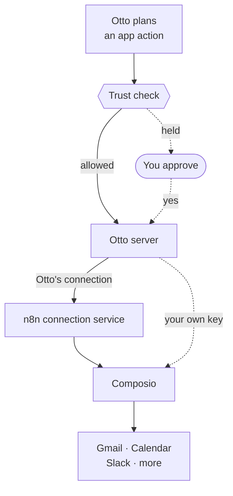
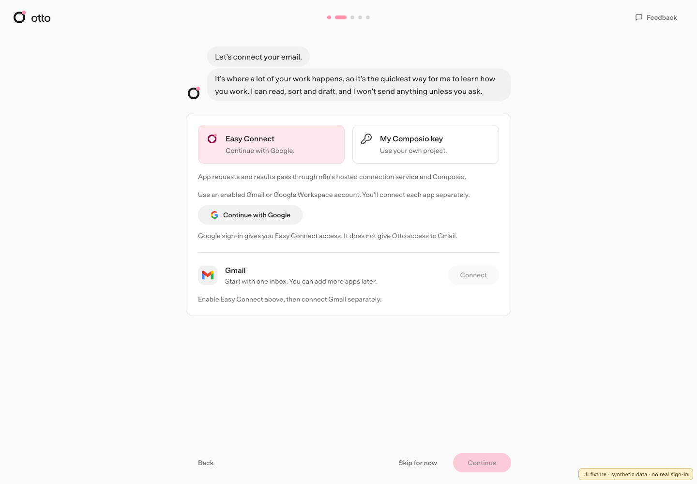
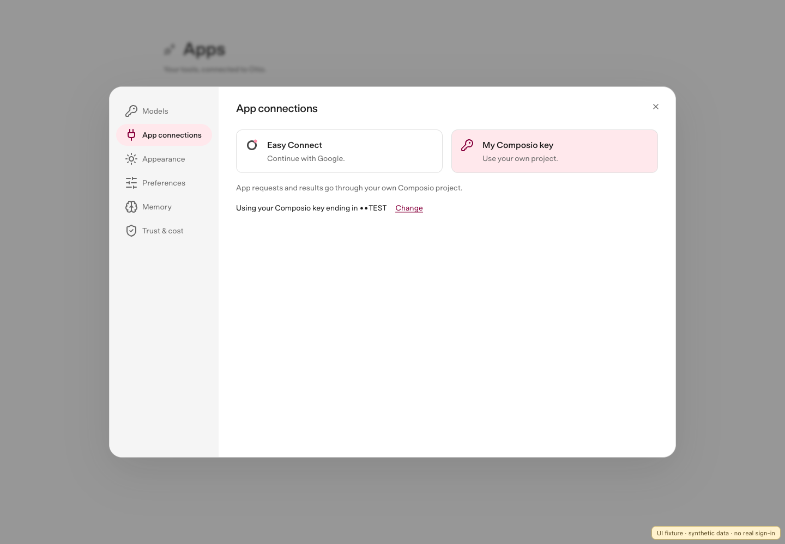

import { Steps } from '@astrojs/starlight/components';

Connect Gmail, Google Calendar, Drive, Sheets, Docs, Slack and many other apps from **Apps**. Otto uses [Composio](https://composio.dev) for these connections.

Choose **Easy Connect** and sign in with an allowed Google account, or [use your own Composio key](#use-your-own-composio-project). Both choices work in the desktop app and personal web installs, during setup and in **Settings → App connections**. Hosted web installations use the connection configured by their operator and do not offer this choice. Easy Connect uses n8n's hosted service and doesn't need your own Composio account.

Google sign-in enables Easy Connect only. It doesn't give Otto access to Gmail or another app. You connect each app separately and choose its permissions. Only explicitly allowed email addresses can use Easy Connect. If yours isn't enabled, you can use a personal key; there is no waitlist.

Composio handles each app's sign-in and runs the app actions. Otto's server checks every action before it reaches Composio. With Otto's connection, app requests and results pass through n8n's hosted connection service and Composio. With your own key, they go through your Composio project. Notion and Linear connect through their own MCP servers. See [MCP servers, APIs and CLIs](/connect/mcp-api-cli/).

## Connect your apps

<Steps>

1. Set up **Easy Connect** or **My Composio key** in **Settings → App connections**, then open **Apps**, find an app and select **Connect**.
2. Sign in on the app's consent screen and choose what Otto can access. Google's sign-in screen usually shows Composio, the service that connects the app, rather than Otto. If your own Composio project uses a custom Google auth config, it shows that config's app name instead.
3. Return to Otto when the app is connected.

</Steps>

You can also ask Otto in chat. It searches the same catalog, then sends you a private link to connect.

## Renew or remove Easy Connect access

Your installation stays admitted while its email is allowed, including for background app tasks. New app consent also needs a recent Google browser session. If that session expires while connecting an app, Otto asks you to sign in with Google, then connect the app again. This keeps your current project and connected accounts.

Removing Easy Connect access blocks managed requests from this installation. It doesn't delete connected accounts or revoke the permissions you gave each provider. Disconnect apps first if you also want to remove those grants.

## Automatic app updates

Otto checks Gmail for new mail while it's running. Otto's connection doesn't receive app webhooks, so apps such as Calendar and Slack don't wake Otto automatically. You can still ask Otto to work with them.

Source/server installs using their own Composio project can configure webhooks with `COMPOSIO_WEBHOOK_SECRET`.

## Use your own Composio project

Choose **My Composio key** during setup or in **Settings → App connections**, and paste a project key from the steps below. Otto checks the key before saving it, stores it encrypted on your installation and only shows its last four characters. App consent then uses your project without a pairing code.

The desktop app uses OS-protected storage. A local web install uses the macOS Keychain or a private per-profile key file on Linux. Other server configurations need an operator-provided Vault key. If encrypted data already exists but its key is missing, restore the original key; Otto won't replace it. See [Configuration](/deploy/configuration/#vault).

Signing in with Google while you use a personal key doesn't switch projects. Otto first verifies access, then asks you to confirm the switch. A denied or cancelled sign-in leaves your key and apps unchanged.

Connected accounts belong to the project they were connected through, and Otto never moves them between projects. When you switch between Otto's connection and your own key, Otto disconnects the apps connected through the one you're leaving, then switches. Connect them again afterwards. A sign-in you started before switching won't connect, so start it again too. If Otto can't disconnect an app, it keeps your current connection so you can try again. Apps it already disconnected stay disconnected.

If Easy Connect access has been removed or requires sign-in, you can still switch to a valid personal key. Otto removes the old connections from this installation, but can't revoke their provider permissions through the proxy. Remove those permissions in each provider's settings if needed. A network outage doesn't allow this fallback.

On a source/server install you can instead set `COMPOSIO_API_KEY` in the server environment or `.env`, then restart Otto. This pins the server to that project, so the app doesn't offer the choice. The desktop app ignores `COMPOSIO_API_KEY`.

### Create a project key

<Steps>

1. In the [Composio Dashboard](https://dashboard.composio.dev), open **Platform → your project → Settings → API Keys**.
2. Select **Create API Key** and create a scoped project key with the permissions in the table below.
3. Leave **Tools**, **Triggers**, **Webhooks**, **Observability**, **MCP (Legacy)** and **Tool execution (Legacy)** at **No access**.
4. Copy the key.

</Steps>

| Permission area        | Access         | Otto uses it to                                                     |
| ---------------------- | -------------- | ------------------------------------------------------------------- |
| Connected accounts     | Read and write | Check connections and disconnect accounts                           |
| Session management     | Read and write | Create and delete sessions, and open sign-in links                  |
| Session tool execution | Write only     | Find app actions, load their details and run them                   |
| Toolkits               | Read only      | List the apps you can connect                                       |
| Auth configs           | Read only      | Check and select your Google sign-in setup                          |
| Proxy execute (Legacy) | Write only     | Read account identity, check Gmail updates and fetch sign-in emails |

If you set `COMPOSIO_WEBHOOK_SECRET` for automatic app updates, also grant **Triggers → Read and write**.

See Composio's [project key permissions](https://docs.composio.dev/reference/authenticating-to-composio/project-api-key-permissions) for the API operations each permission allows.

:::caution[You can't edit a key's permissions]
If a permission is missing, create a new key. A valid key with missing permissions can show an "Invalid API key" error.
:::

:::caution[A saved key can still lack sign-in access]
The setup check doesn't test every permission needed to connect Gmail. Grant **Auth configs → Read only** and **Session management → Read and write**, along with the other permissions above.
:::

Keep using a key from the same project. Your connected accounts belong to that project, so a key from another project can't use them.

:::danger[Keep the key private]
The key grants access to the project's connected accounts outside Otto. Don't share it, and keep a server key in a trusted environment.
:::

The catalog needs **Toolkits → Read**. An older project key without it keeps its existing connections and the featured apps.

## Control what each app can access

The app's consent screen decides what Otto can read or change in your account.

If you use your own Composio project, two things control access:

- **The key's permissions** decide what Otto can do in Composio.
- **The app's consent screen** decides what Otto can read or change in your account. The Composio auth config sets which scopes it asks for.

To narrow an app's scopes, change them in its auth config, then reconnect the account. Changing the key doesn't change what you agreed to on the consent screen. See Composio's [Controlling scopes](https://docs.composio.dev/docs/authentication/controlling-scopes).

To choose an auth config for your own project, set `COMPOSIO_<APP>_AUTH_CONFIG_ID` in the server environment. See [Configuration](/deploy/configuration/#apps-and-composio) for the supported settings. These settings don't change Otto's connection or the Notion and Linear MCP connections.

How Otto picks a Google auth config

When Otto uses your own Composio project, it reads the project's enabled custom OAuth2 auth configs for Gmail, Calendar, Drive, Sheets or Docs. Without an explicit setting, it uses the one that's also enabled for Tool Router.

If there are several, or none of them is enabled for Tool Router, sign-in stops with a configuration error. If the project has no enabled custom OAuth2 config, Composio's default applies. A setting in `.env` always wins.

## Every action goes through the trust check

Reads and drafts run directly. Any other action runs directly only when it matches your request. Otherwise Otto asks you first. See [Approvals and the trust check](/trust/approvals/).

## Related resources

- [Models](/connect/models/)
- [MCP servers, APIs and CLIs](/connect/mcp-api-cli/)
- [Approvals and the trust check](/trust/approvals/)
- [Configuration](/deploy/configuration/)
