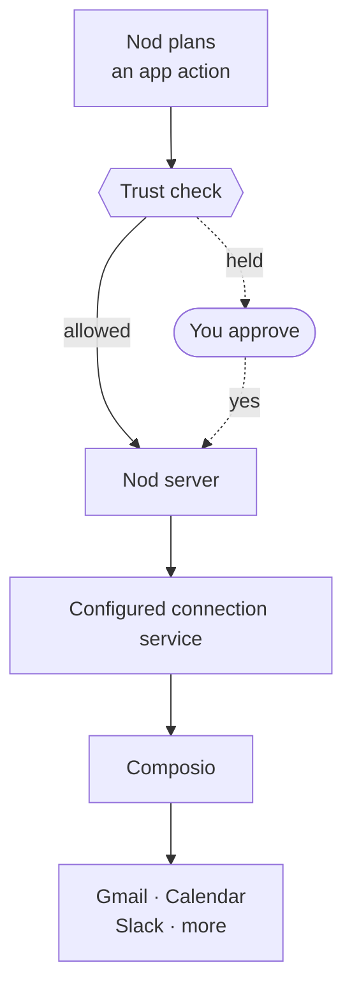

import { Steps } from '@astrojs/starlight/components';

Connect Gmail, Google Calendar, Drive, Sheets, Docs, Slack and many other apps from **Apps**. Select an app, sign in and review its permissions. Search tolerates common typos and abbreviations, and **Categories** narrows the results. Scroll to browse more apps.

During onboarding, connect **Gmail** or **Outlook** so Nod can find emails that need a reply, pull out next steps and draft responses for you to review. Select **Continue without email** to move to the next setup step without a connection. You can connect email, **Google Calendar** or **Outlook Calendar** later from **Apps**. Outlook uses the same account connection for email and calendar, subject to the permissions granted on the provider's consent screen. While signing in, progress and cancellation stay in the selected provider card. If the browser cannot open, use **Open sign-in** there; if signing in is interrupted, return to the card to try again.

After model selection, the app step lists the full catalog by category. Use **Manage** to add or remove accounts. While an app signs in, its card shows **Cancel**. You can continue without connecting any tools. A count shows connected tools, excluding email. You can also connect apps later from **Apps**.

Nod uses [Composio](https://composio.dev) for these connections. By default, app requests and results pass through n8n's hosted connection service and Composio. Source installs can [select a trusted connection service](/deploy/configuration/#apps-and-composio), and server installs and source installs other than ordinary desktop launches can [use their own OpenConnector](/deploy/configuration/#use-your-own-openconnector) instead, so app tokens and requests stay on infrastructure you run. Notion, Linear and n8n connect through their own MCP servers. See [MCP servers, APIs and CLIs](/connect/mcp-api-cli/).

## How Nod protects app connections

**Nod's default Composio project has Zero Data Retention (ZDR) enabled.** Composio does not save the content of covered app calls in its execution logs. For example, a covered email read does not leave a copy of the email text in those logs. It keeps a record of which tool ran, when it ran, and whether it succeeded. See [Composio Zero Data Retention](/trust/privacy/#composio-zero-data-retention) for what this covers and its limits.

Several controls protect each connection:

| Control                                 | What it does                                                                                                                                                                                                                                                             |
| --------------------------------------- | ------------------------------------------------------------------------------------------------------------------------------------------------------------------------------------------------------------------------------------------------------------------------ |
| **App permissions**                     | You connect each app and review the provider's permission screen. That grant sets what Composio can read or change. Some grants cover a whole mailbox.                                                                                                                   |
| **A check before each app call**        | Nod checks reads and actions before sending them to the connection service. Reads and drafts normally run. Other actions need your words, a standing instruction, or a rule that allows them. Otherwise, Nod asks. A rule to ask first also applies to reads and drafts. |
| **Signed requests and account checks**  | Each installation signs requests with its own private key. The connection service holds the public key. Nod checks that the account belongs to the current owner. An account ID alone grants no access.                                                                  |
| **Credentials outside the model**       | Composio holds the access tokens that keep the app connected. These tokens do not enter Nod's prompts, workspace, or browser.                                                                                                                                            |
| **App content cannot grant permission** | Nod marks app results as untrusted data. The trust check sees your words and the proposed action, never the app results. An email cannot authorize an action.                                                                                                            |
| **A record you can review**             | [Usage](/use/spending/) shows app actions and the words that allowed them while the source message exists. You can [disconnect an account](#manage-connected-accounts) or revoke access in the provider's settings.                                                      |

Each signed request carries the time it was signed. If your computer's clock is wrong, the connection service refuses the request. Nod then uses the time the service reports and signs that request once more.

Composio documents credential encryption with AES-256-GCM and TLS for data in transit. Its [security documentation](https://docs.composio.dev/docs/security/overview) explains these controls. Its [Trust Center](https://trust.composio.dev/) provides security reports and its subprocessor list.

With the default setup, app requests and results pass through n8n's connection service and Composio. Other setups use the connection service their operator selects. ZDR limits storage for covered calls. It does not reduce OAuth permissions or set retention for your model provider, destination apps, or Nod's local data. The trust check uses a model and can make mistakes. See the [Security review guide](/trust/security-review/) for the wider boundaries.

The trust check protects requests made through Nod. It cannot block someone who uses a stolen app token outside Nod. The permissions you grant remain the limit of what that token can do. Review those permissions and revoke access in the provider's settings when you no longer need the connection.

## Connect your apps

Browse [custom connections](/connect/community-apps/) for apps that use their own MCP servers. To add a community or partner app, follow [Creating your own connectors](/contribute/apps/).

These steps apply to apps connected through Composio, such as Gmail and Outlook. For Notion, Linear, n8n and other MCP apps, follow [MCP servers, APIs and CLIs](/connect/mcp-api-cli/).

<Steps>

1. Open **Apps**, find an app and select **Connect**.
2. Read the data handling notice, then select **Continue to sign in**. No remote connection starts before this step. With your own OpenConnector, app data doesn't pass through Composio, so this notice is skipped.
3. Sign in on the app's consent screen and choose what Nod can access. The screen may show Composio, the service that connects the app, instead of Nod. With your own OpenConnector, it shows the OAuth app your server operator registered.
4. Return to Nod when the app is connected.

</Steps>

You can also ask Nod in chat. It searches the same catalog with your saved account status, so it can use an existing connection or explain the available recovery steps when an account is unavailable. When you need a new connection, it sends you a private connection link, shown as a connect button in Nod. Sign-in links never go through Telegram or WhatsApp: there, Nod asks you to open Nod, where the button waits in the chat.

Use **Ask Nod** in the **Connect another tool** card below the catalog to get help connecting a tool. It opens chat with your search included, so Nod can guide the setup. If you already have an MCP server address, use **Connect MCP** at the top of the page.

For Composio apps, the data handling notice appears in the desktop app and on a self-hosted server. This includes installs that use a custom connection service. It also appears for connection links from chat, onboarding and reconnection. App content, including email messages, passes through the connection service and Composio when Nod reads or sends it. Both services can read this content. See [data handling and retention](/trust/privacy/#composio-zero-data-retention).

The sign-in dialog closes automatically once Nod confirms the connection.

After you connect from **Apps**, the success notice has an **Open chat** button. Select it to give Nod a task. Your current draft stays in place. Opening chat does not send a message or start work.

If sign-in fails or the link is unavailable, select **Try again** to open a fresh sign-in window. Nod stops waiting as soon as the sign-in page can't start or closes, such as after a restart. If you closed the browser before finishing, select **Start again**. Finish in the newest window; a replaced link can no longer complete sign-in. If sign-in is already finishing, Nod keeps waiting for that result instead of starting another consent flow.

Some browsers preview a link before showing the page. The same live sign-in link remains usable after a preview, until sign-in starts.

The browser confirms which app connected. If the page stays open, select **Return to Nod**. After a failed sign-in, use the same button to check the connection and try again.

Expired chat cards keep the app's name and icon, but their connection button is disabled; ask Nod for a new link. Your existing setup progress stays saved.

## Manage connected accounts

Connected cards in **Apps** show an account count beside the people icon. Select it to review account identities, reconnect or disconnect accounts. When **Add account** is available there, select it to connect another account. Disconnecting removes Nod's access through that connection. You can also review or revoke access in the provider's settings.

Select **Reconnect** to sign in to a saved account again. The control is available when the provider supports it, including while the account is connected. This lets you complete consent again after its permissions change. It keeps the saved account and its settings. Otherwise, if **Add account** is available, use it to create an additional connection without removing the old account. Nod starts an additional connection only when you ask. **Sign-in unavailable** means the provider is not configured or does not support that app. Ask your server operator to check the [connection-service setup](/deploy/configuration/#apps-and-composio).

When access is blocked, Nod is instructed to identify the account and unavailable coverage, deliver completed work and explain the supported next step.

## Automatic app updates

Nod checks Gmail for new mail while it's running, through Composio or your OpenConnector. The connection service doesn't receive app webhooks, so apps such as Calendar and Slack don't wake Nod automatically. You can still ask Nod to work with them.

## When the connection service is busy

All apps connected through the connection service share one allowance for your Nod install. When the service answers HTTP 429 (too many requests) or 503 (unavailable), Nod pauses background reads of all those apps. The pause lasts as long as the service's `Retry-After` header asks, up to 15 minutes. Without that header, the wait starts at one minute. A later refusal doubles it only if that request started after the previous refusal arrived. The wait can grow to 30 minutes. Refusals from requests already in flight do not each add a step. A successful app request that starts after the latest refusal ends the pause.

When the connection service reports its own rate limit or outage during a Gmail inbox check, Nod waits instead of trying that check again immediately. It keeps its cursor and any completed messages for a later check.

During the pause:

- A read you ask for, in chat or a task you started, still tries once. If the service refuses it, the same wait rules apply.
- An action, such as sending an email, fails at once with the time the pause ends. Nod doesn't send it, so it can't run twice. Ask again after that time.
- Background checks, scheduled reads and reads in tasks Nod starts skip these apps. They can try again later.

Errors name the service's reason, such as `installation_busy`, and the HTTP status. MCP servers, APIs, CLIs and local files don't use the connection service, so the pause doesn't affect them.

## Control what each app can access

The app's consent screen decides what Nod can read or change in your account. Review it before connecting.

The connection service's operator selects the Composio auth configuration and scopes requested for each app. If a scope is missing from that configuration, reconnecting alone can't add it. The operator must update the configuration before you reconnect. See Composio's [Controlling scopes](https://docs.composio.dev/docs/authentication/controlling-scopes).

When an action needs a missing permission, Nod is instructed to explain the blocked action, preserve prepared work and compare supported recovery options. It asks before changing the requested result, method or account unless you already chose that recovery path.

A connected account can still lack permission for an action. When the provider reports insufficient scopes, Nod keeps the account connected and gives account-specific recovery guidance. Browser sign-in doesn't add permissions to that API connection. Other permitted actions remain available.

## Every action goes through the trust check

Reads and drafts run directly. Any other action runs directly only when it's part of what you asked for, or what a schedule's instruction, your [standing instruction](/trust/approvals/#standing-instructions) or [your rules](/trust/approvals/#your-rules) allow. Otherwise, or when a rule says to ask first, Nod asks you first. See [Approvals and the trust check](/trust/approvals/).

Nod changes your apps only as far as you ask. Ask what needs a reply and it tells you and offers to draft one; ask it to handle an email and it prepares the draft. Background work drafts by default and does more only as your [standing instruction](/trust/approvals/#standing-instructions) says.

## Related resources

- [Local files](/connect/local-files/)
- [Computer use](/connect/computer-use/)
- [Models](/connect/models/)
- [MCP servers, APIs and CLIs](/connect/mcp-api-cli/)
- [Approvals and the trust check](/trust/approvals/)
- [Your data and privacy](/trust/privacy/)
