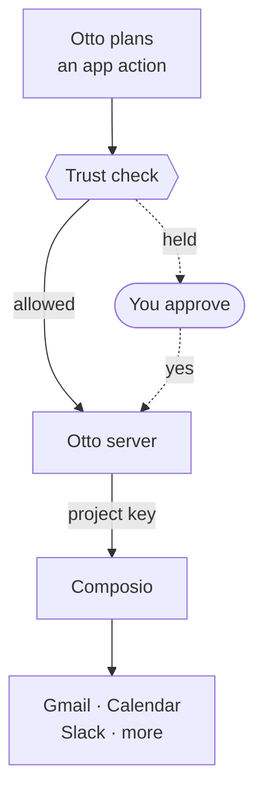
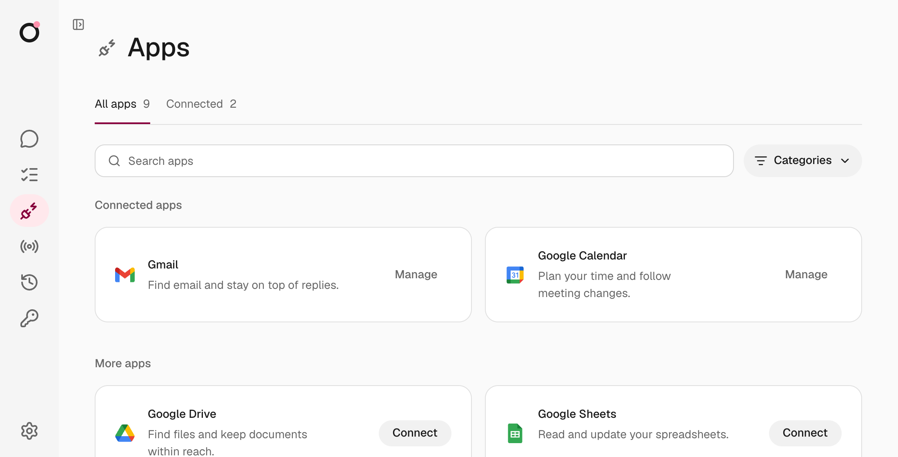

import { Steps, TabItem, Tabs } from '@astrojs/starlight/components';

Otto connects to Gmail, Google Calendar, Drive, Sheets, Docs, Slack and many other apps through [Composio](https://composio.dev). You need your own Composio project and a project API key.

Composio handles each app's sign-in and runs the app actions. Otto's server checks every action before it reaches Composio. Notion and Linear don't need Composio. See [MCP servers, APIs and CLIs](/connect/mcp-api-cli/).

## Create a project key

<Steps>

1. In the [Composio Dashboard](https://dashboard.composio.dev), open **Platform → your project → Settings → API Keys**.
2. Select **Create API Key** and create a scoped project key with the permissions in the table below.
3. Leave **Tools**, **Triggers**, **Webhooks**, **Observability**, **MCP (Legacy)** and **Tool execution (Legacy)** at **No access**.
4. Copy the key.

</Steps>

| Permission area        | Access         | Otto uses it to                                                     |
| ---------------------- | -------------- | ------------------------------------------------------------------- |
| Connected accounts     | Read and write | Check connections and disconnect accounts                           |
| Session management     | Read and write | Create, restore and delete sessions, and open sign-in links         |
| Session tool execution | Write only     | Find app actions, load their details and run them                   |
| Toolkits               | Read only      | List the apps you can connect                                       |
| Auth configs           | Read only      | Pick your custom Google sign-in setup                               |
| Proxy execute (Legacy) | Write only     | Read account identity, check Gmail updates and fetch sign-in emails |

If you set `COMPOSIO_WEBHOOK_SECRET` for automatic app updates, also grant **Triggers → Read and write**.

:::caution[You can't edit a key's permissions]
If a permission is missing, create a new key. A valid key with missing permissions can show an "Invalid API key" error.
:::

## Add the key to Otto

Otto checks the key with Composio and saves it encrypted with the Vault key.

<Tabs syncKey="install">
<TabItem label="Desktop app">

Paste the key in the **Paste your Composio key** step of onboarding. Or open **Settings → Models**, find **App connections**, paste it into **Composio API key** and select **Save key**. If Otto shows **Apply changes**, select it.

</TabItem>
<TabItem label="From source">

Paste the key in the **Paste your Composio key** step of onboarding, or in the **Composio API key** form that the **Apps** page shows until a key is set. Or set `COMPOSIO_API_KEY` in `.env` and restart Otto.

</TabItem>
</Tabs>

Keep using a key from the same project. Your connected accounts belong to that project, so a key from another project can't use them.

:::danger[Keep the key private]
The key grants project-wide access. Anyone who has it, including anyone who can open Otto's desktop settings, can use the project and its connected accounts outside Otto. Use your own project, and share a key only with people you'd trust with every account in it.
:::

## Connect your apps

Open **Apps**, search for an app and select **Connect**. You sign in on the app's own consent screen.

You can also ask Otto in chat. It searches the same catalog with `manage_apps discover`, then sends you a private link to connect.

The catalog lists Composio apps that have managed sign-in or dynamic OAuth registration. It needs **Toolkits → Read**. An older key without it keeps its existing connections and the featured apps.

## Control what each app can access

Two things decide what Otto can do in an app:

- **The key's permissions** decide what Otto can do in Composio.
- **The app's consent screen** decides what Otto can read or change in your account. The Composio auth config sets which scopes it asks for.

To narrow an app's scopes, change them in its auth config, then reconnect the account. Changing the key doesn't change what you agreed to on the consent screen. See Composio's [Controlling scopes](https://docs.composio.dev/docs/authentication/controlling-scopes).

To choose an auth config, set `COMPOSIO_<APP>_AUTH_CONFIG_ID` in `.env`, where `<APP>` is `GMAIL`, `CALENDAR`, `DRIVE`, `SHEETS`, `DOCS`, `SLACK` or `NOTION`.

How Otto picks a Google auth config

When you connect Gmail, Calendar, Drive, Sheets or Docs without a setting, Otto reads your project's enabled custom OAuth2 auth configs for that app. It uses the one that's also enabled for Tool Router.

If there are several, or none of them is enabled for Tool Router, sign-in stops with a configuration error. If the project has no enabled custom OAuth2 config, Composio's default applies. A setting in `.env` always wins.

## Every action goes through the trust check

Reads and drafts run directly. Any other action runs directly only when it matches your request. Otherwise Otto asks you first. See [Approvals and the trust check](/trust/approvals/).

## Related resources

- [Models](/connect/models/)
- [MCP servers, APIs and CLIs](/connect/mcp-api-cli/)
- [Approvals and the trust check](/trust/approvals/)
- [Configuration](/deploy/configuration/)
