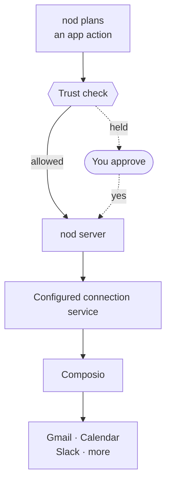

import { Steps } from '@astrojs/starlight/components';

Connect Gmail, Google Calendar, Drive, Sheets, Docs, Slack and many other apps from **Apps**. Select an app, sign in and review its permissions.

During onboarding, select **Connect Gmail** and choose an inbox. Setup continues when the connection is confirmed. Add other apps later from **Apps**.

nod uses [Composio](https://composio.dev) for these connections. By default, app requests and results pass through n8n's hosted connection service and Composio. Source installs can [select a trusted connection service](/deploy/configuration/#apps-and-composio). nod checks each action before it reaches the connection service. Notion, Linear and n8n connect through their own MCP servers. See [MCP servers, APIs and CLIs](/connect/mcp-api-cli/).

## Connect your apps

<Steps>

1. Open **Apps**, find an app and select **Connect**.
2. Sign in on the app's consent screen and choose what nod can access. The screen may show Composio, the service that connects the app, instead of nod.
3. Return to nod when the app is connected.

</Steps>

You can also ask nod in chat. It searches the same catalog, then sends you a private connection link, shown as a connect button in nod.

If sign-in fails or expires, start a new connection. Your existing setup progress stays saved.

## Manage connected accounts

Open an app in **Apps** to see its connected accounts, add another account, reconnect or disconnect an account. Disconnecting removes nod's access through that connection. You can also review or revoke access in the provider's settings.

After updating to this connection service, reconnect your apps in **Apps**. Your conversations, settings and onboarding progress remain in your profile.

## Automatic app updates

nod checks Gmail for new mail while it's running. The connection service doesn't receive app webhooks, so apps such as Calendar and Slack don't wake nod automatically. You can still ask nod to work with them.

## Control what each app can access

The app's consent screen decides what nod can read or change in your account. Review it before connecting.

The connection service's operator selects the Composio auth configuration and scopes requested for each app. If a scope is missing from that configuration, reconnecting alone can't add it. The operator must update the configuration before you reconnect. See Composio's [Controlling scopes](https://docs.composio.dev/docs/authentication/controlling-scopes).

When an action needs a missing permission, nod is instructed to explain the blocked action, preserve prepared work and compare supported recovery options. It asks before changing the requested result, method or account unless you already chose that recovery path.

## Every action goes through the trust check

Reads and drafts run directly. Any other action runs directly only when it's part of what you asked for, or what a schedule's instruction, your [standing instruction](/trust/approvals/#standing-instructions) or [your rules](/trust/approvals/#your-rules) allow. Otherwise, or when a rule says to ask first, nod asks you first. See [Approvals and the trust check](/trust/approvals/).

nod changes your apps only as far as you ask. Ask what needs a reply and it tells you and offers to draft one; ask it to handle an email and it prepares the draft. Background work drafts by default and does more only as your [standing instruction](/trust/approvals/#standing-instructions) says.

## Related resources

- [Models](/connect/models/)
- [MCP servers, APIs and CLIs](/connect/mcp-api-cli/)
- [Approvals and the trust check](/trust/approvals/)
- [Your data and privacy](/trust/privacy/)
