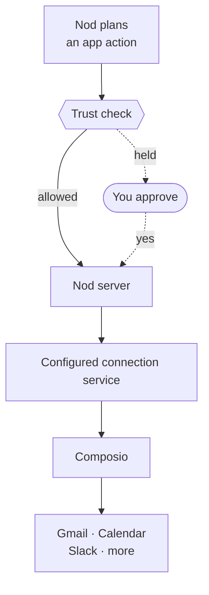

import { Steps } from '@astrojs/starlight/components';

Connect Gmail, Google Calendar, Drive, Sheets, Docs, Slack and many other apps from **Apps**. Select an app, sign in and review its permissions. Search tolerates common typos and abbreviations, and **Categories** narrows the results. Scroll to browse more apps.

During onboarding, connect **Gmail** or **Outlook** so Nod can find emails that need a reply, pull out next steps and draft responses for you to review. Then connect **Google Calendar** or **Outlook Calendar** to work with upcoming meetings and available time. Outlook uses the same account connection for email and calendar, so an account connected in the email step is already shown in the calendar step. The permissions granted on the provider's consent screen still apply. Both steps are optional and have **Skip for now**. While signing in, progress and cancellation stay in the selected provider card. If the browser cannot open, use **Open sign-in** there; if signing in is interrupted, return to the card to try again.

After model selection, the app step lists the full catalog by category. Use **Manage** to add or remove accounts. You can continue without connecting any tools. A count shows connected tools, excluding email. You can also connect apps later from **Apps**.

Nod uses [Composio](https://composio.dev) for these connections. By default, app requests and results pass through n8n's hosted connection service and Composio. Source installs can [select a trusted connection service](/deploy/configuration/#apps-and-composio). Nod checks each action before it reaches the connection service. Notion, Linear and n8n connect through their own MCP servers. See [MCP servers, APIs and CLIs](/connect/mcp-api-cli/).

## Connect your apps

<Steps>

1. Open **Apps**, find an app and select **Connect**.
2. Sign in on the app's consent screen and choose what Nod can access. The screen may show Composio, the service that connects the app, instead of Nod.
3. Return to Nod when the app is connected.

</Steps>

You can also ask Nod in chat. It searches the same catalog, then sends you a private connection link, shown as a connect button in Nod.

If sign-in fails or the link is unavailable, select **Try again** to open a fresh sign-in window. In Apps, the same dialog keeps the account in view and confirms when it connects. If you closed the browser before finishing, select **Start again**. Finish in the newest window; a replaced link can no longer complete sign-in.

The browser's **Return to Nod** button takes you back to check the connection. If you started in the desktop app, it reopens Nod, including when you're connected to your own server.

Expired chat cards keep the app's name and icon, but their connection button is disabled; ask Nod for a new link. Your existing setup progress stays saved.

## Manage connected accounts

Open an app in **Apps** to see its connected accounts, add another account, reconnect or disconnect an account. Disconnecting removes Nod's access through that connection. You can also review or revoke access in the provider's settings.

If an account needs sign-in, select **Reconnect** when offered. It keeps the saved account and its settings. Otherwise, if **Add account** is available, use it to create an additional connection without removing the old account. Nod starts an additional connection only when you ask. **Sign-in unavailable** means the provider is not configured or does not support that app. Ask your server operator to check the [connection-service setup](/deploy/configuration/#apps-and-composio).

When access is blocked, Nod is instructed to identify the account and unavailable coverage, deliver completed work and explain the supported next step.

## Automatic app updates

Nod checks Gmail for new mail while it's running. The connection service doesn't receive app webhooks, so apps such as Calendar and Slack don't wake Nod automatically. You can still ask Nod to work with them.

## Control what each app can access

The app's consent screen decides what Nod can read or change in your account. Review it before connecting.

The connection service's operator selects the Composio auth configuration and scopes requested for each app. If a scope is missing from that configuration, reconnecting alone can't add it. The operator must update the configuration before you reconnect. See Composio's [Controlling scopes](https://docs.composio.dev/docs/authentication/controlling-scopes).

When an action needs a missing permission, Nod is instructed to explain the blocked action, preserve prepared work and compare supported recovery options. It asks before changing the requested result, method or account unless you already chose that recovery path.

A connected account can still lack permission for an action. When the provider reports insufficient scopes, Nod keeps the account connected and gives account-specific recovery guidance. Browser sign-in doesn't add permissions to that API connection. Other permitted actions remain available.

## Every action goes through the trust check

Reads and drafts run directly. Any other action runs directly only when it's part of what you asked for, or what a schedule's instruction, your [standing instruction](/trust/approvals/#standing-instructions) or [your rules](/trust/approvals/#your-rules) allow. Otherwise, or when a rule says to ask first, Nod asks you first. See [Approvals and the trust check](/trust/approvals/).

Nod changes your apps only as far as you ask. Ask what needs a reply and it tells you and offers to draft one; ask it to handle an email and it prepares the draft. Background work drafts by default and does more only as your [standing instruction](/trust/approvals/#standing-instructions) says.

## Related resources

- [Models](/connect/models/)
- [MCP servers, APIs and CLIs](/connect/mcp-api-cli/)
- [Approvals and the trust check](/trust/approvals/)
- [Your data and privacy](/trust/privacy/)
