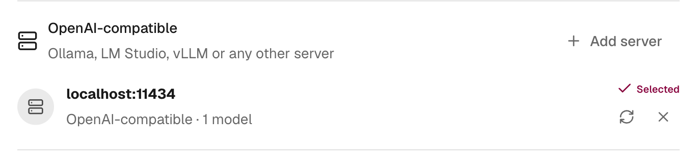

import { Steps, TabItem, Tabs } from '@astrojs/starlight/components';

nod can use a model that runs on your own computer, or on any server with an OpenAI-compatible API. Model requests then go only to the address you enter, and a local model costs nothing per request.

Local models work in the [desktop app](/get-started/install-desktop/) and [source installs](/get-started/install-from-source/).

:::caution[Your model also decides when nod asks you]
nod's [trust check](/trust/approvals/) runs on your selected model. It decides whether your words cover each app action, website step and sign-in, or whether nod asks you first. Smaller models make that call less reliably: they can ask more often, or run something you didn't ask for. Use the largest model your computer runs well.
:::

## Before you start

You need two things from the model server:

- **A model that supports tool calls.** nod does all its work through tools, so a model without them can only chat.
- **At least 64,000 tokens of context.** nod's instructions and tools take about 20,000 tokens before your first message. Most servers start with 4,096, and some cut nod's instructions off without an error.

## Set up your server

<Tabs syncKey="local-server">
<TabItem label="Ollama">

<Steps>

1. Install [Ollama](https://ollama.com) and pull a model that supports tools. On ollama.com, filter models by **Tools**.

   ```sh title="Terminal"
   ollama pull gpt-oss:20b
   ```

2. Start Ollama with a larger context. In the Ollama app, set **Context length** in **Settings** instead.

   ```sh title="Terminal"
   OLLAMA_CONTEXT_LENGTH=65536 ollama serve
   ```

3. Use the address `http://localhost:11434/v1` in nod.

</Steps>

nod reads each Ollama model's details. It lists only models that support tools, sends images to vision models, offers the model's thinking levels and uses its context length.

</TabItem>
<TabItem label="LM Studio">

<Steps>

1. In [LM Studio](https://lmstudio.ai), download a model that supports tools.
2. Load it with **Context Length** set to 65,536 or more.
3. Start the server from the **Developer** tab, or run `lms server start`.
4. Use the address `http://localhost:1234/v1` in nod.

</Steps>

With LM Studio 0.4 or later, nod reads each model's details. It skips embedding models and models not trained for tool use, sends images to vision models and uses the context length the model is loaded with, so the model list shows when that's too small.

</TabItem>
<TabItem label="vLLM">

<Steps>

1. Start [vLLM](https://docs.vllm.ai) with tool calls on. Choose the [tool call parser](https://docs.vllm.ai/en/latest/features/tool_calling.html) that matches your model.

   ```sh title="Terminal"
   vllm serve <model> --max-model-len 65536 --enable-auto-tool-choice --tool-call-parser <parser>
   ```

2. Use the address `http://localhost:8000/v1` in nod. If you started vLLM with `--api-key`, add that key too.

</Steps>

</TabItem>
<TabItem label="llama.cpp">

<Steps>

1. Start [llama.cpp](https://github.com/ggml-org/llama.cpp)'s server. `--jinja` turns on tool calls.

   ```sh title="Terminal"
   llama-server -m <model>.gguf -c 65536 --jinja
   ```

2. Use the address `http://localhost:8080/v1` in nod.

</Steps>

</TabItem>
</Tabs>

## Connect nod

<Steps>

1. Open the account menu, select **Models**, then select **Add server** next to **OpenAI-compatible**. During onboarding, select **More providers**, then **Your own server**.
2. Check the **Server address**. nod fills in Ollama's address, `http://localhost:11434/v1`. If you leave out `/v1`, nod tries it for you.
3. Add an **API key** only if the server needs one.
4. Select **Save connection**, or **Connect** during onboarding.

</Steps>


nod checks the address by listing the server's models. The connection shows the server's host, such as `localhost:11434`. If you haven't chosen a model yet, nod selects the server's first one. To switch, open **Settings → Models** and choose a model.



After you pull or load another model, select the refresh button next to the connection. To change a server's key, add the same address again: nod updates that connection instead of adding a second one.

## Set the server in `.env`

In a source install, you can set the server in `.env` instead of in the app. It then shows **Server settings** in **Models**, and you remove it from `.env`.

```sh title=".env"
LLM_PROVIDER=compatible
OPENAI_COMPATIBLE_BASE_URL=http://localhost:11434/v1
OPENAI_COMPATIBLE_API_KEY=
LLM_MODEL=gpt-oss:20b
```

Leave `OPENAI_COMPATIBLE_API_KEY` empty if the server doesn't need a key, and `LLM_MODEL` empty to use the server's first model. Restart nod after you edit `.env`. If the server isn't running when nod starts, start it and select the refresh button next to the connection. See [Configuration](/deploy/configuration/#models).

## Other OpenAI-compatible services

The same connection works with hosted services that offer an OpenAI-compatible API. Enter the service's address and your API key.

| Service     | Address                          |
| ----------- | -------------------------------- |
| Groq        | `https://api.groq.com/openai/v1` |
| Together AI | `https://api.together.xyz/v1`    |
| DeepSeek    | `https://api.deepseek.com/v1`    |

nod lists every model such a service returns, including ones that can't chat. Pick a chat model that supports tools.

## What changes with these connections

| Area                | With a local or OpenAI-compatible model                                                                                                                                                        |
| ------------------- | ---------------------------------------------------------------------------------------------------------------------------------------------------------------------------------------------- |
| Spending            | nod doesn't know the server's prices, so it records each request at $0. That usage doesn't count toward the [monthly limit or task check-ins](/use/spending/). A paid service still bills you. |
| Images              | Ollama and LM Studio models that support vision get screenshots and images. Models on other servers get text only.                                                                             |
| Thinking levels     | Only Ollama models offer them. Other servers use the model's own default.                                                                                                                      |
| Decision checks     | Your selected model reads your replies to confirmations and checks emails that give account access. See [Decision checks](/connect/models/#decision-checks).                                   |
| Background work     | Memory upkeep and other background work use your selected model.                                                                                                                               |
| Where requests go   | Model requests go only to the address you enter. Web search, websites, your apps and chat channels work as before. See [Your data and privacy](/trust/privacy/).                               |
| Where your key goes | An API key stays in nod's encrypted key store and is added to each request by the nod server, like any other model key. See [Where your keys go](/connect/models/#where-your-keys-go).         |

## Troubleshooting

| Problem                                                       | Fix                                                                                                                                            |
| ------------------------------------------------------------- | ---------------------------------------------------------------------------------------------------------------------------------------------- |
| **nod couldn’t list this server’s models**                    | Check that the server is running, and that the address and API key are right. `curl http://localhost:11434/v1/models` should list your models. |
| **This server has no models nod can use**                     | nod needs a model with tool support, and from Ollama it lists only those. Pull or load one, then try again.                                    |
| nod ignores your request, forgets its tools or repeats itself | The context is too small. Raise it to 65,536 or more and reload the model.                                                                     |
| A new model doesn't appear                                    | Select the refresh button next to the connection.                                                                                              |
| **Can’t load its models** next to a server set in `.env`      | Start the server, then select the refresh button next to the connection.                                                                       |
| **Remove it and add the server again**                        | nod can't read the connection's saved settings. Remove the connection, then add the server again in **Models**.                                |
| nod asks before almost everything, or acts without asking     | The model is too small for the trust check. Switch to a larger model.                                                                          |

## Related resources

- [Models](/connect/models/)
- [Approvals and the trust check](/trust/approvals/)
- [Spending](/use/spending/)
- [Your data and privacy](/trust/privacy/)
