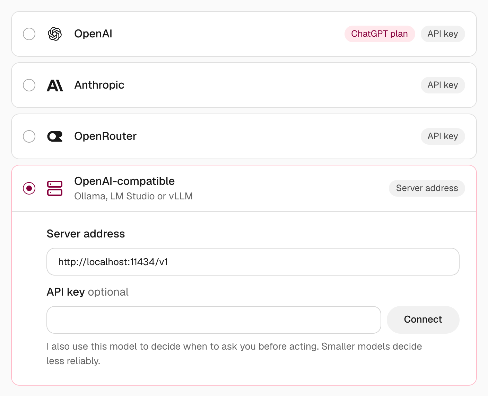

import { Steps, TabItem, Tabs } from '@astrojs/starlight/components';

Nod can use a model that runs on your own computer, or on any server with an OpenAI-compatible API. Your chat requests go to the address you enter. Trust checks use a known small model or a decision service and can have API costs. Their inputs go to that checker service.

Local models work in the [desktop app](/get-started/install-desktop/), [source installs](/get-started/install-from-source/), and [self-hosted servers](/deploy/self-host/).

The model server must be reachable from Nod's server. On a remote install, `localhost` refers to that server; inside Docker, it refers to Nod's container.

:::caution[Connect a Trust checker]
By default, Nod's [trust check](/trust/approvals/) uses your local model at its lowest reasoning setting, and smaller models decide less reliably. You can choose a small model from another connection or a decision service as the [action checker](/connect/models/#select-the-action-checker) instead. Your local model still writes and checks confirmation questions.
:::

## Before you start

You need two things from the model server:

- **A model that supports tool calls.** Nod does all its work through tools, so a model without them can only chat.
- **At least 64,000 tokens of context.** Nod's instructions and tools take about 20,000 tokens before your first message. Most servers start with 4,096, and some cut Nod's instructions off without an error.

## Set up your server

<Tabs syncKey="local-server">
<TabItem label="Ollama">

<Steps>

1. Install [Ollama](https://ollama.com) and pull a model that supports tools. On ollama.com, filter models by **Tools**.

   ```sh title="Terminal"
   ollama pull gpt-oss:20b
   ```

2. Start Ollama with a larger context. In the Ollama app, set **Context length** in **Settings** instead.

   ```sh title="Terminal"
   OLLAMA_CONTEXT_LENGTH=65536 ollama serve
   ```

3. Use the address `http://localhost:11434/v1` in Nod.

</Steps>

Nod reads each Ollama model's details. It lists only models that support tools, sends images to vision models, offers the model's thinking levels and uses its context length.

</TabItem>
<TabItem label="LM Studio">

<Steps>

1. In [LM Studio](https://lmstudio.ai), download a model that supports tools.
2. Load it with **Context Length** set to 65,536 or more.
3. Start the server from the **Developer** tab, or run `lms server start`.
4. Use the address `http://localhost:1234/v1` in Nod.

</Steps>

With LM Studio 0.4 or later, Nod reads each model's details. It skips embedding models and models not trained for tool use, sends images to vision models and uses the context length the model is loaded with, so the model list shows when that's too small.

</TabItem>
<TabItem label="vLLM">

<Steps>

1. Start [vLLM](https://docs.vllm.ai) with tool calls on. Choose the [tool call parser](https://docs.vllm.ai/en/latest/features/tool_calling.html) that matches your model.

   ```sh title="Terminal"
   vllm serve <model> --max-model-len 65536 --enable-auto-tool-choice --tool-call-parser <parser>
   ```

2. Use the address `http://localhost:8000/v1` in Nod. If you started vLLM with `--api-key`, add that key too.

</Steps>

</TabItem>
<TabItem label="llama.cpp">

<Steps>

1. Start [llama.cpp](https://github.com/ggml-org/llama.cpp)'s server. `--jinja` turns on tool calls.

   ```sh title="Terminal"
   llama-server -m <model>.gguf -c 65536 --jinja
   ```

2. Use the address `http://localhost:8080/v1` in Nod.

</Steps>

</TabItem>
</Tabs>

## Connect Nod

<Steps>

1. Open **Settings → Models**, select **Add connection** or **Add**, then choose **OpenAI-compatible**. During onboarding, select **More providers**, then **Your own server**.
2. Check the **Server address**. Nod fills in Ollama's address, `http://localhost:11434/v1`. If you leave out `/v1`, Nod tries it for you.
3. Add an **API key** only if the server needs one.
4. Select **Connect**.

</Steps>



Nod checks the address by listing the server's models. The connection shows the server's host, such as `localhost:11434`. If you haven't chosen a model yet, Nod selects the server's first one. To switch, open **Settings → Models** and choose a model.

After you pull or load another model, or to change a server’s key, open **Manage** beside **OpenAI-compatible** and add the same address again. Nod updates that connection instead of adding a second one.

## Set the server in `.env`

In a source install or self-hosted server, you can set the model server in `.env` instead of in the app. It then shows **Server settings** in **Models**. Remove `OPENAI_COMPATIBLE_BASE_URL` to remove this connection.

```sh title=".env"
LLM_PROVIDER=compatible
OPENAI_COMPATIBLE_BASE_URL=http://localhost:11434/v1
OPENAI_COMPATIBLE_API_KEY=
LLM_MODEL=gpt-oss:20b
```

Leave `OPENAI_COMPATIBLE_API_KEY` empty if the server doesn't need a key, and `LLM_MODEL` empty to use the server's first model. After editing `.env`, [apply the configuration change](/deploy/configuration/#how-settings-work). If the server isn't running when Nod starts, start it, open **Manage** beside **OpenAI-compatible**, then select **Load models** or **Try again**.

## Other OpenAI-compatible services

For services listed in **Models**, such as Groq, Together AI, and DeepSeek, use the [named provider connection](/connect/models/). It includes the provider's model capabilities and prices.

Use an OpenAI-compatible connection for other hosted services that offer this API. Enter the service's address and your API key.

Nod lists every model such a service returns, including ones that can't chat. Pick a chat model that supports tools.

## What changes with these connections

| Area                | With a local or OpenAI-compatible model                                                                                                                                                                                                |
| ------------------- | -------------------------------------------------------------------------------------------------------------------------------------------------------------------------------------------------------------------------------------- |
| Spending            | Nod doesn't know the server's prices, so **Usage** shows its requests as **No price**. That usage doesn't count toward the [monthly limit or task check-ins](/use/spending/#how-each-model-is-priced). A paid service still bills you. |
| Images              | Ollama and LM Studio models that support vision get screenshots and images. Models on other servers get text only.                                                                                                                     |
| Thinking levels     | Only Ollama models offer them. Other servers use the model's own default.                                                                                                                                                              |
| Decision checks     | Trust uses a separate small model or decision service. Email checks use the background model unless a decision service is available. See [Decision checks](/connect/models/#decision-checks).                                          |
| Background work     | Memory upkeep and other background work use your selected model.                                                                                                                                                                       |
| Slow replies        | A slow first reply is normal. The chat shows a rotating word, such as **Joining the dots…**, with how long it has been quiet. If the server sends nothing at all for 30 minutes, Nod stops waiting and says the request failed.        |
| Where requests go   | Chat requests go to the address you enter. Trust requests go to the checker connection. Web search, websites, apps and chat channels work as before. See [Your data and privacy](/trust/privacy/).                                     |
| Where your key goes | Keys saved in **Models** are encrypted. Keys from `.env` stay in server configuration and memory. The server adds the key to requests. See [Where your keys go](/connect/models/#where-your-keys-go).                                  |

## Troubleshooting

| Problem                                                       | Fix                                                                                                                                                      |
| ------------------------------------------------------------- | -------------------------------------------------------------------------------------------------------------------------------------------------------- |
| **Nod couldn’t list this server’s models**                    | Check that the server is running, and that the address and API key are right. `curl http://localhost:11434/v1/models` should list your models.           |
| **This server has no models Nod can use**                     | Nod needs a model with tool support, and from Ollama it lists only those. Pull or load one, then try again.                                              |
| Nod ignores your request, forgets its tools or repeats itself | The context is too small. Raise it to 65,536 or more and reload the model.                                                                               |
| A new model doesn't appear on a server added in Settings      | Open **Manage** next to the connection, choose **Add connection**, then enter the same server address and API key, if used. This updates its model list. |
| **Can’t load its models** next to a server set in `.env`      | Start the server, open **Manage** next to the connection, then choose **Load models** or **Try again**.                                                  |
| **Remove it and add the server again**                        | Nod can't read the connection's saved settings. Remove the connection, then add the server again in **Models**.                                          |
| Nod asks before almost everything, or acts without asking     | Check the separate Trust connection and its mode. A failed check requires confirmation in chat and tasks.                                                |

## Related resources

- [Models](/connect/models/)
- [Approvals and the trust check](/trust/approvals/)
- [Spending](/use/spending/)
- [Your data and privacy](/trust/privacy/)
