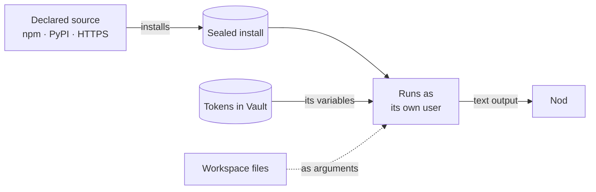

Besides [Composio apps](/connect/apps/), Nod connects to [custom apps](/connect/community-apps/) such as Notion, Linear, Qontext and n8n through their own MCP servers. For other services, it can set up an MCP server, an HTTP API or a command-line tool (CLI).

These built-in MCP apps use the same folder format as community apps. Browse their [app pages](/connect/community-apps/), or follow [Creating your own connectors](/contribute/apps/) to add one.

## Hosted custom apps

Notion, Linear, Qontext and the other hosted custom apps connect through their own MCP servers, the same way as any [other MCP server](#connect-another-service). Open **Apps**, select **Connect** and sign in. If the service ends sign-in with an error, Nod shows that error, with secrets removed.

If an older **Notion MCP** account appears in **Apps** but cannot read pages, connect **Notion** again. After the new connection works, disconnect the old **Notion MCP** account. Its earlier sign-in does not transfer to the direct connection.

If you ask Nod in chat, it sends a link to a private setup page in Nod, and you start the sign-in there. The service's sign-in link never appears in the chat, so the model and chat apps never see it.

If sign-in is cancelled or fails, select **Try again** in the connection dialog. Select **Start again** if you closed the sign-in window. Finish in the newest window, then dismiss the confirmed connection with **Done**.

Nod can use every tool these servers offer, so it can read and change pages, issues, projects and files. Each change goes through the same [trust check](/trust/approvals/) as any app action. Nod renews sign-ins on its own when the service allows it. When Nod is offline, or the service is down or busy, the connection stays and Nod tries again the next time it's used. **Apps** shows **Sign-in required** with **Reconnect** when a sign-in can't be renewed or the service refuses it, for example because it was revoked.

## n8n

Nod builds, tests and changes n8n workflows and n8n Agents through your n8n instance's MCP server. Open **Apps**, select **Connect** on n8n and enter your n8n address, such as `https://you.app.n8n.cloud` or `localhost:5678`. Nod opens n8n's own sign-in and consent page. To use an access token instead, open **Use an access token instead** and paste the token from n8n under **Settings**, **Instance-level MCP**. This is the instance-level MCP token. An n8n API key doesn't work here.

If n8n answers at `http://localhost:5678` from Nod's server, the form opens with that address filled in. Nod checks only that address when the form opens, and connects only when you select **Connect n8n**.

If n8n doesn't answer, turn on MCP access in n8n under **Settings**, **Instance-level MCP**, and try again.

The address can be on Nod's computer or its local network, such as a self-hosted n8n. Inside Docker, `localhost` refers to Nod's container. Only an address you enter or confirm yourself can be local, never one the model proposes. Nod sends that connection's requests and its token only to that address. Browser sign-in can also use a sign-in service at another address when that address is public and uses HTTPS on the standard port. `localhost` and `127.0.0.1` count as the same address when the port matches, because n8n can name itself either way.

Nod loads n8n's tools only when a task needs them and follows n8n's own guide for its tools, plus a short [n8n task guide](/how-it-works/skills/). It writes workflow code to a file in its workspace, checks it with n8n, then creates and tests the workflow with sample data before it reports back. A test doesn't run the steps that send or write to another service, so Nod checks the data each of those steps would have sent. Each n8n action goes through the [trust check](/trust/approvals/), like every app action. See [Build with n8n](/use/n8n/) for what to ask.

## Connect another service

Search **Apps** by service name. If it isn’t listed, select **Ask Nod** on the **Connect another tool** card for help setting it up.

To connect an MCP server yourself, open **Apps** and select **Connect MCP**. Enter a name of up to 80 characters, such as `Work email (n8n)`, and the server URL, then choose browser sign-in, an access token or an API key. Select **Continue** to finish authentication in the private setup dialog. For any MCP server, including the custom apps, the dialog shows the service's reason if sign-in can't start. When the server ends sign-in with an error, the dialog shows that error, with secrets removed. Only a sign-in you decline counts as cancelled. **Connection details** shows any extra setup instructions. Tokens stay outside the chat.

To rename a server you added with **Connect MCP**, open **Apps**, open **Manage accounts** on the server’s card, and select **Rename**. The new name applies to every account on that card. You can search for it in Apps or ask for it by name in chat.

The URL can be a public HTTPS address or, when you type it yourself, an address on your own computer or network, such as `http://127.0.0.1:8080/mcp` or a Tailscale name. Without `http://` or `https://`, Nod uses HTTPS. A public HTTPS address you type can also use a port other than 443. In the desktop app, `localhost` is your computer. Inside Docker, it is Nod's container. A private address stays bound to the origin you entered, also when you reconnect. HTTP is allowed only for private addresses. With browser sign-in, the server's sign-in service can be at another address only when that address is public and uses HTTPS on the standard port. Connections that Nod proposes in chat must use a public HTTPS address.

Nod connects to MCP servers over Streamable HTTP. When a server refuses it with a client error other than 401 or 403, Nod tries the older HTTP+SSE transport at the same address, with the same checks. If that also fails, the error shows the Streamable HTTP reason.

A failed tool request keeps the server's status and reason. Nod does not retry it. If the SSE stream closes, the next request opens a new connection.

Ask Nod to connect a service it can't find in the app catalog. Nod proposes a way in, called an access path, and sends you a link to a private setup page. There, you paste a token or sign in. The model never sees the token.

| Access path | What Nod calls                                                 | How it signs in                                    |
| ----------- | -------------------------------------------------------------- | -------------------------------------------------- |
| MCP server  | Tools on a public HTTPS MCP server, or a private one you enter | A token in a header, or OAuth sign-in              |
| HTTP API    | A method and path on the API                                   | A token in a header, or OAuth sign-in              |
| CLI         | A command with arguments                                       | Tokens and other settings in environment variables |

Some services give each region or workspace its own MCP address, such as a separate EU address, each with its own sign-in. On those services, an account can only sign in through its own address. Nod picks the address from a workspace address you give it, or asks for your workspace address or region before it proposes a connection. If sign-in ends on the service's home page instead of returning to Nod, tell Nod your workspace address and start again, or select **Connect MCP** and enter the address for your region.

Nod keeps the token encrypted in Vault, and the server adds it to each call. Results and errors remove plaintext, JSON-escaped and URL- or form-encoded representations of the token. A returned file containing any of those representations is withheld.

Nod doesn't execute regular-expression constraints from an external MCP input schema. It removes `pattern` and `patternProperties` before local structural validation. When `patternProperties` is removed, local validation allows all dynamic property names. Nod also relaxes rules that depend on the removed patterns. These include exclusive alternatives, negation, conditional rules, and upper limits on matching array items. This includes rules that refer to shared definitions. Unrelated rules keep their checks. Literal values, defaults, and examples stay unchanged. The MCP server remains responsible for enforcing its complete input contract.

## How connected CLIs keep the token safe

A CLI path declares where to install the tool from:

- an npm package,
- a PyPI package, installed with `pipx`, or
- an HTTPS download of a release program or archive, with an optional `sha256` checksum.

It also names the environment variables the tool reads its credentials from, such as `GITHUB_TOKEN`, or `AWS_ACCESS_KEY_ID` and `AWS_SECRET_ACCESS_KEY`. Each name must end in `TOKEN`, `KEY`, `SECRET`, `PASSWORD`, `URL`, `_ID`, `_SID`, `USERNAME`, `USER` or `EMAIL`, so it can't be a variable that loads code, such as `LD_PRELOAD`. A tool with several variables is its own connection.

The setup page shows the source and one field per variable, so you can check it before you paste anything. A command runs for up to 59 minutes unless Nod asks for longer. Installing a missing CLI has its own 10-minute limit before that. When an install runs longer, the error says "The connected CLI install ran longer than its 600-second limit."

Nod installs each tool as its own Linux user, in a folder only that user can open, so neither the workspace user nor another connected tool can change it or read its token. Each run gets an environment built from scratch: a `PATH` with the sealed tool and system folders, a private temporary home and its credential variables.

Nothing comes from the workspace user's files or settings. A program that the model writes or replaces in the workspace never receives the token. You can still pass workspace files as arguments, and the CLI returns text.

## Send and receive files

To attach a workspace file to a Composio action, Nod passes `{workspaceFile, mimeType, name?}`. The server reads and checks the files and uploads them to Composio only when the action runs. If the trust check asks you first, nothing is uploaded until you say yes, and declining sends nothing. Each file can be up to 15 MB, and files in one action can total 90 MB. Your yes covers the exact files Nod showed you: if one is changed or deleted before the action runs, nothing is sent and Nod has to ask again.

Files that apps send back, up to 90 MB each, are saved privately in the workspace one at a time. Nod sees each file's name, type and size, and up to four images of 5 MB or less. Nothing reaches your chat until Nod shares it.

MCP servers, APIs and CLIs use their own upload methods.

## Every action goes through the trust check

The [checker](/trust/approvals/) sees each call's arguments as Nod sends them: the method, path and body, the MCP tool and input, or the CLI arguments. For a saved API or MCP server it sees the path or tool, not the server's address. It runs reads and drafts, and anything else only when your words ask for it. Otherwise Nod asks you first. A call to an access path you haven't saved is refused before that, so Nod never asks you about it.

## Related resources

- [Apps with Composio](/connect/apps/)
- [Models](/connect/models/)
- [Approvals and the trust check](/trust/approvals/)
- [Vault and saved logins](/trust/vault/)
- [Sandbox and browser](/how-it-works/sandbox-and-browser/)
