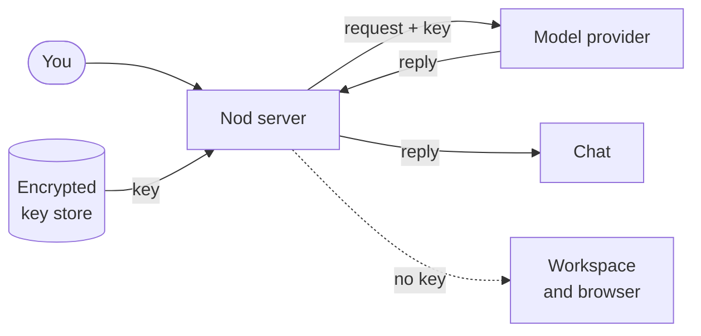

import { Steps, TabItem, Tabs } from '@astrojs/starlight/components';

Nod needs a model connection to think and reply. Connect one or more services in **Settings > Models**, then choose the model Nod uses.

Your requests go to the service you connect. Paid providers bill you for use. To run a model on your own computer instead, see [Local models](/connect/local-models/).

## Supported connections

Select **Add connection** (or **Add** when you already have a connection), then search for a service. Regional and token-plan entries use the key issued for that particular service.

| Connection                         | Setup                                                     | Initial choice                           |
| ---------------------------------- | --------------------------------------------------------- | ---------------------------------------- |
| Google Gemini                      | [AI Studio API key](https://aistudio.google.com/api-keys) | Gemini 3.8 Flash, medium effort          |
| OpenAI / ChatGPT                   | API key or existing ChatGPT sign-in                       | GPT-6.1 Sol / GPT-6 Sol, high effort     |
| Anthropic                          | API key                                                   | Claude Opus 5.5, high effort             |
| OpenRouter                         | API key or browser sign-in                                | GPT-6.1 Sol, high effort                 |
| Google Vertex AI                   | Vertex API key                                            | Gemini 4 Argon, medium effort            |
| Amazon Bedrock                     | API key and Region                                        | You choose the model and routing profile |
| Azure OpenAI                       | Endpoint, deployment, model, and API key                  | The deployment's model                   |
| Cloudflare Workers AI / AI Gateway | Token, account ID, and gateway ID for AI Gateway          | Kimi K2.7 Code / GPT-6.1 Sol             |
| Other named providers              | Service-specific API key                                  | A capable model from that connection     |
| OpenAI-compatible                  | Server address and optional key                           | A model offered by the server            |

Other providers include Ant Ling, Baseten, Cerebras, DeepSeek, Fireworks AI, Groq, Hugging Face, Kimi Coding China, Meta, MiniMax, Mistral, Moonshot AI, NVIDIA, OpenCode Zen and Go, Qwen Token Plan, Radius, Together AI, Vercel AI Gateway, xAI, Xiaomi MiMo and token plans, and Z.AI. The picker includes their supported regional variants.

When an account model list is available, Nod loads it. For services with only a bundled catalog, Nod saves the key and checks access on first use. Neither a catalog nor a saved key proves that your account has credit or permission to run every listed model.

You can change the initial choice. Nod preserves a working choice when you add another connection. It uses the recommended model when available, otherwise the first supported model in that connection's catalog. For Google Gemini, you must choose a model if Gemini 3.8 Flash is unavailable. When Bedrock offers several models or profiles, you must also choose because profiles can change where requests are processed.

:::note[Google free access]
Create a Gemini API key with your Google account in AI Studio. Gemini 3.8 Flash has a [free tier](https://ai.google.dev/gemini-api/docs/pricing), subject to project quotas and availability; Gemini 4 Argon needs paid API access. The free tier has different data-use terms, so review Google's terms before sending private material.
:::

Google does not permit third-party assistants to reuse [Gemini CLI OAuth](https://geminicli.com/docs/resources/faq/). A Gemini app subscription is not a Nod sign-in option. Anthropic's [authentication conditions](https://code.claude.com/docs/en/legal-and-compliance) also require an API connection for Claude in Nod.

## Connect a service

Select **Settings** at the bottom of the sidebar, then **Models**. Select **Add connection** or **Add**, then choose a provider. Onboarding shows the same options before your first chat.

If a key has a recognizable format for a different provider, Nod shows the mismatch beside the key field before sending or saving it. Choose the matching provider or paste that provider's key. Unfamiliar formats still use the provider's normal connection checks; a matching format alone does not prove a key works.

Select **Change** beside **Your model** to open **Choose a model**. Search by model, provider or account, or filter by provider. Models are grouped by connection, with recommended choices first in each group. A check marks both your current model and its connection. Image, audio and thinking icons identify each model’s capabilities; hover over an icon for its label. You can use the arrow keys, Home and End to move through models, then Enter to choose one. During onboarding, **More providers** opens the full list to browse or search.

Select **Manage** beside a provider to see its accounts, add another connection or remove one. If a connection stops working, **Reconnect** restores a sign-in. For a key or server, add the details again; remove the old connection if you no longer need it. When it's the connection you selected, chat links to that screen.

To change to an available model, you can also tell Nod which model and service to use. This works in Nod, Telegram, and WhatsApp. Nod changes the saved selection for the next turn. Connecting a new service or signing in again still needs the private flow in the app.

<Tabs syncKey="model-service">
<TabItem label="OpenAI">

<Steps>

1. Choose **OpenAI**, then **Use an API key**.
2. Paste your key into **API key**, then select **Connect**.

</Steps>

</TabItem>
<TabItem label="ChatGPT">

<Steps>

1. Choose **OpenAI**, then **Sign in with ChatGPT**.
2. Sign in to ChatGPT in the browser tab that opens, and allow Nod to use your ChatGPT plan.
3. Return to Nod. If the browser ends on a page that doesn't load, copy its full address into **Callback URL** and select **Complete sign-in**.

</Steps>

Nod uses OpenAI's [Sign in with ChatGPT](https://developers.openai.com/siwc/token-sharing-open-source) for open-source and locally hosted apps. Requests go to the OpenAI API and use your plan's included usage. ChatGPT lists Nod under [Settings → Usage](https://chatgpt.com/settings/usage), where you can see and limit its usage or disconnect it. It needs ChatGPT Plus or Pro. On other plans, OpenAI's consent page says a required permission isn't available, and the sign-in fails. In a workspace your organization manages, an admin has to allow third-party apps first, or OpenAI says your organization hasn't enabled access for this app. Otherwise, connect an OpenAI API key instead.

ChatGPT sign-in listens on port `1455` where Nod's server runs. If another program uses that port, Nod stops with an error before it opens OpenAI. When connecting to a remote server, the final browser address may not load on your device. Copy that full address into **Callback URL** in Nod and select **Complete sign-in**. The server checks the sign-in and stores the connection; you do not need to expose port `1455` publicly.

</TabItem>
<TabItem label="Anthropic">

<Steps>

1. Choose **Anthropic**.
2. Paste your key into **API key**.
3. Select **Connect**.

</Steps>

Nod uses keys limited to one workspace directly. For other keys, Nod connects automatically when it finds exactly one workspace that accepts the key. If it finds several, choose a named **Workspace** and save again.

If the connection fails because workspace discovery isn't available, **Enter workspace ID manually** appears. Enter the **Workspace ID (optional)** from [Anthropic's workspace settings](https://platform.claude.com/settings/workspaces), then save again. Your API key stays in the form while you choose. No environment variable is needed when connecting in Nod.

</TabItem>
<TabItem label="OpenRouter">

<Steps>

1. Choose **OpenRouter**, then **Sign in with OpenRouter** to create a key for Nod in your browser, or **Use an API key** to paste a key.
2. Finish the sign-in, or select **Connect** for a key.

</Steps>

Nod lists the OpenRouter models that support text and tools.

The `openrouter/free` and `openrouter/auto` routers can select different models for each request. Nod keeps your router choice and uses an 8,192-token working limit. This leaves room for routes with a small context window. Provider limits and free-model availability still apply.

</TabItem>
<TabItem label="Google Gemini">

<Steps>

1. Select **Google Gemini**, then open the link to create a key in AI Studio.
2. Copy the key into **API key** and select **Connect**.
3. Keep Gemini 3.8 Flash for a capable starting choice, or choose another listed model.

</Steps>

The key is separate from Google identity sign-in. Free-tier quotas can limit long tasks; inspect your project's limits in AI Studio if Google reports that a quota is exhausted.

</TabItem>
<TabItem label="Other services">

<Steps>

1. Select **Add connection** or **Add**, then search for your provider.
2. Open its key page if you need a key, then paste the key into the private field.
3. Select **Save key** or **Connect**, then use the recommended model or choose another.

</Steps>

For Cloudflare, enter the **Account ID**. AI Gateway also needs the **Gateway ID**, with unified billing or upstream credentials already configured in Cloudflare. Each saved connection keeps its own account and gateway. For a regional or token-plan provider, use the matching region and plan's key.

Workers AI tokens need [Workers AI Read and Edit](https://developers.cloudflare.com/workers-ai/get-started/rest-api/) permissions. AI Gateway tokens need [AI Gateway Read](https://developers.cloudflare.com/api/resources/ai_gateway/methods/get/) to check the connection and [AI Gateway Run](https://developers.cloudflare.com/ai-gateway/configuration/authentication/) to run models. Cloudflare's **Create authentication token** action grants Run; add Read before connecting it here.

Kimi Coding China uses Kimi's China endpoint. Its key must be valid for that region; this connection does not support the international Kimi Coding endpoint.

</TabItem>
<TabItem label="Amazon Bedrock">

<Steps>

1. In the Amazon Bedrock console, create a long-term key under **API keys**. Short-term keys expire within hours.
2. In Nod, choose **Amazon Bedrock** from the provider list.
3. Enter the **Region** your models run in, such as `us-east-1`, and paste the key into **API key**.
4. Select **Save key** or **Connect**, then choose a model.

</Steps>

Nod lists the models and inference profiles Bedrock offers in that Region, such as `eu.anthropic.claude-opus-5-5`. The key still needs permission to call the one you choose. A profile that starts with `global.` can send requests to any commercial AWS Region. A geographic profile such as `eu.` or `us.` stays in that geography, and each model's page in the AWS docs lists the Regions it can use. That's why Nod doesn't choose a Bedrock model for you.

The key needs to list models (`bedrock:ListFoundationModels` and `bedrock:ListInferenceProfiles`) and call them. Keys made in the Bedrock console get the `AmazonBedrockLimitedAccess` policy, which allows both. Nod doesn't use AWS access keys or profiles.

</TabItem>
<TabItem label="Google Vertex AI">

<Steps>

1. In the Google Cloud console, create an API key for Vertex AI: an express mode key, or a standard key bound to a service account with Vertex AI access in a project with billing.
2. In Nod, choose **Google Vertex AI** from the provider list.
3. Paste the key into **API key**, then select **Save key** or **Connect**.
4. Choose a model.

</Steps>

Nod checks the key with a free token count and lists the Gemini models on Vertex AI. Requests go to Vertex AI's global endpoint. Google recommends service accounts over API keys for production, but Nod doesn't support service account key files yet.

</TabItem>
<TabItem label="Azure OpenAI">

<Steps>

1. In Azure AI Foundry, open your model deployment and copy its endpoint, deployment name and key.
2. In Nod, choose **Azure OpenAI** from the provider list.
3. Enter the **Endpoint**, such as `https://your-resource.openai.azure.com`, and the **Deployment name**. If the deployment has its model's name, Nod fills in **Model**. Otherwise, choose the model the deployment runs.
4. Paste the key into **API key**, then select **Save key** or **Connect**.

</Steps>

Nod uses Azure's v1 API at that endpoint and sends the key only there. The endpoint needs HTTPS, unless it uses a loopback address on Nod's server. An address that ends at the resource or at `/openai` gets `/openai/v1` added. Any other path, such as an API gateway, is used as you enter it.

Each deployment is one connection with one model. Add another connection for each deployment you want to use. The model you choose sets the context size and the prices Nod counts toward your [spending](/use/spending/). Microsoft Entra ID sign-in isn't supported.

</TabItem>
<TabItem label="OpenAI-compatible">

<Steps>

1. Choose **OpenAI-compatible** from the provider list.
2. Check the **Server address**. Nod fills in Ollama's address, `http://localhost:11434/v1`. Add an **API key** only if the server needs one.
3. Select **Connect**.

</Steps>

Use this for Ollama, LM Studio, vLLM, llama.cpp and hosted services with an OpenAI-compatible API. See [Local models](/connect/local-models/) for server setup and what changes.

</TabItem>
</Tabs>

## Switch and manage connections

All the models from your connections appear in one searchable list, grouped by connection. Choosing a model also chooses the connection that pays for it.

OpenRouter models show input and output token prices beside each model name, in USD per million tokens. Prices can wrap to the next line on small screens. The list identifies free tokens and prices that vary by model. These are the rates from the last model list update. Actual charges can vary with routing, caching, context length, and extra services. See [OpenRouter's model pricing](https://openrouter.ai/docs/guides/overview/models#pricing-object).

You can connect several accounts of one service, such as two ChatGPT accounts or a personal and a work API key. A ChatGPT connection shows the account's email. A key connection, including one an OpenRouter sign-in created, shows the key's last four characters, which the model never sees. Signing in again with an account you already connected, or adding the same key or server address to the same service again, updates that connection instead of adding another.

If your selected connection is removed or needs reconnecting, the next connection you add or reconnect in **Models** becomes your model. If only your model disappears from a working connection, Nod keeps your choice and asks you to choose another. Nod doesn't switch by itself after a failed request.

| To                        | Do this                                                                                                      |
| ------------------------- | ------------------------------------------------------------------------------------------------------------ |
| Switch model              | Open **Settings → Models**, then pick a model.                                                               |
| Load a missing model list | Select **Manage** beside the provider, then **Load models** or **Try again**.                                |
| Fix a broken connection   | Open **Manage** and **Reconnect** a sign-in, or add the key or server details again.                         |
| Remove a connection       | Open **Manage** and select **Remove connection** beside the account. If it was selected, choose a new model. |

## One model for everything

Nod uses the same model choice in the app, Telegram and WhatsApp. A task that's already running keeps the model it started with. An audio model's **Text support** label names its companion from the same connection. Requests without recordings use that companion; follow-ups that still include recordings use the audio model. Your saved model choice stays unchanged.

If a model request fails, Nod doesn't switch to another connection. It retries a temporary provider error, such as an overload or rate limit, up to three times.

Background work, such as memory upkeep, uses a smaller model from the same connection when it has one, such as `gpt-6-luna` or `claude-haiku-5-5`. Otherwise it uses your model or, for an audio model, its text companion. Background work and checks use the lightest reasoning their model offers: off, minimal, low or medium in that order, or the model's first effort level if it offers none of these.

## Models with a small context window

For a context window below 65,536 tokens, Nod uses short instructions and loads one detailed tool at a time. It reads guides, saved memory and older messages when needed. Large tool results stay in workspace files, with a short preview in the conversation.

Nod reserves space for the reply and starts history compaction earlier. It keeps your current request and rules complete. If a request still does not fit, Nod asks for a shorter request or a model with a larger context window. Large images and tool schemas can need a larger window. Token estimates cannot guarantee that every provider accepts a request.

The same server checks still decide app actions, sign-ins and payments. A smaller context window does not change those checks. Model ability still affects whether Nod can complete a task.

## Decision checks

Nod can use a decision model to check action permission, read confirmation replies, and check emails that give account access. Your selected model writes and checks confirmation questions. Nod selects each checker before its request. A failed check never switches models.

### Select the action checker

Set `NOD_TRUST_MODEL` in the server configuration, then [apply the change](/deploy/configuration/#how-settings-work).

| Value      | Action permission, strict app reads, and confirmation replies             |
| ---------- | ------------------------------------------------------------------------- |
| `selected` | Your selected model at its lowest reasoning setting. This is the default. |
| `llm`      | A small LLM.                                                              |
| `decision` | The first available decision model, or a small LLM.                       |

For an audio model, `selected` uses the same-connection text companion shown under **Text support**. The small LLM comes from your selected connection when it offers a known small model. Otherwise, Nod chooses a known small model from another connected service. It chooses before making a request. If no small model is available, the check cannot authorize an action. It never replaces the small checker with your larger chat model.

The small checker can have API costs. A free OpenRouter selection does not start a paid small checker. If no checker is available, Nod cannot approve an action. Check model charges in Usage.

Decision mode selects the first available option in this order:

1. Direct TypeSafe Jev 1.14 with `TYPESAFE_API_KEY`.
2. Jev 1.14 through OpenRouter.
3. Perplexity Decider 1.2 through OpenRouter.
4. OpenAI Decisions with an OpenAI API key, or through OpenRouter.
5. The same small LLM as `llm` mode, when none of these decision models is available.

These keys can come from a connection other than your chat model. ChatGPT subscription credentials never go to a decision service. Nod uses OpenRouter's decision-model list for your key, which applies your provider, privacy and access settings. This list is cached for five minutes. A failed lookup blocks the check. Nod keeps one provider for all steps of each check. A failed or uncertain decision never switches the checker to an LLM.

```sh title=".env"
NOD_TRUST_MODEL=decision
```

There is no separate decision-model setting. Nod selects the model. Your selected chat model still writes and checks confirmation questions. This writing step is separate from action classification.

The gate receives the complete action, owner messages and rules. It receives no tool results or page text. It must preserve exact targets and terms. The server obtains a permission quote from the selected owner source and checks it against the original words. Choosing a source cannot authorize an action by itself.

Jev classifies the full action, then checks the selected owner words in a separate request without action data. A fixed local classifier combines those probabilities. This uses no LLM in decision mode. Reads and private work get a separate effect check, including each declared nested operation.

The server adds calendar facts for month ends, leap days, time zones, and local scheduled-run times. Jev selects the relevant time fields and owner constraints. It also reads calendar dates inside scheduled messages. Code compares explicit clocks, weekdays and elapsed event lengths. These facts grant no permission. The original input stays unchanged. An action that changes Nod settings, signs in, opens a saved session, or uploads a file cannot use the private-preparation path.

A time zone in your words controls conversion. Otherwise, Nod uses your configured time zone, or UTC when none is set. An unresolved relative date requires confirmation.

Before code corrects a time comparison, Jev checks all your instructions for other time conditions. A deadline warning still blocks the action.

A decision request must return every requested answer in a valid form. Missing answers, invalid probabilities and failures cannot authorize an action. A request that exceeds the provider limit fails the check. Nod never cuts your instructions to fit.

Strict app reads and confirmation replies use their own checks. A Jev strict read needs both its read-only check and a separate effect check. Both must reach the Jev threshold of 0.8. The effect check rejects private drafts and each nested write. Other decision models use a read threshold of 0.99. These thresholds are model settings, not measured error rates. An uncertain strict read is skipped. An uncertain reply stays undecided. The reply check sees only your reply, never the action, question or conversation.

:::caution[Measured limits]
These checks decide action permission. They are not a general content safety filter. A model probability does not prove safety. Use the [decision evaluations](/contribute/evals/#compare-decision-checks) to measure changes.
:::

### Account-access email checks

Account-access email checks have separate connection rules in every mode. Without a decision service, email checks use the connection's smaller background model.

Pick a capable checker if Nod acts for you. See the [trust check](/trust/approvals/) and [decision evals](/contribute/evals/#compare-decision-checks).

| Current connection     | Account-access email checks                            |
| ---------------------- | ------------------------------------------------------ |
| OpenAI API key         | GPT Decisions (`gpt-6-luna`) with the same key         |
| OpenRouter             | Jev (`typesafe/jev-1.13`) with the same OpenRouter key |
| Every other connection | Your connection's smaller background model             |

These calls are billed through the connection that runs them. GPT Decisions is paid API use, separate from a ChatGPT subscription. OpenRouter sends the checks to TypeSafe, even when you selected a chat model from another provider. See [OpenAI Decisions](https://developers.openai.com/api/docs/guides/decisions) and [Jev on OpenRouter](https://openrouter.ai/blog/insights/what-is-jev/).

In a source install or self-hosted server, set `TYPESAFE_API_KEY` in `.env` to use Jev directly (`jev-1.13.0`) for these checks. The key selects TypeSafe regardless of your chat connection. Remove it to use the connection rules above, then [apply the configuration change](/deploy/configuration/#how-settings-work). The key stays on the server and is not added to **Models**.

A failed decision request does not switch providers or approve anything: a failed account-access email check hides that email's content. See [Approvals and the trust check](/trust/approvals/).

:::note[Voice without another account]
Open **Settings → Voice & audio**. Open **Voice** to compare samples, or choose **Automatic** to match voices to the conversation language. Provider connections and free voice downloads are in the same chooser. Use [free local voices, OpenRouter sign-in, or an ElevenLabs or OpenAI API key](/use/chat/#send-an-audio-message) without changing your connected chat model. OpenAI speech requires API access, separate from a ChatGPT plan.
:::

## Set connections in server settings

In a source install or self-hosted server, you can add connections in `.env`. They show **Server settings** in **Models**. Update their values in `.env`, then [apply the configuration change](/deploy/configuration/#how-settings-work).

Removing an API key removes its server-managed connection. For an OpenAI-compatible server, remove `OPENAI_COMPATIBLE_BASE_URL` instead. Connections saved through the app stay intact. If you removed the selected connection, choose another model in **Models**.

Every service below supports environment setup. You can add several provider keys at once. Set `LLM_PROVIDER` to the provider ID for your initial model choice. Leave `LLM_MODEL` empty for the [provider's default](#supported-connections), or set an exact model ID from its list. A model you choose in the app takes priority. ChatGPT subscriptions still need browser sign-in in **Models**.

| Provider ID                  | Service                     | Key variable                         |
| ---------------------------- | --------------------------- | ------------------------------------ |
| `openai`                     | OpenAI                      | `OPENAI_API_KEY`                     |
| `anthropic`                  | Anthropic                   | `ANTHROPIC_API_KEY`                  |
| `google`                     | Google Gemini               | `GEMINI_API_KEY`                     |
| `openrouter`                 | OpenRouter                  | `OPENROUTER_API_KEY`                 |
| `amazon-bedrock`             | Amazon Bedrock              | `AWS_BEARER_TOKEN_BEDROCK`           |
| `google-vertex`              | Google Vertex AI            | `GOOGLE_CLOUD_API_KEY`               |
| `azure`                      | Azure OpenAI                | `AZURE_OPENAI_API_KEY`               |
| `ant-ling`                   | Ant Ling                    | `ANT_LING_API_KEY`                   |
| `baseten`                    | Baseten                     | `BASETEN_API_KEY`                    |
| `cerebras`                   | Cerebras                    | `CEREBRAS_API_KEY`                   |
| `cloudflare-workers-ai`      | Cloudflare Workers AI       | `CLOUDFLARE_WORKERS_AI_API_KEY`      |
| `cloudflare-ai-gateway`      | Cloudflare AI Gateway       | `CLOUDFLARE_AI_GATEWAY_API_KEY`      |
| `deepseek`                   | DeepSeek                    | `DEEPSEEK_API_KEY`                   |
| `fireworks`                  | Fireworks AI                | `FIREWORKS_API_KEY`                  |
| `groq`                       | Groq                        | `GROQ_API_KEY`                       |
| `huggingface`                | Hugging Face                | `HF_TOKEN`                           |
| `kimi-coding`                | Kimi Coding China           | `KIMI_API_KEY`                       |
| `meta`                       | Meta                        | `META_API_KEY`                       |
| `minimax`                    | MiniMax                     | `MINIMAX_API_KEY`                    |
| `minimax-cn`                 | MiniMax China               | `MINIMAX_CN_API_KEY`                 |
| `mistral`                    | Mistral                     | `MISTRAL_API_KEY`                    |
| `moonshotai`                 | Moonshot AI                 | `MOONSHOT_API_KEY`                   |
| `moonshotai-cn`              | Moonshot AI China           | `MOONSHOT_CN_API_KEY`                |
| `nvidia`                     | NVIDIA                      | `NVIDIA_API_KEY`                     |
| `opencode`                   | OpenCode Zen                | `OPENCODE_API_KEY`                   |
| `opencode-go`                | OpenCode Go                 | `OPENCODE_GO_API_KEY`                |
| `qwen-token-plan`            | Qwen Token Plan             | `QWEN_TOKEN_PLAN_API_KEY`            |
| `qwen-token-plan-cn`         | Qwen Token Plan China       | `QWEN_TOKEN_PLAN_CN_API_KEY`         |
| `qwen-token-plan-individual` | Qwen Token Plan Individual  | `QWEN_TOKEN_PLAN_INDIVIDUAL_API_KEY` |
| `radius`                     | Radius                      | `RADIUS_API_KEY`                     |
| `together`                   | Together AI                 | `TOGETHER_API_KEY`                   |
| `vercel-ai-gateway`          | Vercel AI Gateway           | `AI_GATEWAY_API_KEY`                 |
| `xai`                        | xAI                         | `XAI_API_KEY`                        |
| `xiaomi`                     | Xiaomi MiMo                 | `XIAOMI_API_KEY`                     |
| `xiaomi-token-plan-ams`      | Xiaomi Token Plan Amsterdam | `XIAOMI_TOKEN_PLAN_AMS_API_KEY`      |
| `xiaomi-token-plan-cn`       | Xiaomi Token Plan China     | `XIAOMI_TOKEN_PLAN_CN_API_KEY`       |
| `xiaomi-token-plan-sgp`      | Xiaomi Token Plan Singapore | `XIAOMI_TOKEN_PLAN_SGP_API_KEY`      |
| `zai`                        | Z.AI                        | `ZAI_API_KEY`                        |
| `zai-coding-cn`              | Z.AI Coding China           | `ZAI_CODING_CN_API_KEY`              |

Additional settings:

| Service           | Settings                                                                                                                                                   |
| ----------------- | ---------------------------------------------------------------------------------------------------------------------------------------------------------- |
| Anthropic         | `ANTHROPIC_WORKSPACE_ID`, required for organization keys that aren't limited to one workspace. Leave empty for keys limited to one workspace.              |
| Amazon Bedrock    | `AWS_REGION`, such as `us-east-1`. Set `LLM_MODEL` to select a model or inference profile when several are available.                                      |
| Azure OpenAI      | `AZURE_OPENAI_ENDPOINT` and `AZURE_OPENAI_MODEL`, the model ID your deployment runs. Set `AZURE_OPENAI_DEPLOYMENT` if the deployment has a different name. |
| Cloudflare        | `CLOUDFLARE_ACCOUNT_ID`, the 32-character hexadecimal account ID. AI Gateway also requires `CLOUDFLARE_GATEWAY_ID`.                                        |
| OpenAI-compatible | `OPENAI_COMPATIBLE_BASE_URL` and optional `OPENAI_COMPATIBLE_API_KEY`. Use `LLM_PROVIDER=compatible` for the initial choice.                               |

Set the cloud provider's required fields before starting Nod. A Cloudflare gateway ID has one to 64 lowercase letters, digits, or hyphens, starting with a letter or digit. Both Cloudflare connections use the same account ID from `.env`; connections saved in **Models** can use separate accounts and gateways.

For Azure, leave `LLM_MODEL` empty to use the deployment's model, or set it to the same model ID as `AZURE_OPENAI_MODEL`. The deployment name defaults to that ID. The [Azure setup rules](#connect-a-service) for endpoints also apply to `.env`.

```sh title=".env"
LLM_PROVIDER=google
GEMINI_API_KEY=<your-key>
```

Regional providers use separate key variables so one region's key isn't automatically sent to another region. These connections don't inherit host-wide AWS profiles or Google service account files.

## Where your keys go

The Nod server adds your key to each model request. The key never enters the workspace, Nod's browser or the model's context.



- Nod encrypts saved keys and sign-ins with the Vault key. macOS uses Keychain, the Windows app uses Windows DPAPI, and Linux source installs use a private file. The self-hosting stack generates `NOD_VAULT_KEY` in its private `.env`. See [Vault configuration](/deploy/configuration/#vault).
- Nod checks credential storage before starting a connection. If storage is unavailable, check the Vault configuration, permissions and database connection, then try again.
- Keys from `.env` stay in server memory and aren't copied into the database.
- Each key goes only to its own service: Amazon Bedrock in the Region you entered, Google Vertex AI, or the Azure OpenAI endpoint you entered.
- Your browser doesn't store the key, and Nod removes it from provider errors.

## Related resources

- [Local models](/connect/local-models/)
- [Apps with Composio](/connect/apps/)
- [MCP servers, APIs and CLIs](/connect/mcp-api-cli/)
- [Configuration](/deploy/configuration/)
- [Spending](/use/spending/)
- [Your data and privacy](/trust/privacy/)

## Images with a text model

If your selected model cannot read images, Nod looks for an image model in your connected services. It checks your selected connection first, then your other connected services. When one is available, it receives your current request and the images. Your selected chat model receives its description and stays selected. This image request uses that service's credentials and counts toward your spending limits. If no image model is available, the files stay in the workspace. See [Files and voice messages](/use/channels/#files-and-voice-messages).
