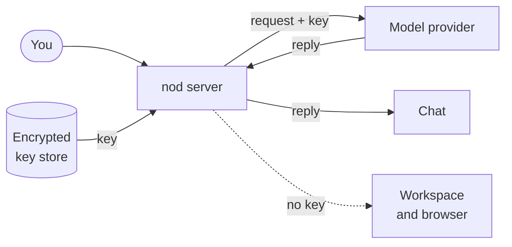

import { Steps, TabItem, Tabs } from '@astrojs/starlight/components';

nod needs a model connection to think and reply. Connect one or more services in **Settings > Models**, then choose the model nod uses.

Your requests go to the service you connect. Paid providers bill you for use. To run a model on your own computer instead, see [Local models](/connect/local-models/).

## Supported connections

Search the provider list to connect any of these services. Regional and token-plan entries use the key issued for that particular service.

| Connection                         | Setup                                                     | Initial choice                           |
| ---------------------------------- | --------------------------------------------------------- | ---------------------------------------- |
| Google Gemini                      | [AI Studio API key](https://aistudio.google.com/api-keys) | Gemini 3.8 Flash, medium effort          |
| OpenAI / ChatGPT                   | API key or existing ChatGPT sign-in                       | GPT-6.1 Sol / GPT-6 Sol, high effort     |
| Anthropic                          | API key                                                   | Claude Opus 5.5, high effort             |
| OpenRouter                         | API key or browser sign-in                                | GPT-6.1 Sol, high effort                 |
| Google Vertex AI                   | Vertex API key                                            | Gemini 4 Argon, medium effort            |
| Amazon Bedrock                     | API key and Region                                        | You choose the model and routing profile |
| Azure OpenAI                       | Endpoint, deployment, model, and API key                  | The deployment's model                   |
| Cloudflare Workers AI / AI Gateway | Token, account ID, and gateway ID for AI Gateway          | Kimi K2.7 Code / GPT-6.1 Sol             |
| Other named providers              | Service-specific API key                                  | A capable model from that connection     |
| OpenAI-compatible                  | Server address and optional key                           | A model offered by the server            |

Other providers include Ant Ling, Baseten, Cerebras, DeepSeek, Fireworks AI, Groq, Hugging Face, Kimi Coding China, Meta, MiniMax, Mistral, Moonshot AI, NVIDIA, OpenCode Zen and Go, Qwen Token Plan, Radius, Together AI, Vercel AI Gateway, xAI, Xiaomi MiMo and token plans, and Z.AI. The picker includes their supported regional variants.

When an account model list is available, nod loads it. For services with only a bundled catalog, nod says **Key saved** and checks access on first use. Neither a catalog nor a saved key proves that your account has credit or permission to run every listed model.

You can change the initial choice. nod preserves a working choice when you add another connection. It uses the recommended model when available, otherwise the first supported model in that connection's catalog. For Google Gemini, you must choose a model if Gemini 3.8 Flash is unavailable. When Bedrock offers several models or profiles, you must also choose because profiles can change where requests are processed.

:::note[Google free access]
Create a Gemini API key with your Google account in AI Studio. Gemini 3.8 Flash has a [free tier](https://ai.google.dev/gemini-api/docs/pricing), subject to project quotas and availability; Gemini 4 Argon needs paid API access. The free tier has different data-use terms, so review Google's terms before sending private material.
:::

Google does not permit third-party assistants to reuse [Gemini CLI OAuth](https://geminicli.com/docs/resources/faq/). A Gemini app subscription is not a nod sign-in option. Anthropic's [authentication conditions](https://code.claude.com/docs/en/legal-and-compliance) also require an API connection for Claude in nod.

## Connect a service

Select **Settings** at the bottom of the sidebar, then **Models**. Search for a service or select a common provider. Onboarding shows the same options before your first chat.

Select your current model to open **Choose a model**. Search by model or provider, then select a model for your next message. Recommended choices appear first, and a check marks your current choice. **Reads images** identifies models that can view images directly; **Extra thinking** identifies models that can think before replying. Capabilities shared by every available model appear once above the list. During onboarding, **More providers** opens the full list to browse or search.

If a connection stops working, its row in **Settings > Models** says what it needs: **Reconnect** a sign-in, or remove a key or server connection and add it again. When it's the connection you selected, chat links to that screen.

To change to an available model, you can also tell nod which model and service to use. This works in nod, Telegram, and WhatsApp. nod changes the saved selection for the next turn. Connecting a new service or signing in again still needs the private flow in the app.

<Tabs syncKey="model-service">
<TabItem label="OpenAI">

<Steps>

1. Next to **OpenAI**, select **Add API key**.
2. Paste your key into **OpenAI API key**, then select **Save connection**.

</Steps>

</TabItem>
<TabItem label="ChatGPT">

<Steps>

1. Next to **OpenAI**, select **Sign in with ChatGPT**.
2. Sign in to ChatGPT in the browser tab that opens, and allow nod to use your ChatGPT plan.
3. Return to nod. If the browser ends on a page that doesn't load, copy its full address into **Callback URL** and select **Complete sign-in**.

</Steps>

nod uses OpenAI's [Sign in with ChatGPT](https://developers.openai.com/siwc/token-sharing-open-source) for open-source and locally hosted apps. Requests go to the OpenAI API and use your plan's included usage. ChatGPT lists nod under [Settings → Usage](https://chatgpt.com/settings/usage), where you can see and limit its usage or disconnect it. It needs ChatGPT Plus or Pro. On other plans, OpenAI's consent page says a required permission isn't available, and the sign-in fails. In a workspace your organization manages, an admin has to allow third-party apps first, or OpenAI says your organization hasn't enabled access for this app. Otherwise, connect an OpenAI API key instead.

ChatGPT sign-in listens for the browser on port `1455` of your computer. If another program uses that port, nod stops with an error before it opens OpenAI.

A ChatGPT connection made with an earlier version of nod needs one reconnect in **Settings > Models**.

</TabItem>
<TabItem label="Anthropic">

<Steps>

1. Next to **Anthropic**, select **Add API key**.
2. Paste your key into **Anthropic API key**, then select **Save connection**.

</Steps>

</TabItem>
<TabItem label="OpenRouter">

<Steps>

1. Next to **OpenRouter**, select **Sign in** to have OpenRouter create a key for nod in your browser, or **Add API key** to paste a key.
2. Finish the sign-in, or select **Save connection** for a key.

</Steps>

nod lists the OpenRouter models that support text and tools.

</TabItem>
<TabItem label="Google Gemini">

<Steps>

1. Select **Google Gemini**, then open the link to create a key in AI Studio.
2. Copy the key into **Google Gemini API key** and select **Save connection**.
3. Keep Gemini 3.8 Flash for a capable starting choice, or choose another listed model.

</Steps>

The key is separate from Google identity sign-in. Free-tier quotas can limit long tasks; inspect your project's limits in AI Studio if Google reports that a quota is exhausted.

</TabItem>
<TabItem label="Other services">

<Steps>

1. Search for your provider in **Models**.
2. Open its key page if you need a key, then paste the key into the private field.
3. Select **Save key** or **Save connection**, then use the recommended model or choose another.

</Steps>

For Cloudflare, enter the **Account ID**. AI Gateway also needs the **Gateway ID**, with unified billing or upstream credentials already configured in Cloudflare. Each saved connection keeps its own account and gateway. For a regional or token-plan provider, use the matching region and plan's key.

Workers AI tokens need [Workers AI Read and Edit](https://developers.cloudflare.com/workers-ai/get-started/rest-api/) permissions. AI Gateway tokens need [AI Gateway Read](https://developers.cloudflare.com/api/resources/ai_gateway/methods/get/) to check the connection and [AI Gateway Run](https://developers.cloudflare.com/ai-gateway/configuration/authentication/) to run models. Cloudflare's **Create authentication token** action grants Run; add Read before connecting it here.

Kimi Coding China uses Kimi's China endpoint. Its key must be valid for that region; this connection does not support the international Kimi Coding endpoint.

</TabItem>
<TabItem label="Amazon Bedrock">

<Steps>

1. In the Amazon Bedrock console, create a long-term key under **API keys**. Short-term keys expire within hours.
2. In nod, next to **Amazon Bedrock**, select **Add API key**.
3. Enter the **Region** your models run in, such as `us-east-1`, and paste the key into **Amazon Bedrock API key**.
4. Select **Save connection**, then choose a model.

</Steps>

nod lists the models and inference profiles Bedrock offers in that Region, such as `eu.anthropic.claude-opus-5-5`. The key still needs permission to call the one you choose. A profile that starts with `global.` can send requests to any commercial AWS Region. A geographic profile such as `eu.` or `us.` stays in that geography, and each model's page in the AWS docs lists the Regions it can use. That's why nod doesn't choose a Bedrock model for you.

The key needs to list models (`bedrock:ListFoundationModels` and `bedrock:ListInferenceProfiles`) and call them. Keys made in the Bedrock console get the `AmazonBedrockLimitedAccess` policy, which allows both. nod doesn't use AWS access keys or profiles.

</TabItem>
<TabItem label="Google Vertex AI">

<Steps>

1. In the Google Cloud console, create an API key for Vertex AI: an express mode key, or a standard key bound to a service account with Vertex AI access in a project with billing.
2. In nod, next to **Google Vertex AI**, select **Add API key**.
3. Paste the key into **Google Vertex AI API key**, then select **Save connection**.
4. Choose a model.

</Steps>

nod checks the key with a free token count and lists the Gemini models on Vertex AI. Requests go to Vertex AI's global endpoint. Google recommends service accounts over API keys for production, but nod doesn't support service account key files yet.

</TabItem>
<TabItem label="Azure OpenAI">

<Steps>

1. In Azure AI Foundry, open your model deployment and copy its endpoint, deployment name and key.
2. In nod, next to **Azure OpenAI**, select **Add API key**.
3. Enter the **Endpoint**, such as `https://your-resource.openai.azure.com`, and the **Deployment name**. If the deployment has its model's name, nod fills in **Model**. Otherwise, choose the model the deployment runs.
4. Paste the key into **Azure OpenAI API key**, then select **Save connection**.

</Steps>

nod uses Azure's v1 API at that endpoint and sends the key only there. The endpoint needs HTTPS, unless it's on this computer. An address that ends at the resource or at `/openai` gets `/openai/v1` added. Any other path, such as an API gateway, is used as you enter it.

Each deployment is one connection with one model. Add another connection for each deployment you want to use. The model you choose sets the context size and the prices nod counts toward your [spending](/use/spending/). Microsoft Entra ID sign-in isn't supported.

</TabItem>
<TabItem label="OpenAI-compatible">

<Steps>

1. Next to **OpenAI-compatible**, select **Add server**.
2. Check the **Server address**. nod fills in Ollama's address, `http://localhost:11434/v1`. Add an **API key** only if the server needs one.
3. Select **Save connection**.

</Steps>

Use this for Ollama, LM Studio, vLLM, llama.cpp and hosted services with an OpenAI-compatible API. See [Local models](/connect/local-models/) for server setup and what changes.

</TabItem>
</Tabs>

## Switch and manage connections

All the models from your connections appear in one searchable list. Choosing a model also chooses the connection that pays for it.

You can connect several accounts of one service, such as two ChatGPT accounts or a personal and a work API key. A ChatGPT connection shows the account's email. A key connection, including one an OpenRouter sign-in created, shows the key's last four characters, which the model never sees. Signing in again with an account you already connected, or adding the same key or server address to the same service again, updates that connection instead of adding another.

If your selected connection is removed or needs reconnecting, the next connection you add or reconnect becomes your model. If only your model disappears from a working connection, nod keeps your choice and asks you to choose another. nod doesn't switch by itself after a failed request.

| To                      | Do this                                                                                               |
| ----------------------- | ----------------------------------------------------------------------------------------------------- |
| Switch model            | Open **Settings → Models**, then pick a model.                                                        |
| Update a model list     | In **Models**, select the refresh button next to the connection.                                      |
| Fix a broken connection | Do what its row says: **Reconnect** a sign-in, or remove a key or server connection and add it again. |
| Remove a connection     | Select the remove button next to it. If it was selected, choose a new model.                          |

## One model for everything

nod uses the same model choice in the app, Telegram and WhatsApp. A task that's already running keeps the model it started with.

If a model request fails, nod doesn't switch to another connection. It retries a temporary provider error, such as an overload or rate limit, up to three times.

Background work, such as memory upkeep, uses a smaller model from the same connection when it has one, such as `gpt-6-luna` or `claude-haiku-4-5`. Otherwise it uses your model. Background work and checks that use your selected model use the lightest reasoning it offers: off, minimal, low or medium in that order, or the model's first effort level if it offers none of these.

## Decision checks

Two checks can use a decision model: reading whether your reply to a confirmation approves it, and checking whether an email nod reads through your apps gives access to an account. Without a decision model, the email check uses your connection's smaller background model. Your selected model decides whether an action can run, writes and fact-checks confirmation questions, and writes messages.

Pick a capable model if nod acts for you: the [trust check](/trust/approvals/) runs on it. Use the [decision evals](/contribute/evals/#compare-decision-checks) to compare models on synthetic permission checks before changing the model you rely on.

| Current connection     | Decision checks                                        |
| ---------------------- | ------------------------------------------------------ |
| OpenAI API key         | GPT Decisions (`gpt-6-luna`) with the same key         |
| OpenRouter             | Jev (`typesafe/jev-1.13`) with the same OpenRouter key |
| Every other connection | Your selected model                                    |

These calls are billed through the connection that runs them. GPT Decisions is paid API use, separate from a ChatGPT subscription. OpenRouter sends the checks to TypeSafe, even when you selected a chat model from another provider. See [OpenAI Decisions](https://developers.openai.com/api/docs/guides/decisions) and [Jev on OpenRouter](https://openrouter.ai/blog/insights/what-is-jev/).

In a source install, set `TYPESAFE_API_KEY` in `.env` to use Jev directly (`jev-1.13.0`) for these checks. The key selects TypeSafe regardless of your chat connection. Remove it to use the connection rules above, and restart nod after either change. The key stays on the server and is not added to **Models**.

A failed decision request does not switch providers or approve anything: the confirmation stays pending, and your reply reaches nod as an ordinary message. A failed email check hides that email's content. See [Approvals and the trust check](/trust/approvals/).

:::note[Voice needs its own key]
Spoken replies need an OpenAI API key in server settings (`OPENAI_API_KEY`). An OpenAI key in **Models** or a ChatGPT plan doesn't turn on voice.
:::

## Set connections in server settings

In a source install, you can add connections in `.env` instead. They show **Server settings** in **Models**, and you remove them from `.env`, not from the app.

Set `LLM_PROVIDER` to a provider ID below and add its key variable. Leave `LLM_MODEL` empty for the service's recommended model, or set an explicit model ID. A model you choose in the app takes priority.

| Provider ID                  | Service                     | Key variable                         |
| ---------------------------- | --------------------------- | ------------------------------------ |
| `openai`                     | OpenAI                      | `OPENAI_API_KEY`                     |
| `anthropic`                  | Anthropic                   | `ANTHROPIC_API_KEY`                  |
| `google`                     | Google Gemini               | `GEMINI_API_KEY`                     |
| `openrouter`                 | OpenRouter                  | `OPENROUTER_API_KEY`                 |
| `amazon-bedrock`             | Amazon Bedrock              | `AWS_BEARER_TOKEN_BEDROCK`           |
| `google-vertex`              | Google Vertex AI            | `GOOGLE_CLOUD_API_KEY`               |
| `azure`                      | Azure OpenAI                | `AZURE_OPENAI_API_KEY`               |
| `ant-ling`                   | Ant Ling                    | `ANT_LING_API_KEY`                   |
| `baseten`                    | Baseten                     | `BASETEN_API_KEY`                    |
| `cerebras`                   | Cerebras                    | `CEREBRAS_API_KEY`                   |
| `cloudflare-workers-ai`      | Cloudflare Workers AI       | `CLOUDFLARE_WORKERS_AI_API_KEY`      |
| `cloudflare-ai-gateway`      | Cloudflare AI Gateway       | `CLOUDFLARE_AI_GATEWAY_API_KEY`      |
| `deepseek`                   | DeepSeek                    | `DEEPSEEK_API_KEY`                   |
| `fireworks`                  | Fireworks AI                | `FIREWORKS_API_KEY`                  |
| `groq`                       | Groq                        | `GROQ_API_KEY`                       |
| `huggingface`                | Hugging Face                | `HF_TOKEN`                           |
| `kimi-coding`                | Kimi Coding China           | `KIMI_API_KEY`                       |
| `meta`                       | Meta                        | `META_API_KEY`                       |
| `minimax`                    | MiniMax                     | `MINIMAX_API_KEY`                    |
| `minimax-cn`                 | MiniMax China               | `MINIMAX_CN_API_KEY`                 |
| `mistral`                    | Mistral                     | `MISTRAL_API_KEY`                    |
| `moonshotai`                 | Moonshot AI                 | `MOONSHOT_API_KEY`                   |
| `moonshotai-cn`              | Moonshot AI China           | `MOONSHOT_CN_API_KEY`                |
| `nvidia`                     | NVIDIA                      | `NVIDIA_API_KEY`                     |
| `opencode`                   | OpenCode Zen                | `OPENCODE_API_KEY`                   |
| `opencode-go`                | OpenCode Go                 | `OPENCODE_GO_API_KEY`                |
| `qwen-token-plan`            | Qwen Token Plan             | `QWEN_TOKEN_PLAN_API_KEY`            |
| `qwen-token-plan-cn`         | Qwen Token Plan China       | `QWEN_TOKEN_PLAN_CN_API_KEY`         |
| `qwen-token-plan-individual` | Qwen Token Plan Individual  | `QWEN_TOKEN_PLAN_INDIVIDUAL_API_KEY` |
| `radius`                     | Radius                      | `RADIUS_API_KEY`                     |
| `together`                   | Together AI                 | `TOGETHER_API_KEY`                   |
| `vercel-ai-gateway`          | Vercel AI Gateway           | `AI_GATEWAY_API_KEY`                 |
| `xai`                        | xAI                         | `XAI_API_KEY`                        |
| `xiaomi`                     | Xiaomi MiMo                 | `XIAOMI_API_KEY`                     |
| `xiaomi-token-plan-ams`      | Xiaomi Token Plan Amsterdam | `XIAOMI_TOKEN_PLAN_AMS_API_KEY`      |
| `xiaomi-token-plan-cn`       | Xiaomi Token Plan China     | `XIAOMI_TOKEN_PLAN_CN_API_KEY`       |
| `xiaomi-token-plan-sgp`      | Xiaomi Token Plan Singapore | `XIAOMI_TOKEN_PLAN_SGP_API_KEY`      |
| `zai`                        | Z.AI                        | `ZAI_API_KEY`                        |
| `zai-coding-cn`              | Z.AI Coding China           | `ZAI_CODING_CN_API_KEY`              |

Additional settings:

| Service           | Settings                                                                                          |
| ----------------- | ------------------------------------------------------------------------------------------------- |
| Amazon Bedrock    | `AWS_REGION`; choose `LLM_MODEL` explicitly if you want a server-selected profile                 |
| Azure OpenAI      | `AZURE_OPENAI_ENDPOINT`, `AZURE_OPENAI_MODEL`, `AZURE_OPENAI_DEPLOYMENT`                          |
| Cloudflare        | `CLOUDFLARE_ACCOUNT_ID`; AI Gateway also needs `CLOUDFLARE_GATEWAY_ID`                            |
| OpenAI-compatible | `LLM_PROVIDER=compatible`, `OPENAI_COMPATIBLE_BASE_URL`, and optional `OPENAI_COMPATIBLE_API_KEY` |

```sh title=".env"
LLM_PROVIDER=google
GEMINI_API_KEY=<your-key>
```

Restart nod after editing `.env`. Regional providers use separate key variables so one region's key isn't automatically sent to another region. These connections don't inherit host-wide AWS profiles or Google service account files.

## Where your keys go

The nod server adds your key to each model request. The key never enters the workspace, nod's browser or the model's context.



- nod encrypts saved keys and sign-ins with the Vault key. The Mac keeps that key in Keychain, and the Windows app protects it with Windows DPAPI. Other source installs need `NOD_VAULT_KEY`.
- nod checks credential storage before starting a connection. If storage is unavailable, check the Vault configuration, permissions and database connection, then try again.
- Keys from `.env` stay in server memory and aren't copied into the database.
- Each key goes only to its own service: Amazon Bedrock in the Region you entered, Google Vertex AI, or the Azure OpenAI endpoint you entered.
- Your browser doesn't store the key, and nod removes it from provider errors.

## Related resources

- [Local models](/connect/local-models/)
- [Apps with Composio](/connect/apps/)
- [MCP servers, APIs and CLIs](/connect/mcp-api-cli/)
- [Configuration](/deploy/configuration/)
- [Spending](/use/spending/)
- [Your data and privacy](/trust/privacy/)

## Images with a text model

If your selected model cannot read images, nod looks for an image model in your connected services. It checks your selected connection first, then your other connected services. When one is available, it receives your current request and the images. Your selected chat model receives its description and stays selected. This image request uses that service's credentials and counts toward your spending limits. If no image model is available, the files stay in the workspace. See [Files and voice messages](/use/channels/#files-and-voice-messages).
