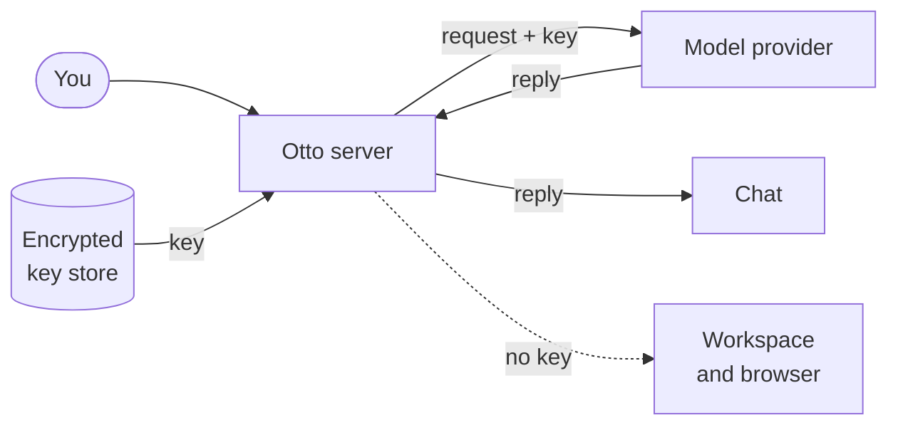

import { Steps, TabItem, Tabs } from '@astrojs/starlight/components';

Otto needs a model connection to think and reply. You connect one or more services in **Models**, then choose the model Otto uses for everything.

Your requests go to the service you connect. Paid providers bill you for use. To run a model on your own computer instead, see [Local models](/connect/local-models/).

## Supported connections

| Service           | How you connect                       | Default model                |
| ----------------- | ------------------------------------- | ---------------------------- |
| OpenAI            | API key                               | GPT-6.1 Sol, high effort     |
| ChatGPT           | Your ChatGPT plan, in local Otto only | GPT-6 Sol, high effort       |
| Anthropic         | API key                               | Claude Opus 5.5, high effort |
| OpenRouter        | API key, or sign in with your browser | GPT-6.1 Sol, high effort     |
| OpenAI-compatible | Server address, in local Otto only    | You choose                   |

You can switch to any other model the service offers.

:::note[Why there's no Claude subscription]
Anthropic's [authentication conditions](https://code.claude.com/docs/en/legal-and-compliance) don't let a Claude plan supply model access to Otto. Use an Anthropic API key or OpenRouter for Claude models.
:::

## Connect a service

Open the account menu and select **Models**. Onboarding shows the same options before your first chat.

<Tabs syncKey="model-service">
<TabItem label="OpenAI">

<Steps>

1. Next to **OpenAI**, select **Add API key**.
2. Paste your key into **OpenAI API key**, then select **Save connection**.

</Steps>

</TabItem>
<TabItem label="ChatGPT">

<Steps>

1. Next to **OpenAI**, select **Connect ChatGPT**.
2. Sign in to ChatGPT in the browser tab that opens.
3. Return to Otto. If the browser ends on a page that doesn't load, copy its full address into **Callback URL** and select **Complete sign-in**.

</Steps>

ChatGPT sign-in listens for the browser on port `1455` of your computer. If another program uses that port, Otto stops with an error before it opens OpenAI.

</TabItem>
<TabItem label="Anthropic">

<Steps>

1. Next to **Anthropic**, select **Add API key**.
2. Paste your key into **Anthropic API key**, then select **Save connection**.

</Steps>

</TabItem>
<TabItem label="OpenRouter">

<Steps>

1. Next to **OpenRouter**, select **Connect account** to sign in with your browser, or **Add API key** to paste a key.
2. Finish the sign-in, or select **Save connection** for a key.

</Steps>

Otto lists the OpenRouter models that support text and tools.

</TabItem>
<TabItem label="OpenAI-compatible">

<Steps>

1. Next to **OpenAI-compatible**, select **Add server**.
2. Check the **Server address**. Otto fills in Ollama's address, `http://localhost:11434/v1`. Add an **API key** only if the server needs one.
3. Select **Save connection**.

</Steps>

Use this for Ollama, LM Studio, vLLM, llama.cpp and hosted services with an OpenAI-compatible API. See [Local models](/connect/local-models/) for server setup and what changes.

</TabItem>
</Tabs>

## Switch and manage connections

All the models from your connections appear in one searchable list. Choosing a model also chooses the connection that pays for it.

| To                     | Do this                                                                      |
| ---------------------- | ---------------------------------------------------------------------------- |
| Switch model           | Select the model name above the message box, then pick a model.              |
| Update a model list    | In **Models**, select the refresh button next to the connection.             |
| Fix an expired sign-in | Select **Reconnect** on a ChatGPT or OpenRouter sign-in connection.          |
| Remove a connection    | Select the remove button next to it. If it was selected, choose a new model. |

## One model for everything

Otto uses the same model choice in the app, Telegram and WhatsApp. A task that's already running keeps the model it started with.

If a model request fails, Otto doesn't switch to another connection. It retries a temporary provider error, such as an overload or rate limit, up to three times.

Background work, such as memory upkeep, uses a smaller model from the same connection when it has one, such as `gpt-6-luna` or `claude-haiku-4-5`. Otherwise it uses your model. Background work and checks that use your selected model use the lightest reasoning it offers: off, minimal, low or medium in that order, or the model's first effort level if it offers none of these.

## Decision checks

Two checks can use a decision model: reading whether your reply to a confirmation approves it, and checking whether an email Otto reads through your apps gives access to an account. Without a decision model, the email check uses your connection's smaller background model. Your selected model decides whether an action can run, writes and fact-checks confirmation questions, and writes messages.

| Current connection   | Decision checks                                        |
| -------------------- | ------------------------------------------------------ |
| OpenAI API key       | GPT Decisions (`gpt-6-luna`) with the same key         |
| OpenRouter           | Jev (`typesafe/jev-1.13`) with the same OpenRouter key |
| Anthropic directly   | Your selected model                                    |
| ChatGPT subscription | Your selected model                                    |
| OpenAI-compatible    | Your selected model                                    |

These calls are billed through the connection that runs them. GPT Decisions is paid API use, separate from a ChatGPT subscription. OpenRouter sends the checks to TypeSafe, even when you selected a chat model from another provider. See [OpenAI Decisions](https://developers.openai.com/api/docs/guides/decisions) and [Jev on OpenRouter](https://openrouter.ai/blog/insights/what-is-jev/).

In a source install, set `TYPESAFE_API_KEY` in `.env` to use Jev directly (`jev-1.13.0`) for these checks. The key selects TypeSafe regardless of your chat connection. Remove it to use the connection rules above, and restart Otto after either change. The key stays on the server and is not added to **Models**.

A failed decision request does not switch providers or approve anything: the confirmation stays pending, and your reply reaches Otto as an ordinary message. A failed email check hides that email's content. See [Approvals and the trust check](/trust/approvals/).

:::note[Voice needs its own key]
Spoken replies need an OpenAI API key in server settings (`OPENAI_API_KEY`). An OpenAI key in **Models** or a ChatGPT plan doesn't turn on voice.
:::

## Set connections in server settings

In a source install, you can add connections in `.env` instead. They show **Server settings** in **Models**, and you remove them from `.env`, not from the app. OpenAI-compatible servers are added only in the app.

| Setting              | What it does                                                            |
| -------------------- | ----------------------------------------------------------------------- |
| `OPENAI_API_KEY`     | Adds an OpenAI connection. Also enables voice.                          |
| `ANTHROPIC_API_KEY`  | Adds an Anthropic connection.                                           |
| `OPENROUTER_API_KEY` | Adds an OpenRouter connection.                                          |
| `LLM_PROVIDER`       | Sets the first choice: `openai` (default), `anthropic` or `openrouter`. |
| `LLM_MODEL`          | Sets the first model. Leave it empty for the service default.           |

```sh title=".env"
LLM_PROVIDER=anthropic
ANTHROPIC_API_KEY=<your-key>
```

A model you choose in the app takes priority over `LLM_PROVIDER` and `LLM_MODEL`. Restart Otto after you edit `.env`.

## Where your keys go

The Otto server adds your key to each model request. The key never enters the workspace, Otto's browser or the model's context.



- Otto encrypts saved keys and sign-ins with the Vault key. The Mac keeps that key in Keychain, and the Windows app protects it with Windows DPAPI. Other source installs need `OTTO_VAULT_KEY`.
- Keys from `.env` stay in server memory and aren't copied into the database.
- Your browser doesn't store the key, and Otto removes it from provider errors.

## Related resources

- [Local models](/connect/local-models/)
- [Apps with Composio](/connect/apps/)
- [MCP servers, APIs and CLIs](/connect/mcp-api-cli/)
- [Configuration](/deploy/configuration/)
- [Spending](/use/spending/)
- [Your data and privacy](/trust/privacy/)
