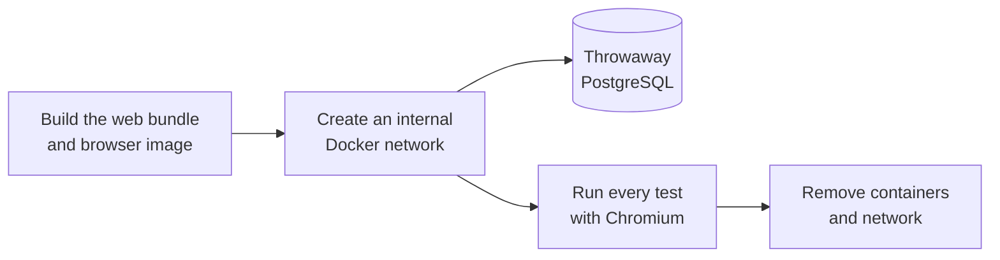
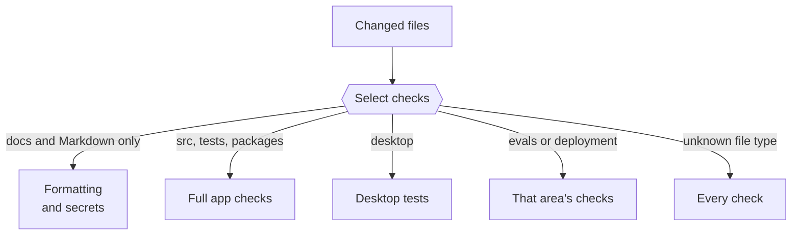

This page lists the checks to run before you open a pull request, the tests worth writing and what CI checks for each change.

## Run the checks

Run these four commands before you open a pull request:

```sh title="Terminal"
pnpm run check             # types, import boundaries, formatting
pnpm test                  # deterministic tests; database cases skip without TEST_DATABASE_URL
pnpm run test:integration  # every test in Linux with a disposable PostgreSQL and Chromium
pnpm run build             # types and web bundle
```

`pnpm run format` fixes formatting. To run one test file while you work:

```sh title="Terminal"
pnpm exec tsx --test tests/approvals.test.ts
```

## Git hooks

`pnpm install` sets up Git hooks with [Lefthook](https://github.com/evilmartians/lefthook).

| Hook       | What runs                                                                                                                                           |
| ---------- | --------------------------------------------------------------------------------------------------------------------------------------------------- |
| Pre-commit | Prettier formats your staged files. If [Gitleaks](https://github.com/gitleaks/gitleaks) is installed, it scans them for secrets.                    |
| Pre-push   | `pnpm run lint`: `pnpm run check` without formatting. It type-checks, checks import boundaries and checks that the workspace images share packages. |

Secret scanning skips its generic keyword check in tests and fixtures. Known key formats fail everywhere, so keep test values synthetic.

## Extra checks for some areas

| If you change | Also run                                                 |
| ------------- | -------------------------------------------------------- |
| `desktop/`    | `pnpm run desktop:test`                                  |
| `evals/`      | `pnpm --dir evals run check` and `pnpm --dir evals test` |
| `docs/`       | `pnpm --dir docs build`                                  |

The [capability evals](/contribute/evals/) call live models, so they aren't part of these checks. They run nightly and on request.

When the evaluation harness changes, CI starts PostgreSQL for its database checks. These checks use synthetic data and disposable schemas.

## Integration tests

`pnpm run test:integration` runs every test file in Linux, with Chromium and a throwaway PostgreSQL database. It never uses your local database or credentials.



The network has no internet access, and your source folders are mounted read-only. The run fails if any test is skipped.

Wait for a controlled frame to finish loading before checking an old control binding. A reload can still show the previous document while navigation is pending.

## Write tests that catch real regressions

Add a test only when it would catch a real regression in one of these areas. Extend the existing file for that area instead of adding a new one.

| Area                  | For example                                                                                         |
| --------------------- | --------------------------------------------------------------------------------------------------- |
| Core harness          | One thread and Pi session per owner, turns one at a time, stop, interruption, reset, session rebase |
| Sandbox isolation     | Nothing on the host, no keys in the sandbox, contained paths                                        |
| Safety                | Approvals, uncertain actions, Vault and sign-in fencing, onboarding task cards                      |
| Owner isolation       | Owner scoping, local access, URL guards, redaction                                                  |
| Integration contracts | Channel delivery, schedule firing, downloads, OAuth completion                                      |

Leave out tautological tests, mocks that return what they were told, and tests of UI copy, wording, CSS, constants or configuration. For a change in `src/web`, check it in the running app instead.

## Keep test data synthetic

- Use made-up names, addresses such as `example.com` and fake keys.
- Use disposable database schemas. Never reset or write to your normal local database.
- Never call a live model, a connected account or a real recipient from a test.
- Keep keys, real accounts and private content out of fixtures, logs and screenshots.

## RTK workspace check

The workspace image includes [RTK](https://github.com/rtk-ai/rtk), which shortens command output for the model. This check measures its savings and confirms that exports and file searches stay unfiltered. It runs 15 synthetic cases in disposable containers with networking off. It doesn't call a model or a connected account.

```sh title="Terminal"
docker build -f Dockerfile.workspace -t nod-eval-workspace:latest .
pnpm exec tsx scripts/eval-rtk.ts --smoke
```

`--smoke` runs each case once. Leave it out for three repetitions. Results go to `.local/rtk-eval/candidate`.

To compare with an image built without RTK, run `--phase baseline --baseline <commit> --image <baseline-image>` with the same case version and repetition count. Then run `node scripts/eval-rtk-report.mjs` for the chart and summary.

## What CI checks

CI reads the files a pull request changes and runs only the checks those files need. Formatting and secret scanning always run. The required **Checks, tests and build** result is present on every pull request, and fails if the scope check fails.



| You change                                       | CI also runs                                                                                                                                 |
| ------------------------------------------------ | -------------------------------------------------------------------------------------------------------------------------------------------- |
| `docs/`, Markdown files, `LICENSE` or `NOTICE`   | Nothing more. This is the light path. A `docs/` change also runs the **Docs** workflow, which builds the site and checks its internal links. |
| Only a release's version, manifest and changelog | The release metadata and source check. Installers are built after merge.                                                                     |
| `src/`, `public/` or `tests/`                    | `pnpm run check`, the build, integration tests, image checks, and the desktop and eval checks                                                |
| Root package files, lockfile or Dockerfiles      | All of the above, plus the n8n delivery checks                                                                                               |
| `desktop/`                                       | Desktop tests                                                                                                                                |
| `evals/`                                         | `pnpm --dir evals run check` and `pnpm --dir evals test`                                                                                     |
| `deployment/n8n/`                                | The n8n delivery contract tests                                                                                                              |

A manual CI run uses every check. The exception is a run on `release/desktop`, which compares that branch with `main`. The rules are in [`.github/scripts/ci-scope.mjs`](https://github.com/n8n-io/nod/blob/main/.github/scripts/ci-scope.mjs).

nod keeps no Git notes. Every CI run deletes any `refs/notes/*` ref on GitHub, such as the AI authorship notes that [git-ai](https://usegitai.com) pushes after each `git push`. GitHub can't block notes refs, and git-ai skips Git hooks, so don't run tools that push notes in this repository.

CI does not package desktop apps on pull requests or normal merges to `main`. Only **Build desktop release** packages the apps. It checks Mac updates, signature rejection and profile preservation on both Mac architectures. It also checks Windows workspace paths, installation, startup and updates. A failed check blocks publication. See [Desktop releases](/contribute/desktop-releases/).

## Related resources

- [Contribute to nod](/contribute/)
- [Capability evals](/contribute/evals/)
- [Pull requests](/contribute/pull-requests/)
- [Desktop releases](/contribute/desktop-releases/)
