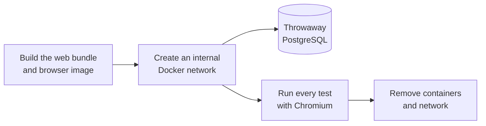
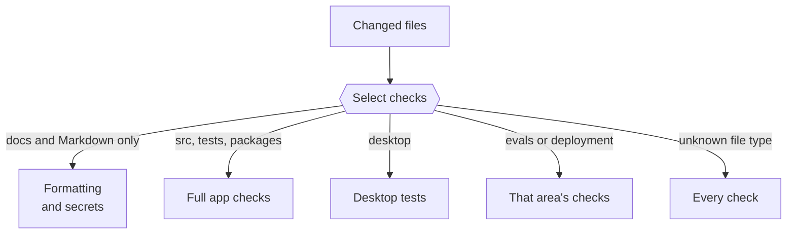

Choose checks that match the files and behavior you change. This page explains the available commands, Git hooks, test policy, and CI checks.

## Choose the checks

Start with focused checks. Run broader checks only when the change affects shared behavior or the focused checks cannot verify it.

| If you change                              | Check                                                                                                                                   |
| ------------------------------------------ | --------------------------------------------------------------------------------------------------------------------------------------- |
| README, contributor instructions, or media | Format the changed text files, check links, and review the rendered text and media. Application lint, tests, and builds are not needed. |
| Docs site pages, configuration, or code    | Run `pnpm --dir docs build` and review the affected pages.                                                                              |
| Application code                           | Run focused tests and the type, import, formatting, or build checks needed for the affected behavior.                                   |

For example, check README formatting with:

```sh title="Terminal"
pnpm exec prettier --check README.md
```

To run one test file while you work:

```sh title="Terminal"
pnpm exec tsx --test tests/approvals.test.ts
```

## Available application checks

Use these commands when needed to verify an application change. They are not a condition for opening every pull request.

```sh title="Terminal"
pnpm run check
pnpm test
pnpm run test:integration
pnpm run build
```

`pnpm run check` checks types, import boundaries, and formatting. `pnpm test` runs deterministic tests and skips database cases without `TEST_DATABASE_URL`. The integration command runs every test in Linux with disposable PostgreSQL and Chromium fixtures. The build command checks types and builds the app.

## Git hooks

`pnpm install` sets up Git hooks with [Lefthook](https://github.com/evilmartians/lefthook).

| Hook       | What runs                                                                                                                        |
| ---------- | -------------------------------------------------------------------------------------------------------------------------------- |
| Pre-commit | Prettier formats your staged files. If [Gitleaks](https://github.com/gitleaks/gitleaks) is installed, it scans them for secrets. |
| Pre-push   | `pnpm run lint`: `pnpm run check` without formatting. It type-checks and checks import boundaries.                               |

Secret scanning skips its generic keyword check in tests and fixtures. Known key formats fail everywhere, so keep test values synthetic.

## Checks for affected areas

| If you change                           | Also run                                                                                                                                      |
| --------------------------------------- | --------------------------------------------------------------------------------------------------------------------------------------------- |
| `desktop/`                              | `pnpm run desktop:test`                                                                                                                       |
| `deployment/self-host/`                 | The server and standalone bundle checks in [Self-host bundle](https://github.com/n8n-io/nod/blob/main/.github/workflows/self-host-bundle.yml) |
| `evals/`                                | `pnpm --dir evals run check` and `pnpm --dir evals test`                                                                                      |
| Docs site pages, configuration, or code | `pnpm --dir docs build`                                                                                                                       |

The [capability evals](/contribute/evals/) call live models, so they aren't part of these checks. They run nightly and on request.

When the evaluation harness changes, CI starts PostgreSQL for its database checks. These checks use synthetic data and disposable schemas.

## Security checks

The **Security analysis** workflow runs on pull requests, on `main`, and each week. Semgrep runs its `p/ci` rules on the repository. Error-level findings fail the job. Metrics and version checks are off. Review parser warnings because a partial parse can leave code unchecked. Run the same check locally:

```sh
semgrep scan --config p/ci --severity ERROR --metrics off --disable-version-check --error .
```

CodeQL checks JavaScript, TypeScript, and Python when the repository is public. To use it while the repository is private, enable GitHub Code Security and set `NOD_PRIVATE_CODEQL` to `true`. The workflow does not change repository access or branch protection.

CI also runs Gitleaks on all fetched Git refs and the checkout. It downloads the pinned scanner through the authenticated GitHub API and checks its SHA-256 before extraction. The exceptions in `.gitleaks.toml` name exact public values, source hashes, or synthetic fixtures. Do not add an exception for a live credential.

Windows CI downloads Electron through the authenticated GitHub API. The download, cached archives, native fixtures and release build use the checksums shipped with the pinned Electron package. The download token is scoped to its preparation step and is not passed to the test apps.

Native Mac update fixtures also use the checksums shipped with the pinned Electron package. They verify the archive without a separate checksum download.

Check dependency advisories in each package:

```sh
pnpm audit
pnpm --dir desktop audit
pnpm --dir docs audit
```

The workspace image installs Python packages from `src/providers/docker/workspace-artifacts.txt` and `workspace-video.txt` with `--require-hashes`. Their `.in` files hold the direct requirements. To update a file, change its `.in` file and compile it with `uv`:

```sh
uv pip compile src/providers/docker/workspace-artifacts.in --python-version 3.11 --python-platform x86_64-manylinux_2_28 --generate-hashes --no-header --no-annotate --output-file src/providers/docker/workspace-artifacts.txt
```

Use the same command for `workspace-video.in`. Check both Linux AMD64 and ARM64 installs. The desktop runtime fingerprint includes both lockfiles, so a change requires a new runtime pack.

Before changing repository visibility, scan all branches and tags. Review existing releases, Actions logs, and downloadable artifacts for private content. GitHub makes the existing Actions history and logs public with the repository. Rotate any exposed credential before publication; deleting its current file does not remove Git history.

## Integration tests

`pnpm run test:integration` runs every test file in Linux, with Chromium and a throwaway PostgreSQL database. It never uses your local database or credentials.



The network has no internet access, and your source folders are mounted read-only. The run fails if any test is skipped.

Wait for a controlled frame to finish loading before checking an old control binding. A reload can still show the previous document while navigation is pending.

## Mac guest protection

Run this check on a Mac with Docker running. It creates a disposable Lima VM from a prepared runtime pack. It tests normal startup, stacked AppArmor signals, mount restrictions, and PostgreSQL data after a restart with the old profile restored. It does not use your Nod profile or connected accounts. The check needs 3 GiB of VM memory. It stops the VM before deleting its files. If the VM cannot stop, the check keeps its control files for recovery.

```sh title="Terminal"
pnpm run desktop:prepare
NOD_TEST_GUEST_ASSETS="$PWD/.local/desktop-runtime-assets" node --test --test-name-pattern='guest repair' desktop/test/runtime-assets.test.mjs
```

The normal desktop tests skip this check when `NOD_TEST_GUEST_ASSETS` is absent or the host is not macOS.

## Write tests that catch real regressions

Add a test only when it would catch a real regression in one of these areas. Extend the existing file for that area instead of adding a new one.

| Area                  | For example                                                                                                                      |
| --------------------- | -------------------------------------------------------------------------------------------------------------------------------- |
| Core harness          | One thread per owner, saved chat and task sessions, one turn per session at a time, stop, interruption, reset and session rebase |
| Sandbox isolation     | Nothing on the host, no keys in the sandbox, contained paths                                                                     |
| Safety                | Approvals, uncertain actions, Vault and sign-in fencing, onboarding task cards                                                   |
| Owner isolation       | Owner scoping, local access, URL guards, redaction                                                                               |
| Integration contracts | Channel delivery, schedule firing, downloads, OAuth completion                                                                   |

Leave out tautological tests, mocks that return what they were told, and tests of UI copy, wording, CSS, constants or configuration. For a change in `src/web`, check it in the running app instead.

## Keep test data synthetic

- Use made-up names, addresses such as `example.com` and fake keys.
- Use disposable database schemas. Never reset or write to your normal local database.
- Never call a live model, a connected account or a real recipient from a test.
- Keep keys, real accounts and private content out of fixtures, logs and screenshots.

## RTK workspace check

The workspace image includes [RTK](https://github.com/rtk-ai/rtk), which shortens command output for the model. This check measures its savings and confirms that exports and file searches stay unfiltered. It runs 15 synthetic cases in disposable containers with networking off. It doesn't call a model or a connected account.

```sh title="Terminal"
docker build -f Dockerfile.workspace -t nod-eval-workspace:latest .
pnpm exec tsx scripts/eval-rtk.ts --smoke
```

`--smoke` runs each case once. Leave it out for three repetitions. Results go to `.local/rtk-eval/candidate`.

To compare with an image built without RTK, run `--phase baseline --baseline <commit> --image <baseline-image>` with the same case version and repetition count. Then run `node scripts/eval-rtk-report.mjs` for the chart and summary.

## What CI checks

CI reads the files a pull request changes and runs only the checks those files need. Formatting and secret scanning always run. The required **Checks, tests and build** result is present on every pull request, and fails if the scope check fails.



| You change                                       | CI also runs                                                                                                                                 |
| ------------------------------------------------ | -------------------------------------------------------------------------------------------------------------------------------------------- |
| `docs/`, Markdown files, `LICENSE` or `NOTICE`   | Nothing more. This is the light path. A `docs/` change also runs the **Docs** workflow, which builds the site and checks its internal links. |
| Only a release's version, manifest and changelog | The release metadata and source check. Installers are built after merge.                                                                     |
| `src/`, `public/` or `tests/`                    | `pnpm run check`, the build, integration tests, image checks, and the desktop and eval checks                                                |
| Root package files, lockfile or Dockerfiles      | All of the above, plus the n8n delivery checks                                                                                               |
| `desktop/`                                       | Desktop tests                                                                                                                                |
| `evals/`                                         | `pnpm --dir evals run check` and `pnpm --dir evals test`                                                                                     |
| `deployment/n8n/`                                | The n8n delivery contract tests                                                                                                              |
| `deployment/self-host/`                          | Full app checks, plus the **Self-host bundle** workflow's native builds and server and installer checks for both architectures               |

A manual CI run uses every check. The exception is a run on `release/desktop`, which compares that branch with `main`. The rules are in [`.github/scripts/ci-scope.mjs`](https://github.com/n8n-io/nod/blob/main/.github/scripts/ci-scope.mjs).

Nod keeps no Git notes. Every CI run deletes any `refs/notes/*` ref on GitHub, such as the AI authorship notes that [git-ai](https://usegitai.com) pushes after each `git push`. GitHub can't block notes refs, and git-ai skips Git hooks, so don't run tools that push notes in this repository.

CI does not package desktop apps on pull requests or normal merges to `main`. Only **Build desktop release** packages the apps. It checks Mac updates, signature rejection and profile preservation on both Mac architectures. It also checks Windows workspace paths, installation, startup and updates. A failed check blocks publication. See [Desktop releases](/contribute/desktop-releases/).

## Related resources

- [Contribute to Nod](/contribute/)
- [Capability evals](/contribute/evals/)
- [Pull requests](/contribute/pull-requests/)
- [Desktop releases](/contribute/desktop-releases/)
