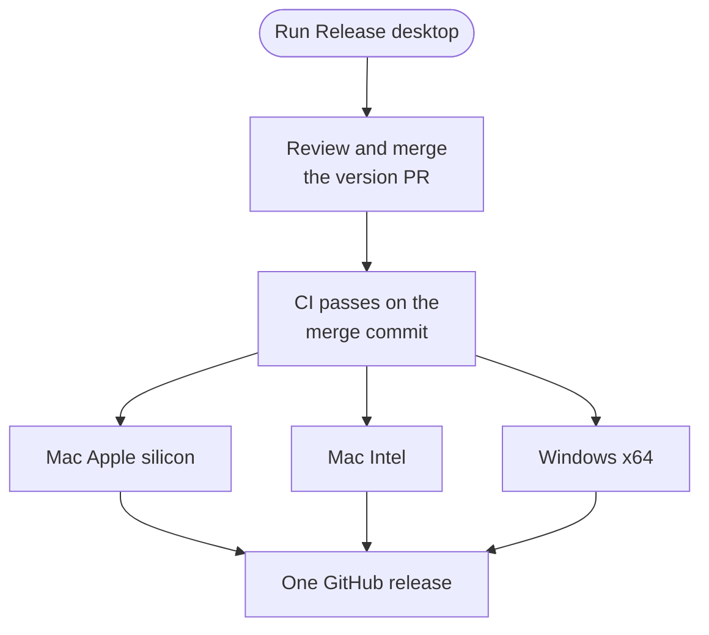

import { Steps } from '@astrojs/starlight/components';

This page is for maintainers who publish the Otto desktop app, and for anyone helping private-alpha testers install it.

The short version: run **Release desktop**, review and merge the version pull request, and CI publishes one GitHub release with all three installers.

Each release is named **Otto v0.x.x** and links these installers:

| Platform          | Installer                                                           | Updates   |
| ----------------- | ------------------------------------------------------------------- | --------- |
| Mac Apple silicon | `Otto-arm64.dmg`                                                    | Automatic |
| Mac Intel         | `Otto-x64.dmg`                                                      | Manual    |
| Windows x64       | `Otto-Setup-x64.exe` with `Otto-Runtime-win32-x64.tar.gz` (preview) | Manual    |

Mac ZIP files, runtime packs, checksums, the public certificate and update metadata stay on the same release as supporting assets.

## Configure the repository once

Create a GitHub environment named `release` with these values. Never commit certificate keys or passwords.

| Kind              | Name                             | Value                                                                                |
| ----------------- | -------------------------------- | ------------------------------------------------------------------------------------ |
| Secret            | `APPLE_CERTIFICATE`              | Base64-encoded PKCS#12 certificate and private key                                   |
| Secret            | `APPLE_CERTIFICATE_PASSWORD`     | The PKCS#12 export password                                                          |
| Variable          | `APPLE_SIGNING_IDENTITY`         | The exact certificate common name, such as `Otto Internal`                           |
| Variable          | `APPLE_CERTIFICATE_SHA256`       | Lowercase SHA-256 of the public DER certificate, from `shasum -a 256 signing.cer`    |
| Variable          | `OTTO_SIGNING_MODE`              | `self-signed`, which is also the default                                             |
| Optional variable | `OTTO_DESKTOP_UPDATE_SOURCE_URL` | Base URL of the private update service. Leave it unset to use the public GitHub API. |

- In the repository's Actions settings, allow GitHub Actions to create pull requests.
- Self-signed builds require the source repository to stay private.
- Without the original certificate export, create a code-signing certificate in Keychain Access. Export it with its private key and keep the original for later builds.

Private releases use the configured n8n download service for first-run downloads and updates. Its GitHub credential stays in n8n, and no token enters the app.

## Release a version

<Steps>

1. Open **Actions → Release desktop → Run workflow** on `main`. Leave **version** empty for the next patch, or enter a version such as `0.2.0`.

2. Review the `release/desktop` pull request. It changes only the desktop version, the release manifest and the changelog, with notes grouped by Conventional Commit type. Edit the notes if a change needs more explanation.

3. Merge after review and CI. If `main` changes before you merge, run **Release desktop** again to update the source and notes.

4. Wait for CI on the merge commit. It builds and signs the three installers, then checks signing, runtime hashes, the Windows install and the downloaded installer bytes. It publishes one release only if every build and check passes.

</Steps>

There's no daily release. Only a merged release pull request, which changes `desktop/release.json`, starts **Build desktop release**; other merges to `main` don't run it. The [capability evals](/contribute/evals/) don't gate publication.

## Inspect or recover a build

The **Build desktop release** workflow runs on `main` by hand for a draft or a recovery run.

| Input         | Off                                                            | On                                                                         |
| ------------- | -------------------------------------------------------------- | -------------------------------------------------------------------------- |
| **automatic** | Use the version and notes from the merged release pull request | Pick the next patch without a version pull request. Use for recovery only. |
| **publish**   | Leave a draft to inspect                                       | Publish after every check passes                                           |

Release builds run one at a time, and up to 100 runs can wait in the queue. A failed build can reuse its matching draft. Published assets are never replaced.

## How installed apps update

Drafts are never offered to the installer or the updater.

- The Mac app checks at startup, every six hours while it's open, and after waking if a check is due. **Check for Updates…** in the Otto menu checks right away.
- Updates download on their own, then offer **Restart** or **Later**.
- If a reply, schedule or background check is running, or Otto can't tell, it asks before restarting.
- If the runtime hasn't changed, Otto reuses it and downloads only the app.
- Windows updates are manual in the preview. Quit Otto, then run the new installer. The profile is kept.

## Help private-alpha testers

Mac testers need an Intel or Apple silicon Mac, and a supported provider API key or ChatGPT plan. They copy Otto to Applications and follow the **Open Anyway** and Keychain prompts if macOS shows them. Managed Macs may need IT approval. The first start downloads the runtime, so it needs an internet connection.

On Windows, testers download `Otto-Setup-x64.exe` and `Otto-Runtime-win32-x64.tar.gz` into the same folder. They keep the runtime pack compressed, then run the installer.

| Situation                | What to know                                                                                                                                                                  |
| ------------------------ | ----------------------------------------------------------------------------------------------------------------------------------------------------------------------------- |
| Not enough storage       | Otto needs the runtime's extracted size plus 512 MiB, and downloads also reserve the archive size. The error says how much to free. Free it and retry. Existing data is kept. |
| Moving from Otto Preview | Version 0.1.2 introduced the Otto app identity and a fresh profile. Install it by hand. There's no migration, and earlier data is left untouched.                             |
| Setup was interrupted    | Retry it.                                                                                                                                                                     |
| It still fails           | Open **Send feedback** in Chat to review and send the diagnostic report. If Chat can't open, send the visible setup error.                                                    |

:::danger[Don't delete the profile to recover]
Never delete the profile, VM, database or runtime cache as a routine recovery step. A downgrade or full backup-and-restore isn't supported. Testers should never send API keys, passwords or the settings file.
:::

In development, **Copy trace** copies the same report without sending it. `OTTO_FEEDBACK_URL` changes where feedback goes, and an empty value turns sending off.

:::caution[Hardware needs aren't measured yet]
The storage check covers installing the runtime only. The VM reserves 3 to 6 GiB of RAM and a 24 GiB virtual disk that grows as it's used.
:::

## Signing limits

:::caution[Self-signed, not notarized]
Mac builds use an internal self-signed certificate, not an Apple Developer ID, and aren't notarized. A new Mac may need **System Settings → Privacy & Security → Open Anyway**. Windows builds are unsigned and can show a publisher warning.
:::

Keeping the same certificate gives the app a stable signing identity, but macOS can still ask for Keychain approval. Otto explains that prompt before it reads saved API keys.

GitHub-hosted Mac runners can't run nested virtualization. CI checks binaries and packaging, but it can't prove Otto's private computer boots on a real Mac.

Physical Mac checks before wider distribution

Use disposable profiles and synthetic content on a physical Apple silicon Mac.

- **Fresh profile:** install, pass the first-launch gate, connect a model, finish onboarding, and confirm the runtime is prepared and the workspace and browser work.
- **Upgrade:** start from the previous signed release (0.1.2 or later). Try **Later** and **Restart**, then confirm settings, conversations, workspace and browser state survive and an unchanged runtime is reused.
- **Daily use:** check login startup, notification text and clicks, quitting, and retry after an interrupted install.
- **Oldest macOS:** run on the oldest advertised macOS version.

The full release guide, including build cost and the later Developer ID path, is in [`desktop/RELEASING.md`](https://github.com/n8n-io/otto/blob/main/desktop/RELEASING.md).

## Related resources

- [Contribute to Otto](/contribute/)
- [Pull requests](/contribute/pull-requests/)
- [Checks and tests](/contribute/checks-and-tests/)
- [Desktop app](/deploy/desktop-app/)
- [Install the desktop app](/get-started/install-desktop/)
