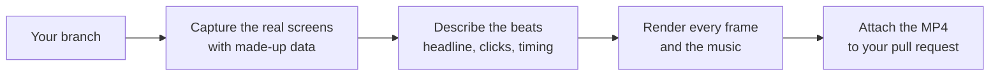

This page explains how to make a short video of a feature you built, so reviewers and users can see it working.

A feature video is a 20 to 30 second square clip. It shows the real Nod interface with made-up data, a cursor that uses your feature once, and a short headline. Make one when your pull request adds or changes something a user can see. A bug fix doesn't need one.

## How it works

The video is built from your branch's own frontend. A script runs it without a server, a database or an account, answers its requests from a file of made-up data, clicks through your feature and takes screenshots. A second script animates over those screenshots and renders the video. Nothing is screen-recorded, so nothing private can end up in it.

## Before you start

You need:

- the repository set up as in [Contribute to Nod](/contribute/#set-up-a-development-copy), with dependencies installed;
- [ffmpeg](https://ffmpeg.org/download.html);
- Chrome or Chromium;
- zsh, which macOS includes;
- a network connection, because the video loads the n8n brand fonts.

## Make a video with a coding agent

The repository includes an agent skill, `feature-video`, in `.claude/skills/feature-video`. It holds the full instructions, the templates and the scripts.

1. Open the repository in Claude Code, on your feature branch.
2. Ask for the video, for example `/feature-video for the Run now button on schedules`.
3. Watch the result. Check that every screen is your feature as it ships, and that every claim is true.
4. Drag the MP4 into the **Summary** of your pull request description.

Other coding agents can follow the same instructions. Point yours at `.claude/skills/feature-video/SKILL.md`.

The agent works in a temporary folder. Captures, pages and videos never go into the repository.

## What a good video shows

- **The real interface.** Screens come from your branch, at their real size. Nothing is redrawn.
- **One action per feature.** The click that explains it, and what Nod shows next.
- **Made-up data only.** No real accounts, emails, keys or private content. See [Pull requests](/contribute/pull-requests/#prepare-the-pull-request).
- **True claims.** Show Nod finishing a job only if you have seen it finish that job.
- **Limits that matter.** If the feature is a preview or needs something, say so in the video.

## Release videos

The same skill makes a video for a whole release from its highlights. Ask for `/feature-video for the v0.7.4 release`. It captures the screens from the release's tag.
