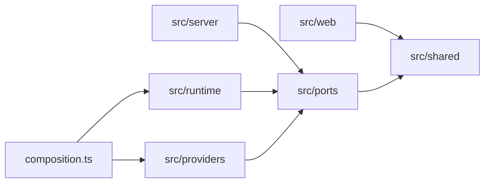

import { FileTree, Steps } from '@astrojs/starlight/components';

This section is for anyone who wants to report a problem, fix a bug or build something in Nod.

Everyone taking part follows the [code of conduct](https://github.com/n8n-io/nod/blob/main/CODE_OF_CONDUCT.md).

## Ways to help

| You want to                     | Do this                                                                                                                     |
| ------------------------------- | --------------------------------------------------------------------------------------------------------------------------- |
| Report a bug                    | Fill in the [bug report form](https://github.com/n8n-io/nod/issues/new/choose).                                             |
| Ask a question or share an idea | Start a thread in [Discussions](https://github.com/n8n-io/nod/discussions).                                                 |
| Report a vulnerability          | [Report it privately](https://github.com/n8n-io/nod/security/advisories/new). Never in a public issue.                      |
| Fix or build something          | Send a [pull request](/contribute/pull-requests/). For anything larger than a small fix, open an issue or discussion first. |

Agreeing on the approach first saves you from building something that can't merge.

## Set up a development copy

<Steps>

1. Install Node.js 24.21.0 or newer, pnpm 10.34.5, Docker with Compose v2 and Git. Development works on macOS and Linux.

2. Follow [Install from source](/get-started/install-from-source/) for the first start and credential storage setup.

3. Start Nod with automatic reload.

   ```sh title="Terminal"
   pnpm run dev
   ```

4. Connect your own model key and accounts. Never use shared, production or customer credentials.

</Steps>

`pnpm run dev` turns analytics off by default. See [Analytics](/deploy/analytics/) for the settings.

To work on the desktop app, follow its [development steps](https://github.com/n8n-io/nod/blob/main/desktop/README.md). Set `NOD_DESKTOP_USER_DATA` to a new, absolute folder path to start a development run with a fresh profile.

:::note[Separate lockfiles]
The app, the desktop build tools and the docs site each have their own pnpm lockfile. The app installs a flat `node_modules` folder so the desktop build can copy the whole engine and its dependencies.
:::

## Find your way around the code

Nod's server code is split into layers. `src/server/composition.ts` is the only file that chooses which providers and runtimes Nod uses.

<FileTree>

- src/
  - ports/ capabilities as interfaces
  - providers/ vendor SDKs such as Pi, Composio, Docker and agent-browser
  - runtime/ the agent's tools, prompts and skills
  - server/ product policy, storage and HTTP
    - composition.ts picks every implementation
  - shared/ browser-safe types
  - web/ the client
- tests/ tests for the app
- desktop/ the desktop app
- evals/ capability evals
- deployment/ self-hosting and n8n delivery
- docs/ this site

</FileTree>

`pnpm run check` enforces which layer can import which. Vendor SDKs stay in `src/providers`. Environment settings stay out of `src/runtime`, `src/ports`, `src/shared` and `src/web`.



Each arrow means "may import". Every layer may also import `src/shared`.

### Where each area lives

| Area                            | Main code                                                                                                                              | Tests                                                                                                            |
| ------------------------------- | -------------------------------------------------------------------------------------------------------------------------------------- | ---------------------------------------------------------------------------------------------------------------- |
| Thread, turns, stop and reset   | `src/server/thread.ts`, `src/runtime/`                                                                                                 | `tests/thread.test.ts`, `tests/pi.test.ts`                                                                       |
| Approvals and the trust check   | `src/server/trust.ts`, `src/server/approvals.ts`                                                                                       | `tests/approvals.test.ts`, `tests/approvals-application.test.ts`, `tests/agent-guard.test.ts`                    |
| Vault, sign-in and payments     | `src/server/vault.ts`, `src/server/vault-use.ts`, `src/server/vault-access.ts`, `src/server/vault-crypto.ts`, `src/server/payments.ts` | `tests/vault.test.ts`, `tests/vault-chat-code.test.ts`, `tests/browser-sign-in.test.ts`, `tests/browser.test.ts` |
| Workspace and browser isolation | `src/providers/docker/`, `src/providers/agent-browser/`, `Dockerfile.*`                                                                | `tests/sandbox.test.ts`, `tests/browser.test.ts`                                                                 |
| Connected apps                  | `src/server/integrations.ts`, `src/providers/composio/`, `src/providers/discovered/`                                                   | `tests/integrations.test.ts`                                                                                     |
| Channels                        | `src/server/channels.ts`, `src/providers/chat-sdk/`                                                                                    | `tests/channels.test.ts`, `tests/channel-delivery.test.ts`, `tests/channel-application.test.ts`                  |
| Schedules and background checks | `src/server/schedules.ts`, `src/server/triage.ts`                                                                                      | `tests/schedules.test.ts`                                                                                        |
| Memory                          | `src/server/memory.ts`, `src/server/memory-learning.ts`                                                                                | `tests/memory-application.test.ts`                                                                               |
| Files and downloads             | `src/server/artifacts.ts`                                                                                                              | `tests/downloads.test.ts`, `tests/download-delivery.test.ts`                                                     |
| Local access and URL guards     | `src/server/access.ts`                                                                                                                 | `tests/approvals.test.ts`, `tests/url-guards.test.ts`                                                            |
| Web client                      | `src/web/`                                                                                                                             | Check the change in the running app                                                                              |
| Desktop app                     | `desktop/`                                                                                                                             | `desktop/test/`                                                                                                  |
| Capability evals                | `evals/`                                                                                                                               | `evals/tests/`                                                                                                   |

For how a request moves through these parts, read [Architecture](/how-it-works/architecture/).

## Coding agents

Coding agents follow [AGENTS.md](https://github.com/n8n-io/nod/blob/main/AGENTS.md), and so does everyone else. It holds the rules every change follows, including the safety invariants. The same checks and review apply whether you or an agent wrote the change.

## License

Nod is licensed under the [Apache License 2.0](https://github.com/n8n-io/nod/blob/main/LICENSE). Contributions you submit are licensed under the same terms, as section 5 of the license describes.

## In this section

- [Checks and tests](/contribute/checks-and-tests/): the commands to run, Git hooks, the test policy and what CI checks.
- [Capability evals](/contribute/evals/): real tasks against real Nod, and what the nightly verdict means.
- [Pull requests](/contribute/pull-requests/): title rules, review, merging and dependency updates.
- [Desktop releases](/contribute/desktop-releases/): publish a new version of the desktop app.
- [Change analytics](/contribute/analytics/): add, change or remove an analytics event and update the dashboards.
- [Interface design](/contribute/interface-design/): colors, type, spacing and the checks for a UI change.
- [Write docs](/contribute/write-docs/): run this site and write pages in the house style.
