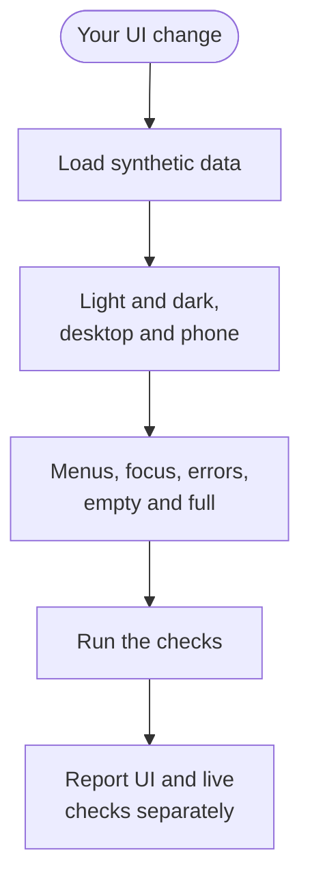

This page lists the design rules for Nod's web and desktop interface, and how to check a UI change before you open a pull request.

Nod follows the [n8n brand system](https://guidelines.n8n.design/): neutral gray surfaces, pink primary actions and clear text. Nod keeps its own symbol. It's a product mark, not a copy of the n8n logo.

## Keep it simple

Chat is the main work area. Tasks, schedules, apps, channels and the Vault support it. Keep navigation and results clear, and keep decoration out of active work.

| Do                                                      | Don't                                                   |
| ------------------------------------------------------- | ------------------------------------------------------- |
| Let the content speak for itself                        | Add eyebrow labels above titles                         |
| Use a title only when it adds something                 | Write titles that restate what the screen already shows |
| Keep text short, with little text per screen            | Explain a control that's already clear                  |
| Show a state with an icon or text, plus its color       | Let color alone carry a state or a safety decision      |
| Keep statuses, tabs and navigation items clear controls | Style controls as marketing capsules                    |

## Color

The palette lives in [`src/web/theme.css`](https://github.com/n8n-io/nod/blob/main/src/web/theme.css). Page styles use its variables. Don't add page-specific colors.

| Role                 | Variable                 | Light                    | Dark                  |
| -------------------- | ------------------------ | ------------------------ | --------------------- |
| Canvas               | `--background`           | `--white` (#fafafa)      | `--black` (#191919)   |
| Sidebar              | `--sidebar`              | #f5f5f5                  | #1f1f1f               |
| Raised surface       | `--surface`              | `--gray-0` (#fff)        | `--gray-90` (#242424) |
| Inset surface        | `--surface-inset`        | `--gray-20` (#eaeaea)    | `--gray-85` (#353535) |
| Main text            | `--foreground`           | `--black`                | `--white`             |
| Secondary text       | `--text-secondary`       | `--gray-80` (#464646)    | `--gray-30` (#d6d6d6) |
| Muted text           | `--muted-foreground`     | `--gray-70` (#676767)    | `--gray-40` (#bfbfbf) |
| Primary action       | `--primary`              | `--brand-pink` (#ff91ac) | `--brand-pink`        |
| Text on primary      | `--primary-foreground`   | `--black`                | `--black`             |
| Selected surface     | `--accent-soft`          | `--pink-10` (#ffe8ec)    | `--pink-80` (#5a0026) |
| Link and focus       | `--link`, `--ring`       | `--pink-70` (#87003c)    | `--brand-pink`        |
| Sent message         | `--chat-sent`            | `--pink-20` (#ffd0d9)    | `--pink-80`           |
| Text on sent message | `--chat-sent-foreground` | `--black`                | `--white`             |

Use black text on brand pink. Brand pink text doesn't have enough contrast on a light surface, so light-theme links and keyboard focus use deep pink, `--pink-70`.

| Element                                         | Minimum contrast |
| ----------------------------------------------- | ---------------- |
| Body text                                       | 7:1              |
| Small text, placeholders, links and status text | 4.5:1            |
| Essential control boundaries and focus          | 3:1              |
| Dividers                                        | Can be softer    |

Success (`--success`), warning (`--warning`), error (`--error`) and information (`--info`) are product states, each with a `-soft` background. Always pair them with an icon or text.

Native charts use the [brand's pink and neutral palette](https://guidelines.n8n.design/colors) through `--chart-1` to `--chart-12`. Use `--chart-line-1` to `--chart-line-3` for lines and bar outlines so marks stay readable on light and dark surfaces. Keep category names, values and line styles available; color alone must not identify a series. Maps, diagrams and other native visuals use the same pink selection and neutral surface tokens as the rest of the interface. Reserve success, warning, error and information colors for actual states, not chart categories.

## Type

The interface uses Geist, and code uses Geist Mono, the same fonts as the n8n editor. Both use the SIL Open Font License and are served locally from `public/fonts`. Use regular weight for body text and medium for headings.

| Use                         | Size                   | Line height            |
| --------------------------- | ---------------------- | ---------------------- |
| Page title                  | 32 px; 28 px on phones | 36 px; 32 px on phones |
| Sign-in story title         | 40 px                  | 42 px                  |
| Message and long text       | 16 px                  | 1.6                    |
| Control and supporting text | 14 px                  | At least 18 px         |
| Small graphic detail        | 10 px                  | At least 14 px         |

Turn on standard ligatures, balance short headings, and let paragraphs wrap naturally. Keep code, passwords, URLs and user content in their original case. Don't apply the brand's uppercase capsule style to technical data.

## Spacing and shape

| Rule           | Value                                                                                               |
| -------------- | --------------------------------------------------------------------------------------------------- |
| Layout spacing | 8 px steps; 4 px and 12 px for small controls and details                                           |
| Corners        | 8 px for controls, 12 px for content, 16 px for dialogs; fully round for dots, avatars and switches |
| Content width  | Pages up to 1184 px, chat up to 880 px                                                              |
| Phone inset    | 16 px                                                                                               |
| Depth          | Borders and space for lists; shadows for menus, dialogs and the composer                            |

Page padding changes with the available width. Pages share one title size, and actions align with the page heading.

## Icons and brand details

| Item               | Rule                                                                                                                                  |
| ------------------ | ------------------------------------------------------------------------------------------------------------------------------------- |
| Icon set           | [n8n icons](https://n8n-icons.vercel.app/) from `src/web/components/icons.tsx`; Lucide only where the set has no icon yet             |
| Icon sizes         | The 12 px drawing at 14 px and below, the 16 px drawing up to 18 px, scaled to 28 px for sidebar navigation; page titles have no icon |
| Icon style         | Outline by default, Solid for the selected navigation item; neutral color, pink for selected navigation, state colors on status icons |
| Connected services | Logos keep their official colors                                                                                                      |
| Dot grid           | 24 px, only on the sign-in story and the empty conversation. Never in messages, tables, forms, app lists or Settings.                 |

Don't show a construction grid. Keep the existing reduced-motion behaviour. The brand guide doesn't define motion for product interfaces yet.

The sidebar is 96 px wide when collapsed and 224 px when expanded. Keep its 44 px Nod mark and navigation icons the same size and position through the width transition. Chat message actions and composer controls share 32 px targets and 4 px gaps.

The sidebar toggle sits at the middle of its divider. Its rounded panel outline has a wider sidebar pane when open and a narrow inset when closed. Keep a 44 × 44 px target around the 32 × 32 px circular face. Reveal it near the edge after 120 ms, wait 300 ms before hiding it, and keep it visible through the sidebar transition. Keyboard focus and touch keep it available; reduced motion removes the animation and delays.

## Tooltips and shortcuts

Use `Button`'s `title` and `shortcut` props for action hints. Wrap other controls in `Tooltip` to share the same surface, spacing, and keyboard hint style.

Show hints after 100 ms of pointer hover or immediately on keyboard focus. Only show shortcuts that work on the current platform. Keep essential instructions visible without hovering.

Use `isPrimaryModifier` for Command on macOS and Control on Windows and Linux. Generate hints with `shortcutLabel` and accept only the modifiers the action supports.

## Shared tabs and action menus

Use `Tabs` for switching between related panels. Apps and workbook sheets use pills; Settings and diagnostics use the underline variant. The component owns selection, focus and arrow-key navigation. Pages own the content and can refuse a tab change while an edit needs saving. Keep page-specific tab styles to layout and spacing.

Use `ActionMenu` for a button that opens a list of actions or choices. It shares menu spacing, selection, disabled states, keyboard navigation, dismissal and focus return. Message and microphone menus reuse its surface, items and navigation while keeping their own context-click, recording and permission behavior.

Keep searchable selection in `SearchPicker`. Form popovers, editor tools, emoji pickers and native system menus retain their own interaction rules.

Rules for each surface

| Surface                   | Rule                                                                                                               |
| ------------------------- | ------------------------------------------------------------------------------------------------------------------ |
| Shell                     | Neutral sidebar, pink selection, quiet utility controls                                                            |
| Chat                      | Neutral received bubbles, pink sent bubbles, readable tables and files                                             |
| Composer                  | Clear boundary, visible focus, one primary send action                                                             |
| Scheduled work            | Shared title, row spacing and action height; each schedule contains its details and run history                    |
| Apps and channels         | Neutral cards, visible connection state, consistent controls                                                       |
| Vault                     | Clear selection, fields and error states; secure forms preserved; one summary line and the ways to add while empty |
| Usage                     | One summary line, one cost card, a quiet statement list                                                            |
| Sign-in                   | Plain capability text, pink sign-in action, one inset story panel                                                  |
| Onboarding                | Clear connection steps, no decorative grid behind fields                                                           |
| Credentials and approvals | Clear action hierarchy; origin and expiry preserved                                                                |
| File previews             | One panel beside the chat; quiet header actions; local scrolling                                                   |
| Native desktop setup      | Same palette and type scale as the web app                                                                         |

## Check your change in the running app

The test suite doesn't cover how the interface looks. Run Nod with synthetic data and look at the change yourself.

- Check light and dark themes at desktop and phone sizes.
- Open menus and dialogs. Check selected tabs, keyboard focus, disabled controls, long text, tables and errors.
- Check empty and populated states.
- Confirm the fonts load, text contrast holds and the page doesn't scroll sideways.
- Run `pnpm run check`, `pnpm run test:integration` and `pnpm run build`. Add screenshots with synthetic data to your pull request.

## Related resources

- [Contribute to Nod](/contribute/)
- [Checks and tests](/contribute/checks-and-tests/)
- [Pull requests](/contribute/pull-requests/)
- [Write docs](/contribute/write-docs/)
