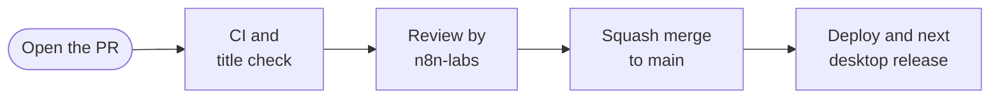
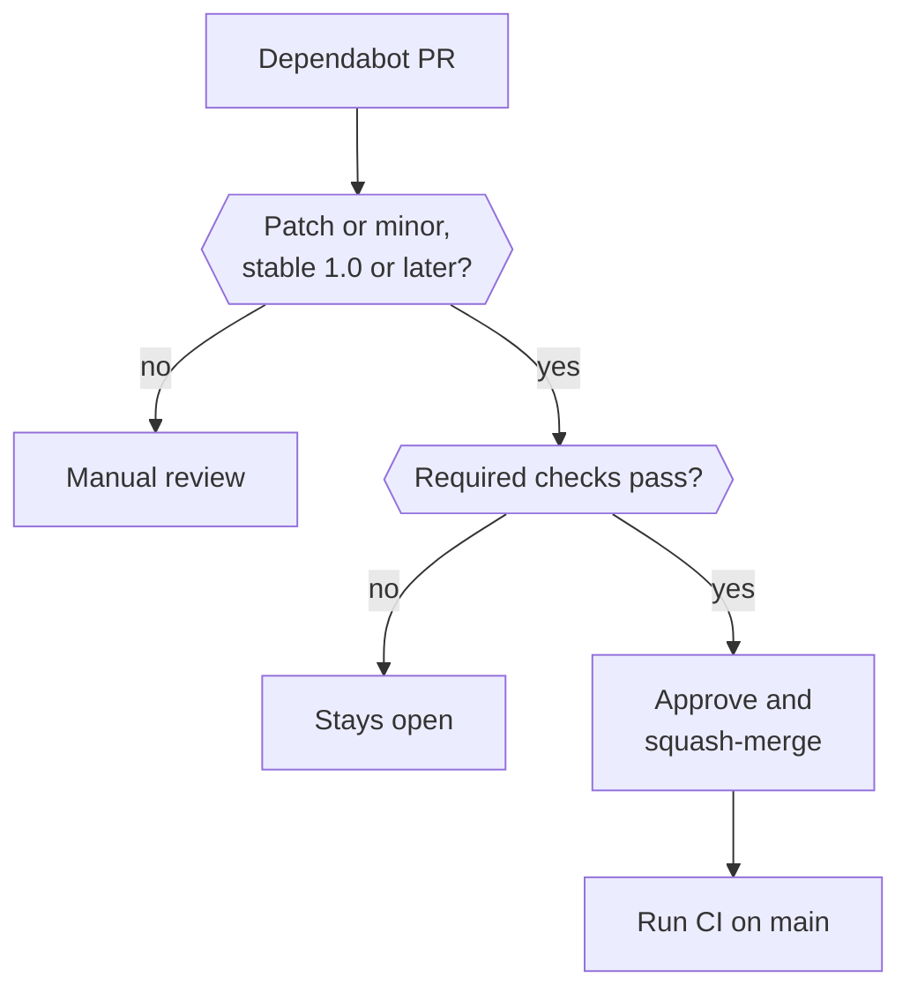

This page explains how to title and prepare a pull request, how it gets reviewed and merged, and how dependency updates flow in.

## Write the title

Every pull request title follows [Conventional Commits](https://www.conventionalcommits.org/en/v1.0.0/): `type(scope): description`. The scope is optional. Add `!` before the colon for a breaking change. The **Conventional PR title** check fails any other title.

| Title                                    | What it says                    |
| ---------------------------------------- | ------------------------------- |
| `fix(backend): handle a missing session` | A bug fix in the backend        |
| `feat(web): add keyboard controls`       | A new feature in the web client |
| `docs: explain saved browser sessions`   | A docs change with no scope     |
| `feat(api)!: remove the old route`       | A breaking change               |

Use one of these types:

| Type                   | Use it for                                  |
| ---------------------- | ------------------------------------------- |
| `feat`                 | A new feature                               |
| `fix`                  | A bug fix                                   |
| `perf`                 | A performance improvement                   |
| `refactor`             | A code change that doesn't change behaviour |
| `docs`                 | Documentation only                          |
| `test`                 | Tests only                                  |
| `build`, `ci`, `chore` | Build tooling, CI workflows and maintenance |
| `style`                | Formatting only                             |
| `revert`               | Undoing an earlier change                   |

The title matters beyond the check. Desktop release notes group merged changes by type.

## Prepare the pull request

- **Keep it focused** on one change, and fill in the template.
- **Explain why** the change is needed and how you tested it. Add screenshots or a short video for UI changes.
- **Call out safety-sensitive changes.** Changes to approvals, the trust check, Vault, sign-in, the sandbox or owner isolation get a closer review and need tests.
- **Keep secrets out.** No keys, credentials, real accounts or private content in code, tests, logs or screenshots.
- **Follow the existing style.** Otto's code has no comments or JSDoc, and its docs use short, plain sentences.

The template's checklist asks you to confirm you've seen the code, run it and take responsibility for it. That applies whether you or a coding agent wrote it. See [Checks and tests](/contribute/checks-and-tests/) for what to run first.

## Review and merge

- Workflows from first-time contributors start after a maintainer approves them.
- A member of [@n8n-io/n8n-labs](https://github.com/n8n-io/otto/blob/main/.github/CODEOWNERS) reviews every change.
- Use a squash merge for a normal pull request. Merge commits are also allowed. Rebase merges are turned off.
- Keep the pull request title as the commit title when you merge.

:::note[For maintainers]
Require **Conventional PR title** in the status checks for `main`. In the merge settings, use the pull request title and a blank body for both squash merges and merge commits.
:::

## From merge to release

When CI passes on `main`, the **Deploy production** workflow deploys that revision to the hosted service, unless a newer commit has already landed. See [Cloudflare](/deploy/cloudflare/).

Merged changes reach desktop users in the next desktop release. A maintainer runs **Release desktop**, merges its version pull request, and CI publishes one GitHub release. Installed Mac apps then update on their own. See [Desktop releases](/contribute/desktop-releases/). Source installs pick up changes with `git pull`.

## Dependency updates

[Dependabot](https://github.com/n8n-io/otto/blob/main/.github/dependabot.yml) checks for updates every Monday at 06:00 Europe/Lisbon. It covers npm packages in the app, the desktop app, the Cloudflare adapter and the docs site, GitHub Actions, Dockerfiles and Compose images.

| Rule       | What it does                                                                                                                                                                 |
| ---------- | ---------------------------------------------------------------------------------------------------------------------------------------------------------------------------- |
| Cooldown   | A version update waits until the release is at least three days old. Security updates don't wait.                                                                            |
| Grouping   | Related npm packages update together, such as Pi, Tiptap, the chat SDK, React and Tailwind. Patch and minor updates to one Docker image share a pull request across folders. |
| Limits     | Up to 10 open version-update pull requests per ecosystem. Security updates have a separate limit set by GitHub.                                                              |
| Auto-merge | Verified patch and minor updates merge on their own once required checks pass. Every dependency in a group must qualify.                                                     |

Major updates, pre-1.0 npm versions, npm prereleases and unclassified updates always wait for a person. So do GitHub Actions updates, because they change workflow files, which need a code owner's review. A passing CI run lowers the risk of an update, but it doesn't guarantee compatibility.

The [merge workflow](https://github.com/n8n-io/otto/blob/main/.github/workflows/dependabot-auto-merge.yml) never checks out pull request code. It binds the approval and merge to one signed Dependabot commit and waits up to 60 minutes for checks. If checks fail or the commit changes, the pull request stays open. After you fix or rerun CI, rerun the merge workflow if needed.

GitHub doesn't trigger workflows from a merge made with `GITHUB_TOKEN`, so the workflow starts CI on `main` itself. That CI run then deploys as usual. If the dispatch fails, rerun CI on `main` by hand.

Repository settings auto-merge needs

- `Checks, tests and build`, `Secret scanning` and `Conventional PR title` are required on `main`, and the branch must be up to date.
- `main` requires one approving review and a code owner's review.
- GitHub Actions is allowed to approve pull requests. Its approval satisfies the one-review rule, but it isn't a code owner.
- [CODEOWNERS](https://github.com/n8n-io/otto/blob/main/.github/CODEOWNERS) leaves npm manifests, lockfiles, Dockerfiles and `compose.yaml` without owners, so the workflow's approval can merge them.
- The `auto-merge` job itself isn't a required check, because it waits for the required checks.

:::caution[Not every pin is covered]
Dependabot doesn't update Python packages installed inline in Dockerfiles, tools downloaded by pinned workflow commands, or the desktop runtime's custom build lock. Update those by hand.
:::

Known vulnerabilities that reach only the docs site and have no usable fix are listed in [`docs/osv-scanner.toml`](https://github.com/n8n-io/otto/blob/main/docs/osv-scanner.toml), each with its reason and a review date. OSV-Scanner and OpenSSF Scorecard skip them until that date.

## Related resources

- [Contribute to Otto](/contribute/)
- [Checks and tests](/contribute/checks-and-tests/)
- [Desktop releases](/contribute/desktop-releases/)
- [Write docs](/contribute/write-docs/)
