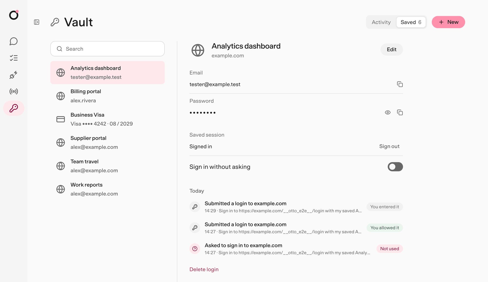
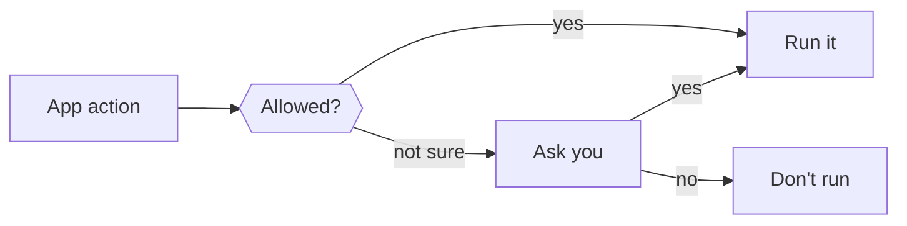
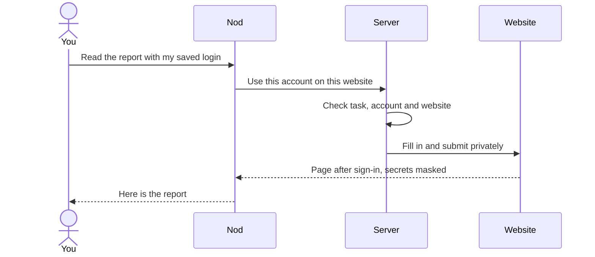
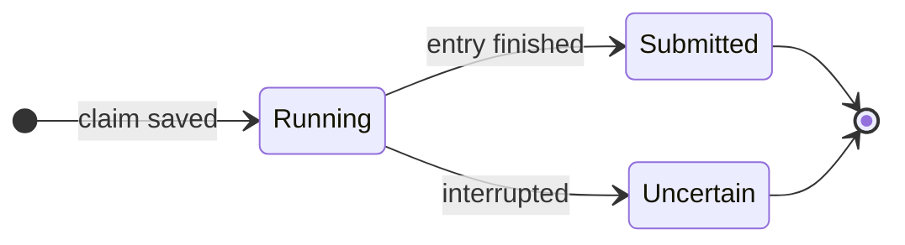

import {
  Aside,
  Badge,
  Card,
  CardGrid,
  FileTree,
  LinkCard,
  Steps,
  TabItem,
  Tabs,
} from '@astrojs/starlight/components';

This page explains how to run the Nod docs on your computer, how to write a page that reads like the rest of the site, and which components and diagrams you can use.

The short version: write for a busy person who has never seen Nod's code. Lead with the answer. Use short sentences, "you", and a diagram whenever something moves between parts.

## Run the docs locally

The docs are an [Astro Starlight](https://starlight.astro.build) site in the `docs` folder. It has its own lockfile, like `desktop`.

<Steps>

1. Install the docs dependencies.

   ```sh title="Terminal"
   pnpm --dir docs install --frozen-lockfile
   ```

2. Start the dev server. It reloads when you save a page.

   ```sh title="Terminal"
   pnpm --dir docs dev
   ```

3. Open `http://localhost:4321/docs/` in your browser.

4. Before you open a pull request, build the site. The build fails on a broken link or a missing heading anchor.

   ```sh title="Terminal"
   pnpm --dir docs build
   ```

</Steps>

On every pull request that changes the site, the **Docs** workflow builds it as it ships to `nod.n8n.io`, checks every internal link, and attaches the built site to the run as the `nod-site` artifact.

## Publish the docs

The Cloudflare Pages project **nod-n8n**, at [nod.n8n.io](https://nod.n8n.io/), serves the landing page, `src/pages/next.astro`, at its root and these docs under `/docs/`. Its production branch is `main`. The build puts the docs under `/docs/`, then copies the landing page and the 404 page to the root. Without a root `404.html`, Pages serves the landing page for every unknown address.

Every push to `main` that changes the site runs the **Docs** workflow, which builds the site and deploys it. To redeploy without a change, run the workflow on `main` from the **Actions** tab. The deploy job runs in the `nod-n8n` GitHub environment, which only `main` can use, and reads its `CLOUDFLARE_ACCOUNT_ID` and `CLOUDFLARE_API_TOKEN` secrets. The token needs **Cloudflare Pages: Edit** on the project's account. That permission covers every Pages project in the account, so keep the token in that environment only.

## Where pages live

<FileTree>

- docs/
  - astro.config.mjs site settings, sidebar and plugins
  - src/
    - content/docs/ every page, one file per page
      - index.mdx the home page
      - get-started/
      - use/
      - trust/
      - connect/
      - how-it-works/
      - deploy/
      - contribute/
    - assets/ images and screenshots
    - styles/theme.css the Nod theme

</FileTree>

Each folder under `src/content/docs` is one sidebar section. The file name becomes the URL, so `trust/payments.md` is published at `/trust/payments/`. Set the order inside a section with `sidebar.order` in the front matter.

Use `.md` for most pages. Use `.mdx` only when the page needs a component such as `<Steps>` or `<Tabs>`.

## Start from this template

```md title="src/content/docs/use/example.md"
---
title: Do the thing
description: One sentence that says what this page helps you do. Search engines and link previews show it.
sidebar:
  order: 3
---

One sentence that answers the question this page is about.

A short paragraph with the context a newcomer needs.

## Do the thing

1. Open **Settings → Example**.
2. Turn on **Example**.

## How it works

A diagram, then two or three short paragraphs.

## Related resources

- [Parent page](/use/chat/)
- [Sibling page](/use/tasks/)
```

## Write like the rest of the docs

Nod's docs follow the [n8n docs style](https://docs.n8n.io/contribute/contribution-guide-for-n8n-docs/style-guide-for-n8n-docs), which builds on the Microsoft Writing Style Guide.

### Plain language

| Avoid                                        | Use instead            |
| -------------------------------------------- | ---------------------- |
| utilize, leverage                            | use                    |
| in order to                                  | to                     |
| functionality, capabilities                  | features, what it does |
| It's important to note that X                | X                      |
| Nod provides a powerful, seamless way to ... | Nod lets you ...       |
| The owner                                    | you                    |
| Pi, the agent, the LLM (in user pages)       | Nod, or the model      |

- **Lead with the answer.** Put one sentence under the title that says what the page lets you do.
- **Keep sentences short.** One idea each, under 25 words. Split anything held together by a semicolon.
- **Cut filler and marketing.** No "simply", "powerful", "robust" or "seamless". Say what happens.
- **Be exact.** Write "for 90 days", not "for a while". Write "Nod asks you", not "Nod may ask".
- **Lead with the action.** "To stop Nod, select **Stop**", not "There is a button that stops Nod".

### Voice and person

- Talk to the reader as "you". Name Nod in the third person: "Nod asks", not "we ask".
- Use active voice: "The server checks the action", not "The action is checked".
- Use contractions: "don't", "can't", "you'll".
- Use "they" for an unknown person.

### Formatting

- Headings use sentence case and say what the section is about: "Approve a payment", not "Payments flow".
- UI labels are bold and match the app exactly: **Settings → Memory**, **Sign in again**.
- File names, commands, settings and code are in `code`. Placeholders look like `<your-key>`.
- Use the Oxford comma, one space between sentences, and no em dashes or ellipses.
- Write numbers from zero to nine as words and 10 or more as numerals, except for versions, sizes and percentages.

### Page shape

- **One page, one job.** Split a page when it mixes how-to steps with a long explanation.
- **Self-contained sections.** Someone may land on a heading from search. Restate the one fact the section needs instead of writing "as mentioned above".
- **Landing pages list their children** under **In this section**, with one line each.
- **Child pages end with Related resources**: a link to the parent and to sibling pages.
- **Explain limits honestly.** If a check doesn't cover something, say so in a `caution` aside.

## Link to other pages

Write internal links as site paths that start and end with `/`. The build adds the `/docs/` prefix and checks that every page and heading exists.

```md
See [Approve one payment](/trust/payments/#approve-one-payment).
```

Link to source files with full GitHub URLs, such as [`src/server/trust.ts`](https://github.com/n8n-io/nod/blob/main/src/server/trust.ts). Link at the first useful mention only.

## Components

Import components at the top of an `.mdx` page:

```mdx
import { Aside, Steps, Tabs, TabItem } from '@astrojs/starlight/components';
```

### Asides

Use an aside for one thing the reader must not miss. Keep it to two sentences.

:::note
A **note** adds useful context.
:::

:::tip[Shortcut]
A **tip** saves time. You can give any aside a custom title.
:::

:::caution
A **caution** warns about a limit or a step that's easy to get wrong.
:::

:::danger
A **danger** aside warns about data loss or a security risk.
:::

```md
:::caution[Back up the Vault key]
Saved logins can't be read without it.
:::
```

Asides work in `.md` and `.mdx` pages.

### Steps

Wrap a numbered list in `<Steps>` for a procedure. Each step starts with a verb.

<Steps>

1. Open **Vault**.
2. Select **Add**, then **Login**.
3. Enter the website, username and password, then select **Save**.

</Steps>

### Tabs

Use tabs when the same task differs by platform or setup.

<Tabs syncKey="platform">
  <TabItem label="macOS" icon="apple">
    Nod keeps the Vault key in the macOS Keychain.
  </TabItem>
  <TabItem label="Linux" icon="linux">
    Set `NOD_VAULT_KEY` in `.env` before the first start.
  </TabItem>
</Tabs>

Tabs with the same `syncKey` switch together across the page.

### Cards and link cards

Use cards for a short grid of ideas, and link cards to send readers onward.

<CardGrid>
  <Card title="Card" icon="puzzle">
    Two lines at most.
  </Card>
  <Card title="Another card" icon="padlock">
    Starlight's icon names work here.
  </Card>
</CardGrid>

<LinkCard title="Trust and Vault" href="/trust/" description="How Nod keeps you in control." />

### Badges

Mark status inline: <Badge text="Preview" variant="caution" /> <Badge text="Local only" variant="note" /> <Badge text="New" variant="success" />.

```mdx
<Badge text="Local only" variant="note" />
```

### Code blocks

Give a code block a `title` when it's a file or a terminal. Mark lines to draw attention.

```sh title=".env" {2} ins={3}
PORT=4310
NOD_VAULT_KEY=<your-key>
OPENAI_API_KEY=<your-key>
```

````md
```sh title=".env" {2} ins={3}
PORT=4310
NOD_VAULT_KEY=<your-key>
OPENAI_API_KEY=<your-key>
```
````

### Images

Store screenshots in `src/assets/screens` and use synthetic data only. Write alt text that says what the image shows.

```md

```

## Diagrams

Draw diagrams with [Mermaid](https://mermaid.js.org) in a `mermaid` code block. They follow the site's light and dark theme. Keep each diagram small: about eight boxes, short labels and one idea. Draw decisions as hexagons, `{{Like this?}}`, because diamonds grow very tall. Prefer `flowchart TD` when a left-to-right chart would be wider than about five boxes.

Add a class to highlight a box:

| Class       | Use it for                         |
| ----------- | ---------------------------------- |
| `:::accent` | The part the page is about, or you |
| `:::muted`  | Background or optional parts       |
| `:::go`     | A step that runs                   |
| `:::stop`   | A step that is refused or held     |

### Flowchart

Use a flowchart for parts and the paths between them.



````md

````

### Sequence diagram

Use a sequence diagram when the order of messages matters.



### State diagram

Use a state diagram for something that moves through a few states.



## Check your page

- [ ] The first sentence answers what the page is for.
- [ ] Every heading says what its section covers.
- [ ] Steps start with a verb and match the labels in the app.
- [ ] Diagrams have eight boxes or fewer and short labels.
- [ ] No keys, real accounts or private data in text, code or screenshots.
- [ ] `pnpm --dir docs build` passes.

## Related resources

- [Contribute to Nod](/contribute/)
- [Checks and tests](/contribute/checks-and-tests/)
- [Pull requests and releases](/contribute/pull-requests/)
