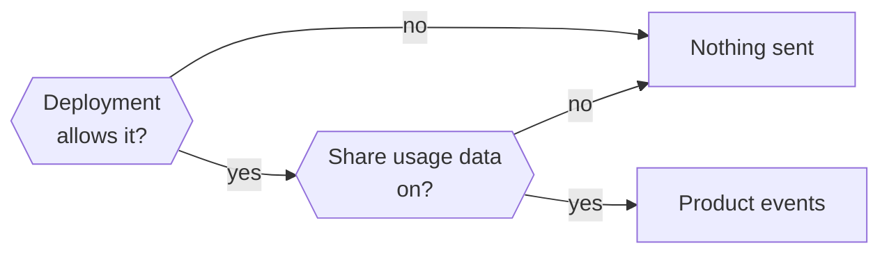

Nod shares bounded product events so the team can understand usage, reliability, and cost. These analytics never capture screen recordings or session replays.

Usage sharing is on for new owners. It sends bounded product data to the Nod team at n8n through its EU-hosted PostHog project, including from independent source installations. The public ingestion identifier is fixed; there is no runtime override for another project.

Messages, generated content, connected-app results, and credentials are excluded from analytics events. About you sends only fixed choices and stores them on a PostHog person profile tied to the analytics ID so the team can filter usage by those answers. Answers you choose to submit in an in-app [survey](#surveys), including typed text, are the content exception. If you enter an email address for updates about Nod and other n8n products and tick its consent checkbox in onboarding, Nod stores that address on the same PostHog profile and sends an unverified signup request to n8n's Customer.io Labs workspace only if **Share usage data** is on when you submit. Fixed About you choices accompany it only if you shared them successfully. Submission sends no email; later notifications require a separate double opt-in confirmation. While sharing is on, a separate model request assigns a fixed [task category](#task-categories); its input goes to your selected model connection, not PostHog.

## Turn usage sharing on or off

Change **Share usage data** in **Settings → Privacy & data**. Existing owners keep their saved choice. The welcome screen, About you's opening message and onboarding's privacy step say that usage data is shared. A fresh packaged local app records when its first native setup window becomes visible while sharing is on by default; returning profiles wait for their saved choice before recording an app open.

The deployment must also allow collection. `NOD_ANALYTICS_ENABLED=false` always disables it.

| Setting                     | Effect                                                                                    |
| --------------------------- | ----------------------------------------------------------------------------------------- |
| `NOD_ANALYTICS_ENABLED`     | `false` disables analytics events. `true` enables availability, including in development. |
| `NOD_ANALYTICS_ENVIRONMENT` | Labels source-install events `production` or `development`; it doesn't enable collection. |

Restart Nod after changing either variable. To disable the separate feedback collector too, set `NOD_FEEDBACK_ENABLED=false`. Model providers, connected services, and software updates have separate network access.

Opt-out drops unsent events. Turning sharing back on doesn't revive events from the earlier sharing period. It can't recall an opening event already sent under the default-on setting or other events already transmitted.

### Stop sharing or delete past data

Turning sharing off stops new analytics events and person-profile updates. It doesn't delete past PostHog or Customer.io data, including About you answers and an email address already stored on a profile. An email submission already in flight may still reach either service when sharing is turned off. Use **Send feedback** or privacy@n8n.io to request deletion from the Nod team.

## Identity and environments

Analytics groups observed events by a pseudonymous analytics ID (`local:<UUID>`) stored with the server data root. A local desktop uses its local profile; web and desktop clients connected to one server share that server's ID. The team counts each unique ID once as an observed install; there is no separate install event. A fresh packaged local app can first appear when its native setup window opens. Other IDs can first appear later than installation or first open. A local desktop records a verified remote-server connection under its own ID when both collection and the server owner's saved usage-sharing choice allow it. Later activity on that server uses a different ID and is not joined to the desktop ID. Distinct-ID charts count observed sharing runtime profiles, not downloads, verified client installations, devices, or people.

The ID persists across updates while its data root exists; removing that data creates a new ID, while a copied profile or explicitly supplied server ID can reuse one. An ID's first recorded `v4` production event marks when it entered the observed sample, not its install or first-open time. Events appear only while collection and sharing are enabled.

The About you profile can link this ID's events to its fixed choices. If you submit an email address in onboarding, PostHog can link that usage to the address too.

| Runtime                      | Identity storage               | Collection available by default |
| ---------------------------- | ------------------------------ | ------------------------------- |
| Source or self-hosted server | `<NOD_DATA_ROOT>/analytics-id` | `NODE_ENV=production`           |
| Local desktop runtime        | Desktop profile                | Packaged apps                   |

Official Mac, Windows and Linux desktop releases label events as `production`. Pull request and manual preview builds use `development`.

The owner's sharing choice still applies. Nod disables IP geolocation. Ordinary events don't create PostHog person profiles. Submitting About you explicitly creates or updates a profile with fixed choices under the analytics ID while **Share usage data** is on. This happens whether or not you provide an email. The profile has `onboarding_profile_completed=true` and one property per question:

| Person property           | Value                                                                |
| ------------------------- | -------------------------------------------------------------------- |
| `onboarding_scope`        | Fixed choice or `skipped`                                            |
| `onboarding_roles`        | Array of fixed choices, `other` for a typed answer, or `['skipped']` |
| `onboarding_who_for`      | Fixed choice, `skipped`, or `not_asked`                              |
| `onboarding_company_size` | Fixed choice, `skipped`, or `not_asked`                              |
| `onboarding_jobs`         | Array of fixed choices, `other` for a typed answer, or `['skipped']` |

With **Mostly personal life**, Nod still asks about occupation but skips who-for and company size. Both properties use `not_asked` in the event and on the person profile.

The typed **Something else** text stays out of PostHog and Customer.io. The `onboarding_profile_answered` event keeps per-option booleans for event-time analysis. A new About submission removes any old per-option person properties; existing profiles keep them until resubmitted. Separate consent lets Nod add `email` and the consent flag, time, version, exact checkbox wording, and privacy policy link to the same PostHog profile. The fixed choices accompany the Customer.io signup only after they were shared successfully.

Packaged release builds with a plain `x.y.z` version report `production`. Local and prerelease desktop builds report `development`. A production source launch with `pnpm start` sets `app_version` to its Git revision when its working directory is the clean Nod repository root and no version is configured. Private self-host bundles report their verified source revision. Other source installs can set `NOD_APP_VERSION` to a release version or source revision. Source installs report `production` when `NODE_ENV=production` and `NOD_APP_VERSION` isn't a prerelease, unless overridden. Dashboards filter to production and include both staff and external usage. Internal/test exclusions are off; separating internal use into another project is deferred.

## What is excluded

- Messages, replies, task titles, summaries, quotes, and answer-choice text.
- Tool arguments and results, app records, web pages, file contents, file names, and paths.
- Names, other contact details, account names, and private owner, thread, turn, and message IDs. A separately consented onboarding email is the exception.
- Website domains, URLs, endpoint addresses, private hostnames, and IP addresses.
- Vault values and login inventories, payment amounts and currencies, card details, codes, keys, and order details.
- Raw errors, console output, and network headers or bodies.
- Owner-configured model names and endpoints. These report bounded categories such as `compatible` and `custom`.

Survey text is sent as entered, so leave out the private information listed above.

Task categories describe the inferred purpose of a request. They don't establish completed goals, usefulness, satisfaction, or frustration.

## Event properties

Events use `analytics_schema=v4`, `environment`, and `app_version` when available. This schema starts fresh; earlier analytics aren't migrated into its dashboards.

UI events add `surface` (`web` or `desktop`) and a normalized app `route`. Server events add `capture_source=server`.

Browser SDK metadata can include the browser and OS names/versions, device type, screen and viewport dimensions, SDK name/version, event time/UUID, and pseudonymous session/window IDs. Native first-open, path, and verified-server-connection events have their time and UUID but no browser session or window metadata. The public ingestion identifier is included for routing. This metadata doesn't contain the raw browser user-agent string or private Nod owner, thread, turn, or message IDs.

The server SDK adds its name and version, event timestamp and UUID, and a constant server marker (`$is_server=true`). Ordinary events disable GeoIP lookup (`$geoip_disable=true`) and person-profile processing (`$process_person_profile=false`). Explicit `$set` calls add the fixed About you choices and, after separate consent, `email` and consent metadata under the analytics ID.

Server events captured within a turn add a random analytics `run_id`, `work_type` (`immediate`, `scheduled`, or `background`), and `owner_requested`. Resumed work retains its originating execution mode. The separate `task_type` describes the request's purpose. UI presentation and artifact events don't include `run_id`. Private turn and message IDs are excluded.

Owner-authored messages in Tasks are owner-requested background work. Agent-created child tasks can also retain the original owner request, so `owner_requested=true` doesn't establish a new owner message. Work category and owner request are separate dimensions; autonomous event and schedule starts aren't owner-requested.

Autonomous work outside a turn uses `work_type=background`, `owner_requested=false`, and `system_activity` (`memory_learning`, `onboarding`, or `writing_style`). It has no run ID. Model requests without an established context use `work_type=unclassified` so their usage remains visible; this doesn't mean they were owner-requested or free.

Server events must pass a strict schema. UI events keep only allowed properties and values. Public provider and app names come from supported catalogs; custom connections report `custom`.

Model events use one `provider` property. Onboarding completion and execution starts report the selected provider. Execution completion reports the last agent provider used, when observed. Each `model_used` event identifies the provider for that request, so model switches remain visible.

### Setup and app interaction

| Event                                             | What it records                                                                                                                                     |
| ------------------------------------------------- | --------------------------------------------------------------------------------------------------------------------------------------------------- |
| `$pageview`                                       | Normalized app route. URLs use the placeholder `https://app.example` host.                                                                          |
| `app_opened`                                      | Fresh packaged native setup opening or first consented app UI session, with fixed entry and route; native setup marks server telemetry support.     |
| `startup_path_selected`                           | Fresh native Welcome navigation: local Get started, opening the remote-server form, or returning to Welcome. It does not confirm server connection. |
| `server_connection_verified`                      | The desktop successfully authenticated with a saved Nod server and entered the ready state. No server URL, token, or owner identifier.              |
| `onboarding_step_viewed`                          | Step (`welcome`, `email`, `about`, `brain`, `privacy`, `join`) and direction. The native setup window has no step-view event.                       |
| `onboarding_step_skipped`                         | Skipped `email` step.                                                                                                                               |
| `onboarding_profile_answered`                     | Finished About you: scope, one true/false per role and task, conditional who-for answer, company size, and fixed skip/other markers. No typed text. |
| `onboarding_community_opened`                     | Discord or forum opened from Join us.                                                                                                               |
| `onboarding_updates_email_submitted`              | Updates email accepted by PostHog and the contact workflow after its consent box was ticked, without the address in this event.                     |
| `model_setup_completed`                           | A usable selected model verified when setup reaches Privacy: provider and catalog-safe model, or `custom`.                                          |
| `onboarding_completed`                            | First saved completion and selected model provider, when available.                                                                                 |
| `settings_viewed`, `tab_viewed`                   | Fixed settings section or Apps page tab.                                                                                                            |
| `local_setting_changed`                           | Changed, persisted local theme, launch-at-login, or notification choice with a fixed value.                                                         |
| `notification_opened`                             | Clicked browser reply notification, without its content. Native notification clicks aren't observed.                                                |
| `chat_message_sent`                               | Attachment/reply booleans, text/voice input, and composer/task-card/ask-Nod/task-reply/answer-choice/approval-card source.                          |
| `owner_message_accepted`                          | Newly committed owner message by bounded channel. Excludes duplicates, commands, private verification, message text, and private message/turn IDs.  |
| `chat_stop_requested`                             | Stop requested in the app.                                                                                                                          |
| `task_card_started`, `task_action`                | Card kind and bounded position, or fixed task control.                                                                                              |
| `setup_link_clicked`, `link_opened`               | Setup kind or text/tooltip source and optional bounded position. No link destination.                                                               |
| `browser_handoff_action`                          | Successful done, back, reload, expand, or collapse operation.                                                                                       |
| `message_reaction_changed`, `message_action`      | Fixed reaction/action, input method, and assistant/user role. Copy follows clipboard success.                                                       |
| `attachment_added`                                | Picker/drop/paste, first-file category, and count bucket (`1`, `2-5`, `6+`).                                                                        |
| `app_connect_clicked`, `app_connection_completed` | Entry point and whether access setup was needed, or completed connection flow.                                                                      |
| `model_selected`                                  | Provider, settings/onboarding entry, and whether the recommendation was chosen.                                                                     |
| `ui_error`                                        | Fixed area and action, without error text.                                                                                                          |
| `feedback_sent`                                   | Bug/feature/other category and attachment/report booleans, without feedback content.                                                                |

Settings sections are `general`, `notifications`, `models`, `voice`, `memory`, and `privacy`. A section view means it was reached by navigation or scrolling, not that a setting changed. Settings paths normalize to `/settings`. Apps tabs are `all` and `connected`; `/tasks` is the Scheduled page and has no tab events.

Connecting email is optional. About you answers are counted as fixed choices in an event and stored on the PostHog person profile tied to the analytics ID, even if you don't provide an email. The team can filter linked events by the profile's **current** choices. Ordinary events don't carry event-time person-property snapshots, including those captured after About you, so PostHog's event-time person-property filter does not match them. Earlier events can be included by current-person filtering and reflect later edits to the answers. Words typed under **Something else** stay in the owner's memory note. Entering an address for updates in the final step does not send it until its consent checkbox is ticked, setup is finished, and the contact workflow is configured. The address is added to the PostHog profile and sent through the internal workflow to create or update an unverified Customer.io Labs profile. Only fixed About you choices shared successfully accompany it; submission sends no email. Later updates require a separate confirmation flow. Model setup can be bypassed when already configured. On reaching Privacy, Nod verifies the selected model and emits `model_setup_completed` while sharing is on; this includes the preconfigured path. Successful final setup also emits this milestone as a fallback if the Privacy request was missed. A return to Privacy can emit another observation, so model-mix insights select one milestone per analytics ID. `onboarding_completed` follows a successful final required-model check and can identify its provider, but only among IDs that finished setup. The setup funnel measures observed step visits, not connection success. Sharing must be enabled when a step appears to observe it; the native setup window has no step-view event.

Native setup-opening, startup-path, and verified-server-connection events use the local desktop ID. Opening the server form records a remote path choice, and returning to Welcome records a new path choice. Verification records an authenticated connection after the saved server starts; checking a candidate address before saving it does not count. The desktop rechecks the server's current usage-sharing choice and revision before recording verification. Older servers without a revision still connect, but their successful connections are not observed by this event until upgraded. This allows first-open-to-verified-connection measurement for a desktop ID. The connected server's other events use its own ID and cannot be joined to that desktop journey. A later opt-out or failed delivery can leave an opening without observed continuation; missing continuation is not confirmed abandonment.

Native first opens from builds that can emit `server_connection_verified` include `server_connection_telemetry_available=true`. Use that marker to limit the first-day server-connection rate to eligible first-open cohorts; older native opens lack it. There is no separate install event.

### Runs, models, and connected services

| Event                                                   | What it records                                                                                                                                                                      |
| ------------------------------------------------------- | ------------------------------------------------------------------------------------------------------------------------------------------------------------------------------------ |
| `turn_started`                                          | Source, channel, background flag, execution mode, owner-requested flag, selected public model when available, and task taxonomy version when supported.                              |
| `turn_completed`                                        | The same context, outcome, execution/queue milliseconds, and bounded waiting or failure reason.                                                                                      |
| `task_classified`                                       | One fixed task purpose, classification status, and taxonomy version for an execution segment.                                                                                        |
| `task_finished`                                         | Committed task status (`done` or `cancelled`) and actor (`owner` or `agent`).                                                                                                        |
| `prepared_work_saved`                                   | A changed preparation or saved offer message, with `prepared` or `notified` outcome.                                                                                                 |
| `prepared_work_updated`                                 | Changed owner-requested control: `useful`, `not_useful`, `handled`, `dismiss`, or `snooze`.                                                                                          |
| `chat_stopped`, `task_stopped`, `conversation_reset`    | Server-accepted stop or completed reset.                                                                                                                                             |
| `tool_used`                                             | Fixed tool category, outcome, milliseconds, and subagent flag.                                                                                                                       |
| `model_used`                                            | Provider/public model, purpose (`agent`, `memory`, `review`, `tasks`, `task_classification`), outcome, token counts, milliseconds, and estimated `cost_usd` when priced.             |
| `model_connection_changed`, `model_connection_observed` | Provider, API-key/subscription/OAuth method, status or selected-model state, and bounded effort.                                                                                     |
| `connection_changed`, `connection_observed`             | Public app or `custom`, connection method, and status/bounded failure reason where applicable.                                                                                       |
| `connection_inventory_observed`                         | Zero-inclusive latest observed connected app types and their count. Public app slugs and `custom` only; no account count or names.                                                   |
| `channel_connection_observed`                           | Telegram or WhatsApp and a bounded disabled, setup-pending, connected, or configured-unverified state. No handle, number, or account ID.                                             |
| `service_used`                                          | App, method, outcome, milliseconds, bounded failure reason, and optional preparation phase. Local file actions count as `local_files`, without paths or file names.                  |
| `source_read`                                           | Source category (`connected_app`, `tasks`, `other`), discovery/record-read operation, outcome, milliseconds, and bounded record/unavailable counts.                                  |
| `confirmation_changed`                                  | Asked/approved/declined/executed/expired/uncertain, fixed action kind, and turn source.                                                                                              |
| `secure_entry_changed`                                  | Sign-in/payment/code kind and requested/superseded/approved/submitted/failed/uncertain state.                                                                                        |
| `settings_updated`                                      | Accepted settings request by section, operation, and optional channel; can include unchanged writes. Channel operations name the request, not confirmed connection or disconnection. |
| `setting_changed`                                       | Committed setting change by fixed setting, owner/agent/system actor, and bounded state when available. No free-form values.                                                          |
| `schedule_changed`                                      | Create/update/delete, once/recurring kind, bounded cadence, and user/agent actor.                                                                                                    |
| `memory_changed`                                        | Note/skill, save/forget/archive/clear, and owner/agent/background actor.                                                                                                             |
| `vault_changed`, `vault_imported`                       | Login/card kind and operation, or number imported. No domains or inventory.                                                                                                          |

Channel reconnect requests use `settings_updated` with operation `connect_started`, like Telegram setup and QR renewal. This counts accepted requests, not confirmed connections.

An execution segment ends with `succeeded`, a waiting state, `failed`, `cancelled`, `interrupted`, or `skipped`. Success means execution finished; it doesn't verify the whole task. A crash can leave a start without a completion. One turn can handle several queued messages.

Task completion records a declared status, not verified success. `notified` means an offer message was saved, not that an external notification arrived or was read. Prepared-work feedback records the requested action, which can be performed through Nod's tools. It isn't a survey or a rating for every task. Rejected, rolled-back, and unchanged writes don't count. These events exclude task identifiers, titles, prepared content, and feedback text.

`duration_ms` measures execution time. `queue_duration_ms` measures waiting to start. They exclude time awaiting an owner response between segments. Join related measurements using the analytics ID and analytics `run_id`.

`cost_usd` is a model price estimate, including API-equivalent estimates for plan usage. Check `pricing` (`api`, `plan_estimate`, `unavailable`) before interpreting totals. Unpriced usage isn't free. Browser runtime fees, independent integration charges, and who pays aren't measured.

An explicitly reported API cost of zero remains zero. A zero estimate without a reported charge is unpriced and has no `cost_usd`. Positive plan estimates remain priced even when the provider reports no charge. Costs are rounded to six decimal places after pricing is classified, so a tiny known cost can display as zero.

Saved connections don't prove access works. Successful service calls don't prove task success. Connection observations occur at startup, when sharing turns on, and after changes. Individual `connection_observed` events omit the zero state and can include older connections. `connection_inventory_observed` adds one zero-inclusive app-type snapshot after a successful read; the latest snapshot is the latest observed state, not continuously verified live inventory. Several accounts of the same public app, or several custom connections, count as one type. Source reads measure observed calls and bounded results, without source identifiers or content.

Channel observations include both channels, including disabled ones, after a successful settings read while sharing is on. Telegram reports `connected` only after an owner is paired and its configured polling or registered webhook mode is ready. Linked WhatsApp reports `connected` only while the link reports that state; a configured cloud webhook remains `configured_unverified`. These states describe observed setup, not successful message delivery.

Setting changes exclude rejected and unchanged writes. Turning usage sharing off prevents capture of that change too. Local browser notification choices are `enabled`, `disabled`, or `dismissed`. `dismissed` means saving **Not now**, not closing a delivered notification. Theme values are `light`, `dark`, or `system`. Launch-at-login and desktop notifications use `enabled` or `disabled`.

Server settings cover theme, conversation traces, usage sharing, voice and speech replies, notification rules, personal rules, timezone, locale, hour cycle, quiet hours, paused proactivity, memory controls, spending limits, and model/effort selection. Values are bounded states such as on/off, configured/default/cleared, or a fixed mode. Voice names, rule text, exact times, locale/timezone values, and spending amounts are excluded.

The `system` setting actor identifies app-reported automatic browser-timezone initialization. It isn't an owner choice or an authorization signal.

### Task categories

Nod assigns one broad purpose to eligible requests after the execution segment ends. Classification runs separately and doesn't delay the reply. `task_classified` joins to the segment using the analytics ID and random analytics `run_id`; it doesn't reveal the task's title or exact request.

Taxonomy version `1` has these fixed values:

| `task_type`            | Intended result                                               |
| ---------------------- | ------------------------------------------------------------- |
| `research`             | Find, check, or compare information and options.              |
| `communication`        | Prepare, send, or organize correspondence.                    |
| `content_creation`     | Write, edit, or produce documents, presentations, or media.   |
| `data_analysis`        | Calculate or analyze structured data.                         |
| `file_management`      | Find, organize, move, or convert existing files.              |
| `scheduling`           | Arrange meetings, calendar entries, or reminders.             |
| `monitoring`           | Watch for changes or report changes against an earlier state. |
| `app_setup`            | Connect or configure apps and integrations.                   |
| `translation`          | Change content from one language to another.                  |
| `software_development` | Build, debug, or change code and technical automation.        |
| `transaction`          | Buy, book, pay, cancel, or submit a concrete transaction.     |
| `advice`               | Explain, teach, plan, or advise without an outside action.    |
| `other`                | A clear purpose outside the named categories.                 |
| `unknown`              | No clear purpose or no single primary purpose.                |

A compound request receives its primary purpose, not a new label for every combination. Categories describe intended work, not the tools used or whether it succeeded.

The classifier receives at most 6,000 characters from the original owner request, saved task brief, or schedule instruction, with known secrets redacted. Nod doesn't add assistant replies, tool history, or attachments. This bounded input still reaches your model provider; only the fixed category, status, version, and existing execution context enter the classification event. Classification requests are excluded from conversation traces.

Nod uses an approved small text model on the currently selected connection, at its lowest reasoning effort. Both models must have known positive catalog prices, and neither the classifier's input nor output rate may be higher. Free, unknown-price, and variable-price selections skip classification, as do unsupported connections or unavailable suitable models. An already selected approved small model can classify too. There is no fallback to the main model or another connection. Each call has a 10-second deadline, a 512-token output limit, and no retries. Its usage remains in model-cost totals and is identifiable by `purpose=task_classification`.

The result is reused for resumed segments and later segments in the same task session during the same sharing period. A new chat request is classified separately. Observer/event work, onboarding work, and cancelled, interrupted, or skipped segments are not classified. Turning sharing off cancels in-flight classification and prevents its result from being sent. Turning it back on doesn't revive the old result.

| `classification_status` | Meaning                                                                   |
| ----------------------- | ------------------------------------------------------------------------- |
| `classified`            | The model returned an allowed category, including `unknown` when unclear. |
| `unavailable`           | No eligible classifier was available or capacity prevented dispatch.      |
| `failed`                | The request failed, timed out, or returned an invalid response.           |
| `not_applicable`        | The segment is excluded or has no usable request text.                    |

The last three statuses use `task_type=unknown`. Read both properties: a model's uncertainty, an unavailable classifier, and a failed request are different observations. An absent classification event is a separate missing observation, not `unknown`.

Category views show the observed mix, execution outcomes and duration, known model costs with pricing coverage, classification coverage, and classifier overhead. They count execution segments, not whole jobs: resumed segments can repeat the category, and duration excludes time waiting between them. Reach across analytics IDs shows breadth, but an ID can appear in several categories. Classification eligibility depends on the selected provider/model and work type, so the mix may not represent all work. Coverage includes all observed completed segments with usable run IDs. The taxonomy marker distinguishes supported measurement from `not instrumented` observations, which remain in the denominator. Coverage allows 60 seconds after completion for asynchronous classification before reporting a missing result; older events without the marker aren't classification failures.

### Outputs and answer choices

| Event                     | What it records                                                                                                       |
| ------------------------- | --------------------------------------------------------------------------------------------------------------------- |
| `output_created`          | Committed assistant presentation or file delivery, by kind and count.                                                 |
| `presentation_viewed`     | Visible image/map/flights/seats/booking/chart/apps/diagram presentation.                                              |
| `presentation_action`     | Presentation kind, message/drawer location, and successful open/copy action.                                          |
| `artifact_viewed`         | Artifact kind and message/drawer location.                                                                            |
| `artifact_action`         | Kind, message/drawer/commands/composer location, and copy/download/download-request/open/reveal/reuse-request action. |
| `answer_choices_viewed`   | Single/multiple mode and number offered (one to six).                                                                 |
| `answer_choices_selected` | The same context and number successfully selected (one to six).                                                       |

Views require a visible app and content intersecting its viewport. Repeated mounting doesn't count again within the current capture period. These observations aren't unique files or a linked conversion funnel.

Presentation open means expanding the native presentation into its drawer; copy follows clipboard success. A presentation keeps the same impression identity in the message and drawer, and does not count as a file artifact view. Presentation content, labels, and identifiers are excluded.

`download_requested` records a browser request. `download` records a native save that returned successfully. A request alone doesn't prove a local file exists.

`open` and `reveal` follow native API success. `reuse_requested` means the app dispatched a reuse request, not that an attachment was accepted or sent. Reuse locations also cover the command palette (`commands`) and internal file drops (`composer`); artifact views remain limited to message and drawer locations.

Answer-choice views count once per question in a sharing period, while the choices are in the viewport and the app is visible. Selections follow a server-accepted answer. Option toggles, answers with only typed text, and failed, rejected, or unavailable submissions are not selections; typed text sent with choices counts only the choices. Accepted choices also emit `chat_message_sent` with `source=answer_choice` and `input=text`. Question and option IDs, labels, selected text, and response content are excluded. An accepted approval-card answer emits `chat_message_sent` with `source=approval_card` and `input=text`; the server's `confirmation_changed` event records whether it approved or declined.

### Surveys

While **Share usage data** is on, the Nod team can show a short survey, such as how likely you are to recommend Nod. Surveys become eligible after you've sent Nod messages on at least three different UTC calendar days. That count stays on your Nod installation and isn't sent to PostHog. Questions and targeting are set in PostHog.

The survey asks one question at a time. Choosing a score, such as a recommendation score from 0 to 10, sends it immediately, even if you close the survey afterward. Typed text is sent only when you select **Next** or **Send**. Closing never sends unsubmitted text or withdraws answers already sent. You can close a survey without answering.

| Event              | When                                              | Properties                                                                                                                                                                                                                |
| ------------------ | ------------------------------------------------- | ------------------------------------------------------------------------------------------------------------------------------------------------------------------------------------------------------------------------- |
| `survey shown`     | A survey appears                                  | `$survey_id`, `$survey_iteration`                                                                                                                                                                                         |
| `survey sent`      | You choose a score or select **Next** or **Send** | `$survey_id`, `$survey_iteration`, `$survey_submission_id`, `$survey_completed`, `$survey_questions` (question IDs and wording), and submitted answers so far: integer scores from 0 to 10 or text up to 2,000 characters |
| `survey dismissed` | You close a survey                                | `$survey_id`, `$survey_iteration`; after a partial submission, also `$survey_submission_id` and `$survey_partially_completed`. No answers or unsubmitted text                                                             |

These answers go to the same EU PostHog project as other usage events. Text is sent as entered, so don't include private conversations, credentials, or account details. Turning sharing off hides the card and stops further survey events.

### Read first-attempt outcomes

The first-attempt table starts with each analytics ID's first observed `v4` onboarding completion, then applies the selected cohort dates. It selects the earliest owner-requested chat or Tasks execution start within seven elapsed days. Only that execution's matching completion determines its outcome. Later attempts and resumed executions can't replace an initial failure or waiting state.

No start is separated into an open seven-day window or an elapsed window. A start without a matching completion remains unknown, not failed. Missing analytics run IDs are reported separately. Results include observations up to the earlier of now and the selected end date. A matching completion can occur after the seven-day start window.

The denominator includes all selected observed onboarding completions, including incomplete windows. This isn't a sample of verified new people or unassisted installations. The separate seven-day activation funnel measures eventual success and can include retries.

### Read return and cost measurements

The primary return table starts at an analytics ID's first observed successful owner-requested execution segment in `v4`, before applying the selected cohort date range. A resumed segment can establish that first success. This is an execution milestone, not proof of a useful completed task or an onboarding-qualified cohort.

The return proxy is a later execution start with `owner_requested=true` and `source=user` or `task`. It can be an agent-created child of an existing owner request, so it doesn't establish a fresh message or human visit. All resume starts are excluded, including genuine confirmation messages. Queue delays and later child starts can cross window boundaries without new owner input; messages merged into a running turn don't create separate starts. Active-use and first-attempt return charts use the same execution-start proxy.

`owner_message_accepted` measures fresh owner messages across the web app, Telegram, and WhatsApp after the event ships. Its `channel` is `web`, `telegram`, `whatsapp`, or `other` for an unrecognized or future source. It is emitted after a new message commits, including messages merged into running work and explicit yes/no confirmation replies, and excludes duplicate deliveries, commands, and private verification replies. It has no analytics run ID. Earlier `v4` history lacks this event. `chat_message_sent` covers web and desktop UI only and can differ when a client closes before recording the response.

The aha candidate is the number of accepted owner messages per analytics ID; there is no chosen threshold yet. First-day message counts use the 24 hours after an ID's first observed production event. D3 activity uses the third UTC calendar date after first observation and only includes cohorts whose full D3 day has elapsed. The D0–D7 return cohort instead begins with the first accepted message. The channel property says where a message arrived, not whether the owner paired that channel.

| Window | Elapsed time after first success | Included in the denominator after |
| ------ | -------------------------------- | --------------------------------- |
| D1     | 1 day to less than 2 days        | 2 days                            |
| W1     | 7 days to less than 14 days      | 14 days                           |
| W2     | 14 days to less than 21 days     | 21 days                           |
| W4     | 28 days to less than 35 days     | 35 days                           |

Only fully elapsed windows count, as of the earlier of now and the selected end date. No mature sample means no rate. The 30% W4 reference applies to this completed-execution cohort as a product proxy; it doesn't establish human return or whole-task retention. The separate first-attempt return charts start at the first matching execution start, including previously observed analytics IDs and failed attempts; they are diagnostic and aren't compared with that reference.

The segment-cost table groups `model_used` records by analytics ID and random analytics `run_id`, then shows known subtotals for whole segments and their provider/model contributions. Provider and model come from actual usage records, not the last model on the completion event. Resumes have separate run IDs.

Mean, median, and p90 use samples with at least one priced request and can represent partial costs. Coverage columns identify samples whose observed requests are all priced, unpriced requests, and samples with no prices; an entirely unpriced group has no cost value. Subtotals include only observed requests in the selected date range. A segment spanning its boundaries can have incomplete costs even when every observed request has a price. Segments without model records and maintenance or unclassified work without a run ID are absent from this table, not free; total model-spend and pricing-coverage charts retain unscoped usage. Neither table exposes private task or turn IDs.

## Measurement gaps

Survey answers can provide recommendation scores and reasons from respondents. They don't establish satisfaction among everyone who uses Nod or explain why someone never returns. Role, company size, AI experience, and preferred AI tools are not collected. Named-group NPS and retention need audience information and sufficient responses. Usage events cannot establish useful task completion or trust.

## Collection safeguards

Nod does not collect session recordings, screen captures, DOM snapshots, or recording metadata for analytics. The recorder is disabled and snapshot events are rejected. The pseudonymous browser session/window IDs listed above are ordinary SDK metadata and don't indicate a recording.

Page URLs use `https://app.example` plus a fixed app route, such as `/settings`. This placeholder preserves navigation counts without sharing your host, query strings, fragments, or private IDs. Nod doesn't contact that address.

Autocapture, console and network capture, automatic exceptions, feature-flag events, and PostHog's automatic survey popups are disabled. Nod draws survey cards itself and requests only the feature flags needed for survey targeting.

Capture failures don't interrupt Nod. PostHog configuration and model keys never enter the workspace.

## Related resources

- [Configuration reference](/deploy/configuration/)
- [Your data and privacy](/trust/privacy/)
- [Change analytics and read dashboards](/contribute/analytics/)
- [Desktop app internals](/deploy/desktop-app/)
