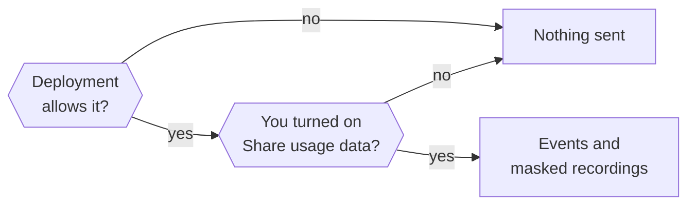

This page explains what usage data Nod collects, how to turn it on or off, and what session recordings never show.

Usage data is opt-in for each owner and off by default. Nod sends product events and masked session recordings to the Nod team's n8n-owned PostHog project in the EU (`eu.i.posthog.com`), including from independent source installations. The ingestion project identifier is public; there is no runtime override for another analytics project.

Nod never sends what you write, what Nod replies, what your apps return, or what you type into a form. Events describe what kind of thing happened, using fixed lists of values, counts and durations.

## Turn usage data on or off

You turn on **Share usage data** in the introduction, or later in **Settings → General**. Opt-in usage events and recordings start only in the app after your choice is saved; the native Welcome window sends neither.

Next to the switch, Nod says: "Help us make Nod better by sharing how you use it. Never your messages." It links to this page, which lists everything that is sent.

The deployment has a switch too. Nod collects only when both are on, and `NOD_ANALYTICS_ENABLED=false` always wins.

| Setting                     | Effect                                                                                    |
| --------------------------- | ----------------------------------------------------------------------------------------- |
| `NOD_ANALYTICS_ENABLED`     | `false` turns off events and recordings. `true` turns them on, even in development.       |
| `NOD_ANALYTICS_ENVIRONMENT` | Sets the event label to `production` or `development` without turning anything on or off. |

Restart Nod after you change either one.

To disable both upstream analytics and feedback, set `NOD_ANALYTICS_ENABLED=false` and `NOD_FEEDBACK_ENABLED=false` in the environment used to start Nod. In the desktop app, quit it completely and launch it with those variables. This stops those two collectors, including feedback status checks. Model providers, connected services and software updates have separate network access; this is not an offline mode.

## Identity

Nod counts installations, not people. Two installations count as two, and a shared one counts as one.

| Runtime                      | Identity                                                      | Available by default                                                          |
| ---------------------------- | ------------------------------------------------------------- | ----------------------------------------------------------------------------- |
| Source or self-hosted server | `local:<installation UUID>` in `<NOD_DATA_ROOT>/analytics-id` | With `NODE_ENV=production`, including `pnpm start` and the self-hosting stack |
| Local desktop runtime        | `local:<installation UUID>` in the desktop profile            | In packaged apps, not in development                                          |

Web and desktop clients connected to the same server use that server's installation identity. A separate local desktop assistant has its own identity.

"Available" still needs the owner's opt-in. PostHog creates no person profile and doesn't look up your location from your IP address.

### Stop sharing or delete past data

Turn off **Share usage data** in **Settings → General** to stop sending. Turning it off doesn't delete data PostHog already has. To ask for that, use **Send feedback** in the app and ask for your analytics data to be deleted. The Nod team handles the request.

## Internal builds

Events say `environment=development` unless they come from a release build:

| Runtime        | `production` when                                                                                                         |
| -------------- | ------------------------------------------------------------------------------------------------------------------------- |
| Desktop app    | A packaged app built by the release workflow with a plain `x.y.z` version. Local and pre-release builds are `development` |
| Source install | `NODE_ENV=production` and `NOD_APP_VERSION` isn't a pre-release such as `1.2.0-beta.1`                                    |

`NOD_ANALYTICS_ENVIRONMENT` overrides the label for source installs. Dashboards read only `production`.

## What never leaves Nod

- Message text, Nod's replies, task titles, summaries and quotes.
- Tool arguments, tool results, app data, web pages and files.
- Names, email addresses, account names, phone numbers and IDs of your threads, turns or messages.
- Full page addresses, paths, queries, subdomains, private hostnames and IP addresses. For websites Nod visits, signs in to or buys from, and links you open from a reply, only the registrable domain leaves, such as `example.co.uk` for `shop.example.co.uk/cart?id=42`.
- Raw error text, console output, request headers and bodies.
- Vault values, card details, codes, keys, order details and shop accounts. A payment sends only its amount, currency, status and the shop's registrable domain.
- Model names from an OpenAI-compatible server you run yourself. They're sent as `custom`.
- Azure OpenAI endpoints and deployment names, and Amazon Bedrock Regions. An Azure connection reports the model you chose for it.

## Events

Every event carries `analytics_schema=nod_v3` and `environment`. Packaged releases add `app_version`.

- **UI events** and recordings add `surface` (`web` or `desktop`) and a normalized `route`.
- **Server events** add `capture_source=server`.
- **Events within a turn** carry a random `run_id`. It's separate from Nod's private turn and conversation IDs, and joins a turn's tools, model requests and services.
- **Events within a web turn** also carry `$session_id`, the PostHog recording session of the browser tab that sent the message.

Every event is checked against an explicit schema before it's sent. Unknown events, unknown properties and values outside the lists below are dropped.

### What you do in the app

| Event                          | When                                               | Properties                                                                                                                                                                                          |
| ------------------------------ | -------------------------------------------------- | --------------------------------------------------------------------------------------------------------------------------------------------------------------------------------------------------- |
| `$pageview`                    | A page becomes visible                             | `route`: `/`, `/onboarding`, `/apps`, `/channels`, `/tasks`, `/prepared`, `/usage`, `/vault`, `/settings`, `/browser`, `/credentials`, `/payments` or `/not-found`                                  |
| `$snapshot`                    | Masked full or incremental recording               | PostHog replay metadata and masked snapshot data                                                                                                                                                    |
| `nod_onboarding_step_viewed`   | An onboarding step appears                         | `step`: `welcome`, `intro`, `email`, `calendar`, `brain`, `apps`, `launch_at_login`; `direction`: `forward`, `back`                                                                                 |
| `nod_onboarding_step_skipped`  | You skip an onboarding step                        | `step`: `email`, `calendar`                                                                                                                                                                         |
| `nod_settings_viewed`          | A settings tab appears                             | `tab`: `general`, `models`, `app_connections`, `memory`                                                                                                                                             |
| `nod_tab_viewed`               | A tab inside a page appears or you switch to it    | `page`: `tasks`, `apps`; `tab`: `current`, `scheduled`, `previous`, `all`, `connected`                                                                                                              |
| `nod_chat_message_sent`        | The server accepts a message you sent from the app | `has_attachments`, `is_reply`; `source`: `composer`, `task_card`, `ask_nod`, `task_reply`                                                                                                           |
| `nod_chat_stop_requested`      | You select stop                                    | None                                                                                                                                                                                                |
| `nod_task_card_started`        | You start a first-chat task card                   | `kind`: `immediate`, `ongoing`; `position`: `0`, `1`, `2`                                                                                                                                           |
| `nod_setup_link_clicked`       | You open a setup link in a reply                   | `setup`: `app`, `vault`, `website`, `browser`                                                                                                                                                       |
| `nod_link_opened`              | You open or play a link from a reply               | Registrable `domain`; `source`: `text`, `preview`, `tooltip`, `player`; for `preview` and `player`, the row's `position`, 1 to 20. Never the address                                                |
| `nod_browser_handoff_action`   | You use a control on a browser Nod handed to you   | `action`: `done`, `back`, `reload`, `expand`, `collapse`                                                                                                                                            |
| `nod_message_reaction_changed` | You add, change or remove a reaction               | `operation`: `add`, `remove`, `change`; `reaction`: `thumbs_up`, `heart`, `joy`, `party`, `wow`, `pray`, `thumbs_down`, `other`; `method`: `quick`, `picker`, `double_click`, `menu`, `pin`; `role` |
| `nod_message_action`           | You copy or reply to a message                     | `action`: `copy`, `reply`; `role`: `assistant`, `user`; `method`: `button`, `context_menu`                                                                                                          |
| `nod_attachment_added`         | You add files to a message                         | `method`: `picker`, `drop`, `paste`; `kind` of the first file: `image`, `pdf`, `other`; `count`: `1`, `2-5`, `6+`                                                                                   |
| `nod_task_action`              | You use a task's controls                          | `action`: `expand`, `stop`, `show_in_chat`, `show_activity`, `reply`                                                                                                                                |
| `nod_app_connect_clicked`      | You start connecting an app                        | `entry`: `apps`, `chat`, `onboarding`, `manage`; `result`: `opened`, `needs_access_setup`                                                                                                           |
| `nod_model_selected`           | A model choice you made is saved                   | `provider`: a supported provider ID or `other`; `entry`: `settings`, `onboarding`; `recommended`. Never the model name                                                                              |
| `nod_ui_error`                 | An instrumented UI action or render fails          | `area`: `application`, `onboarding`, `chat`, `settings`, `apps`, `models`; `action`: `load`, `save`, `send`, `connect`, `disconnect`, `prepare`, `stop`, `render`. Never the error itself           |

Onboarding asks about **Share usage data** in the introduction. Step events are sent only after you turn it on, so the welcome screen and introduction are usually not recorded. The native welcome is not recorded. The introduction is recorded if sharing was already enabled when it appears; enabling sharing there does not backfill earlier events. The Open at login question is reported when it appears. Setup finishes after the last required step. If you leave usage sharing off, onboarding sends nothing. Email and calendar can be skipped. The apps step always lets you continue without connecting a tool.

### What Nod does

Turns and chat:

| Event                      | When                                            | Properties                                                                                                                                                                                                                                                                                                                                                                                                                                                                |
| -------------------------- | ----------------------------------------------- | ------------------------------------------------------------------------------------------------------------------------------------------------------------------------------------------------------------------------------------------------------------------------------------------------------------------------------------------------------------------------------------------------------------------------------------------------------------------------- |
| `nod_turn_started`         | A queued turn starts                            | `source`: `user`, `schedule`, `event`, `resume`, `task`; `channel`: `web`, `telegram`, `whatsapp`, `other`; `background`; `model_provider` and `model` of the selected model, when one is set                                                                                                                                                                                                                                                                             |
| `nod_turn_completed`       | A turn finishes or exits                        | Turn properties plus `outcome`: `succeeded`, `waiting_credentials`, `waiting_user`, `failed`, `cancelled`, `interrupted`, `skipped`; `duration_ms`, `queue_duration_ms`; `waiting_reason`: `question`, `approval`, `credentials`; `failure_reason`: `spending_limit`, `model` (the model provider returned an error), `unknown`. Here `model_provider` and `model` name the model the turn's own agent requests used, or the selected model at turn start if it made none |
| `nod_chat_stopped`         | The server accepts a stop                       | None                                                                                                                                                                                                                                                                                                                                                                                                                                                                      |
| `nod_task_stopped`         | The server stops a background task              | None                                                                                                                                                                                                                                                                                                                                                                                                                                                                      |
| `nod_conversation_reset`   | The server finishes a conversation reset        | None                                                                                                                                                                                                                                                                                                                                                                                                                                                                      |
| `nod_onboarding_completed` | The server saves the first completed onboarding | `model_provider` of the selected model, when one is set                                                                                                                                                                                                                                                                                                                                                                                                                   |
| `nod_feedback_sent`        | The server accepts feedback you send            | `category`: `bug`, `feature`, `other`; `has_attachments`, `has_report`. Never the feedback itself                                                                                                                                                                                                                                                                                                                                                                         |

A crash can leave a started turn without a completion event, and one turn can take several queued messages. Don't read turn counts as message counts. `skipped` is an activity check that had nothing new to read.

Tools, confirmations and models:

| Event                           | When                                                                                    | Properties                                                                                                                                                                                                                                                                                                         |
| ------------------------------- | --------------------------------------------------------------------------------------- | ------------------------------------------------------------------------------------------------------------------------------------------------------------------------------------------------------------------------------------------------------------------------------------------------------------------ |
| `nod_tool_used`                 | A tool call finishes, in the main session or a subagent                                 | `tool`: `apps`, `ask_user`, `browser`, `browser_session`, `create_audio`, `delegate`, `manage_apps`, `manage_personal_context`, `pay`, `react_to_message`, `send_message`, `share_file`, `sign_in`, `skills`, `task`, `workspace`, `web`, `other`; `outcome`; `duration_ms`; `subagent`                            |
| `nod_confirmation_changed`      | Nod asks for your yes, or the question closes                                           | `status`: `asked`, `approved`, `declined`, `executed`, `expired`, `uncertain`; `action_kind`: `app`, `browser`, `sign_in`, `settings`, `memory`; `source` of the turn that asked                                                                                                                                   |
| `nod_model_used`                | A model request finishes                                                                | `provider`: a supported provider ID, `typesafe`, or `other`; `model`; `purpose`: `agent`, `memory`, `review`, `tasks`, `analytics` (retired conversation analysis); `outcome`; `input_tokens`, `output_tokens`, `cached_input_tokens`, `cost_usd`; `pricing`: `api`, `plan_estimate`, `unavailable`; `duration_ms` |
| `nod_model_connection_changed`  | A model connection is saved, removed, or its save or sign-in fails                      | `provider`: a supported provider ID; `method`: `api_key`, `subscription`, `oauth`; `status`: `connected`, `disconnected`, `failed`. Never the key, address or account                                                                                                                                              |
| `nod_model_connection_observed` | Each model connection, after opt-in, at startup and after model changes                 | `provider`, `method`, `selected`; `model` and `effort`: `off`, `minimal`, `low`, `medium`, `high`, `xhigh`, `max` on the selected connection only                                                                                                                                                                  |
| `nod_website_visited`           | Nod's browser shows a page, or a web fetch reads one, at most once per website per turn | Registrable `domain`; `via`: `browser`, `fetch`; `subagent`. Never the address, page or search text                                                                                                                                                                                                                |

Provider IDs come from the fixed [supported connection list](/connect/models/#set-connections-in-server-settings), plus `compatible` for owner-configured endpoints. Arbitrary provider names, endpoints, cloud account IDs, gateway IDs, and credentials are never analytics properties. A model connection's `connected` status means its configuration was saved; providers using a bundled catalog check access on first use.

`workspace` groups the file and shell tools inside Nod's workspace, and `web` groups web search and page fetches. `model` is the provider's public model name for hosted providers, and `custom` for an OpenAI-compatible server. The same rule applies to `model` on turn and model connection events. `cost_usd` is the provider's charge, or the estimated API price for plan usage. `input_tokens` includes cached input. `cached_input_tokens` is the part read from the provider's prompt cache, when the provider reports it. `duration_ms` is the elapsed time Nod measures for handling the request and can include request setup or reporting overhead.

Settings, memory and schedules:

| Event                  | When                                                              | Properties                                                                                                                                                                      |
| ---------------------- | ----------------------------------------------------------------- | ------------------------------------------------------------------------------------------------------------------------------------------------------------------------------- |
| `nod_settings_updated` | A settings change succeeds, including a model selection from chat | `section`: `account`, `preferences`, `channels`, `models`, `trust`, `memory`, `apps`; `operation`: `update`, `connect_started`, `disconnect`; `channel`: `telegram`, `whatsapp` |
| `nod_memory_changed`   | A memory note or learned skill is saved or removed                | `kind`: `note`, `skill`; `operation`: `save`, `forget`, `archive`, `clear`; `actor`: `owner`, `agent`, `background`. Never the note                                             |
| `nod_schedule_changed` | A schedule change commits                                         | `operation`: `create`, `update`, `delete`; `schedule_kind`: `once`, `recurring`; bounded `cadence`; `actor`: `user`, `agent`                                                    |

Apps, connections and Vault:

| Event                      | When                                                                                                       | Properties                                                                                                                                                                                                                                                                                                                                                                 |
| -------------------------- | ---------------------------------------------------------------------------------------------------------- | -------------------------------------------------------------------------------------------------------------------------------------------------------------------------------------------------------------------------------------------------------------------------------------------------------------------------------------------------------------------------- |
| `nod_connection_changed`   | A connection is attempted, saved, fails, is removed                                                        | Validated public catalog `app` or `custom`, public `domain` when available, `connection_method`, `status`, bounded `failure_reason`                                                                                                                                                                                                                                        |
| `nod_service_used`         | A managed app, HTTP, MCP, CLI or saved browser session operation finishes                                  | App, domain, method, outcome, `duration_ms`, bounded `failure_reason`, optional `operation_phase`; no arguments, action names or results                                                                                                                                                                                                                                   |
| `nod_connection_observed`  | A connected app or access path is observed at startup, opt-in or after changes                             | Validated public app, normalized domain when available, and connection method                                                                                                                                                                                                                                                                                              |
| `nod_vault_changed`        | A Vault item is actually created, changed or removed                                                       | `item_type`: `login`, `card`; `operation`; `source` when known; normalized public `domain` for logins. No values, labels, account names or card details                                                                                                                                                                                                                    |
| `nod_vault_imported`       | New logins are committed by an import                                                                      | Batches of up to 100 normalized `domains`, one entry per imported login; `unavailable` when no public domain can be derived. No login values or names                                                                                                                                                                                                                      |
| `nod_secure_entry_changed` | A sign-in, payment or verification code request opens, is entered, fails, becomes uncertain or is replaced | `kind`: `sign_in`, `payment`, `code`; `status`: `requested`, `superseded` (a newer request replaced it), `submitted`, `failed`, `uncertain` for every kind, plus `approved` when you approve a payment with the card's security code; registrable `domain` of the sign-in page or shop; exact `amount` and `currency` of a payment. Never the card, order, item or account |

## Turn timing

Product analytics use events from the server and app. Nod does not read conversations with a model for analytics. It does not infer task categories, completed goals or frustration.

`duration_ms` measures one execution segment. `queue_duration_ms` measures its wait to start. A successful turn does not prove that the whole requested job is complete.

The shared `run_id` links model, tool and service events from one turn. It covers delegated work. Parallel turns have separate IDs. Join on both the pseudonymous owner and `run_id`. A shared run does not prove which service caused a failure.

App messages can link their events to that tab's masked recording. Other channels and resumed turns have no recording link. A restart loses an in-memory recording link.

On upgrade, Nod removes your local classification records. It keeps task state and the cost ledger. Historical data already sent to PostHog stays there until deleted.

Older events can contain inferred task labels. New turns do not emit `nod_task_started`, `nod_task_linked`, `nod_task_updated`, `nod_task_analysis` or `nod_frustration_signal`. Dashboards must show those as historical data.

The retired `follow_up` tool value remains valid for older saved events. New replies include optional next steps in the result message.

## Connections and consent

Connection and Vault login domains identify public services: `team.example.com/private?token=...` becomes `example.com`. Paths, queries, account subdomains, local hosts and IP addresses are omitted. Managed apps preserve validated public catalog slugs. Unverified or user-named services use `custom` with the normalized endpoint domain when available. CLI install links are not treated as service domains. Cards have no associated website domain.

`connected` means an access path was durably saved; saved CLI credentials don't prove a command works. A connection supporting both HTTP and MCP emits one event per method. `nod_service_used` success means that the instrumented provider call returned successfully, not that the user's task succeeded. Background Gmail polling, verification-mail lookup and writing-style reads are outside that metric. Failure reasons come from structured provider metadata, never raw error text.

Connection observations run after opt-in, at startup and after connection changes. Count distinct opted-in identities reporting each connection in the selected period. These are observations, not a live account inventory.

Vault imports batch domain entries so a 5,000-login import emits at most 50 events. Count entries in `domains`, not import events.

Opt-out drops unsent events and recordings. Turning sharing back on cannot revive events from an earlier consent period. Browser tabs revoke capture when notified of a preference change. This can't recall an event already transmitted. Historical data in PostHog isn't deleted by the switch.

Website domains, sign-in domains and purchase amounts let the Nod team see which kinds of websites Nod is used on and how much is spent through it.

These are pseudonymous, opt-in measurements. Installation IDs and service domains are not anonymous, and opted-in users may not represent the whole user base.

## What recordings show

Recordings show navigation, layout, controls, scrolling and clicks, with private content removed.

- **Masked:** all input values and all text, except product labels marked as public.
- **Blocked:** chat messages and drafts, reply quotes, link previews, attachments and file previews, task titles, steps and results, the Usage summary and the text of each Usage row, connected account and channel names, model connection labels and errors, credential and model-key forms, Vault values, the remote browser view, images, media, iframes and canvases.
- **Replaced:** every URL becomes a fixed `https://nod.invalid` route, without query strings, fragments or external destinations.
- **Never collected:** console output, request headers and bodies, network payloads, autocapture, automatic exceptions, feature-flag events and person profiles.

Capture failures never interrupt Nod. Model keys and PostHog settings never enter the workspace.

To add, change or remove an event, see [Change analytics](/contribute/analytics/).

## Prepared work

Nudges are blocked from session recordings like any other chat message. Source reads and private preparation use the existing `other` tool category and do not count as completed app writes. Feedback on prepared work goes through `manage_personal_context`, so it counts as one ordinary `nod_tool_used` call; the feedback itself stays in the owner database.

## Related resources

- [Configuration reference](/deploy/configuration/)
- [Your data and privacy](/trust/privacy/)
- [Change analytics](/contribute/analytics/)
- [Desktop app internals](/deploy/desktop-app/)
