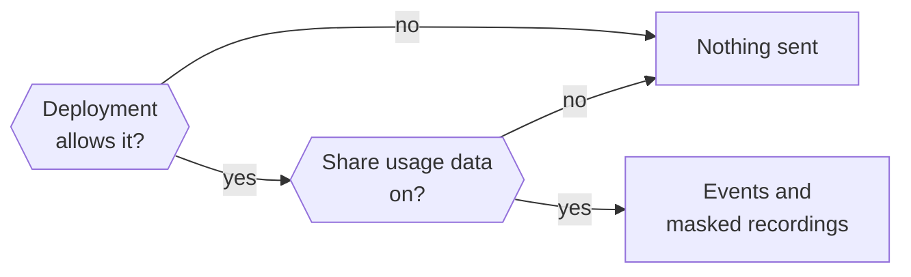

Nod shares bounded product events and masked session recordings so the team can understand usage, reliability, and cost.

Usage sharing is on for new owners. Data goes to the n8n-owned PostHog project in the EU (`eu.i.posthog.com`), including from independent source installations. The public ingestion identifier is fixed; there is no runtime override for another project.

Messages, generated content, connected-app results, credentials, and free-form input are excluded. Optional profile answers and survey responses use the fixed categories below.

## Turn usage sharing on or off

Change **Share usage data** in **Settings → General**. Existing owners keep their saved choice. Onboarding's privacy step explains sharing; the native Welcome window sends no events or recordings.

The deployment must also allow collection. `NOD_ANALYTICS_ENABLED=false` always disables it.

| Setting                     | Effect                                                                                         |
| --------------------------- | ---------------------------------------------------------------------------------------------- |
| `NOD_ANALYTICS_ENABLED`     | `false` disables events and recordings. `true` enables availability, including in development. |
| `NOD_ANALYTICS_ENVIRONMENT` | Labels source-install events `production` or `development`; it doesn't enable collection.      |

Restart Nod after changing either variable. To disable the separate feedback collector too, set `NOD_FEEDBACK_ENABLED=false`. Model providers, connected services, and software updates have separate network access.

Opt-out drops unsent events and recordings. Turning sharing back on doesn't revive events from the earlier sharing period. It can't recall events already transmitted.

### Stop sharing or delete past data

Turning sharing off doesn't delete past PostHog data. Use **Send feedback** to request deletion from the Nod team.

## Identity and environments

Nod counts installations, not people. Two installations count as two; a shared installation counts as one. Clients connected to one server share its pseudonymous `local:<installation UUID>` identity.

| Runtime                      | Identity storage               | Collection available by default |
| ---------------------------- | ------------------------------ | ------------------------------- |
| Source or self-hosted server | `<NOD_DATA_ROOT>/analytics-id` | `NODE_ENV=production`           |
| Local desktop runtime        | Desktop profile                | Packaged apps                   |

The owner's sharing choice still applies. Nod disables IP geolocation. Ordinary events don't create PostHog person profiles. Submitting an optional profile or opening a survey can create one with categories and survey participation state. Names and contact details aren't added.

Packaged release builds with a plain `x.y.z` version report `production`. Local and prerelease desktop builds report `development`. Source installs report `production` when `NODE_ENV=production` and `NOD_APP_VERSION` isn't a prerelease, unless overridden. Dashboards filter to production and apply the project's internal/test exclusions.

## What is excluded

- Messages, replies, task titles, summaries, quotes, and answer-choice text.
- Tool arguments and results, app records, web pages, file contents, file names, and paths.
- Names, contact details, account names, and private owner, thread, turn, and message IDs.
- Website domains, URLs, endpoint addresses, private hostnames, and IP addresses.
- Vault values and login inventories, payment amounts and currencies, card details, codes, keys, and order details.
- Raw errors, console output, and network headers or bodies.
- Owner-configured model names and endpoints. These report bounded categories such as `compatible` and `custom`.

The schema doesn't infer task categories, completed goals, or frustration from conversations.

## Event properties

Events use `analytics_schema=nod_v4`, `environment`, and `app_version` when available. This schema starts fresh; earlier analytics aren't migrated into its dashboards.

UI events add `surface` (`web` or `desktop`) and a normalized app `route`. Server events add `capture_source=server`. Submitted profile categories appear as `profile_role`, `profile_company_size`, `profile_ai_experience`, and `profile_ai_tools` on both.

Events within a turn add a random analytics `run_id`, `work_type` (`immediate`, `scheduled`, or `background`), and `owner_requested`. Resumed work retains its originating category. Web turns can also carry the sending tab's PostHog `$session_id`. Private turn and message IDs are excluded.

Autonomous work outside a turn uses `work_type=background`, `owner_requested=false`, and `system_activity` (`memory_learning`, `onboarding`, or `writing_style`). It has no run ID. Model requests without an established context use `work_type=unclassified` so their usage remains visible; this doesn't mean they were owner-requested or free.

Server events must pass a strict schema. UI events keep only allowed properties and values. Public provider and app names come from supported catalogs; custom connections report `custom`.

### Setup and app interaction

| Event                                                     | What it records                                                                                                     |
| --------------------------------------------------------- | ------------------------------------------------------------------------------------------------------------------- |
| `$pageview`, `$snapshot`                                  | Normalized app route or masked replay data. URLs become `https://nod.invalid` routes.                               |
| `nod_onboarding_step_viewed`                              | Step (`welcome`, `email`, `brain`, `privacy`, `profile`, `community`) and direction. Native Welcome isn't observed. |
| `nod_onboarding_step_skipped`                             | Skipped `email`, `profile`, or `community` step.                                                                    |
| `nod_onboarding_completed`                                | First saved completion and selected model provider, when available.                                                 |
| `nod_community_opened`                                    | Public n8n Labs community `forum` destination.                                                                      |
| `nod_settings_viewed`, `nod_tab_viewed`                   | Fixed settings tab or tasks/apps page tab.                                                                          |
| `nod_chat_message_sent`                                   | Attachment/reply booleans and composer/task-card/ask-Nod/task-reply/answer-choice source.                           |
| `nod_chat_stop_requested`                                 | Stop requested in the app.                                                                                          |
| `nod_task_card_started`, `nod_task_action`                | Card kind and bounded position, or fixed task control.                                                              |
| `nod_setup_link_clicked`, `nod_link_opened`               | Setup kind or text/tooltip source and optional bounded position. No link destination.                               |
| `nod_browser_handoff_action`                              | Done, back, reload, expand, or collapse.                                                                            |
| `nod_message_reaction_changed`, `nod_message_action`      | Fixed reaction/action, input method, and assistant/user role.                                                       |
| `nod_attachment_added`                                    | Picker/drop/paste, first-file category, and count bucket (`1`, `2-5`, `6+`).                                        |
| `nod_app_connect_clicked`, `nod_app_connection_completed` | Entry point and whether access setup was needed, or completed connection flow.                                      |
| `nod_model_selected`                                      | Provider, settings/onboarding entry, and whether the recommendation was chosen.                                     |
| `nod_ui_error`                                            | Fixed area and action, without error text.                                                                          |
| `nod_feedback_sent`                                       | Bug/feature/other category and attachment/report booleans, without feedback content.                                |

Email, profile answers, and community joining are optional. Model setup can be bypassed when already configured. Sharing must be enabled when a step appears to observe it.

### Runs, models, and connected services

| Event                                                            | What it records                                                                                                                                     |
| ---------------------------------------------------------------- | --------------------------------------------------------------------------------------------------------------------------------------------------- |
| `nod_turn_started`                                               | Source, channel, background flag, work category, owner-requested flag, and selected public model when available.                                    |
| `nod_turn_completed`                                             | The same context, outcome, execution/queue milliseconds, and bounded waiting or failure reason.                                                     |
| `nod_chat_stopped`, `nod_task_stopped`, `nod_conversation_reset` | Server-accepted stop or completed reset.                                                                                                            |
| `nod_tool_used`                                                  | Fixed tool category, outcome, milliseconds, and subagent flag.                                                                                      |
| `nod_model_used`                                                 | Provider/public model, purpose (`agent`, `memory`, `review`, `tasks`), outcome, token counts, milliseconds, and estimated `cost_usd` when priced.   |
| `nod_model_connection_changed`, `nod_model_connection_observed`  | Provider, API-key/subscription/OAuth method, status or selected-model state, and bounded effort.                                                    |
| `nod_connection_changed`, `nod_connection_observed`              | Public app or `custom`, connection method, and status/bounded failure reason where applicable.                                                      |
| `nod_service_used`                                               | App, method, outcome, milliseconds, bounded failure reason, and optional preparation phase.                                                         |
| `nod_source_read`                                                | Source category (`connected_app`, `tasks`, `other`), discovery/record-read operation, outcome, milliseconds, and bounded record/unavailable counts. |
| `nod_confirmation_changed`                                       | Asked/approved/declined/executed/expired/uncertain, fixed action kind, and turn source.                                                             |
| `nod_secure_entry_changed`                                       | Sign-in/payment/code kind and requested/superseded/approved/submitted/failed/uncertain state.                                                       |
| `nod_settings_updated`                                           | Fixed section, operation, and optional channel.                                                                                                     |
| `nod_schedule_changed`                                           | Create/update/delete, once/recurring kind, bounded cadence, and user/agent actor.                                                                   |
| `nod_memory_changed`                                             | Note/skill, save/forget/archive/clear, and owner/agent/background actor.                                                                            |
| `nod_vault_changed`, `nod_vault_imported`                        | Login/card kind and operation, or number imported. No domains or inventory.                                                                         |

An execution segment ends with `succeeded`, a waiting state, `failed`, `cancelled`, `interrupted`, or `skipped`. Success means execution finished; it doesn't verify the whole task. A crash can leave a start without a completion. One turn can handle several queued messages.

`duration_ms` measures execution time. `queue_duration_ms` measures waiting to start. They exclude time awaiting an owner response between segments. Join related measurements using the installation identity and analytics `run_id`.

`cost_usd` is a model price estimate, including API-equivalent estimates for plan usage. Check `pricing` (`api`, `plan_estimate`, `unavailable`) before interpreting totals. Unpriced usage isn't free. Browser runtime fees, independent integration charges, and who pays aren't measured.

Saved connections don't prove access works. Successful service calls don't prove task success. Connection observations occur at startup, when sharing turns on, and after changes; they aren't a live account inventory. Source reads measure observed calls and bounded results, without source identifiers or content.

### Outputs and answer choices

| Event                         | What it records                                                          |
| ----------------------------- | ------------------------------------------------------------------------ |
| `nod_output_created`          | Committed assistant presentation or file delivery, by kind and count.    |
| `nod_presentation_viewed`     | Visible image/map/flights/seats/booking/chart/apps/diagram presentation. |
| `nod_artifact_viewed`         | Artifact kind and message/drawer location.                               |
| `nod_artifact_action`         | Kind, location, and copy/download/download-request action.               |
| `nod_answer_choices_viewed`   | Single/multiple mode and number offered (one to six).                    |
| `nod_answer_choices_selected` | The same context and number successfully selected (one to six).          |

Views require a visible app and content intersecting its viewport. Repeated mounting doesn't count again within the current capture period. These observations aren't unique files or a linked conversion funnel.

`download_requested` records a browser request. `download` records a native save that returned successfully. A request alone doesn't prove a local file exists.

Answer-choice collectors and dashboards are ready for the separate answer-choice feature integration. They exclude option labels, selected text, and response content.

## Optional profile and feedback

The onboarding profile is optional. Leave any field unanswered or skip it. `nod_profile_updated` carries only submitted categories:

| Field           | Allowed answers                                                                                   |
| --------------- | ------------------------------------------------------------------------------------------------- |
| `role`          | `agency_owner`, `business_owner`, `employee`, `individual`, `other`                               |
| `company_size`  | `solo`, `2_10`, `11_50`, `51_200`, `201_plus`                                                     |
| `ai_experience` | `new`, `occasional`, `regular`, `technical`                                                       |
| `ai_tools`      | Any of `chatgpt`, `claude`, `gemini`, `copilot`, `n8n`, `coding_agents`, `other`, or `none` alone |

These answers describe the installation's audience. They don't identify an employer or establish who pays. Unanswered fields remain unknown; multiple AI-tool categories aren't additive.

Eligible installations see **One question about Nod**. Selecting it opens an optional survey. Closing it dismisses that survey. Submitting or dismissing prevents another offer of that kind on the installation.

- **Recommendation:** A score from zero to 10 after at least three successful owner-initiated runs across three active days. The first must be at least seven days ago; the latest within three days.
- **Stopped use:** One fixed reason after at least three successful owner-initiated runs and seven days without owner-requested activity. Recent queued, running, failed, cancelled, or waiting work prevents the offer. Reasons cover no useful task, setup, reliability, speed, cost, privacy, another tool, or other. There is no free-text field.

Only successful owner-initiated runs count towards the eligibility threshold. Automatic activity doesn't reset inactivity. The stopped-use question appears only when someone reopens the app; it can't reach people who never return. No email or other outreach is sent.

The server translates validated actions into PostHog `survey shown`, `survey sent`, and `survey dismissed` events. They contain fixed survey/question identifiers, a random submission ID, and the numeric score or fixed reason. Survey participation metadata can be stored on the pseudonymous profile. Sharing must be on.

Nod owns survey display and eligibility. Draft or paused status in PostHog doesn't disable the app's survey UI. Turning usage sharing off or setting `NOD_ANALYTICS_ENABLED=false` suppresses offers and capture.

## What recordings show

Recordings show navigation, layout, controls, scrolling, and clicks with private content removed.

- All input values and text are masked except static product labels marked public.
- Chat, answer choices, survey/profile controls, artifacts, attachments, tasks, Usage details, account names, credentials, Vault values, and the remote browser view are blocked.
- Images, media, iframes, and canvases are blocked. URLs become fixed `https://nod.invalid` app routes.
- Console output, network payloads, autocapture, automatic exceptions, and feature-flag events are disabled. Remote survey popups are disabled; Nod renders its own optional survey.

Capture failures don't interrupt Nod. PostHog configuration and model keys never enter the workspace.

## Related resources

- [Configuration reference](/deploy/configuration/)
- [Your data and privacy](/trust/privacy/)
- [Change analytics and read dashboards](/contribute/analytics/)
- [Desktop app internals](/deploy/desktop-app/)
