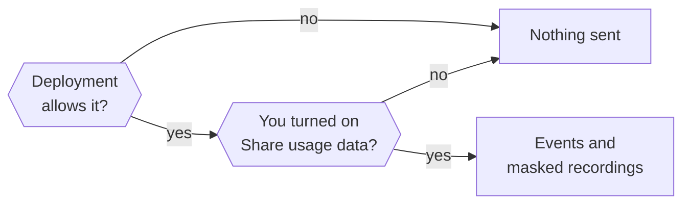

This page explains what usage data Otto collects, how to turn it on or off, and what session recordings never show.

Usage data is opt-in for each owner and off by default. Otto sends product events and masked session recordings to PostHog in the EU. It never sends names, email addresses, messages or anything you type.

## Turn usage data on or off

You turn on **Share usage data** in the last onboarding step, or later in **Settings → General** in the desktop app and **Settings → Appearance** on the web. Nothing is collected before you sign in or opt in.

The deployment has a switch too. Otto collects only when both are on, and `OTTO_ANALYTICS_ENABLED=false` always wins.



| Setting                      | Effect                                                                                    |
| ---------------------------- | ----------------------------------------------------------------------------------------- |
| `OTTO_ANALYTICS_ENABLED`     | `false` turns off events and recordings. `true` turns them on, even in development.       |
| `OTTO_ANALYTICS_ENVIRONMENT` | Sets the event label to `production` or `development` without turning anything on or off. |

Restart Otto after you change either one. Hosted operators set them in `GATEWAY_ENV` and roll out a new release. See [Hosted on Cloudflare](/deploy/cloudflare/).

## Identity

Otto counts installations and hosted accounts, not people. Two installations count as two, and a shared one counts as one.

| Runtime                | Identity                                                       | Available by default                               |
| ---------------------- | -------------------------------------------------------------- | -------------------------------------------------- |
| Source install         | `local:<installation UUID>` in `<OTTO_DATA_ROOT>/analytics-id` | With `pnpm start`, not with `pnpm run dev`         |
| Desktop app            | `local:<installation UUID>` in the desktop profile             | In packaged apps, not in development               |
| Hosted                 | `hosted:<owner UUID>` from the signed-in account               | When `OTTO_ENVIRONMENT=production`, not in staging |
| Hosted, before sign-in | None                                                           | Never                                              |

"Available" still needs the owner's opt-in. A hosted identity always comes from the signed-in account, never from a header the client sends. Recording stops and the identity resets when the account changes or signs out.

## Events

Every event carries `analytics_schema`, `deployment` (`local` or `hosted`) and `environment`. UI events and recordings add `surface` (`web` or `desktop`) and a normalized `route`. Server events add `capture_source=server`. Properties are fixed values or booleans, apart from the turn duration. Otto rejects any other event or property.

| Event                            | When                                            | Properties                                                                                                                              |
| -------------------------------- | ----------------------------------------------- | --------------------------------------------------------------------------------------------------------------------------------------- |
| `$pageview`                      | A normalized route becomes visible              | `route`                                                                                                                                 |
| `$snapshot`                      | Masked full or incremental recording            | PostHog replay metadata and masked snapshot data                                                                                        |
| `otto_onboarding_step_viewed`    | An onboarding step appears                      | `step`: `welcome`, `brain`, `about`, `email`, `telegram`, `open_source`                                                                 |
| `otto_onboarding_completed`      | The server saves the first completed onboarding | None                                                                                                                                    |
| `otto_settings_viewed`           | A settings tab appears                          | `tab`: `general`, `profile`, `appearance`, `preferences`, `models`, `memory`, `trust`                                                   |
| `otto_settings_updated`          | A settings change succeeds                      | `section`: `account`, `preferences`, `connections`, `channels`, `models`; `operation`: `update`, `connect_started`, `disconnect`        |
| `otto_chat_message_sent`         | The server accepts a message from the UI        | `has_attachments`, `is_reply`                                                                                                           |
| `otto_chat_stop_requested`       | You select stop                                 | None                                                                                                                                    |
| `otto_chat_stopped`              | The server accepts a stop                       | None                                                                                                                                    |
| `otto_conversation_reset`        | The server finishes a conversation reset        | None                                                                                                                                    |
| `otto_turn_started`              | A queued turn starts                            | `source`: `user`, `schedule`, `event`, `resume`; `channel`: `web`, `telegram`, `whatsapp`, `other`; `background`                        |
| `otto_turn_completed`            | A turn finishes or exits                        | Turn properties plus `outcome`: `succeeded`, `waiting_credentials`, `waiting_user`, `failed`, `cancelled`, `interrupted`; `duration_ms` |
| `otto_schedule_changed`          | A schedule change commits, from the UI or Otto  | `operation`: `create`, `update`, `delete`                                                                                               |
| `otto_ui_error`                  | An instrumented UI action or render fails       | `area` and `action` from a fixed list, never the raw error                                                                              |
| `otto_desktop_setup_step_viewed` | A desktop setup step appears                    | `step`: `preferences`, `preparing`, `ready`, `error`                                                                                    |
| `otto_desktop_setup_completed`   | First-time desktop setup completes              | None                                                                                                                                    |

A crash can leave a started turn without a completion event, and one turn can take several queued messages. Don't read turn counts as message counts.

## What recordings show

Recordings show navigation, layout, controls, scrolling and clicks, with private content removed.

- **Masked:** all input values and all text, except product labels marked as public.
- **Blocked:** chat messages, credential and model-key forms, Vault values, the remote browser view, images, media, iframes and canvases.
- **Replaced:** every URL becomes a fixed `https://otto.invalid` route, without query strings, fragments or external destinations.
- **Never collected:** console output, request headers and bodies, network payloads, autocapture, automatic exceptions, feature-flag events and person profiles.

Capture failures never interrupt Otto. Model keys and PostHog settings never enter the workspace.

## Add UI without leaking content

- Content is masked by default. Keep it that way.
- Put `data-analytics-public` only around static product labels, never around a container that can hold user content.
- Put `data-analytics-private` on a subtree to block it from recordings.
- Extend the existing privacy regression tests when you add a recording surface or change these rules.

## Validate changes

Run the normal checks. The tests use synthetic data and intercepted transports, and never call PostHog.

```sh title="Terminal"
pnpm run check
pnpm run test:integration
pnpm run build
```

After a desktop UI build, check the real Electron renderer and recorder:

```sh title="Terminal"
node desktop/scripts/check-analytics.mjs
```

For a manual web walkthrough, run `pnpm exec tsx scripts/analytics-fixture.ts` and open `http://127.0.0.1:4358`. It uses a synthetic token and a local collector, and writes captured batches to `.local/analytics-fixture.json`. None of these checks prove that live events reach PostHog.

## Related resources

- [Configuration reference](/deploy/configuration/)
- [Hosted on Cloudflare](/deploy/cloudflare/)
- [Your data and privacy](/trust/privacy/)
- [Desktop app internals](/deploy/desktop-app/)
