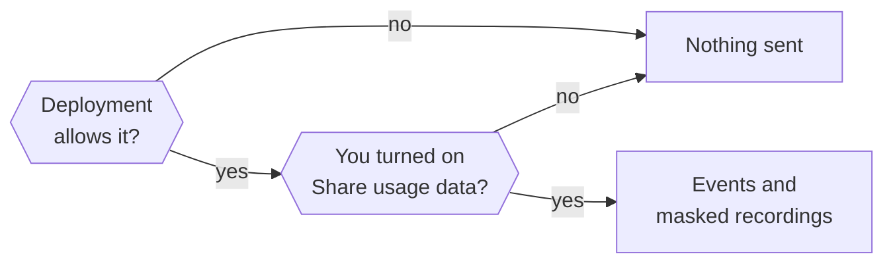

This page explains what usage data Otto collects, how to turn it on or off, and what session recordings never show.

Usage data is opt-in for each owner and off by default. Otto sends product events and masked session recordings to the Otto team's n8n-owned PostHog project in the EU (`eu.i.posthog.com`), including from independent source installations. The ingestion project identifier is public; there is no runtime override for another analytics project. Raw conversation and form content are excluded. Connected services are identified by normalized public domains.

## Turn usage data on or off

You turn on **Share usage data** in the last onboarding step, or later in **Settings → General** in the desktop app and **Settings → Appearance** on the web. Nothing is collected before you sign in or opt in.

The deployment has a switch too. Otto collects only when both are on, and `OTTO_ANALYTICS_ENABLED=false` always wins.



| Setting                      | Effect                                                                                    |
| ---------------------------- | ----------------------------------------------------------------------------------------- |
| `OTTO_ANALYTICS_ENABLED`     | `false` turns off events and recordings. `true` turns them on, even in development.       |
| `OTTO_ANALYTICS_ENVIRONMENT` | Sets the event label to `production` or `development` without turning anything on or off. |

Restart Otto after you change either one.

To disable both upstream analytics and feedback, set `OTTO_ANALYTICS_ENABLED=false` and `OTTO_FEEDBACK_ENABLED=false` in the environment used to start Otto. In the desktop app, quit it completely and launch it with those variables. This stops those two collectors, including feedback status checks. Model providers, connected services and software updates have separate network access; this is not an offline mode.

## Identity

Otto counts installations, not people. Two installations count as two, and a shared one counts as one.

| Runtime        | Identity                                                       | Available by default                       |
| -------------- | -------------------------------------------------------------- | ------------------------------------------ |
| Source install | `local:<installation UUID>` in `<OTTO_DATA_ROOT>/analytics-id` | With `pnpm start`, not with `pnpm run dev` |
| Desktop app    | `local:<installation UUID>` in the desktop profile             | In packaged apps, not in development       |

"Available" still needs the owner's opt-in.

## Events

Every event carries `analytics_schema=otto_v3` and `environment`. UI events and recordings add `surface` (`web` or `desktop`) and a normalized `route`. Server events add `capture_source=server`. Events within a turn also carry a random `run_id`, separate from Otto's private turn and conversation IDs. Packaged releases also include `app_version`. Properties use an explicit schema: allowed generic task labels, bounded execution states, booleans, counts, durations, opaque analytics IDs and normalized service domains. Unknown properties are rejected.

| Event                            | When                                                                                    | Properties                                                                                                                                                                                                                         |
| -------------------------------- | --------------------------------------------------------------------------------------- | ---------------------------------------------------------------------------------------------------------------------------------------------------------------------------------------------------------------------------------- |
| `$pageview`                      | A normalized route becomes visible                                                      | `route`                                                                                                                                                                                                                            |
| `$snapshot`                      | Masked full or incremental recording                                                    | PostHog replay metadata and masked snapshot data                                                                                                                                                                                   |
| `otto_onboarding_step_viewed`    | An onboarding step appears                                                              | `step`: `welcome`, `brain`, `about`, `email`, `telegram`, `open_source`                                                                                                                                                            |
| `otto_onboarding_completed`      | The server saves the first completed onboarding                                         | None                                                                                                                                                                                                                               |
| `otto_settings_viewed`           | A settings tab appears                                                                  | `tab`: `general`, `profile`, `appearance`, `preferences`, `models`, `memory`, `trust`                                                                                                                                              |
| `otto_settings_updated`          | A settings change succeeds                                                              | `section`: `account`, `preferences`, `channels`, `models`; `operation`: `update`, `connect_started`, `disconnect`                                                                                                                  |
| `otto_chat_message_sent`         | The server accepts a message from the UI                                                | `has_attachments`, `is_reply`                                                                                                                                                                                                      |
| `otto_chat_stop_requested`       | You select stop                                                                         | None                                                                                                                                                                                                                               |
| `otto_chat_stopped`              | The server accepts a stop                                                               | None                                                                                                                                                                                                                               |
| `otto_conversation_reset`        | The server finishes a conversation reset                                                | None                                                                                                                                                                                                                               |
| `otto_turn_started`              | A queued turn starts                                                                    | `source`: `user`, `schedule`, `event`, `resume`; `channel`: `web`, `telegram`, `whatsapp`, `other`; `background`                                                                                                                   |
| `otto_turn_completed`            | A turn finishes or exits                                                                | Turn properties plus `outcome`: `succeeded`, `waiting_credentials`, `waiting_user`, `failed`, `cancelled`, `interrupted`; `duration_ms`, `queue_duration_ms`; `waiting_reason`: `question`, `approval`, `credentials` when waiting |
| `otto_schedule_changed`          | A schedule change commits, from the UI or Otto                                          | `operation`: `create`, `update`, `delete`; `schedule_kind`: `once`, `recurring`; bounded `cadence`                                                                                                                                 |
| `otto_connection_changed`        | A connection is attempted, saved, fails, is removed                                     | Validated public catalog `app` or `custom`, public `domain` when available, `connection_method`, `status`, bounded `failure_reason`                                                                                                |
| `otto_service_used`              | A managed app, HTTP, MCP, CLI or saved browser session operation finishes               | App, domain, method, outcome, `duration_ms`, bounded `failure_reason`, optional `operation_phase`; no arguments, action names or results                                                                                           |
| `otto_connection_observed`       | A connected app or access path is observed at startup, opt-in or after changes          | Validated public app, normalized domain when available, and connection method                                                                                                                                                      |
| `otto_vault_changed`             | A Vault item is actually created, changed or removed                                    | `item_type`: `login`, `card`; `operation`; `source` when known; normalized public `domain` for logins. No values, labels, account names or card details                                                                            |
| `otto_vault_imported`            | New logins are committed by an import                                                   | Batches of up to 100 normalized `domains`, one entry per imported login; `unavailable` when no public domain can be derived. No login values or names                                                                              |
| `otto_task_started`              | The post-turn analyzer identifies a new request                                         | Opaque `task_id`, short `task_type`, `task_action`, `task_subject`, bounded `task_activities`, originating `source` and `channel`                                                                                                  |
| `otto_task_linked`               | An analyzed turn is associated with a task                                              | Task properties, including originating `source` and `channel`; the common `run_id` links its service activity                                                                                                                      |
| `otto_task_updated`              | An identified task progresses                                                           | Task properties, `outcome`: `active`, `waiting`, `completed`, `failed`, `cancelled`; `completion_evidence`, `elapsed_ms`, `turn_count`                                                                                             |
| `otto_frustration_signal`        | The analyzer identifies an explicit complaint or repeated unresolved correction/request | Bounded `signal`, `reason`, `task_type` and `channel`                                                                                                                                                                              |
| `otto_task_analysis`             | Analysis finishes, is unavailable or the queue is full                                  | `source`, `outcome`: `analyzed`, `unavailable`, `invalid`, `failed`, `queue_full`; `task_count` and `unknown_label_count` for analyzed turns                                                                                       |
| `otto_ui_error`                  | An instrumented UI action or render fails                                               | `area` and `action` from a fixed list, never the raw error                                                                                                                                                                         |
| `otto_desktop_setup_step_viewed` | A desktop setup step appears                                                            | `step`: `preferences`, `preparing`, `ready`, `error`                                                                                                                                                                               |
| `otto_desktop_setup_completed`   | First-time desktop setup completes                                                      | None                                                                                                                                                                                                                               |

A crash can leave a started turn without a completion event, and one turn can take several queued messages. Don't read turn counts as message counts.

## Request analysis and timing

With usage data enabled, a tool-free call to your selected model at its lowest supported reasoning effort analyzes a bounded portion of the finished conversation and previously associated requests. This uses your model account and its spending limit. The selector takes the first advertised effort among `off`, `minimal`, `low` and `medium`, or the first advertised level if none match. Tool payloads, attachments, screenshots and Vault values are excluded. The model returns short generated labels and references to supplied messages; references are sent to the selected model for association and stored in Otto's private database, but are not sent to PostHog. No conversation excerpts, summaries or explanations go to PostHog. There is no separate taxonomy version or classification status property.

The model combines a small vocabulary of generic actions and subjects, such as `find:document`, `analyze:spreadsheet` and `send:email`. It also selects a broad task type. This supports compound requests without defining every possible task or assigning category IDs. The vocabulary is declared once in the event schema and included in the model instructions. Add a primitive only when it describes a reusable product need.

The export validator rejects labels outside that vocabulary, extra fields and malformed references. A model cannot invent a person's name or private topic as an exported label. `unknown` is the fallback for a concept the vocabulary does not cover; its count and invalid or dropped analyses remain visible. Classification can still be semantically wrong. The eval harness checks lifecycle correctness, reference-label agreement and repeated/paraphrased consistency separately.

Existing labels are supplied with known tasks for reuse on continuations. Associations can span turns and restarts within the same session. A new consent period or conversation reset prevents linking back to previous requests. Analysis is asynchronous, has a bounded queue and does not retry a failed model request. Overflow reports are coalesced while the queue is full; other skipped runs appear as missing analysis, so `queue_full` event counts are not dropped-turn counts. A crash can miss an analysis; these measurements are not an exhaustive record of every request.

For example, `communication` can split into `summarize` / `email`, `draft` / `email`, and `send` / `message`. Creating a recurring reminder is `schedule` / `automation`; its later run uses the actual requested action and subject. Unknown dimensions remain visible. App and domain labels come from actual connection or service events, not from model guesses.

One goal can contain several requested activities. For example, finding records, totaling them, and emailing the total stays one task, with one outcome and elapsed time. `task_action` and `task_subject` describe its primary goal. `task_activities` stores up to eight unique `action:subject` pairs, such as `find:document`, `analyze:document`, and `send:email`. Only requested components qualify; the model must not invent intermediate tool steps.

Activities accumulate as that goal is clarified across turns. The primary pair is kept first; older known activities precede newly identified ones when the eight-entry cap is reached. Independent requested results get separate task IDs. Completed means the whole goal is inferred complete, not that one component finished. No per-activity outcome, duration, order or service attribution is claimed.

To count tasks requesting an activity, take the latest snapshot per owner and task in the selected period, expand the activity list, and count distinct tasks. One task can appear under several activities, so these counts must not be added to calculate total tasks. The bounded analysis can miss components; it is not a complete workflow trace.

The shared `run_id` connects a turn's service attempts, timing, frustration signals and inferred tasks. It covers approved actions and delegated work within that turn; parallel turns get different IDs. External connection callbacks and UI changes have no run ID unless they happen within the turn. Revocation invalidates the whole run, including work that finishes after sharing is turned back on.

Count each service attempt once. Attribute its category only when the run has one inferred task; show multiple-task, no-task and unavailable-analysis coverage separately. A link means the service was used in the same turn, not that it caused a task's failure. Repeated completion can add a link and newly requested activities without another completion or a longer completion time. Join on both the pseudonymous owner and `run_id`.

Completion is **inferred**, not independently verified delivery. A successful runtime turn does not establish that the user's goal was achieved. Corrections can reopen a task; no reply does not mean cancellation. Frustration describes an interaction, not a person's mood or personality. It requires an explicit complaint or repeated unresolved request/correction; routine edits and negative text quoted for a task should not qualify. Model classification can still be wrong and needs evaluation before treating it as a dependable success measure.

`elapsed_ms` runs from the first associated request to the observed turn finish, including queueing and time between turns. `duration_ms` on turn completion measures that execution segment, excluding the classifier call. `queue_duration_ms` measures the queued turn's wait to execute. Scheduled-run timing begins with that run's queued request, not when the schedule was created. A turn that pauses includes the runtime's bounded `waiting_reason`: `question`, `approval` or `credentials`. This is observed execution state, not an inferred blocker. These timings do not yet separate active work, user waiting and provider latency within a task. Compare percentiles by task category, source and app version, and show unfinished requests alongside completed ones to avoid hiding slow or failed work.

For example, a request to summarize email can produce `task_type=communication`, `task_action=summarize`, `task_subject=email`, `outcome=completed`, `completion_evidence=inferred`, `elapsed_ms=42000`. A later explicit complaint can produce `signal=explicit_complaint`, `reason=output_quality`. Neither event contains the request or complaint text.

## Connections and consent

Connection and Vault login domains identify public services: `team.example.com/private?token=...` becomes `example.com`. Paths, queries, account subdomains, local hosts and IP addresses are omitted. Managed apps preserve validated public catalog slugs, including apps outside the featured list. Domains use a reviewed mapping when known; the provider catalog does not supply a website domain for every app. Unverified or user-named services use `custom` with the normalized endpoint domain when available. CLI install links are not treated as service domains. Cards have no associated website domain. Connection and Vault events describe actual changes, not a request returning HTTP 200. Browser service-use events cover reopening a previously saved profile at its saved origin. They do not enumerate browsing history or arbitrary shell network calls.

`connected` means an access path was durably saved; saved CLI credentials do not prove a command works. A connection supporting both HTTP and MCP emits one event per method. `otto_service_used` success means that the instrumented provider call returned successfully, not that the user's task succeeded. Background Gmail polling, verification-mail lookup and writing-style reads are outside that metric.

Service failures include account/session/token preparation and actual execution. Failure reasons are `authentication`, `permission`, `rate_limited`, `timeout`, `unavailable`, `invalid_request`, `cancelled` or `unknown`; connection setup can also report `invalid_configuration`, `authorization_failed` or `verification_failed`. The mapper uses structured provider metadata, never raw error text. Composio tool-response errors without a contracted status remain `unknown`. Preparation failures carry `operation_phase=preparation`; successful service durations cover the instrumented execution, while turn timing covers the broader work. A saved browser profile reopening does not prove an authenticated website action succeeded.

Connection observations run after opt-in, at startup and after connection changes. They include existing connections using only app, domain and method. Count distinct opted-in identities reporting each connection in the selected period. These are observations, not a live account inventory or an exact connection-attempt conversion funnel. HTTP and MCP access to the same service appear as separate methods.

Vault imports batch domain entries so a 5,000-login import emits at most 50 events instead of overflowing the capture limit. Repeated domains represent multiple imported logins. Count entries in `domains`, not import events; skipped and existing logins do not appear.

Opt-out cancels pending analysis and drops unsent events and recordings. Turning sharing back on cannot revive queued server events or task associations from an earlier consent period. Browser tabs revoke capture when notified of a preference change and refresh their session. A local opt-out stays latched until an explicit opt-in in that tab; a delayed peer opt-in cannot clear it. If saving opt-out fails, a full reload can restore the previously saved setting; retry the failed save to persist revocation. This cannot recall an event already transmitted or instantly stop another device before its session refreshes. Historical data in PostHog is not deleted by the switch.

These are pseudonymous, opt-in measurements. Installation IDs and service domains are not anonymous, and opted-in users may not represent the whole user base.

## What recordings show

Recordings show navigation, layout, controls, scrolling and clicks, with private content removed.

- **Masked:** all input values and all text, except product labels marked as public.
- **Blocked:** chat messages, credential and model-key forms, Vault values, the remote browser view, images, media, iframes and canvases.
- **Replaced:** every URL becomes a fixed `https://otto.invalid` route, without query strings, fragments or external destinations.
- **Never collected:** console output, request headers and bodies, network payloads, autocapture, automatic exceptions, feature-flag events and person profiles.

Capture failures never interrupt Otto. Model keys and PostHog settings never enter the workspace.

## Add UI without leaking content

- Content is masked by default. Keep it that way.
- Put `data-analytics-public` only around static product labels, never around a container that can hold user content.
- Put `data-analytics-private` on a subtree to block it from recordings.
- Extend the existing privacy regression tests when you add a recording surface or change these rules.

## Validate changes

Run the normal checks. The tests use synthetic data and intercepted transports, and never call PostHog.

```sh title="Terminal"
pnpm run check
pnpm run test:integration
pnpm run build
```

After a desktop UI build, check the real Electron renderer and recorder:

```sh title="Terminal"
node desktop/scripts/check-analytics.mjs
```

For a manual web walkthrough, run `pnpm exec tsx scripts/analytics-fixture.ts` and open `http://127.0.0.1:4358`. The fixture uses synthetic data and restricts browser connections to localhost. Starting it clears `.local/analytics-fixture.json`.

1. Leave **Share usage data** off. Open `http://127.0.0.1:4358/__fixture__/summary` in another tab; `enabled` must be `false` and `count` must remain zero.
2. Turn sharing on in onboarding or **Settings → Appearance**, navigate the fixture, and wait for captured batches. Refresh the summary: `count` should increase and `privateDataLeaked` must stay `false`. Inspect events in `.local/analytics-fixture.json`.
3. Turn sharing off, reload the fixture, and continue navigating. The summary must show `enabled: false` and its event count must stop increasing.

This walkthrough exercises the browser SDK with synthetic APIs. The integration tests cover server analytics and task classification; neither proves live delivery to PostHog.

## Related resources

- [Configuration reference](/deploy/configuration/)
- [Your data and privacy](/trust/privacy/)
- [Desktop app internals](/deploy/desktop-app/)
