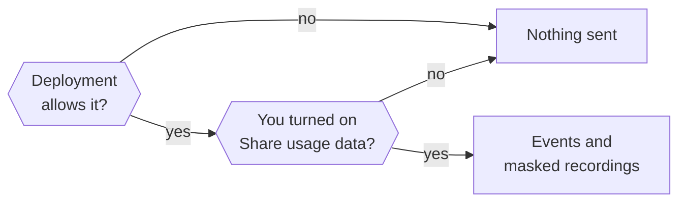

This page explains what usage data Otto collects, how to turn it on or off, and what session recordings never show.

Usage data is opt-in for each owner and off by default. Otto sends product events and masked session recordings to the Otto team's n8n-owned PostHog project in the EU (`eu.i.posthog.com`), including from independent source installations. The ingestion project identifier is public; there is no runtime override for another analytics project.

Otto never sends what you write, what Otto replies, what your apps return, or what you type into a form. Events describe what kind of thing happened, using fixed lists of values, counts and durations.

## Turn usage data on or off

You turn on **Share usage data** in the first onboarding step, or later in **Settings → General**. Nothing is collected before you opt in. The desktop setup window sends nothing, because it runs before you choose.

Next to the switch, Otto says: "Help us make Otto better by sharing how you use it. Never your messages." It links to this page, which lists everything that is sent.

The deployment has a switch too. Otto collects only when both are on, and `OTTO_ANALYTICS_ENABLED=false` always wins.

| Setting                      | Effect                                                                                    |
| ---------------------------- | ----------------------------------------------------------------------------------------- |
| `OTTO_ANALYTICS_ENABLED`     | `false` turns off events and recordings. `true` turns them on, even in development.       |
| `OTTO_ANALYTICS_ENVIRONMENT` | Sets the event label to `production` or `development` without turning anything on or off. |

Restart Otto after you change either one.

To disable both upstream analytics and feedback, set `OTTO_ANALYTICS_ENABLED=false` and `OTTO_FEEDBACK_ENABLED=false` in the environment used to start Otto. In the desktop app, quit it completely and launch it with those variables. This stops those two collectors, including feedback status checks. Model providers, connected services and software updates have separate network access; this is not an offline mode.

## Identity

Otto counts installations, not people. Two installations count as two, and a shared one counts as one.

| Runtime        | Identity                                                       | Available by default                       |
| -------------- | -------------------------------------------------------------- | ------------------------------------------ |
| Source install | `local:<installation UUID>` in `<OTTO_DATA_ROOT>/analytics-id` | With `pnpm start`, not with `pnpm run dev` |
| Desktop app    | `local:<installation UUID>` in the desktop profile             | In packaged apps, not in development       |

"Available" still needs the owner's opt-in. PostHog creates no person profile and doesn't look up your location from your IP address.

### Stop sharing or delete past data

Turn off **Share usage data** in **Settings → General** to stop sending. Turning it off doesn't delete data PostHog already has. To ask for that, use **Send feedback** in the app and ask for your analytics data to be deleted. The Otto team handles the request.

## Internal builds

Events say `environment=development` unless they come from a release build:

| Runtime        | `production` when                                                                                                         |
| -------------- | ------------------------------------------------------------------------------------------------------------------------- |
| Desktop app    | A packaged app built by the release workflow with a plain `x.y.z` version. Local and pre-release builds are `development` |
| Source install | `NODE_ENV=production` and `OTTO_APP_VERSION` isn't a pre-release such as `1.2.0-beta.1`                                   |

`OTTO_ANALYTICS_ENVIRONMENT` overrides the label for source installs. Dashboards read only `production`.

## What never leaves Otto

- Message text, Otto's replies, task titles, summaries and quotes.
- Tool arguments, tool results, app data, web pages and files.
- Names, email addresses, account names, phone numbers and IDs of your threads, turns or messages.
- Full page addresses, paths, queries, subdomains, private hostnames and IP addresses. For websites Otto visits, signs in to or buys from, and links you open from a reply, only the registrable domain leaves, such as `example.co.uk` for `shop.example.co.uk/cart?id=42`.
- Raw error text, console output, request headers and bodies.
- Vault values, card details, codes, keys, order details and shop accounts. A payment sends only its amount, currency, status and the shop's registrable domain.
- Model names from an OpenAI-compatible server you run yourself. They're sent as `custom`.

## Events

Every event carries `analytics_schema=otto_v3` and `environment`. Packaged releases add `app_version`.

- **UI events** and recordings add `surface` (`web` or `desktop`) and a normalized `route`.
- **Server events** add `capture_source=server`.
- **Events within a turn** carry a random `run_id`. It's separate from Otto's private turn and conversation IDs, and joins a turn's tools, model requests, services and inferred tasks.
- **Events within a web turn** also carry `$session_id`, the PostHog recording session of the browser tab that sent the message.

Every event is checked against an explicit schema before it's sent. Unknown events, unknown properties and values outside the lists below are dropped.

### What you do in the app

| Event                           | When                                               | Properties                                                                                                                                                                                          |
| ------------------------------- | -------------------------------------------------- | --------------------------------------------------------------------------------------------------------------------------------------------------------------------------------------------------- |
| `$pageview`                     | A page becomes visible                             | `route`: `/`, `/onboarding`, `/apps`, `/channels`, `/tasks`, `/trust`, `/browser`, `/credentials`, `/payments` or `/not-found`                                                                      |
| `$snapshot`                     | Masked full or incremental recording               | PostHog replay metadata and masked snapshot data                                                                                                                                                    |
| `otto_onboarding_step_viewed`   | An onboarding step appears                         | `step`: `welcome`, `brain`, `email`, `about`, `telegram`, `open_source`; `direction`: `forward`, `back`                                                                                             |
| `otto_onboarding_step_skipped`  | You skip an onboarding step                        | `step`: `email`, `telegram`                                                                                                                                                                         |
| `otto_settings_viewed`          | A settings tab appears                             | `tab`: `general`, `models`, `app_connections`, `memory`                                                                                                                                             |
| `otto_tab_viewed`               | A tab inside a page appears or you switch to it    | `page`: `tasks`, `trust`, `apps`; `tab`: `current`, `scheduled`, `previous`, `activity`, `saved`, `all`, `connected`                                                                                |
| `otto_chat_message_sent`        | The server accepts a message you sent from the app | `has_attachments`, `is_reply`; `source`: `composer`, `task_card`, `ask_otto`, `task_reply`                                                                                                          |
| `otto_chat_stop_requested`      | You select stop                                    | None                                                                                                                                                                                                |
| `otto_task_card_started`        | You start a first-chat task card                   | `kind`: `immediate`, `ongoing`; `position`: `0`, `1`, `2`                                                                                                                                           |
| `otto_setup_link_clicked`       | You open a setup link in a reply                   | `setup`: `app`, `vault`, `website`, `browser`                                                                                                                                                       |
| `otto_link_opened`              | You open or play a link from a reply               | Registrable `domain`; `source`: `text`, `preview`, `tooltip`, `player`; for `preview` and `player`, the row's `position`, 1 to 20. Never the address                                                |
| `otto_browser_handoff_action`   | You use a control on a browser Otto handed to you  | `action`: `done`, `back`, `reload`, `expand`, `collapse`                                                                                                                                            |
| `otto_message_reaction_changed` | You add, change or remove a reaction               | `operation`: `add`, `remove`, `change`; `reaction`: `thumbs_up`, `heart`, `joy`, `party`, `wow`, `pray`, `thumbs_down`, `other`; `method`: `quick`, `picker`, `double_click`, `menu`, `pin`; `role` |
| `otto_message_action`           | You copy or reply to a message                     | `action`: `copy`, `reply`; `role`: `assistant`, `user`; `method`: `button`, `context_menu`                                                                                                          |
| `otto_attachment_added`         | You add files to a message                         | `method`: `picker`, `drop`, `paste`; `kind` of the first file: `image`, `pdf`, `other`; `count`: `1`, `2-5`, `6+`                                                                                   |
| `otto_task_action`              | You use a task's controls                          | `action`: `expand`, `stop`, `show_in_chat`, `show_activity`, `reply`                                                                                                                                |
| `otto_app_connect_clicked`      | You start connecting an app                        | `entry`: `apps`, `chat`, `onboarding`, `manage`; `result`: `opened`, `needs_access_setup`                                                                                                           |
| `otto_model_selected`           | A model choice you made is saved                   | `provider`: `openai`, `anthropic`, `openrouter`, `compatible`, `other`; `entry`: `chat`, `settings`, `onboarding`; `recommended`. Never the model name                                              |
| `otto_ui_error`                 | An instrumented UI action or render fails          | `area`: `application`, `onboarding`, `chat`, `settings`, `apps`, `models`; `action`: `load`, `save`, `send`, `connect`, `disconnect`, `prepare`, `stop`, `render`. Never the error itself           |

Onboarding asks about **Share usage data** in its first step. Step events are sent only after you turn it on, so the step where you choose is usually not recorded. If you leave it off, onboarding sends nothing.

### What Otto does

Turns and chat:

| Event                       | When                                            | Properties                                                                                                                                                                                                                                                                                                                                                                                                                                                                |
| --------------------------- | ----------------------------------------------- | ------------------------------------------------------------------------------------------------------------------------------------------------------------------------------------------------------------------------------------------------------------------------------------------------------------------------------------------------------------------------------------------------------------------------------------------------------------------------- |
| `otto_turn_started`         | A queued turn starts                            | `source`: `user`, `schedule`, `event`, `resume`, `task`; `channel`: `web`, `telegram`, `whatsapp`, `other`; `background`; `model_provider` and `model` of the selected model, when one is set                                                                                                                                                                                                                                                                             |
| `otto_turn_completed`       | A turn finishes or exits                        | Turn properties plus `outcome`: `succeeded`, `waiting_credentials`, `waiting_user`, `failed`, `cancelled`, `interrupted`, `skipped`; `duration_ms`, `queue_duration_ms`; `waiting_reason`: `question`, `approval`, `credentials`; `failure_reason`: `spending_limit`, `model` (the model provider returned an error), `unknown`. Here `model_provider` and `model` name the model the turn's own agent requests used, or the selected model at turn start if it made none |
| `otto_chat_stopped`         | The server accepts a stop                       | None                                                                                                                                                                                                                                                                                                                                                                                                                                                                      |
| `otto_task_stopped`         | The server stops a background task              | None                                                                                                                                                                                                                                                                                                                                                                                                                                                                      |
| `otto_conversation_reset`   | The server finishes a conversation reset        | None                                                                                                                                                                                                                                                                                                                                                                                                                                                                      |
| `otto_onboarding_completed` | The server saves the first completed onboarding | `model_provider` of the selected model, when one is set                                                                                                                                                                                                                                                                                                                                                                                                                   |
| `otto_feedback_sent`        | The server accepts feedback you send            | `category`: `bug`, `feature`, `other`; `has_attachments`, `has_report`. Never the feedback itself                                                                                                                                                                                                                                                                                                                                                                         |

A crash can leave a started turn without a completion event, and one turn can take several queued messages. Don't read turn counts as message counts. `skipped` is an activity check that had nothing new to read.

Tools, confirmations and models:

| Event                            | When                                                                                     | Properties                                                                                                                                                                                                                                                                                                                             |
| -------------------------------- | ---------------------------------------------------------------------------------------- | -------------------------------------------------------------------------------------------------------------------------------------------------------------------------------------------------------------------------------------------------------------------------------------------------------------------------------------- |
| `otto_tool_used`                 | A tool call finishes, in the main session or a subagent                                  | `tool`: `apps`, `ask_user`, `browser`, `browser_session`, `create_audio`, `delegate`, `follow_up`, `manage_apps`, `manage_personal_context`, `pay`, `react_to_message`, `send_message`, `share_file`, `sign_in`, `skills`, `task`, `workspace`, `web`, `other`; `outcome`; `duration_ms`; `subagent`                                   |
| `otto_confirmation_changed`      | Otto asks for your yes, or the question closes                                           | `status`: `asked`, `approved`, `declined`, `executed`, `expired`, `uncertain`; `action_kind`: `app`, `browser`, `sign_in`, `settings`, `memory`; `source` of the turn that asked                                                                                                                                                       |
| `otto_model_used`                | A model request finishes                                                                 | `provider`: `openai`, `anthropic`, `openrouter`, `typesafe`, `compatible`, `other`; `model`; `purpose`: `agent`, `memory`, `review`, `tasks`, `analytics` (the request analysis below); `outcome`; `input_tokens`, `output_tokens`, `cached_input_tokens`, `cost_usd`; `pricing`: `api`, `plan_estimate`, `unavailable`; `duration_ms` |
| `otto_model_connection_changed`  | A model connection is saved, removed, or its save or sign-in fails                       | `provider`: `openai`, `anthropic`, `openrouter`, `compatible`; `method`: `api_key`, `subscription`, `oauth`; `status`: `connected`, `disconnected`, `failed`. Never the key, address or account                                                                                                                                        |
| `otto_model_connection_observed` | Each model connection, after opt-in, at startup and after model changes                  | `provider`, `method`, `selected`; `model` and `effort`: `off`, `minimal`, `low`, `medium`, `high`, `xhigh`, `max` on the selected connection only                                                                                                                                                                                      |
| `otto_website_visited`           | Otto's browser shows a page, or a web fetch reads one, at most once per website per turn | Registrable `domain`; `via`: `browser`, `fetch`; `subagent`. Never the address, page or search text                                                                                                                                                                                                                                    |

`workspace` groups the file and shell tools inside Otto's workspace, and `web` groups web search and page fetches. `model` is the provider's public model name for hosted providers, and `custom` for an OpenAI-compatible server. The same rule applies to `model` on turn and model connection events. `cost_usd` is the provider's charge, or the estimated API price for plan usage. `input_tokens` includes cached input. `cached_input_tokens` is the part read from the provider's prompt cache, when the provider reports it. `duration_ms` is the elapsed time Otto measures for handling the request and can include request setup or reporting overhead.

Settings, memory and schedules:

| Event                   | When                                               | Properties                                                                                                                                                                      |
| ----------------------- | -------------------------------------------------- | ------------------------------------------------------------------------------------------------------------------------------------------------------------------------------- |
| `otto_settings_updated` | A settings change succeeds                         | `section`: `account`, `preferences`, `channels`, `models`, `trust`, `memory`, `apps`; `operation`: `update`, `connect_started`, `disconnect`; `channel`: `telegram`, `whatsapp` |
| `otto_memory_changed`   | A memory note or learned skill is saved or removed | `kind`: `note`, `skill`; `operation`: `save`, `forget`, `archive`, `clear`; `actor`: `owner`, `agent`, `background`. Never the note                                             |
| `otto_schedule_changed` | A schedule change commits                          | `operation`: `create`, `update`, `delete`; `schedule_kind`: `once`, `recurring`; bounded `cadence`; `actor`: `user`, `agent`                                                    |

Apps, connections and Vault:

| Event                       | When                                                                                                       | Properties                                                                                                                                                                                                                                                                                                                                                                 |
| --------------------------- | ---------------------------------------------------------------------------------------------------------- | -------------------------------------------------------------------------------------------------------------------------------------------------------------------------------------------------------------------------------------------------------------------------------------------------------------------------------------------------------------------------- |
| `otto_connection_changed`   | A connection is attempted, saved, fails, is removed                                                        | Validated public catalog `app` or `custom`, public `domain` when available, `connection_method`, `status`, bounded `failure_reason`                                                                                                                                                                                                                                        |
| `otto_service_used`         | A managed app, HTTP, MCP, CLI or saved browser session operation finishes                                  | App, domain, method, outcome, `duration_ms`, bounded `failure_reason`, optional `operation_phase`; no arguments, action names or results                                                                                                                                                                                                                                   |
| `otto_connection_observed`  | A connected app or access path is observed at startup, opt-in or after changes                             | Validated public app, normalized domain when available, and connection method                                                                                                                                                                                                                                                                                              |
| `otto_vault_changed`        | A Vault item is actually created, changed or removed                                                       | `item_type`: `login`, `card`; `operation`; `source` when known; normalized public `domain` for logins. No values, labels, account names or card details                                                                                                                                                                                                                    |
| `otto_vault_imported`       | New logins are committed by an import                                                                      | Batches of up to 100 normalized `domains`, one entry per imported login; `unavailable` when no public domain can be derived. No login values or names                                                                                                                                                                                                                      |
| `otto_secure_entry_changed` | A sign-in, payment or verification code request opens, is entered, fails, becomes uncertain or is replaced | `kind`: `sign_in`, `payment`, `code`; `status`: `requested`, `superseded` (a newer request replaced it), `submitted`, `failed`, `uncertain` for every kind, plus `approved` when you approve a payment with the card's security code; registrable `domain` of the sign-in page or shop; exact `amount` and `currency` of a payment. Never the card, order, item or account |

Tasks Otto works on, inferred after each turn:

| Event                     | When                                                                                    | Properties                                                                                                                                                                                                                                             |
| ------------------------- | --------------------------------------------------------------------------------------- | ------------------------------------------------------------------------------------------------------------------------------------------------------------------------------------------------------------------------------------------------------ |
| `otto_task_started`       | The post-turn analyzer identifies a new request                                         | Opaque `task_id`, short `task_type`, `task_action`, `task_subject`, bounded `task_activities`, `use_case`, `context`, `collaboration`, originating `source` and `channel`, `starter`; `model_provider` and `model` of the turn that produced the event |
| `otto_task_linked`        | An analyzed turn is associated with a task                                              | Task properties, including originating `source` and `channel` and the turn's model; the common `run_id` links its service activity                                                                                                                     |
| `otto_task_updated`       | An identified task progresses                                                           | Task properties, `outcome`: `active`, `waiting`, `completed`, `failed`, `cancelled`; `completion_evidence`: `action_succeeded`, `settings_changed`, `inferred`, `none`; `elapsed_ms`, `turn_count`                                                     |
| `otto_frustration_signal` | The analyzer identifies an explicit complaint or repeated unresolved correction/request | Bounded `signal`, `reason`, `task_type` and `channel`                                                                                                                                                                                                  |
| `otto_task_analysis`      | Analysis finishes, is unavailable or the queue is full                                  | `source`, `outcome`: `analyzed`, `unavailable`, `invalid`, `failed`, `queue_full`; `task_count`, `unknown_label_count` and `other_label_count` for analyzed turns                                                                                      |

## Request analysis and timing

With usage data enabled, a tool-free call to your selected model at its lowest supported reasoning effort analyzes a bounded portion of the finished conversation and previously associated requests. It runs after turns you started, scheduled runs, resumes and background tasks. Event turns, activity checks and the onboarding first-task turn are skipped. This uses your model account, appears in your usage and counts toward your spending limit. The selector takes the first advertised effort among `off`, `minimal`, `low` and `medium`, or the first advertised level if none match. Tool payloads, attachments, screenshots, verification codes and Vault values are excluded, and every run of three or more digits, including digits separated by spaces or punctuation such as `12 34 56` or `1,234`, is replaced with `#`. The model returns short generated labels and references to supplied messages; references are sent to the selected model for association and stored in Otto's private database, but are not sent to PostHog. No conversation excerpts, summaries or explanations go to PostHog.

The model combines a small vocabulary of generic actions and subjects, such as `find:document`, `analyze:spreadsheet` and `send:email`. It also selects a broad task type, one `use_case` family, a `context` and a `collaboration` mode. This supports compound requests without defining every possible task or assigning category IDs. The vocabulary is declared once in the event schema and included in the model instructions. Add a primitive only when it describes a reusable product need.

The export validator rejects task labels outside that vocabulary, extra fields and malformed references. A `use_case`, `context` or `collaboration` outside its list becomes `other` or `unclear`. A model can't invent a person's name or private topic as an exported label. `unknown` is the fallback for a concept the vocabulary doesn't cover, and `other` or `unclear` for the three dimensions below. `unknown_label_count` and `other_label_count` and invalid or dropped analyses remain visible. Classification can still be semantically wrong. The eval harness checks lifecycle correctness, reference-label agreement and repeated/paraphrased consistency separately.

Existing labels are supplied with known tasks for reuse on continuations. Associations can span turns and restarts within the same session. A new consent period or conversation reset prevents linking back to previous requests. Analysis is asynchronous, has a bounded queue and doesn't retry a failed model request. Overflow reports are coalesced while the queue is full; other skipped runs appear as missing analysis, so `queue_full` event counts are not dropped-turn counts. A crash can miss an analysis; these measurements are not an exhaustive record of every request.

For example, `communication` can split into `summarize` / `email`, `draft` / `email`, and `send` / `message`. A general question is `advice` with `explain` / `knowledge`, paying a bill is `transaction` with `pay` / `finance`, ordering groceries is `order` / `product`, cancelling a subscription is `cancel` / `finance`, and booking a flight is `transaction` with `book` / `travel`. `meeting` is the meeting or call itself, such as its agenda, notes or transcript; `calendar` is its time slot. `place` is a physical place or local service, and `device` a physical or smart device. A reminder for you is `schedule` / `task`. Setting up recurring work Otto performs is `schedule` / `automation`; its later run uses the actual requested action and subject. App and domain labels come from actual connection or service events, not from model guesses.

One goal can contain several requested activities. For example, finding records, totaling them, and emailing the total stays one task, with one outcome and elapsed time. `task_action` and `task_subject` describe its primary goal. `task_activities` stores up to eight unique `action:subject` pairs. Only requested components qualify; the model must not invent intermediate tool steps. Activities accumulate as that goal is clarified across turns. Completed means the whole goal is inferred complete, not that one component finished.

Each task also carries three dimensions:

| Dimension       | Values                                                                                                                                                                                                                           |
| --------------- | -------------------------------------------------------------------------------------------------------------------------------------------------------------------------------------------------------------------------------- |
| `use_case`      | One generic family, such as `email_triage`, `meeting_prep`, `food_ordering`, `subscription_management`, `trip_planning` or `writing_and_editing`, or `other`. The full list is `taskUseCase` in `src/server/analytics-events.ts` |
| `context`       | `work`, `personal`, `unclear`                                                                                                                                                                                                    |
| `collaboration` | `directive` (you hand over the whole task), `iteration` (you refine the result over turns), `learning` (you want to understand), `validation` (you check your own work), `unclear`                                               |

Health, wellbeing, religion, politics, sexuality, legal trouble and children are never families. Those requests get `other` or the closest generic family. A continuing task keeps its earlier dimension when the model answers `other` or `unclear`.

To count tasks requesting an activity, take the latest snapshot per owner and task in the selected period, expand the activity list, and count distinct tasks. One task can appear under several activities, so these counts must not be added to calculate total tasks.

The shared `run_id` connects a turn's tool calls, model requests, service attempts, confirmations, timing, frustration signals and inferred tasks. It covers delegated work within that turn; parallel turns get different IDs. External connection callbacks and UI changes have no run ID unless they happen within the turn. Revocation invalidates the whole run, including work that finishes after sharing is turned back on. Join on both the pseudonymous owner and `run_id`. A link means the service was used in the same turn, not that it caused a task's failure.

A turn started by a message from the web or desktop app carries that tab's recording `$session_id` on all of its events, including the task and frustration events analyzed later. A reviewer can open a failed task or a frustration signal in the masked recording of the session that sent the message. The recording stays masked and blocked as described below. Telegram, WhatsApp, scheduled, event and resumed turns carry no recording ID. The link is kept in memory, so a turn that runs after a restart has none.

Completion is **inferred**, not independently verified delivery. A successful runtime turn doesn't establish that the user's goal was achieved. A completed task gets `completion_evidence=action_succeeded` when the same turn (`run_id`) also did something in an app or on a website that the server saw succeed:

- a connected-app action that passed the trust check, whether it ran straight away or after your yes, unless its name marks it as a read (`get`, `list`, `fetch`, `search`, `find`, `read`, `retrieve`, `query`, `lookup`, `view`, `describe` or `download`);
- a browser step you confirmed that ran;
- a submitted payment (`otto_secure_entry_changed` with `kind=payment` and `submitted`).

When the turn only changed Otto's own schedules, notification settings, spending limits or memory, it gets `settings_changed`. Otherwise it's `inferred`; unfinished tasks are `none`. Reads, sign-ins, browser steps that ran without asking and `send_message`, which only messages you, don't count. The read check uses the action's name, so an app action with an unusual name can be counted the wrong way. Every completed task in that turn gets the evidence, and a task finished in a later turn than its action stays `inferred`. Corrections can reopen a task; no reply doesn't mean cancellation. Frustration describes an interaction, not a person's mood or personality. It requires an explicit complaint or repeated unresolved request/correction.

`starter` is `true` when the task's request is the title of a first-chat task card, which is what **Do it** sends. A message you type with the exact card title counts too.

### Real jobs

A **real job** is a task you asked for that Otto finished in an app or on a website. In events, it's the latest `otto_task_updated` for a `task_id` with `source` `user` or `task`, `starter=false`, `outcome=completed` and `completion_evidence=action_succeeded`. First-chat task cards, scheduled runs, event turns and changes to Otto's own settings don't count. Count distinct `task_id` values; a task reopened after completion counts once.

`elapsed_ms` runs from the first associated request to the observed turn finish, including queueing and time between turns. `duration_ms` on turn completion measures that execution segment, excluding the classifier call. `queue_duration_ms` measures the queued turn's wait to execute. A turn that pauses includes the runtime's bounded `waiting_reason`. These timings don't yet separate active work, user waiting and provider latency within a task. Compare percentiles by task category, source and app version, and show unfinished requests alongside completed ones.

## Weekly installations

Opt-in analytics only covers people who turned usage data on. To estimate everyone, the desktop update check counts installations each week without identifying anyone, and with no consent switch because nothing in it is personal.

On each check, the desktop app sends n8n's update service a random weekly ID, its platform and app version, on the release-list request only. The ID is a new random UUID each ISO week, kept in the desktop profile, so checks within a week count once. The update service sees the ID with your IP address, as it does on every update check, but PostHog receives no IP, so weeks can't be linked there. The service sends one `otto_update_check` event to PostHog per check, with `distinct_id` `week:<id>`, `platform`, `app_version`, `analytics_schema`, `environment` (`production` for stable versions), no person profile and GeoIP off. It never forwards your IP address, and a failed send never affects the update check.

- **Weekly installations:** unique `distinct_id` values of `otto_update_check` per week. An app that is open on a few days still counts once. Source installs and apps that don't check that week aren't counted.
- **Scale up opted-in numbers:** divide weekly installations by the opted-in installations active the same week (unique `local:` IDs with any event), then multiply opted-in counts, such as real jobs, by that factor. This assumes opted-in people use Otto like everyone else, so treat the result as a rough total.

The weekly IDs are separate from installation IDs and can't be joined with opt-in analytics.

## Connections and consent

Connection and Vault login domains identify public services: `team.example.com/private?token=...` becomes `example.com`. Paths, queries, account subdomains, local hosts and IP addresses are omitted. Managed apps preserve validated public catalog slugs. Unverified or user-named services use `custom` with the normalized endpoint domain when available. CLI install links are not treated as service domains. Cards have no associated website domain.

`connected` means an access path was durably saved; saved CLI credentials don't prove a command works. A connection supporting both HTTP and MCP emits one event per method. `otto_service_used` success means that the instrumented provider call returned successfully, not that the user's task succeeded. Background Gmail polling, verification-mail lookup and writing-style reads are outside that metric. Failure reasons come from structured provider metadata, never raw error text.

Connection observations run after opt-in, at startup and after connection changes. Count distinct opted-in identities reporting each connection in the selected period. These are observations, not a live account inventory.

Vault imports batch domain entries so a 5,000-login import emits at most 50 events. Count entries in `domains`, not import events.

Opt-out cancels pending analysis and drops unsent events and recordings. Turning sharing back on can't revive queued server events or task associations from an earlier consent period. Browser tabs revoke capture when notified of a preference change. This can't recall an event already transmitted. Historical data in PostHog isn't deleted by the switch.

Website domains, sign-in domains and purchase amounts let the Otto team see which kinds of websites Otto is used on and how much is spent through it.

These are pseudonymous, opt-in measurements. Installation IDs and service domains are not anonymous, and opted-in users may not represent the whole user base.

## What recordings show

Recordings show navigation, layout, controls, scrolling and clicks, with private content removed.

- **Masked:** all input values and all text, except product labels marked as public.
- **Blocked:** chat messages and drafts, reply quotes, link previews, attachments and file previews, task titles, steps and results, Trust activity, connected account and channel names, model connection labels and errors, credential and model-key forms, Vault values, the remote browser view, images, media, iframes and canvases.
- **Replaced:** every URL becomes a fixed `https://otto.invalid` route, without query strings, fragments or external destinations.
- **Never collected:** console output, request headers and bodies, network payloads, autocapture, automatic exceptions, feature-flag events and person profiles.

Capture failures never interrupt Otto. Model keys and PostHog settings never enter the workspace.

To add, change or remove an event, see [Change analytics](/contribute/analytics/).

## Related resources

- [Configuration reference](/deploy/configuration/)
- [Your data and privacy](/trust/privacy/)
- [Change analytics](/contribute/analytics/)
- [Desktop app internals](/deploy/desktop-app/)
