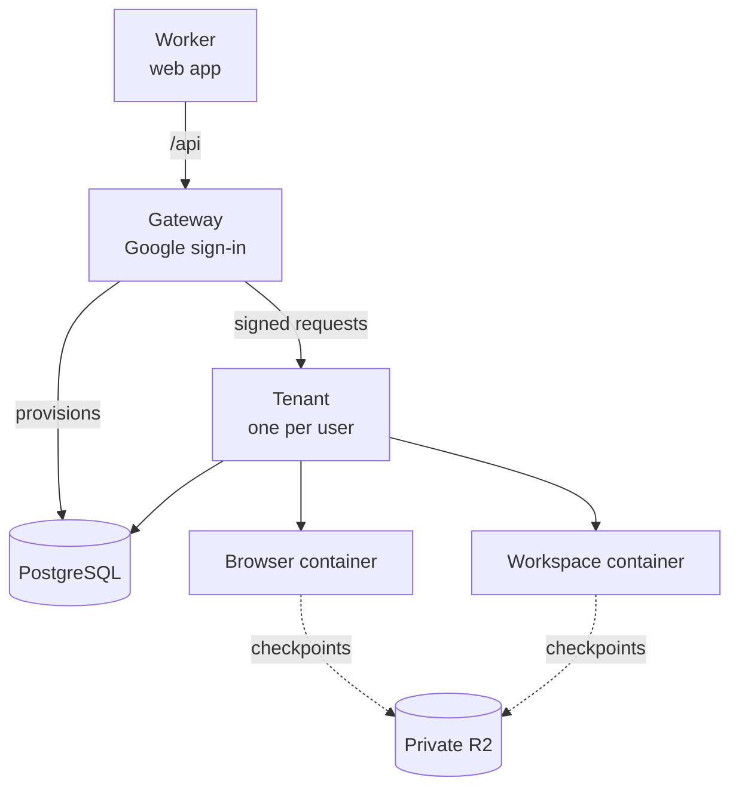
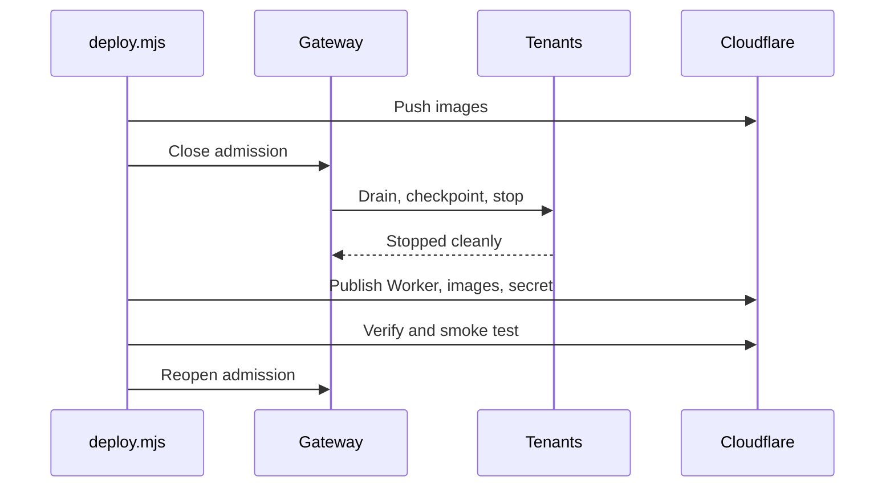

import { Steps } from '@astrojs/starlight/components';

This runbook is for operators who run Otto on Cloudflare for several people. To learn how hosted mode keeps users apart, read [Hosted mode](/how-it-works/hosted-mode/).

:::danger[Reset before you deploy this release]
This release has no migration path from the task model. Reset every existing environment with the [database reset](#reset-the-database) before you deploy it.
:::

## Architecture

The Worker serves the web app and sends `/api/*` to one private gateway. The gateway signs users in with Google and sends signed requests to each user's own tenant. Provider keys stay in the Node runtime.



| Class                        | Image tag                            | Instance type | Development max | Production max |
| ---------------------------- | ------------------------------------ | ------------- | --------------- | -------------- |
| `GatewayContainer`           | `otto-<environment>:<SHA>`           | `basic`       | 1               | 1              |
| `TenantContainer`            | same runtime image                   | `standard-1`  | 8               | 100            |
| `BrowserComputerContainer`   | `otto-<environment>-browser:<SHA>`   | `standard-4`  | 8               | 100            |
| `WorkspaceComputerContainer` | `otto-<environment>-workspace:<SHA>` | `standard-2`  | 8               | 100            |

`OTTO_MAX_USERS` caps admission at 8 by default. Set it to 100 in production. The containers' maximum instances don't admit users on their own, so raise both together, along with database connections and budget.

## Check a change

```sh title="Terminal"
pnpm install --frozen-lockfile && pnpm run build
pnpm --dir deployment/cloudflare install --frozen-lockfile
pnpm --dir deployment/cloudflare run check
pnpm --dir deployment/cloudflare test
cd deployment/cloudflare
pnpm exec wrangler deploy --env development --dry-run --containers-rollout=none
pnpm exec wrangler deploy --env production --dry-run --containers-rollout=none
```

Dry runs check bundling and configuration only.

## Run hosted mode locally

<Steps>

1. Create a private `.env.hosted.local` (mode 600) from `deployment/hosted.env.example`. Add a dedicated development database reachable from Docker, a fresh `OTTO_MASTER_KEY` from `openssl rand -base64 32`, a random `BETTER_AUTH_SECRET` of at least 32 characters, `OTTO_ENVIRONMENT=development`, model keys, and a Google OAuth client with the redirect `http://localhost:4330/api/auth/callback/google`. App connections use the managed service by default; `COMPOSIO_API_KEY` is optional for an operator-owned project.

2. Build and start.

   ```sh title="Terminal"
   pnpm run build
   pnpm --dir deployment/cloudflare install --frozen-lockfile
   node scripts/start-hosted.mjs --check
   node scripts/start-hosted.mjs
   ```

3. Open `http://localhost:4330`. R2 is emulated locally.

4. Press Ctrl-C to drain work and stop. If the stop is refused, run `node scripts/start-hosted.mjs --resume`.

</Steps>

Run only one Wrangler container stack at a time, and rebuild `dist/web` after UI edits.

## Environments and secrets

`wrangler.jsonc` defines separate `development` and `production` environments. Keep their databases, keys and Google clients separate too. If you supply your own Composio keys, use separate projects for each environment. Use a dedicated PostgreSQL database, because provisioning changes default grants.

Each environment has one `GATEWAY_ENV` Worker secret, compact JSON with these keys:

| Key                                                              | Value                                                                                                                        |
| ---------------------------------------------------------------- | ---------------------------------------------------------------------------------------------------------------------------- |
| `DATABASE_URL`                                                   | The dedicated database                                                                                                       |
| `OTTO_MASTER_KEY`                                                | 32 random bytes, base64-encoded                                                                                              |
| `BETTER_AUTH_SECRET`, `GOOGLE_CLIENT_ID`, `GOOGLE_CLIENT_SECRET` | Google sign-in                                                                                                               |
| `COMPUTER_PROVIDER`                                              | `cloudflare`, or `e2b` with `E2B_API_KEY` and `E2B_COMPUTER_TEMPLATE`                                                        |
| `OBJECT_STORAGE_PROVIDER`                                        | `http`                                                                                                                       |
| `OBJECT_STORAGE_ENDPOINT`                                        | `http://otto.storage/v1/objects/`                                                                                            |
| Model keys                                                       | Your model provider keys                                                                                                     |
| Optional `COMPOSIO_*` keys                                       | Your own Composio project instead of managed app connections. See [Configuration](/deploy/configuration/#apps-and-composio). |
| Optional                                                         | `OTTO_MAX_USERS`, `OTTO_DEVELOPER_IDS`, `OTTO_PRIVACY_NOTICE_FILE`, `OTTO_ANALYTICS_ENABLED`, `OTTO_ANALYTICS_ENVIRONMENT`   |

- Keep `GATEWAY_ENV` under 5 KiB.
- Never put secrets in build arguments, Vite variables or Wrangler `vars`.
- Secret changes take effect only through a new release rollout.

:::danger[`OTTO_MASTER_KEY` is recovery material]
Replacing it invalidates tenant credentials and encrypted data. Store it like a backup key.
:::

## Privacy notice and analytics

Write your notice to `public/privacy-notice.md` and set `OTTO_PRIVACY_NOTICE_FILE=dist/web/privacy-notice.md`. Otto serves it at `/privacy`, and an unreadable or invalid file stops startup. Check `/privacy` while signed out, then set it as the Google OAuth privacy policy URL before you invite anyone.

Analytics are on by default for `production` only, and each user still has to opt in. They go to the Otto team's n8n-owned EU PostHog project. Set `OTTO_ANALYTICS_ENABLED=false` to turn them off, or `true` to inspect a development deployment. Set `OTTO_FEEDBACK_ENABLED=false` in the same `GATEWAY_ENV` to disable feedback submissions and status checks for all tenants. Custom feedback collectors use `OTTO_FEEDBACK_URL`, `OTTO_FEEDBACK_RECEIPT_URL_PREFIX` and, if needed, `OTTO_FEEDBACK_TOKEN`. See [Analytics and recordings](/deploy/analytics/) and [feedback configuration](/deploy/configuration/#analytics-and-feedback). Describe the enabled recipients in your privacy notice.

## Create storage

Each environment needs exactly one private EU R2 bucket bound as `TENANT_FILES`. Create it once. The command needs `CLOUDFLARE_ACCOUNT_ID` and a separate operator token, `CLOUDFLARE_R2_OPERATOR_TOKEN`, with Workers R2 Storage Edit.

```sh title="Terminal"
pnpm --dir deployment/cloudflare run provision:storage development
pnpm --dir deployment/cloudflare run provision:storage production
```

## Workspace users

Workspace commands run as `node`, and each connected CLI as its own user in group `otto-connected` (gid 1002) with a private home. A deployed container gives every process root's capabilities, so both start through `setpriv --no-new-privs` with inheritable and ambient capabilities cleared. Otherwise a workspace command could read a CLI token from `/proc`. Connected CLIs live outside checkpoints and reinstall from their declared source after a restart.

## Computer network

Browser and workspace computers keep public internet access for browsing, package installs and Git. Before each computer starts, the computer's Durable Object routes plain HTTP and HTTPS to private, CGNAT, link-local and metadata ranges (`10.0.0.0/8`, `100.64.0.0/10`, `169.254.0.0/16`, `172.16.0.0/12`, `192.168.0.0/16`, `fc00::/7`, `fe80::/10`) to `PrivateNetworkRefusal`, which answers 403. Cloudflare only routes ports 80 and 443 through these handlers, so other ports to those ranges are not filtered. The browser is also limited by Otto's own proxy, which allows only public addresses.

Run this check on the development environment after a change to computer networking. You need two development owners, A and B. Ask Otto, as each owner, to run the commands in its workspace.

1. As owner A, start a listener and print the workspace's address:

   ```sh
   setsid python3 -m http.server 8080 --bind 0.0.0.0 </dev/null >/dev/null 2>&1 &
   python3 -c "import socket; s=socket.socket(socket.AF_INET, socket.SOCK_DGRAM); s.connect(('1.1.1.1', 53)); print(s.getsockname()[0])"
   ```

2. As owner B, run the probe with A's address. It sends one request to each target:

   ```sh
   A=<address from step 1>
   python3 - "$A" <<'PY'
   import socket, struct, sys, urllib.error, urllib.request
   a = sys.argv[1]
   gateway = next(socket.inet_ntoa(struct.pack('<L', int(f[2], 16))) for f in (l.split() for l in open('/proc/net/route').readlines()[1:]) if f[1] == '00000000')
   def http(url):
       try:
           with urllib.request.urlopen(url, timeout=4) as r: return r.status
       except urllib.error.HTTPError as e: return e.code
       except Exception as e: return type(e).__name__
   def tcp(host, port):
       try:
           socket.create_connection((host, port), timeout=4).close(); return 'open'
       except Exception as e: return type(e).__name__
   for name, result in [
       ('public http', http('http://example.com/')),
       ('public https', http('https://example.com/')),
       ('metadata http', http('http://169.254.169.254/')),
       ('gateway http', http(f'http://{gateway}/')),
       ('sibling http 8080', http(f'http://{a}:8080/')),
       ('sibling tcp 8080', tcp(a, 8080)),
       ('sibling health 4311', http(f'http://{a}:4311/health')),
       ('gateway tcp 8080', tcp(gateway, 8080)),
   ]: print(f'{name}: {result}')
   PY
   ```

Public HTTP and HTTPS should give 200, and metadata and gateway HTTP should give 403. Before this policy, those two fail with an error or answer. Any `open` or HTTP status for the sibling or gateway on another port means that address is reachable over raw TCP, which only an in-container firewall or `enableInternet = false` can stop. Report it before the next production deploy.

## Computer checkpoints

A checkpoint is a gzip tar of the workspace (`/home/node/state`) or the user's browser data, stored in R2.

| Limit                | Value                                                                          |
| -------------------- | ------------------------------------------------------------------------------ |
| Size                 | 1 GiB uncompressed and 100,000 entries                                         |
| Always skipped       | `__pycache__` and `.cache` folders, FIFOs and sockets                          |
| Browser skips        | Chromium HTTP, code, GPU, shader, Dawn and CRX caches                          |
| Browser keeps        | Cookies, Local Storage, IndexedDB and Service Worker data                      |
| Browser saves when   | It goes idle, which closes its pages                                           |
| Workspace saves when | About 20 seconds after the last command, and before it sleeps, stops or drains |

When a conversation turn ends waiting for the user, the tenant holds its running browser. For up to 30 minutes, the hold keeps the browser container awake so its pages survive. The next turn or a reset releases it. Workspace commands from different sessions run side by side, and the workspace saves once all of them have finished.

:::caution[Changes between checkpoints can be lost]
If a workspace container is lost before its next checkpoint, recent changes are lost. The model is told on its next command.
:::

If Otto can't confirm that a command stopped safely, it can't tell what the command changed, so it destroys that computer and refuses it for the rest of the tenant's generation. The next generation restores the last checkpoint; for a workspace, it also tells the model what was lost.

A workspace too large to save keeps running on its previous checkpoint, and the model's next bash output says what to delete. Unsaved changes are dropped when it sleeps, stops or drains. This never blocks a deploy.

## CI and rollout

`ci.yml` runs root checks, PostgreSQL tests, the build, this package's checks and tests, both dry runs and the image builds. `deploy.yml` runs after CI passes on the current `main` commit, in the GitHub `production` environment.

| Kind     | Name                    | Value                                                       |
| -------- | ----------------------- | ----------------------------------------------------------- |
| Secret   | `CLOUDFLARE_API_TOKEN`  | Deployment token (Workers publish and settings, Containers) |
| Secret   | `CLOUDFLARE_ACCOUNT_ID` | Account ID                                                  |
| Secret   | `GATEWAY_ENV`           | Production gateway JSON                                     |
| Variable | `OTTO_PUBLIC_URL`       | Canonical HTTPS origin                                      |

`scripts/deploy.mjs production` then runs these steps:

<Steps>

1. Push all three images and resolve their digests.
2. Close a durable admission barrier, authorized by an HMAC derived from `OTTO_MASTER_KEY`.
3. Drain each tenant, then require clean browser and workspace checkpoints and a confirmed stop of each exact generation. Active holds, a command still running, a computer still running after an interrupted command, a workspace still marked mid-command, or an expired deadline block the deploy. Finished but unsaved work is saved to a checkpoint, or discarded with a notice if it can't be saved. A computer left uncertain or restoring whose container is already gone goes back to its last checkpoint instead. Nothing is force-cancelled.
4. Publish Worker code, image references and `GATEWAY_ENV` together with `wrangler deploy --secrets-file`.
5. Verify every container application's image and rollout, the R2 binding and a public smoke test, then reopen admission.

</Steps>



Otto refuses to redeploy the SHA already in production, so configuration changes need a new release. For a manual development deploy with locally built `linux/amd64` images, run `pnpm --dir deployment/cloudflare run deploy:development`.

## Recover or roll back

If a deployment is interrupted, check out the same release, load the same private environment with `OTTO_RELEASE` set to that SHA, and run:

```sh title="Terminal"
node deployment/cloudflare/scripts/recover.mjs production status
node deployment/cloudflare/scripts/recover.mjs production abort
node deployment/cloudflare/scripts/recover.mjs production complete
```

Use `abort` only before activation and `complete` only after it. A failed or expired deployment never reopens on its own. Don't delete the barrier, substitute a nonce or clear a fence to get past a failure.

If `status` shows a deployment that failed while draining, for example because a tenant's computer was left uncertain, run `abort`. It stops each tenant the drain couldn't account for, confirms its runtime and computers are stopped cleanly, and reopens admission. If a tenant still can't be confirmed, admission stays closed and `abort` can be retried. Then start a new deployment.

Before a rollback, confirm the previous code supports the current SQL schema, Durable Object classes, checkpoint format and keys, and stop the current generations. A Worker rollback doesn't revert PostgreSQL, R2 or completed external actions, so prefer a forward fix.

## Remove one account

To delete one hosted user and their data, for example on request or to free an `OTTO_MAX_USERS` slot, load the same private environment as for recovery. Run a dry run first, then the removal:

```sh title="Terminal"
node deployment/cloudflare/scripts/recover.mjs production deprovision <owner-id> --dry-run
node deployment/cloudflare/scripts/recover.mjs production deprovision <owner-id>
```

The dry run prints counts and changes nothing. The removal refuses while a deployment is in progress and keeps a deployment from starting until it ends. Then it:

<Steps>

1. Asks the user's runtime to disconnect their Composio accounts and triggers, Telegram and WhatsApp, and MCP connections.
2. Marks the account as being removed, so no start, wake or webhook restarts it.
3. Stops the runtime and its computers, and confirms the stop.
4. Deletes the user's R2 objects under `<environment>/<owner>/`.
5. Deletes the user's Better Auth user, sessions and accounts, and their account settings.
6. Drops the user's schemas and role, after checking they match the names derived from the owner ID, and deletes the registry row and channel claims. This frees the slot.

</Steps>

Every step can be repeated, so if the command stops partway or times out, run it again until it reports the account removed. Step 1 starts a stopped runtime, so the user's own schedules or app events can still run briefly before step 2. If the runtime can't start to disconnect apps, add `--skip-release` and revoke those external accounts by hand, since the removal then leaves them at the providers. Otto deletes its own tokens for MCP sign-ins but can't revoke them at the service, which may list Otto as a connected app until the user removes it. R2 aborts incomplete multipart uploads on its own after seven days. The tenant and computer Durable Objects keep only identity and checkpoint references, which no new account reuses.

Run it once on development with a test account before you use it in production.

## Reset the database

A reset removes every account and its data from one environment. Use it only when a release requires it.

<details>
<summary>Database reset runbook</summary>

<Steps>

1. Confirm the exact origin, database, bucket, provider projects and release. Keep the deployment, OAuth clients, provider keys, Composio auth configs and `OTTO_MASTER_KEY`.
2. Close admission with the deployment barrier, as in a rollout. Confirm every tenant and computer generation has stopped, and keep the gateway from restarting.
3. Remove external resources while their IDs are readable: unregister each user's Telegram webhook, delete their Composio triggers, sessions and connected accounts, and revoke the OAuth grants of their MCP connections and of any direct Notion or Linear connections from earlier releases.
4. Delete R2 objects under `<environment>/<owner>/` (`artifacts/`, `sessions/`, `computers/`) and abort incomplete multipart uploads.
5. In PostgreSQL, drop every tenant app and jobs schema and tenant role. Delete Better Auth users, accounts, sessions, verification rows and account settings. Clear the tenant registry and channel claim records, but keep the auth and control table definitions.
6. Verify zero users, sessions, tenant schemas, roles, registry rows and owner objects. Keep a counts-only record, and never log user content or credentials.
7. Reopen admission with the same deployment operation. Check `/api/health`, that anonymous sessions have no access, and that old sessions are rejected.

</Steps>

If a provider or database call fails partway, keep admission closed and verify again before you retry. Provider backups and logs are outside this procedure.

</details>

## Optional: E2B computers

E2B runs one sandbox per user, with the browser, workspace and connected CLIs as separate Linux users behind an nftables guard. Only root reaches E2B's control port, and the browser keeps its temporary files, including its display cookie, in a private folder. Cloudflare remains the selected hosted provider.

```sh title="Terminal"
node --import tsx deployment/e2b/build.ts computer --check
node --import tsx deployment/e2b/build-local.ts
node deployment/e2b/validate-computer.mjs otto-e2b-computer:<hash-prefix>
node --env-file=<private-dev-env> --import tsx deployment/e2b/build.ts computer <template-name>
```

In order: an offline context check, a local image, isolation checks, and the billable template build.

Select it with `COMPUTER_PROVIDER=e2b`, `OBJECT_STORAGE_PROVIDER=postgres`, `E2B_API_KEY` and the returned template ID as `E2B_COMPUTER_TEMPLATE`. Live acceptance (`deployment/e2b/acceptance.ts plan|run|inspect|cleanup`) must pass in a disposable development sandbox before you turn E2B on anywhere.

## Related resources

- [Configuration reference](/deploy/configuration/)
- [Analytics and recordings](/deploy/analytics/)
- [Hosted mode](/how-it-works/hosted-mode/)
- [Troubleshooting](/deploy/troubleshooting/)
