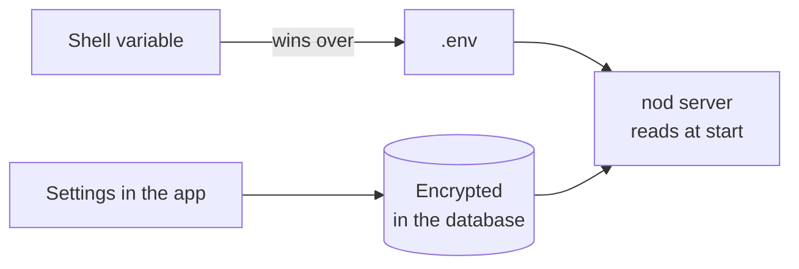
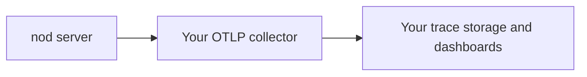

This page lists the settings a source install of nod reads, what each one does and its default.

## How settings work

- Settings live in `.env` in the repository folder. Git ignores it. `pnpm start` creates it from `.env.example` the first time, readable only by you.
- A variable set in your shell wins over the same variable in `.env`.
- nod reads settings when it starts. Restart nod after you change one.
- Most things don't need a variable. You connect models, apps and channels in the app, and nod saves them encrypted.
- The desktop app doesn't read `.env`. It manages its own settings in **Settings**.



## Server and data

| Variable                  | What it does                                                                                                                                            | Default                   |
| ------------------------- | ------------------------------------------------------------------------------------------------------------------------------------------------------- | ------------------------- |
| `PORT`                    | The local port for the app and API.                                                                                                                     | `4310`                    |
| `NOD_DATA_ROOT`           | The folder for local data: sessions, workspace files and the access key.                                                                                | `.local`                  |
| `NOD_POSTGRES_PASSWORD`   | The password of the local PostgreSQL container. `pnpm start` generates one and saves it. A value you set needs at least 43 letters, digits, `_` or `-`. | Generated                 |
| `DATABASE_URL`            | The PostgreSQL connection. `pnpm start` fills it in for the local container on `127.0.0.1:54329`. Set another URL to use your own database.             | Local container           |
| `DATABASE_POOL_MAX`       | The most database connections the server opens.                                                                                                         | `12`                      |
| `NOD_PUBLIC_URL`          | The address you open nod at.                                                                                                                            | `http://localhost:<PORT>` |
| `NOD_PRIVACY_NOTICE_FILE` | A Markdown privacy notice served at `/privacy`.                                                                                                         | No notice                 |

## Models

Keys set here become server-managed connections. They stay in server memory and aren't copied into the database. You can also add connections in **Models** without any variable. See [Models](/connect/models/).

| Variable                     | What it does                                                                                                                             | Default                                                                                                            |
| ---------------------------- | ---------------------------------------------------------------------------------------------------------------------------------------- | ------------------------------------------------------------------------------------------------------------------ |
| `LLM_PROVIDER`               | The provider of the first model choice: `openai`, `anthropic`, `openrouter` or `compatible`. A model you pick in the app takes priority. | `openai`                                                                                                           |
| `LLM_MODEL`                  | The first model choice.                                                                                                                  | `gpt-6.1-sol`, `claude-opus-5-5` or `openai/gpt-6.1-sol` by provider, or the server's first model for `compatible` |
| `OPENAI_API_KEY`             | Adds an OpenAI connection. It also turns on voice replies.                                                                               | Empty                                                                                                              |
| `ANTHROPIC_API_KEY`          | Adds an Anthropic connection.                                                                                                            | Empty                                                                                                              |
| `OPENROUTER_API_KEY`         | Adds an OpenRouter connection.                                                                                                           | Empty                                                                                                              |
| `OPENAI_COMPATIBLE_BASE_URL` | Adds an [OpenAI-compatible server](/connect/local-models/), such as Ollama at `http://localhost:11434/v1`. Local nod only.               | Empty                                                                                                              |
| `OPENAI_COMPATIBLE_API_KEY`  | The key for that server, if it needs one.                                                                                                | Empty                                                                                                              |
| `TYPESAFE_API_KEY`           | Selects direct Jev for reading approval replies, regardless of the chat connection.                                                      | Empty                                                                                                              |
| `TTS_MODEL`                  | The OpenAI speech model for voice replies.                                                                                               | `gpt-4o-mini-tts`                                                                                                  |
| `TTS_VOICE`                  | The voice for voice replies. Not in `.env.example`.                                                                                      | `coral`                                                                                                            |

Without `TYPESAFE_API_KEY`, an OpenAI API connection uses GPT Decisions and an OpenRouter connection uses Jev through OpenRouter. Direct Anthropic, ChatGPT subscription and OpenAI-compatible connections use the selected chat model for this check. Your selected model still writes messages. See [Decision checks](/connect/models/#decision-checks) for billing, data routing, and failure behavior.

## Apps and Composio

Desktop and source/server installs offer Easy Connect with Google sign-in or a personal Composio key. Easy Connect requires an email or verified Google Workspace domain allowed by the proxy operator. Select either in **Settings → App connections**; see [Apps](/connect/apps/#use-your-own-composio-project).

Setting `COMPOSIO_API_KEY` pins a source/server install to its own project, and the app no longer offers the choice. The desktop app ignores `COMPOSIO_API_KEY`. Packaged and ordinary source desktop launches also ignore `NOD_COMPOSIO_PROXY_URL`; [isolated desktop development](/deploy/desktop-app/) can override it.

| Variable                           | What it does                                                                                                      | Default          |
| ---------------------------------- | ----------------------------------------------------------------------------------------------------------------- | ---------------- |
| `COMPOSIO_API_KEY`                 | Uses your own Composio project directly. Set it in the server environment or `.env`, then restart nod.            | Empty            |
| `NOD_COMPOSIO_PROXY_URL`           | Uses a custom connection service in place of nod's when `COMPOSIO_API_KEY` is absent.                             | nod's connection |
| `COMPOSIO_WEBHOOK_SECRET`          | Verifies Composio webhook deliveries for automatic app updates. The key also needs **Triggers → Read and write**. | Empty            |
| `COMPOSIO_GMAIL_AUTH_CONFIG_ID`    | Picks the Composio auth config, and so the OAuth scopes, for Gmail.                                               | Automatic        |
| `COMPOSIO_CALENDAR_AUTH_CONFIG_ID` | The same for Google Calendar.                                                                                     | Automatic        |
| `COMPOSIO_DRIVE_AUTH_CONFIG_ID`    | The same for Google Drive.                                                                                        | Automatic        |
| `COMPOSIO_SHEETS_AUTH_CONFIG_ID`   | The same for Google Sheets.                                                                                       | Automatic        |
| `COMPOSIO_DOCS_AUTH_CONFIG_ID`     | The same for Google Docs.                                                                                         | Automatic        |
| `COMPOSIO_SLACK_AUTH_CONFIG_ID`    | The same for Slack.                                                                                               | Automatic        |

For `NOD_COMPOSIO_PROXY_URL`, use a trusted HTTPS origin without a path, query, fragment or user credentials. HTTP is allowed only for `localhost`, `127.0.0.1` or `[::1]` during local development.

Webhook and auth-config settings apply only when nod uses your own Composio project, through `COMPOSIO_API_KEY` or a key saved in the app. Explicit auth-config IDs take precedence. Otherwise, nod discovers eligible custom configurations across supported toolkits. It uses Composio defaults only when no custom configuration exists. Ambiguous or unavailable custom configurations stop the connection instead of falling back.

Easy Connect's operator selects its configurations on the connection service. nod doesn't send these auth-config settings to that service. Notion and Linear connect through their own MCP servers, so these settings don't apply to them. See [Apps](/connect/apps/) for key permissions and automatic-update limits.

## Vault

| Variable        | What it does                                                                                                                                                                                                     | Default |
| --------------- | ---------------------------------------------------------------------------------------------------------------------------------------------------------------------------------------------------------------- | ------- |
| `NOD_VAULT_KEY` | A base64 32-byte key that encrypts saved credentials and overrides automatic local storage. Local macOS uses Keychain; local Linux web uses a private profile file. Other server modes require a configured key. | Empty   |

For an explicitly managed server key, create it with `openssl rand -base64 32`. Local Linux web installs keep their generated key at `NOD_DATA_ROOT/vault/master-key`, outside the sandbox. The directory and key must be owned by the server user and private. Desktop uses its existing OS-protected key.

nod never generates a replacement when encrypted data already exists. Restore the original key if it is missing. Back up the private key separately alongside the encrypted database; a database backup alone cannot recover saved credentials.

:::danger[Back up the Vault key]
Saved credentials can't be read without it. Keep a copy somewhere safe, outside the repository.
:::

## Channels

Set up Telegram and WhatsApp in **Channels** instead. The app checks the account and saves the settings encrypted, and those override these variables. See [Channels](/use/channels/).

| Variable                        | What it does                                                                             | Default |
| ------------------------------- | ---------------------------------------------------------------------------------------- | ------- |
| `TELEGRAM_ENABLED`              | `true` turns on Telegram.                                                                | `false` |
| `TELEGRAM_BOT_TOKEN`            | The bot token from BotFather.                                                            | Empty   |
| `TELEGRAM_WEBHOOK_SECRET_TOKEN` | The secret Telegram sends with each webhook call: 16 to 256 letters, digits, `_` or `-`. | Empty   |
| `TELEGRAM_ALLOWED_USER_ID`      | The only Telegram user ID nod answers.                                                   | Empty   |
| `WHATSAPP_ENABLED`              | `true` turns on WhatsApp.                                                                | `false` |
| `WHATSAPP_POLICY_CONFIRMED`     | `true` confirms your use is allowed under the WhatsApp terms. Required.                  | `false` |
| `WHATSAPP_ACCESS_TOKEN`         | The WhatsApp Cloud API access token from Meta.                                           | Empty   |
| `WHATSAPP_APP_SECRET`           | The Meta app secret. nod uses it to check webhook signatures.                            | Empty   |
| `WHATSAPP_PHONE_NUMBER_ID`      | The ID of the business sender number.                                                    | Empty   |
| `WHATSAPP_VERIFY_TOKEN`         | The token Meta sends when it verifies the webhook.                                       | Empty   |
| `WHATSAPP_ALLOWED_NUMBER`       | The only phone number nod answers, 7 to 15 digits.                                       | Empty   |

## Analytics and feedback

| Variable                          | What it does                                                                                                                       | Default                                                                                                                                     |
| --------------------------------- | ---------------------------------------------------------------------------------------------------------------------------------- | ------------------------------------------------------------------------------------------------------------------------------------------- |
| `NOD_ANALYTICS_ENABLED`           | `false` turns off usage data and recordings for everyone. `true` turns them on in development too. Each owner still has to opt in. | On with `pnpm start`, off with `pnpm run dev`                                                                                               |
| `NOD_ANALYTICS_ENVIRONMENT`       | The label on events: `production` or `development`.                                                                                | `production` with `NODE_ENV=production`, unless `NOD_APP_VERSION` is a pre-release; desktop sets it to `production` only for release builds |
| `NOD_FEEDBACK_ENABLED`            | `false` disables feedback submissions and status checks, regardless of the configured collector.                                   | Enabled                                                                                                                                     |
| `NOD_FEEDBACK_URL`                | The HTTPS address that receives **Send feedback** reports. An empty value turns submission off.                                    | The nod team at n8n                                                                                                                         |
| `NOD_FEEDBACK_RECEIPT_URL_PREFIX` | Required with a custom collector. An HTTPS issue collection URL ending in `/`; receipts must belong to that origin and path.       | n8n's Linear `LAB` issues for the default collector                                                                                         |
| `NOD_TRACES_URL`                  | The HTTPS address that receives conversation traces from owners who opt in. An empty value turns traces off for everyone.          | The nod team at n8n                                                                                                                         |
| `NOD_TRACES_TOKEN`                | The token sent as `x-nod-traces-token` with each trace. Without it, nod sends no traces and hides the switch.                      | Empty; official desktop builds include one                                                                                                  |

See [Analytics and recordings](/deploy/analytics/) for what's collected.

Analytics go to the nod team's n8n-owned EU PostHog project, even in independent installations. There is no runtime override for that project. Feedback defaults to `https://internal.users.n8n.cloud/webhook/nod/feedback`; the dialog identifies the configured recipient before submission. To disable both collectors, set `NOD_ANALYTICS_ENABLED=false` and `NOD_FEEDBACK_ENABLED=false`, then restart nod. These settings apply to source installs and the desktop process environment. They do not disable model, app or update traffic.

For an operator-owned collector, set `NOD_FEEDBACK_URL=https://feedback.example.com/intake` and `NOD_FEEDBACK_RECEIPT_URL_PREFIX=https://issues.example.com/projects/nod/issues/`. A submitted receipt can then link to `https://issues.example.com/projects/nod/issues/123`, but not another project or origin. Receipt URLs cannot contain credentials, queries, fragments or encoded path separators. The collector uses nod's existing feedback envelope and receipt contract; setting an endpoint alone does not create a compatible service. `NOD_FEEDBACK_TOKEN`, when set, supplies the server-only `x-nod-feedback-token` header. It never goes to the browser or sandbox.

## OpenTelemetry

Set `OTEL_EXPORTER_OTLP_ENDPOINT` to send model request metadata to your own collector. Leave it empty to keep export off.

| Variable                      | What it does                                                              | Default           |
| ----------------------------- | ------------------------------------------------------------------------- | ----------------- |
| `OTEL_EXPORTER_OTLP_ENDPOINT` | The base HTTP or HTTPS URL of your OTLP collector. nod adds `/v1/traces`. | Empty; export off |

```sh title=".env"
OTEL_EXPORTER_OTLP_ENDPOINT=http://127.0.0.1:4318
```

Restart nod after you set or remove the variable. For the desktop app, set it in the process environment before you start nod. The desktop app does not read `.env`.



nod sends one span for each model usage record, including helper and background work. Spans contain:

- The provider and model names, request category, operation, and status.
- The request start and end times.
- Available input, output, and cache token counts.
- Available cost, estimated cost, and pricing source.

Requests from one turn share a trace ID. Exported IDs use a random key that changes when nod restarts. nod does not send internal execution IDs.

The export contains no prompts, replies, tool arguments, tool results, keys, or raw errors. Custom model names are included. The collector controls storage, access, and retention.

This export is separate from **Share usage data** and **Share conversation traces**. Those switches do not control it. Setting the endpoint enables this export only.

nod uses OTLP over HTTP with JSON encoding. It sends batches every five seconds and at shutdown. Each request has a five-second timeout. The queue holds at most 256 spans. Failed batches and excess spans are dropped, with no retry. Export does not delay model requests or change spending controls.

This version exports model spans only. It does not export metrics, logs, browser steps, or tool spans. Use your collector to add authentication headers when it forwards spans. nod does not send authentication headers or support OTLP over gRPC.

## Computers

| Variable              | What it does                            | Default         |
| --------------------- | --------------------------------------- | --------------- |
| `WORKSPACE_CONTAINER` | The Docker container for the workspace. | `nod-workspace` |
| `BROWSER_CONTAINER`   | The Docker container for the browser.   | `nod-browser`   |

## Related resources

- [Install from source](/get-started/install-from-source/)
- [Desktop app internals](/deploy/desktop-app/)
- [Troubleshooting](/deploy/troubleshooting/)
