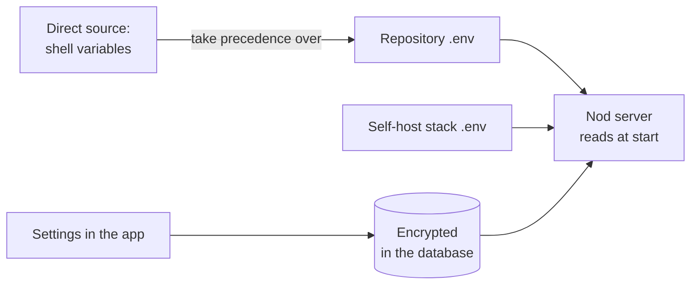
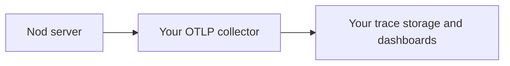

Configure a source install or self-hosted server through environment variables. This page lists supported settings, defaults, and precedence.

## How settings work

- A source install reads `.env` in the repository folder. Git ignores it. `pnpm start` creates it from `.env.example`, readable only by you.
- The [self-hosting stack](/deploy/self-host/) has its own `.env` in `deployment/self-host/`. Keep it private and include it in your backup.
- For a direct source install, a variable set in your shell wins over the same variable in the repository `.env`.
- For the self-hosting stack, put application settings in its private `.env`. Compose passes all supported model variables from this file through `env_file`; no edits to `compose.yaml` are needed. It does not forward arbitrary variables from your host shell. Keep `NOD_AUTH_TOKEN`, `NOD_VAULT_KEY`, and `NOD_POSTGRES_PASSWORD` in `.env` and unset shell overrides before setup or Compose.
- Nod reads settings when it starts. After editing `.env`, [apply the configuration changes](#apply-configuration-changes).
- Most things don't need a variable. You connect models, apps and channels in the app, and Nod saves them encrypted.
- The desktop app doesn't read `.env`. When connected to a server, it uses that server's configuration. Its server address and token are client settings.



## Apply configuration changes

For a Docker installation, run this from the folder containing its `.env` and `compose.yaml`:

```sh title="Terminal"
docker compose up -d --wait
```

If you use the bundled HTTPS proxy, run `docker compose --profile https up -d --wait` instead. Compose recreates containers whose configuration changed and preserves their data volumes. `docker compose restart` keeps the old environment values.

For a direct source install, stop and start the Nod process. The desktop app does not read `.env`; it uses the configuration of the server it connects to.

## Server and data

| Variable                  | What it does                                                                                                                                                         | Default                                             |
| ------------------------- | -------------------------------------------------------------------------------------------------------------------------------------------------------------------- | --------------------------------------------------- |
| `PORT`                    | The local port for the app and API.                                                                                                                                  | `4310`                                              |
| `NOD_HOST`                | The address the server listens on. Use `0.0.0.0` inside the self-hosting container. A non-loopback address requires `NOD_AUTH_TOKEN`.                                | `127.0.0.1`                                         |
| `NOD_AUTH_TOKEN`          | The access token for the web and desktop clients: at least 43 letters, digits, `_`, or `-`. Required for a remote bind or public URL. Never printed in startup logs. | Unset; local installs generate a private access key |
| `NOD_DATA_ROOT`           | The folder for local data: sessions, workspace files and the access key.                                                                                             | `.local`                                            |
| `NOD_POSTGRES_PASSWORD`   | The password of the local PostgreSQL container. `pnpm start` generates one and saves it. A value you set needs at least 43 letters, digits, `_` or `-`.              | Generated                                           |
| `DATABASE_URL`            | The PostgreSQL connection. `pnpm start` fills it in for the local container on `127.0.0.1:54329`. Set another URL to use your own database.                          | Local container                                     |
| `DATABASE_POOL_MAX`       | The most database connections the server opens.                                                                                                                      | `12`                                                |
| `NOD_PUBLIC_URL`          | The exact origin you open Nod at. Remote origins require HTTPS and `NOD_AUTH_TOKEN`. No path, query, fragment, or user credentials. Loopback origins can use HTTP.   | `http://localhost:<PORT>`                           |
| `NOD_PRIVACY_NOTICE_FILE` | A Markdown privacy notice served at `/privacy`.                                                                                                                      | No notice                                           |

App sign-in pages and callbacks use `NOD_PUBLIC_URL`, including through an SSH tunnel. See [Connect apps on the server](/deploy/self-host/#connect-apps-on-the-server).

The access token grants full access to this server's assistant. `setup.sh` generates it from 32 cryptographically random bytes. For manual setup, use `openssl rand -hex 32`; a long word or repeated character is not a secure token. Keep it separate from `NOD_VAULT_KEY`.

Omit `NOD_AUTH_TOKEN` and `NOD_PUBLIC_URL` from a local source configuration when you don't set them. An explicitly empty value is invalid. The Docker setup fills both in.

Changing `NOD_AUTH_TOKEN` and [applying the configuration](#apply-configuration-changes) revokes the previous token. Reconnect your web and desktop clients with the new token. See [Rotate access](/deploy/server-operations/#rotate-access).

For a remote server, set both values before starting:

```sh title=".env"
NOD_PUBLIC_URL=https://nod.example.com
NOD_AUTH_TOKEN=<your-generated-token>
```

Use the [self-hosting guide](/deploy/self-host/) to configure HTTPS and private backing services. Setting a public URL alone does not create a proxy or a certificate.

## Models

Keys set here become server-managed connections. They stay in server memory and aren't copied into the database. You can also add connections in **Models** without any variable. See [Models](/connect/models/).

| Variable                     | What it does                                                                                                                                                          | Default                                                          |
| ---------------------------- | --------------------------------------------------------------------------------------------------------------------------------------------------------------------- | ---------------------------------------------------------------- |
| `LLM_PROVIDER`               | The provider of the first model choice: any [supported provider ID](/connect/models/#set-connections-in-server-settings). A model you pick in the app takes priority. | `openai`                                                         |
| `LLM_MODEL`                  | The first model choice.                                                                                                                                               | The [provider's default](/connect/models/#supported-connections) |
| `OPENAI_API_KEY`             | Adds an OpenAI connection. It also turns on voice transcription and voice replies.                                                                                    | Empty                                                            |
| `ANTHROPIC_API_KEY`          | Adds an Anthropic connection.                                                                                                                                         | Empty                                                            |
| `ANTHROPIC_WORKSPACE_ID`     | The workspace for `ANTHROPIC_API_KEY`. Required only for organization keys that aren't limited to one workspace.                                                      | Empty                                                            |
| `OPENROUTER_API_KEY`         | Adds an OpenRouter connection with ElevenLabs and Kokoro voices. Also enables transcription when no OpenAI API connection is available.                               | Empty                                                            |
| `ELEVENLABS_API_KEY`         | Adds an ElevenLabs connection for account voices and transcription, without a chat model.                                                                             | Empty                                                            |
| `OPENAI_COMPATIBLE_BASE_URL` | Adds an [OpenAI-compatible server](/connect/local-models/), such as Ollama at `http://localhost:11434/v1`. The address must be reachable from Nod's server.           | Empty                                                            |
| `OPENAI_COMPATIBLE_API_KEY`  | The key for that server, if it needs one.                                                                                                                             | Empty                                                            |
| `TYPESAFE_API_KEY`           | Selects direct Jev for account-access email and for Trust checks in `decision` mode.                                                                                  | Empty                                                            |
| `NOD_TRUST_MODEL`            | Selects the action checker: `selected`, `llm` or `decision`. The checker also checks strict app reads and confirmation replies.                                       | `selected`                                                       |
| `TTS_MODEL`                  | The OpenAI speech model for voice replies.                                                                                                                            | `gpt-4o-mini-tts`                                                |
| `STT_MODEL`                  | The OpenAI or OpenRouter model for incoming voice messages. On OpenRouter, a model ID without `/` gets the `openai/` prefix.                                          | `gpt-transcribe` (`openai/gpt-transcribe` on OpenRouter)         |
| `TTS_VOICE`                  | The voice for voice replies.                                                                                                                                          | `coral`                                                          |

The [provider settings table](/connect/models/#set-connections-in-server-settings) lists every supported key, including `GEMINI_API_KEY` for Google Gemini and `GOOGLE_CLOUD_API_KEY` for Vertex AI. It also lists the required Bedrock Region, Azure endpoint and model, and Cloudflare account and gateway settings. You can configure several providers at once; `LLM_PROVIDER` only sets the initial selection.

Without `TYPESAFE_API_KEY`, account-access email uses GPT Decisions on an OpenAI API connection or Jev on OpenRouter. Other connections use their smaller background model, when available. The Trust mode controls confirmation replies. Your selected text model writes and checks most approval wording in separate requests; permanent Gmail deletion receives a fixed server-written question and button label. See [Decision checks](/connect/models/#decision-checks) for billing, data routing, and failure behavior.

`NOD_TRUST_MODEL=selected` uses your selected model at its lowest reasoning setting. `llm` uses a known small LLM. `decision` selects direct TypeSafe Jev 1.14, then OpenRouter Jev, then Perplexity Decider through OpenRouter, then OpenAI Decisions. If none is available, it selects the small LLM before the check starts. A failed lookup blocks the check. A failed or uncertain decision never switches the checker to an LLM. There is no separate decision-model override. These settings do not change account-access email checks or which model writes and checks confirmation wording. Browser confirmation wording includes page-visible text; the action checker does not receive it.

Voice reuses OpenRouter and OpenAI API keys saved in **Models**. To connect these services or ElevenLabs, open **Settings → Voice & audio**, choose a **Voice provider**, then select **Connect** beside it. **Manage** opens an existing connection. Set `ELEVENLABS_API_KEY` for a server-managed ElevenLabs connection; it supplies speech without adding a chat model. Allow Text to Speech, Speech to Text, and Voices read on the key.

Selecting an ElevenLabs account voice uses ElevenLabs for transcription and replies. Otherwise, cloud transcription uses OpenAI, then OpenRouter, then ElevenLabs, depending on which connection is available. You can also [download local voices](#local-speech) without an API connection.

## Apps and Composio

Nod routes Composio connections through n8n's connection service by default. Users connect each app directly from onboarding or **Apps**.

| Variable                 | What it does                                                                                      | Default                      |
| ------------------------ | ------------------------------------------------------------------------------------------------- | ---------------------------- |
| `NOD_COMPOSIO_PROXY_URL` | Selects a trusted connection service for source/server installs and isolated desktop development. | `https://composio.n8n.cloud` |

Use an HTTPS origin without a path, query, fragment or user credentials. HTTP is allowed only for `localhost`, `127.0.0.1` or `[::1]` during local development. Packaged and ordinary source desktop launches use Nod's service; [isolated desktop development](/deploy/desktop-app/) can override it.

The service operator configures the Composio project and app authorization settings. Those credentials never enter Nod's client configuration. Notion, Linear and n8n connect through their own MCP servers. See [Apps](/connect/apps/).

## Vault

| Variable        | What it does                                                                                                                                         | Default                   |
| --------------- | ---------------------------------------------------------------------------------------------------------------------------------------------------- | ------------------------- |
| `NOD_VAULT_KEY` | A base64 32-byte key that encrypts saved credentials. Overrides automatic source-install key storage. The self-hosting stack generates it in `.env`. | Unset for source installs |

For an explicitly managed server key, create it with `openssl rand -base64 32`. Without it, macOS source installs use Keychain, and Linux source installs use `NOD_DATA_ROOT/vault/master-key`, outside the sandbox. Other source platforms require `NOD_VAULT_KEY`. The Linux key directory and file must be owned by the server user and private. Desktop uses its OS-protected key.

Nod never generates a replacement when encrypted data already exists. Restore the original key if it is missing. Back up the private key separately alongside the encrypted database; a database backup alone cannot recover saved credentials.

:::danger[Back up the Vault key]
Saved credentials can't be read without it. Keep a copy somewhere safe, outside the repository.
:::

## Channels

Leave every variable for a channel blank or unset to manage it in **Channels**. The app checks your account and saves its settings encrypted.

Setting any nonempty variable for a channel makes that entire channel server-managed. Its environment configuration takes precedence over saved settings. The app shows this state and prevents configuration edits or removal.

Set `TELEGRAM_ENABLED=false` or `WHATSAPP_ENABLED=false` to disable a channel explicitly. Otherwise, supplying channel settings enables it. Remove or clear every variable for that channel to return to its previous saved setup. Credentials from the environment are never copied into the database.

| Variable                        | What it does                                                                                                                     | Default                                 |
| ------------------------------- | -------------------------------------------------------------------------------------------------------------------------------- | --------------------------------------- |
| `TELEGRAM_ENABLED`              | `true` enables Telegram; `false` disables it. Either value makes the channel server-managed.                                     | Unset; follows supplied configuration   |
| `TELEGRAM_MODE`                 | `polling` receives messages through outbound requests. `webhook` needs a public HTTPS address and a registered Telegram webhook. | `polling` for environment-managed setup |
| `TELEGRAM_BOT_TOKEN`            | The bot token from BotFather.                                                                                                    | Empty                                   |
| `TELEGRAM_WEBHOOK_SECRET_TOKEN` | The secret Telegram sends with each webhook call: 16 to 256 letters, digits, `_` or `-`. Required for webhook mode.              | Generated in memory for polling         |
| `TELEGRAM_ALLOWED_USER_ID`      | The only Telegram user ID Nod answers.                                                                                           | Empty                                   |
| `WHATSAPP_ENABLED`              | `true` enables WhatsApp; `false` disables it. Either value makes the channel server-managed.                                     | Unset; follows supplied configuration   |
| `WHATSAPP_MODE`                 | `bot` links a separate number. `self-chat` links your own number. `cloud` uses Meta Cloud API.                                   | `cloud` for environment-managed setup   |
| `WHATSAPP_POLICY_CONFIRMED`     | `true` confirms your use is allowed under the WhatsApp terms. Required.                                                          | `false`                                 |
| `WHATSAPP_ACCESS_TOKEN`         | The WhatsApp Cloud API access token from Meta.                                                                                   | Empty                                   |
| `WHATSAPP_APP_SECRET`           | The Meta app secret. Nod uses it to check webhook signatures.                                                                    | Empty                                   |
| `WHATSAPP_PHONE_NUMBER_ID`      | The ID of the business sender number.                                                                                            | Empty                                   |
| `WHATSAPP_VERIFY_TOKEN`         | The token Meta sends when it verifies the webhook.                                                                               | Empty                                   |
| `WHATSAPP_ALLOWED_NUMBER`       | Your personal number, with country code, 7 to 15 digits. Required for `bot` and Cloud API. Self-chat uses the linked number.     | Empty                                   |

For QR setup, use **Channels** to scan the code. The `bot` and `self-chat` modes do not use the Meta access token, app secret, business phone number ID or webhook token. The saved device keys stay encrypted in the database. See [WhatsApp setup](/use/channels/#set-up-a-channel).

The smallest Telegram configuration needs `TELEGRAM_BOT_TOKEN` and `TELEGRAM_ALLOWED_USER_ID`; it uses polling.

### Telegram webhooks

Set `TELEGRAM_MODE=webhook` and `TELEGRAM_WEBHOOK_SECRET_TOKEN`, then [apply the configuration](#apply-configuration-changes). Register the webhook using Telegram's [setWebhook method](https://core.telegram.org/bots/api#setwebhook) with these fields:

| Field                  | Value                                                         |
| ---------------------- | ------------------------------------------------------------- |
| `url`                  | Your public HTTPS origin followed by `/api/webhooks/telegram` |
| `secret_token`         | The same value as `TELEGRAM_WEBHOOK_SECRET_TOKEN`             |
| `allowed_updates`      | `["message", "message_reaction"]`                             |
| `drop_pending_updates` | `false`                                                       |

Nod does not register environment-managed webhooks for you. Check [getWebhookInfo](https://core.telegram.org/bots/api#getwebhookinfo) for the saved URL, update types, and delivery errors. Register again after changing the public URL or webhook secret, or to enable reactions on an existing webhook.

To switch to polling, remove the webhook with Telegram's [deleteWebhook method](https://core.telegram.org/bots/api#deletewebhook), keeping `drop_pending_updates=false`. Set `TELEGRAM_MODE=polling` and apply the configuration. Telegram does not allow polling while a webhook is registered.

## Analytics and feedback

| Variable                          | What it does                                                                                                                                                                    | Default                                                                                                                                     |
| --------------------------------- | ------------------------------------------------------------------------------------------------------------------------------------------------------------------------------- | ------------------------------------------------------------------------------------------------------------------------------------------- |
| `NOD_ANALYTICS_ENABLED`           | `false` turns off usage data for everyone. `true` turns them on in development too. Each owner can still turn it off.                                                           | On with `pnpm start`, off with `pnpm run dev`                                                                                               |
| `NOD_ANALYTICS_ENVIRONMENT`       | The label on events: `production` or `development`.                                                                                                                             | `production` with `NODE_ENV=production`, unless `NOD_APP_VERSION` is a pre-release; desktop sets it to `production` only for release builds |
| `NOD_APP_VERSION`                 | Release `x.y.z` (optional `-`/`+` suffix) or lowercase hex source revision (7–64 characters) in analytics events and feedback reports. Other values are omitted from analytics. | Packaged app version, verified private-bundle revision, or clean Nod repository-root revision with `pnpm start`; otherwise omitted          |
| `NOD_FEEDBACK_ENABLED`            | `false` disables feedback submissions and status checks, regardless of the configured collector.                                                                                | Enabled                                                                                                                                     |
| `NOD_FEEDBACK_URL`                | The HTTPS address that receives **Send feedback** reports. An empty value turns submission off.                                                                                 | The Nod team at n8n                                                                                                                         |
| `NOD_FEEDBACK_RECEIPT_URL_PREFIX` | Required with a custom collector. An HTTPS issue collection URL ending in `/`; receipts must belong to that origin and path.                                                    | n8n's Linear `LAB` issues for the default collector                                                                                         |
| `NOD_FEEDBACK_TOKEN`              | Server-only authentication sent as `x-nod-feedback-token` to the configured feedback collector.                                                                                 | Empty                                                                                                                                       |
| `NOD_TRACES_URL`                  | The HTTPS address that receives conversation traces from owners who opt in. An empty value turns traces off for everyone.                                                       | The Nod team at n8n                                                                                                                         |
| `NOD_TRACES_TOKEN`                | The token sent as `x-nod-traces-token` with each trace. Without it, Nod sends no traces and hides the switch.                                                                   | Empty; official desktop builds include one                                                                                                  |
| `NOD_ONBOARDING_EMAIL_URL`        | The HTTPS address that accepts onboarding email submissions. An empty value disables email signup.                                                                              | `https://internal.users.n8n.cloud/webhook/nod/onboarding-updates`                                                                           |

See [Analytics](/deploy/analytics/) for what's collected.

Analytics go to the Nod team's n8n-owned EU PostHog project, even in independent installations. There is no runtime override for that project. An onboarding email submitted with consent to updates about Nod and other n8n products is stored there as a person property only when **Share usage data** is on as it is submitted. The server also sends the address and consent record through the configured n8n workflow to the n8n-labs Customer.io workspace in the US. Fixed About you choices are included only after they were shared successfully; typed **Something else** answers are excluded. n8n records its receipt time for the Customer.io consent record, and Customer.io identifies by email to update an existing profile or create one for a new address. Both destinations must accept the submission before Nod reports success. If sharing is turned off while the email is being saved, it may still be stored; use **Send feedback** or privacy@n8n.io to ask for deletion. Submission creates or updates an unverified profile and sends no email. Do not send updates until a double opt-in flow confirms the address. Feedback defaults to `https://internal.users.n8n.cloud/webhook/nod/feedback`; the dialog identifies the configured recipient before submission. To disable analytics, contact signup, and feedback, set `NOD_ANALYTICS_ENABLED=false`, leave `NOD_ONBOARDING_EMAIL_URL` empty, and set `NOD_FEEDBACK_ENABLED=false`, then [apply the configuration](#apply-configuration-changes). These settings apply to source installs and the desktop process environment. They do not disable model, app or update traffic.

For an operator-owned collector, set `NOD_FEEDBACK_URL=https://feedback.example.com/intake` and `NOD_FEEDBACK_RECEIPT_URL_PREFIX=https://issues.example.com/projects/nod/issues/`. A submitted receipt can then link to `https://issues.example.com/projects/nod/issues/123`, but not another project or origin. Receipt URLs cannot contain credentials, queries, fragments or encoded path separators. The collector uses Nod's existing feedback envelope and receipt contract; setting an endpoint alone does not create a compatible service. `NOD_FEEDBACK_TOKEN`, when set, supplies the server-only `x-nod-feedback-token` header. It never goes to the browser or sandbox.

## OpenTelemetry

Set `OTEL_EXPORTER_OTLP_ENDPOINT` to send model request metadata to your own collector. Leave it empty to keep export off.

| Variable                      | What it does                                                              | Default           |
| ----------------------------- | ------------------------------------------------------------------------- | ----------------- |
| `OTEL_EXPORTER_OTLP_ENDPOINT` | The base HTTP or HTTPS URL of your OTLP collector. Nod adds `/v1/traces`. | Empty; export off |

```sh title=".env"
OTEL_EXPORTER_OTLP_ENDPOINT=http://127.0.0.1:4318
```

[Apply the configuration](#apply-configuration-changes) after you set or remove the variable. For the desktop app, set it in the process environment before you start Nod. The desktop app does not read `.env`.



Nod sends one span for each model usage record, including helper and background work. Spans contain:

- The provider and model names, request category, operation, and status.
- The request start and end times.
- Available input, output, and cache token counts.
- Available cost, estimated cost, and pricing source.

Requests from one turn share a trace ID. Exported IDs use a random key that changes when Nod restarts. Nod does not send internal execution IDs.

The export contains no prompts, replies, tool arguments, tool results, keys, or raw errors. Custom model names are included. The collector controls storage, access, and retention.

This export is separate from **Share usage data** and **Share conversation traces**. Those switches do not control it. Setting the endpoint enables this export only.

Nod uses OTLP over HTTP with JSON encoding. It sends batches every five seconds and at shutdown. Each request has a five-second timeout. The queue holds at most 256 spans. Failed batches and excess spans are dropped, with no retry. Export does not delay model requests or change spending controls.

This version exports model spans only. It does not export metrics, logs, browser steps, or tool spans. Use your collector to add authentication headers when it forwards spans. Nod does not send authentication headers or support OTLP over gRPC.

## Computers

| Variable              | What it does                            | Default         |
| --------------------- | --------------------------------------- | --------------- |
| `WORKSPACE_CONTAINER` | The Docker container for the workspace. | `nod-workspace` |
| `BROWSER_CONTAINER`   | The Docker container for the browser.   | `nod-browser`   |

The self-hosting stack sets these names to `nod-workspace-<project>` and `nod-browser-<project>`, using `COMPOSE_PROJECT_NAME` for `<project>`. It gives the server a restricted Docker connection; the workspace and browser receive no Docker socket or provider keys.

## Local speech

In **Settings → Voice & audio**, choose **Free voices**, then **Set up → Download voices**, or enable local speech from chat. Nod downloads pinned Whisper and Kokoro models into its data directory and runs them in a separate process on the runtime host. Audio is processed in memory. The worker receives no provider keys or connected account credentials. Local voices speak English, Spanish, French, Hindi, Italian or Brazilian Portuguese. With **Assistant voice** on **Automatic**, Nod uses the current speech service and chooses a matching language-specific voice when available. It keeps the service's default when the language is unclear or unsupported. Downloading audio models alone doesn't change a saved voice choice; explicitly choosing **Free voices** selects local speech once the download finishes. If you connect to a remote Nod server, inference runs on that server.

The default voice uses OpenRouter, then OpenAI, then ElevenLabs, then local speech, depending on which connection is available. Selecting a local voice explicitly uses local speech for both transcription and replies. Nod does not change providers automatically after a failed paid request.

## Docker stack settings

These values belong in `deployment/self-host/.env` and control Compose. They are separate from the application settings above.

| Variable               | What it does                                                                                                                             | Default                                                |
| ---------------------- | ---------------------------------------------------------------------------------------------------------------------------------------- | ------------------------------------------------------ |
| `COMPOSE_PROJECT_NAME` | Names this installation's containers and volumes. Changing it selects different data; use the restore procedure to move an installation. | Generated once by `setup.sh`; existing values are kept |
| `NOD_BIND_ADDRESS`     | Host interface for the backend port. Keep loopback when using Caddy or another local proxy.                                              | `127.0.0.1`                                            |
| `NOD_IMAGE_TAG`        | Tag assigned to the images built from your checked-out source. It does not download a published release.                                 | `local`                                                |
| `NOD_SERVER_MEMORY`    | Server container's memory limit.                                                                                                         | `2g`                                                   |
| `NOD_BROWSER_MEMORY`   | Browser container's memory limit.                                                                                                        | `3g`                                                   |
| `NOD_WORKSPACE_MEMORY` | Workspace container's memory limit.                                                                                                      | `2g`                                                   |

Compose sets `NOD_HOST`, `NOD_DATA_ROOT`, `WORKSPACE_CONTAINER`, `BROWSER_CONTAINER`, `NODE_ENV`, and `NOD_ENVIRONMENT` for its internal layout. These values override `.env` in the stack. Store data in the supplied volumes rather than changing container paths.

Set `DATABASE_URL` only to use an external PostgreSQL server. The bundled database still starts, but Nod uses the external database. The backup and restore commands support the bundled database only.

## Advanced source installs

The packaged server supplies these values. Change them only when you run a custom source layout.

| Variable          | What it does                                                                                                                 | Default                  |
| ----------------- | ---------------------------------------------------------------------------------------------------------------------------- | ------------------------ |
| `NOD_WEB_ROOT`    | Directory containing the built web app.                                                                                      | `dist/web`               |
| `NODE_ENV`        | Use `production` for a persistent server. Also controls development behavior and analytics defaults.                         | Set by the start command |
| `NOD_ENVIRONMENT` | Runtime environment label. The conversation-reset development control is available only in `development` outside production. | `development`            |

Variables beginning `NOD_DESKTOP_` and `NOD_TEST_` are internal runtime and test settings. Do not use them to configure a self-hosted server.

## Related resources

- [Host your own server](/deploy/self-host/)
- [Back up and update a server](/deploy/server-operations/)
- [Install from source](/get-started/install-from-source/)
- [Desktop app internals](/deploy/desktop-app/)
- [Troubleshooting](/deploy/troubleshooting/)
