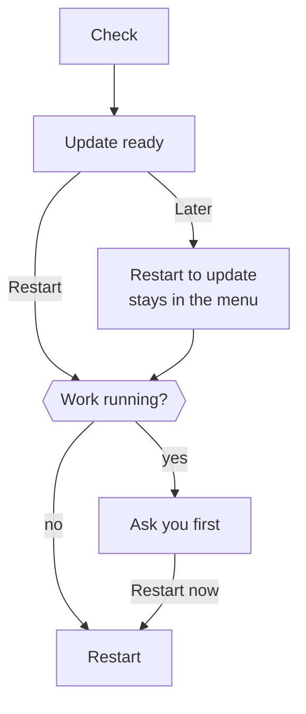

import { Badge, Steps, TabItem, Tabs } from '@astrojs/starlight/components';

This page explains what the desktop app runs on your computer, where it keeps your data and how it updates.

The desktop app is the same Otto as a source install. It starts the same server and web app, and adds installation, credential storage and a native window. You don't need Node.js, Docker Desktop or PostgreSQL.

## What runs on your computer


<Tabs syncKey="os">
<TabItem label="Mac" icon="apple">

- Electron runs the app window and the Otto server.
- Lima and Apple's Virtualization framework run a private Ubuntu virtual machine. It gets half your memory, between 3 and 6 GiB, and a 24 GiB disk that grows as it's used.
- The VM holds PostgreSQL and separate workspace and browser containers. Docker runs only inside the VM.

</TabItem>
<TabItem label="Windows" icon="seti:windows">

- Electron runs the app window and the Otto server.
- A private WSL 2 distribution named `Otto-<profile>` holds PostgreSQL and separate workspace and browser containers. Docker runs only inside it.
- Otto doesn't change your default WSL distribution or global WSL settings.

</TabItem>
</Tabs>

The workspace and browser have separate networks, no access to your home folder, no Docker socket and no model keys. Models don't run on your computer. Requests go to the provider you connect.

## The runtime pack

The app download is small. On first launch, Otto downloads a matching runtime pack with the container images, the base VM image and the tools that run them.

- Otto checks the archive size and SHA-256 before it extracts anything.
- On a Mac, before it installs, Otto checks free space for the extracted files plus 512 MiB, and the archive size when it downloads.
- On a Mac, Otto checks every extracted file. Verified packs live in `~/Library/Application Support/Otto/runtime/<release>`. The VM mounts them read-only. Old versions stay on disk; Otto doesn't clean them up yet.
- On Windows, Otto imports the pack into its WSL distribution, then deletes the archive.
- An app update reuses the runtime when it hasn't changed.

If a download isn't available, you can import the matching `Otto-Runtime-darwin-<arch>-<id>.tar.gz` from the release page by hand. On Windows, put `Otto-Runtime-win32-x64.tar.gz` from the same release next to the installer and run it again.

## Access and keys

The server listens on a loopback port that needs a token, created again at every launch. Only the app's own windows receive it, so a website in your normal browser can't reach Otto.

Electron `safeStorage` encrypts the Composio key and the Vault key. It uses the macOS key store on a Mac and DPAPI on Windows. Model connections and saved logins are encrypted with the Vault key. None of them enter the containers.

## Where your data lives

<Tabs syncKey="os">
<TabItem label="Mac" icon="apple">

| What                            | Where                                                  |
| ------------------------------- | ------------------------------------------------------ |
| App settings and profile        | `~/Library/Application Support/Otto/profiles/local`    |
| Private VM, database, workspace | `~/.otto-desktop/<profile>`                            |
| Runtime packs                   | `~/Library/Application Support/Otto/runtime/<release>` |

</TabItem>
<TabItem label="Windows" icon="seti:windows">

| What                          | Where                             |
| ----------------------------- | --------------------------------- |
| App settings and profile      | `%APPDATA%\Otto\profiles\local`   |
| Private computer and database | WSL distribution `Otto-<profile>` |

Windows file permissions protect the profile folder. Uninstalling removes the app but keeps the profile and the distribution.

</TabItem>
</Tabs>

Your installation is the VM disks, database, workspace files, browser profiles, Otto sessions and encrypted settings together. Copying only the database isn't a backup.

:::caution[No tested backup yet]
There's no supported backup, restore or downgrade. Don't delete the profile, VM or runtime cache to fix a problem. Retry first, then [send feedback](/deploy/troubleshooting/#send-feedback-with-a-diagnostic-report).
:::

## Updates

Otto checks for updates when it starts, every six hours while open, and after your computer wakes if a check is due. **Check for Updates…** in the Otto menu, menu bar or tray checks now.



Restarting stops a running reply, scheduled task or background check, and you can ask Otto to continue afterwards. Queued messages, schedules and app checks resume. Unsent text in the message box isn't kept.

Otto downloads the new app or installer and, when it changed, the new runtime pack before it offers the restart. On Windows, the restart runs the installer in the background and opens Otto again.

Otto keeps its profile, credentials and container volumes. A runtime update replaces tools and images without resetting the database.

## Windows preview

<Badge text="Preview" variant="caution" /> The Windows app is a preview with a few extra needs.

| Need    | Detail                                                                                       |
| ------- | -------------------------------------------------------------------------------------------- |
| System  | Windows 11 x64 with hardware virtualization                                                  |
| WSL     | WSL 2 with default localhost forwarding or mirrored networking. Otto offers **Install WSL**. |
| Disk    | At least 20 GB free                                                                          |
| Signing | Unsigned. Check the installer against `SHA256SUMS` before you install.                       |

Inside Otto's distribution, drive mounts and Windows process access are turned off. Closing the window keeps Otto in the tray. **Quit Otto** stops only its own distribution.

## Current limits

- Builds exist for Mac with Apple silicon or Intel, and Windows 11 x64. There are no Linux or Windows ARM builds.
- Tasks run only while Otto is open and the computer is awake.
- WhatsApp needs a public HTTPS callback. The app doesn't relay webhooks to your computer.
- A new installation starts with a fresh profile. There's no sync between devices or migration from a source install.

## Build the app

These commands are for developers. Use the Node.js version in the root `package.json` and a local Docker builder.

<Steps>

1. Install dependencies and prepare the runtime.

   ```sh title="Terminal"
   pnpm install --frozen-lockfile
   pnpm --dir desktop install --frozen-lockfile
   pnpm run desktop:prepare
   node desktop/scripts/runtime-pack.mjs --seed-cache
   ```

2. Build, test and package the app.

   ```sh title="Terminal"
   pnpm run build
   pnpm run desktop:test
   pnpm run desktop:build
   ```

</Steps>

The app, DMG and matching runtime archive land in `dist/desktop`. `--seed-cache` installs the runtime on your Mac, and you can skip it.

| To                                  | Run                                                                                        |
| ----------------------------------- | ------------------------------------------------------------------------------------------ |
| Build a DMG with the runtime inside | `pnpm --dir desktop run build --full`                                                      |
| Inspect the packaged engine only    | `pnpm --dir desktop run build --stage-only`, then look in `dist/desktop-staging/engine`    |
| Run the app without packaging       | `pnpm run desktop:dev`                                                                     |
| Replay onboarding                   | `pnpm --dir desktop start --onboarding`                                                    |
| Use a fresh, throwaway profile      | `OTTO_DESKTOP_USER_DATA=/tmp/otto-onboarding-review pnpm --dir desktop start --onboarding` |

`OTTO_DESKTOP_USER_DATA` works only in development. Packaged apps always use their normal profile.

<details>
<summary>Build for Windows</summary>

Run `pnpm run desktop:windows:prepare` on a Linux x64 Docker builder. Then, on Windows x64 with Go 1.26.8 and NSIS, install the root and desktop dependencies from their lockfiles and run `pnpm run build` and `pnpm run desktop:windows:build`.

</details>

## Related resources

- [Install the desktop app](/get-started/install-desktop/)
- [Configuration reference](/deploy/configuration/)
- [Troubleshooting](/deploy/troubleshooting/)
- [Desktop releases](/contribute/desktop-releases/)
- [Sandbox and browser](/how-it-works/sandbox-and-browser/)
