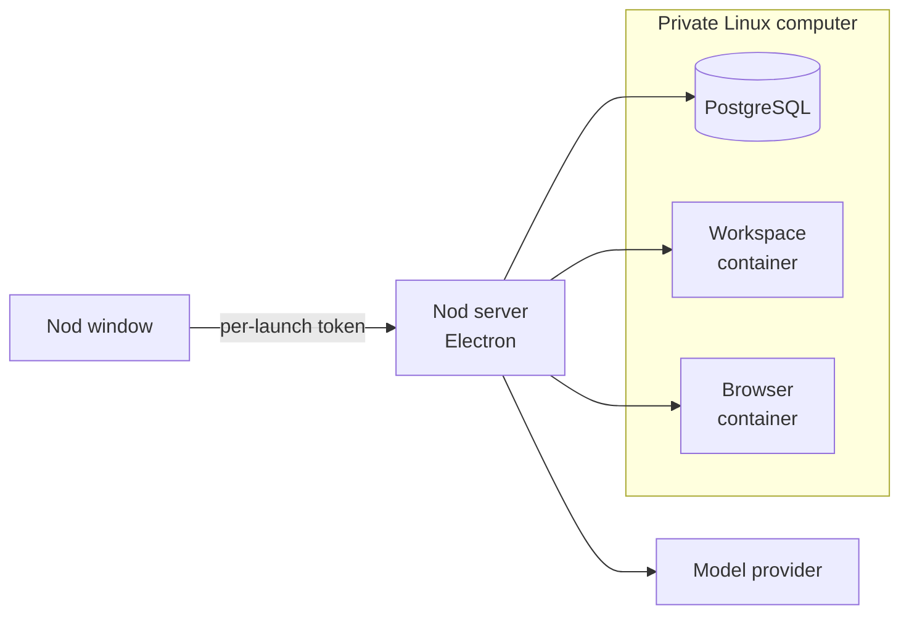
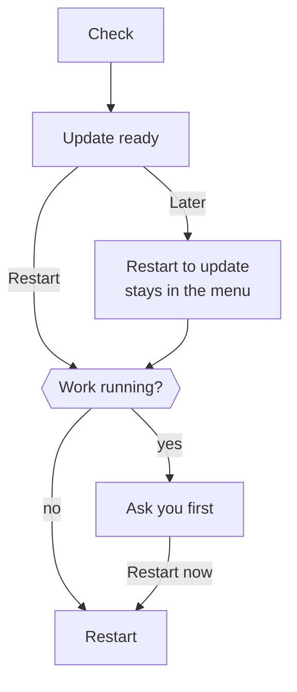

import { Badge, Steps, TabItem, Tabs } from '@astrojs/starlight/components';

This page explains what the desktop app runs on your computer, where it keeps your data and how it updates.

The desktop app can run Nod locally or connect to your own server. Local mode starts the server and web app, with installation, credential storage, and a native window. You don't need Node.js, Docker Desktop, or PostgreSQL.

## Connect to your server

Choose **Server connection** in the Nod app menu or tray, or **Connect to a server** on first launch. Enter the HTTPS server address and its `NOD_AUTH_TOKEN`.

Nod checks the connection before saving it. The operating system's secure storage protects the token. The app restarts into the remote assistant without starting its local runtime. Loopback HTTP addresses work for an SSH tunnel.

Your conversations, files, memories, model connections, and connected accounts stay on the server. The server also owns the encrypted Composio installation identity: connecting another desktop app or browser uses those same accounts, as do Telegram and WhatsApp. The desktop client does not create a separate integration identity or need a local Vault key to connect.

App sign-in opens in your system browser. After signing in, select **Return to Nod** to reopen the desktop app. The connected account stays on the server.

The client keeps its server address and encrypted access token, device preferences, and browser caches on your computer. Closing the desktop app does not stop the server. Your local assistant remains separate; choose **Server connection → Use this computer** to return to it.

See [Host your own server](/deploy/self-host/) for setup. The remaining sections describe local mode.

## What runs on your computer



<Tabs syncKey="os">
<TabItem label="Mac" icon="apple">

- Electron runs the app window and the Nod server. While you use 1Password, a separate helper talks to the 1Password app; it's the only Nod process allowed to load 1Password's library.
- Lima and Apple's Virtualization framework run a private Ubuntu virtual machine. New installations use Ubuntu 26.04 LTS, including the systemd fixes for a [first-boot login-session race](https://github.com/lima-vm/lima/issues/5570) that could otherwise stall startup for several minutes. Existing installations keep their guest and data. The VM gets half your memory, between 3 and 6 GiB, and a 24 GiB disk that grows as it's used. Its first boot installs the matching firewall packages from the runtime pack, and uses Ubuntu's package servers only if that installation fails.
- The VM holds PostgreSQL and separate workspace and browser containers. Docker runs only inside the VM.

</TabItem>
<TabItem label="Windows" icon="seti:windows">

- Electron runs the app window and the Nod server. While you use 1Password, a separate helper talks to the 1Password app.
- A private WSL 2 distribution named `nod-<profile>` holds PostgreSQL and separate workspace and browser containers. Docker runs only inside it.
- Nod reaches PostgreSQL through WSL's localhost forwarding, on a loopback port it picks free at each launch.
- Nod doesn't change your default WSL distribution or global WSL settings.

</TabItem>
</Tabs>

The workspace and browser have separate networks, no access to your home folder, no Docker socket and no model keys. Model requests go to the provider you connect, or to a [local model](/connect/local-models/) server you run.

## Onboarding during startup

On a new desktop profile, choose **Use this computer** to start a local assistant or **Connect to a server**. For a local assistant, the private computer starts in the background after your choice. Nod waits for PostgreSQL and the server when needed, then opens the introduction and analytics choice automatically. Email and calendar are offered before model selection and can both be skipped. The workspace and browser continue starting during onboarding. A model and Open at login are required to finish local desktop setup. Other apps, Telegram, WhatsApp and analytics sharing are optional.

Before the server starts, the native window saves only the analytics choice and whether Welcome was completed. After the ordinary account API accepts that choice, Nod records its acknowledgment. The introduction stays visible until the email step can show its account choices or an actionable error in the main window. That handoff does not wait for the full app catalog, workspace or browser. A restart does not repeat Welcome or overwrite the saved analytics choice; the temporary marker is removed when onboarding completes. Sign-ins, keys and connections use the normal server and storage from the beginning; there is no separate setup backend or credential transfer. The first chat asks what the owner is working on, under the normal chat and memory rules.

Desktop setup requires Open at login to be enabled and checked against the operating system before continuing. On a new profile, Nod enables desktop notifications when its first stored chat introduction appears. macOS may ask for permission; your system settings control delivery. Existing notification choices are preserved. Enabling delivery does not authorize app monitoring or scheduled work. If alerts are blocked, allow Nod in the computer’s notification settings. The web app uses the same onboarding without the native preference step. A completed installation keeps its choices and skips onboarding after an update.

If the user finishes first, an animated Nod logo stays visible until the workspace and browser are ready and completion has been saved. If the services are already ready, chat opens directly without a preparation screen. Runtime failures offer an explicit retry without clearing saved connections. The logo uses the same bounce as Welcome while work continues and pauses on an error. Measured download progress remains available to assistive technology without treating individual downloads as total setup completion. The screen groups detailed startup events into a few messages, while diagnostics keep the individual stages. If completion reports a missing setup requirement, onboarding returns to the relevant step. If notifications are enabled and Nod is not focused, a single notification announces when setup is ready.

## The runtime pack

The app download is small. Local setup downloads a matching runtime pack with the container images, the base VM image and the tools that run them.

- Nod unpacks the archive while it downloads. It uses each file only after that file matches its SHA-256 in the release, and treats the pack as installed only once the archive size and SHA-256 match too. On a Mac, the private computer starts while the container images are still downloading.
- On a Mac, before it installs, Nod checks free space for the extracted files plus 512 MiB.
- A slow download keeps going for as long as data arrives. If no data arrives for five minutes, the download stops and you can retry.
- On a Mac, Nod checks every extracted file. Verified packs live in `~/Library/Application Support/nod/runtime/<release>`. The VM mounts them read-only. After the VM starts, Nod deletes packs that no Nod VM mounts and that are more than a day old, so a downloaded update waits for its restart.
- After its containers start, Nod removes container images from earlier runtimes. On a Mac, the freed space returns to your disk.
- On Windows, Nod imports the pack into its WSL distribution, then deletes the archive.
- An app update reuses the runtime when it hasn't changed. The first release built each week rebuilds it, which also refreshes its system packages, such as the browser.

If a download isn't available, you can import the matching `nod-Runtime-darwin-<arch>-<id>.tar.gz` from the release page by hand. On Windows, put `nod-Runtime-win32-x64.tar.gz` from the same release next to the installer and run it again.

## Access and keys

The server listens on a loopback port that needs a token, created again at every launch. Only the app's own windows receive it, so a website in your normal browser can't reach Nod. The app sends the token only after the server it started reports that port, so another program that takes the port first never gets it.

Electron `safeStorage` encrypts the Vault key. It uses the macOS key store on a Mac and DPAPI on Windows. Model connections and saved logins are encrypted with the Vault key. The key and model credentials stay in the server. A saved website login reaches the browser only through the private sign-in flow.

App connections use Nod's connection service. The private installation identity is encrypted with the Vault key and retained in your profile. Notion and Linear connect directly to their hosted MCP servers, and n8n to your instance's MCP server. See [Apps](/connect/apps/).

## Where your data lives

<Tabs syncKey="os">
<TabItem label="Mac" icon="apple">

| What                            | Where                                                 |
| ------------------------------- | ----------------------------------------------------- |
| App settings and profile        | `~/Library/Application Support/nod/profiles/local`    |
| Private VM, database, workspace | `~/.nod-desktop/<profile>`                            |
| Runtime packs                   | `~/Library/Application Support/nod/runtime/<release>` |

</TabItem>
<TabItem label="Windows" icon="seti:windows">

| What                          | Where                            |
| ----------------------------- | -------------------------------- |
| App settings and profile      | `%APPDATA%\nod\profiles\local`   |
| Private computer and database | WSL distribution `nod-<profile>` |

Windows file permissions protect the profile folder. Uninstalling removes the app but keeps the profile and the distribution.

</TabItem>
</Tabs>

**Remove all data** in **Settings → General**, or in the **Nod** menu when setup cannot finish, stops Nod and its private computer. It deletes the private computer, the profile and the app's browser storage, then restarts and opens setup. The app stays installed. On a Mac it keeps the runtime packs and the key store entry. See [Remove Nod](/get-started/install-desktop/#remove-nod).

The profile holds the only key to the private computer's database. When Nod starts and finds a private computer but no profile, it deletes that private computer and sets up a new one.

Your installation is the VM disks, database, workspace files, browser profiles, Nod sessions and encrypted settings together. Copying only the database isn't a backup.

:::caution[No tested backup yet]
There's no supported backup, restore or downgrade. Don't delete the profile, VM or runtime cache to fix a problem. Retry first, then [send feedback](/deploy/troubleshooting/#send-feedback-with-a-diagnostic-report).
:::

## Updates

Nod checks for updates when it starts, every six hours while open, and after your computer wakes if a check is due. **Check for Updates…** in the Nod menu, menu bar or tray checks now.



Restarting stops a running reply, scheduled task or background check, and you can ask Nod to continue afterwards. Queued messages, schedules and app checks resume. Unsent text in the message box isn't kept.

Nod downloads the new app or installer and, when it changed, the new runtime pack in the background before it offers the restart. While the runtime pack or Windows installer downloads, the update item in the menu shows how far it has got. On a Mac, it also loads the new container images into the running computer, so Nod is ready soon after the restart. An update found by an automatic check shows a notification when notifications are on and quiet hours allow it. The menu offers **Restart to update**, and background checks never open a dialog. On a Mac, an update must be signed by n8n, and Nod refuses one with a lower version number, so an update feed can't roll Nod back to an older build. On Windows, the restart runs the installer in the background and opens Nod again. While Nod shuts down to install the update, its window shows **Updating Nod…** until it reopens.

Nod keeps its profile, credentials and container volumes. A runtime update replaces tools and images without resetting the database.

If a manual update check fails, choose **Try again** or **Not now** and keep using Nod. Background check failures stay quiet. If restarting fails before shutdown begins, **Retry restart** uses the update already downloaded. Once shutdown begins, Nod keeps its separate shutdown recovery prompt.

## Windows preview

<Badge text="Preview" variant="caution" /> The Windows app is a preview with a few extra needs.

| Need    | Detail                                                                                      |
| ------- | ------------------------------------------------------------------------------------------- |
| System  | Windows 11 x64 with hardware virtualization                                                 |
| WSL     | WSL 2 with default localhost forwarding or mirrored networking. Nod offers **Install WSL**. |
| Disk    | At least 20 GB free                                                                         |
| Signing | Unsigned. Check the installer against `SHA256SUMS` before you install.                      |

Inside Nod's distribution, drive mounts and Windows process access are turned off. Closing the window keeps Nod in the tray. **Quit Nod** stops only its own distribution.

## Current limits

- Builds exist for Mac with Apple silicon or Intel, and Windows 11 x64. There are no Linux or Windows ARM builds.
- Local tasks run only while Nod is open and the computer is awake. Server tasks run while the server runs.
- Meta's WhatsApp Cloud API needs a public HTTPS callback. The QR connection works without one. The app doesn't relay webhooks to your computer.
- Separate local installations start with their own profiles and do not sync or migrate data from a source install. To use the same assistant from several devices, connect them to one server.

## Build the app

These commands are for developers. Use the Node.js version in the root `package.json` and a local Docker builder.

<Steps>

1. Install dependencies and prepare the runtime.

   ```sh title="Terminal"
   pnpm install --frozen-lockfile
   pnpm --dir desktop install --frozen-lockfile
   pnpm run desktop:prepare
   node desktop/scripts/runtime-pack.mjs --seed-cache
   ```

2. Build, test and package the app.

   ```sh title="Terminal"
   pnpm run build
   pnpm run desktop:test
   pnpm run desktop:build
   ```

</Steps>

The app, DMG and matching runtime archive land in `dist/desktop`. `--seed-cache` installs the runtime on your Mac, and you can skip it.

The packaged engine includes only the packages in `dependencies` and what they depend on. Keep web-only packages and build tools in `devDependencies`. A desktop test fails if engine code imports one of them, other than Vite for the local development server.

| To                                  | Run                                                                                      |
| ----------------------------------- | ---------------------------------------------------------------------------------------- |
| Build a DMG with the runtime inside | `pnpm --dir desktop run build --full`                                                    |
| Inspect the packaged engine only    | `pnpm --dir desktop run build --stage-only`, then look in `dist/desktop-staging/engine`  |
| Run the app without packaging       | `pnpm run desktop:dev`                                                                   |
| Replay onboarding                   | `pnpm --dir desktop start --onboarding`                                                  |
| Use a fresh, throwaway profile      | `NOD_DESKTOP_USER_DATA=/tmp/nod-onboarding-review pnpm --dir desktop start --onboarding` |

`NOD_DESKTOP_USER_DATA` works in development and in the deliberately marked [isolated test build](/contribute/desktop-releases/#test-a-local-mac-build). Normal packaged apps always use their own profile.

To test a local connection service, run the unpackaged app with a new, absolute profile path and a proxy origin:

```sh title="Terminal"
NOD_DESKTOP_USER_DATA=/tmp/nod-proxy-review \
NOD_COMPOSIO_PROXY_URL=http://127.0.0.1:8787 \
pnpm run desktop:dev
```

For OAuth callbacks, use your development service's public HTTPS origin instead. The address must have no path, query, fragment or user credentials; HTTP is allowed only for loopback. Packaged desktop apps and desktop launches without an explicit development profile ignore this override. Never use your normal Nod profile for this test.

<details>
<summary>Build for Windows</summary>

Run `pnpm run desktop:windows:prepare` on a Linux x64 Docker builder. Then, on Windows x64 with Go 1.26.8 and NSIS, install the root and desktop dependencies from their lockfiles and run `pnpm run build` and `pnpm run desktop:windows:build`.

</details>

## Related resources

- [Host your own server](/deploy/self-host/)
- [Install the desktop app](/get-started/install-desktop/)
- [Configuration reference](/deploy/configuration/)
- [Troubleshooting](/deploy/troubleshooting/)
- [Desktop releases](/contribute/desktop-releases/)
- [Sandbox and browser](/how-it-works/sandbox-and-browser/)
