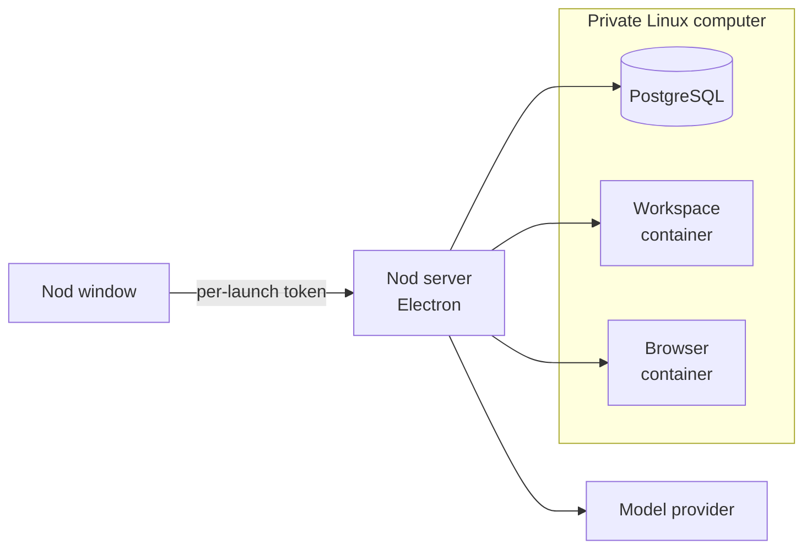
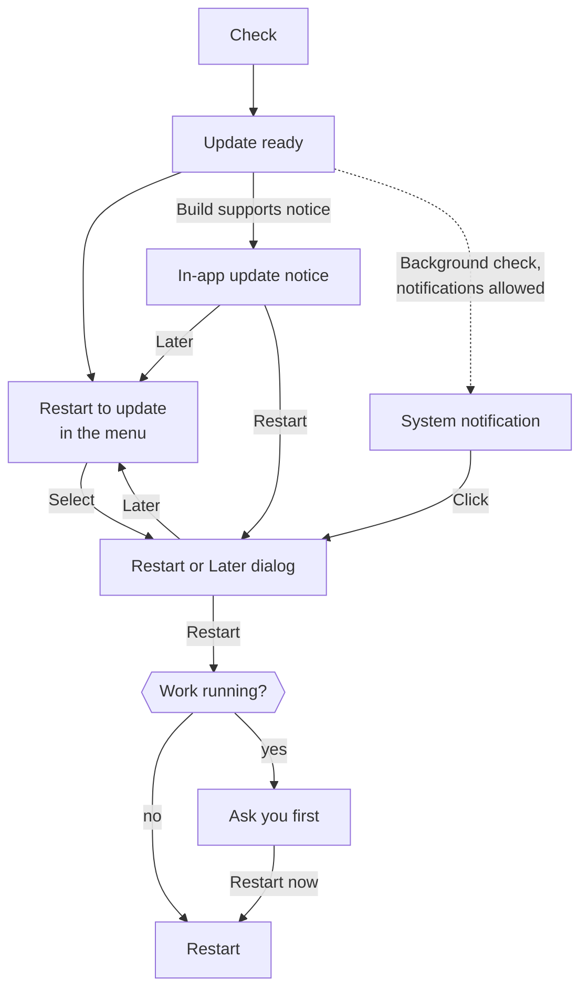

import { Steps, TabItem, Tabs } from '@astrojs/starlight/components';

This page explains what the desktop app runs on your computer, where it keeps your data and how it updates.

The desktop app can run Nod locally or connect to your own server. Local mode starts the server and web app, with installation, credential storage, and a native window. You don't need Node.js, Docker Desktop, or PostgreSQL.

## Connect to your server

Choose **Connect to a server** on first launch. After setup, choose **Replay onboarding…** in the Nod menu (on Windows, from the tray icon), then **Connect to a server** (or **Change server** when already connected). Enter the HTTPS server address and its `NOD_AUTH_TOKEN`. Connection setup is available from onboarding and startup recovery, rather than Settings.

Nod checks the connection before saving it. The operating system's secure storage protects the token. The app restarts into the remote assistant without starting its local runtime. Loopback HTTP addresses work for an SSH tunnel.

For a private certificate authority (CA), first trust its certificate in your operating system's certificate store. Restart Nod after you change that store. Both the desktop app and its local engine add system CAs to Node's default certificates at startup while keeping bundled certificates. The local engine does not inherit `NODE_EXTRA_CA_CERTS` from your shell.

This applies to Node HTTPS requests in the desktop app and local engine. It includes server checks, Composio proxy calls, later API calls, update checks, and analytics. Certificate and hostname checks stay enabled. This uses Node's certificate verification rules, which can differ from the app window's Chromium rules. An operating system distrust setting does not remove a certificate that Node trusts from another source.

Your conversations, files, memories, model connections, and connected accounts stay on the server. The server also owns the encrypted Composio installation identity: connecting another desktop app or browser uses those same accounts, as do Telegram and WhatsApp. The desktop client does not create a separate integration identity or need a local Vault key to connect.

App sign-in opens in your system browser. The completion page names the connected app; close it and return to Nod. The connected account stays on the server.

The client keeps its server address and encrypted access token, device preferences, and browser caches on your computer. Closing the desktop app does not stop the server. Your local assistant remains separate; choose **Replay onboarding… → Change server → Use this computer** to return to it. **Change server** also lets you reconnect with a new address or token. If the server cannot be reached or its saved token cannot be opened, use **Connect to a server** on the startup recovery screen.

Opening or leaving setup does not reset either assistant. **Back to Nod** returns to the current assistant; **Continue setup** replays its onboarding with existing connections and data intact.

See [Host your own server](/deploy/self-host/) for setup. The remaining sections describe local mode.

## What runs on your computer



<Tabs syncKey="os">
<TabItem label="Mac" icon="apple">

- Electron runs the app window and the Nod server. While you use 1Password, a separate helper talks to the 1Password app; it's the only Nod process allowed to load 1Password's library.
- Lima and Apple's Virtualization framework run a private Ubuntu virtual machine. New installations use Ubuntu 26.04 LTS, including the systemd fixes for a [first-boot login-session race](https://github.com/lima-vm/lima/issues/5570) that could otherwise stall startup for several minutes. Existing installations keep their guest and data. The VM gets half your memory, between 3 and 6 GiB, and a 24 GiB disk that grows as it's used. Its first boot installs the matching firewall packages from the runtime pack, and uses Ubuntu's package servers only if that installation fails.
- The VM holds PostgreSQL and separate workspace and browser containers. Docker runs only inside the VM.
- The VM keeps automatic security updates for other packages. Automatic updates cannot replace its Linux kernel, GRUB, or shim, or restart the VM. Kernel security fixes need a tested, explicit upgrade. A new runtime pack does not upgrade an existing VM's kernel.
- At each start, Nod loads its container protection before it starts PostgreSQL. The profile keeps Docker's restrictions and permits signals and process tracing with the exact `docker-default//&unconfined` stacked peer. This repairs the [Ubuntu kernel regression](https://github.com/containerd/containerd/issues/14485) without disabling AppArmor or its namespace restrictions. Existing installations receive the repair and keep their data.

</TabItem>
<TabItem label="Windows" icon="seti:windows">

- Electron runs the app window and the Nod server. While you use 1Password, a separate helper talks to the 1Password app.
- A private WSL 2 distribution named `nod-<profile>` holds PostgreSQL and separate workspace and browser containers. Docker runs only inside it.
- Nod reaches PostgreSQL through WSL's localhost forwarding, on a loopback port it picks free at each launch.
- Nod doesn't change your default WSL distribution or global WSL settings.

</TabItem>
<TabItem label="Linux (preview)" icon="linux">

- A Flatpak runs Electron, the Nod server and the same Lima runtime as the Mac, with QEMU and KVM instead of Apple's Virtualization framework. Install the [Linux x64 preview](/get-started/install-desktop/#linux), or [build the Flatpak](/contribute/desktop-releases/#build-a-linux-flatpak).
- The VM, its firewall rules, container protection and the PostgreSQL, workspace and browser containers are the same as on a Mac. Docker runs only inside the VM, and Nod never uses a Docker installation on your computer.
- Nod needs `/dev/kvm`. Without hardware virtualization it refuses to start its private computer rather than fall back to slow emulation.
- The VM files live in `~/.nod-desktop`, as on a Mac. Saved keys use your desktop's Secret Service, such as GNOME Keyring or KWallet; Nod refuses to save keys when no secret store is available.
- Install the next release bundle to update the app. These bundles have no update repository. Nod's own update checks are off on Linux.
- Like the Mac and Windows apps, the Flatpak can reach your home folder and external drives, so [Local files](/connect/local-files/) and saving to Downloads work. Moving files to the Trash goes through your desktop's portal service (`xdg-desktop-portal`), and saved files go to the Downloads folder your desktop names in `~/.config/user-dirs.dirs`, or your home folder without one. A normal desktop session provides both.

</TabItem>
</Tabs>

The workspace and browser have separate networks, no access to your home folder, no Docker socket and no model keys. Model requests go to the provider you connect, or to a [local model](/connect/local-models/) server you run.

## Onboarding during startup

On a new desktop profile, choose **Get started** to start a local assistant or **Connect to a server**. The private computer and its database start in the background as soon as the welcome screen opens, so they are often ready by the time you continue. On a new profile with no saved keys, Nod's own service starts then too. When the profile has saved keys, the service, and any request to unlock them, waits until you select **Get started**. If the service is still starting when you continue, Nod already shows the email step and turns on its Connect buttons when the service is ready. Choosing a server stops the local computer when the app restarts. Nod waits for PostgreSQL and the server when needed, then continues at the email step. Email is offered before model selection and can be skipped. The workspace and browser continue starting during onboarding. A model is required to finish local desktop setup, and Nod tries to turn on Open at login when setup finishes. Usage data sharing is on by default for a new profile and can be turned off in **Settings → Privacy & data**. Conversation traces, other apps, Telegram and WhatsApp are optional.

Before the server starts, the native window saves only the usage data setting and whether Welcome was completed. After the ordinary account API accepts that choice, Nod records its acknowledgment. The email step preview stays visible until the main window can show its account choices or an actionable error. That handoff does not wait for the full app catalog, workspace or browser. A restart does not repeat Welcome or overwrite the saved analytics choice; the temporary marker is removed when onboarding completes. Sign-ins, keys and connections use the normal server and storage from the beginning; there is no separate setup backend or credential transfer. The first chat opens with a short greeting and idea cards, under the normal chat and memory rules.

When local setup finishes, Nod tries to turn on Open at login and checks it with the operating system. On Linux, Open at login adds `io.n8n.Nod.desktop` to your autostart folder, `$XDG_CONFIG_HOME/autostart` or `~/.config/autostart`. If the operating system blocks this setting, setup still finishes. A restart does not repeat this attempt. A settings storage error still requires a retry. You can turn it off in **Settings → General**. The first stored chat introduction offers an explicit choice to enable notifications. Rendering the introduction does not change the saved preference. macOS may ask for permission; your system settings control delivery. Existing notification choices are preserved. Enabling delivery does not authorize app monitoring or scheduled work. If alerts are blocked, allow Nod in the computer’s notification settings. The web app uses the same onboarding. A completed installation keeps its choices and skips onboarding after an update.

If the user finishes first, an animated Nod logo stays visible until the workspace and browser are ready and completion has been saved. If the services are already ready, chat opens directly without a preparation screen. Runtime failures offer an explicit retry without clearing saved connections. The logo uses the same bounce as Welcome while work continues and pauses on an error. While the runtime pack downloads, the logo's dot travels around its ring as the download progresses, and the screen shows the percentage and the time left, estimated from the last 45 seconds. If no data arrives for five seconds, the dot fades and the screen says Nod is waiting for the network. The Dock icon, or the taskbar button on Windows, shows the same progress. On a Mac, the Dock icon bounces once when Nod is ready for you to carry on, if you're using another app. Assistive technology reads the same progress. The screen groups detailed startup events into a few messages, while diagnostics keep the individual stages. If completion reports a missing setup requirement, onboarding returns to the relevant step. If notifications are enabled and Nod is not focused, a single notification announces when setup is ready.

## The runtime pack

On Mac and Windows the app download is small, and local setup downloads a matching runtime pack with the container images, the base VM image and the tools that run them. The Linux Flatpak already contains its runtime pack, so setup downloads nothing and the pack updates with the app. The rest of this section is about Mac and Windows.

- Nod unpacks the archive while it downloads. It uses each file only after that file matches its SHA-256 in the release, and treats the pack as installed only once the archive size and SHA-256 match too. On a Mac, the private computer starts while the container images are still downloading.
- On a Mac, before it installs, Nod checks free space for the files it still needs to install plus 512 MiB.
- Nod keeps each verified file in place if a later part of the pack fails or you cancel setup. An explicit retry checks and reuses those files. Unverified extracted files stay in a temporary folder, which Nod removes after the attempt ends. The whole archive must still pass its checks before the pack is ready.
- A slow download keeps going for as long as data arrives. If no data arrives for five minutes, the download stops and you can retry.
- If the download stops, or you quit Nod, Nod keeps the downloaded part next to the pack, and the next try asks the server for only the rest. A server that won't send part of the file sends all of it, and Nod skips the bytes it already has. Nod deletes the saved part once the pack is installed, or when the finished pack fails its check, so the next try starts over. On a Mac, Nod keeps the saved part only when there's room for the rest of the download as well as the extracted files.
- On a Mac, **Try again** can use a complete saved archive after a connection failure or cancellation. Nod checks its size and SHA-256 before it installs, without a network request. Each extracted file must still pass its check. If the size or SHA-256 is wrong, Nod removes the archive and stops that attempt. A storage error or cancellation keeps a verified saved archive for another explicit try.
- On a Mac, Nod checks every extracted file. Verified packs live in `~/Library/Application Support/nod/runtime/<release>`. The VM mounts them read-only. After the VM starts, Nod deletes packs that no Nod VM mounts and that are more than a day old, so a downloaded update waits for its restart.
- After its containers start, Nod removes container images from earlier runtimes. On a Mac, the freed space returns to your disk.
- On Windows, Nod imports the pack into its WSL distribution, then deletes the archive.
- An app update reuses the runtime when it hasn't changed. The first release built each week rebuilds it, which also refreshes its system packages, such as the browser.

The Mac container profile comes from [Docker 28.5.1](https://github.com/moby/moby/blob/v28.5.1/vendor/github.com/moby/profiles/apparmor/template.go), under the Apache 2.0 license. Nod adds exact `docker-default//&unconfined` peers for signals and process tracing. The runtime pack includes Docker's license and notices.

If a download isn't available, you can import the matching `nod-Runtime-darwin-<arch>-<id>.tar.gz` from the release page by hand. On Windows, put `nod-Runtime-win32-x64.tar.gz` from the same release next to the installer and run it again.

## Access and keys

The server listens on a loopback port that needs a token, created again at every launch. Only the app's own windows receive it, so a website in your normal browser can't reach Nod. The app sends the token only after the server it started reports that port, so another program that takes the port first never gets it.

Electron `safeStorage` encrypts the Vault key. It uses the macOS key store on a Mac, DPAPI on Windows and the desktop's Secret Service, such as GNOME Keyring or KWallet, on Linux. Model connections and saved logins are encrypted with the Vault key. The key and model credentials stay in the server. A saved website login reaches the browser only through the private sign-in flow.

App connections use Nod's connection service. The private installation identity is encrypted with the Vault key and retained in your profile. Notion and Linear connect directly to their hosted MCP servers, and n8n to your instance's MCP server. See [Apps](/connect/apps/).

## Where your data lives

<Tabs syncKey="os">
<TabItem label="Mac" icon="apple">

| What                            | Where                                                 |
| ------------------------------- | ----------------------------------------------------- |
| App settings and profile        | `~/Library/Application Support/nod/profiles/local`    |
| Private VM, database, workspace | `~/.nod-desktop/<profile>`                            |
| Runtime packs                   | `~/Library/Application Support/nod/runtime/<release>` |

</TabItem>
<TabItem label="Windows" icon="seti:windows">

| What                          | Where                            |
| ----------------------------- | -------------------------------- |
| App settings and profile      | `%APPDATA%\nod\profiles\local`   |
| Private computer and database | WSL distribution `nod-<profile>` |

Windows file permissions protect the profile folder. Uninstalling removes the app but keeps the profile and the distribution.

</TabItem>
<TabItem label="Linux (preview)" icon="linux">

| What                            | Where                                             |
| ------------------------------- | ------------------------------------------------- |
| App settings and profile        | `~/.var/app/io.n8n.Nod/config/nod/profiles/local` |
| Private VM, database, workspace | `~/.nod-desktop/<profile>`                        |
| Runtime pack                    | Inside the Flatpak                                |

To remove Nod completely, choose **Remove all data** first, then run `flatpak uninstall --delete-data io.n8n.Nod`. If you only uninstall, the private computer stays in `~/.nod-desktop`.

</TabItem>
</Tabs>

**Remove all data** in **Settings → Privacy & data**, or in the **Nod** menu when setup cannot finish, stops Nod and its private computer. It deletes the private computer, the profile and the app's browser storage, then restarts and opens setup. The app stays installed. On a Mac it keeps the runtime packs and the key store entry. See [Remove Nod](/get-started/install-desktop/#remove-nod).

The profile holds the only key to the private computer's database. When Nod starts and finds a private computer but no profile, it deletes that private computer and sets up a new one.

Your installation is the VM disks, database, workspace files, browser profiles, Nod sessions and encrypted settings together. Copying only the database isn't a backup.

:::caution[No tested backup yet]
There's no supported backup, restore or downgrade. Don't delete the profile, VM or runtime cache to fix a problem. Retry first, then [send feedback](/deploy/troubleshooting/#send-feedback-with-a-diagnostic-report).
:::

## Updates

On Linux, install the next release bundle to update the app and its runtime pack. These bundles have no update repository. Nod's own update checks are off. The rest of this section is about Mac and Windows.

Nod checks for updates when it starts, every six hours while open, and after your computer wakes if a check is due. Checks continue while a downloaded update waits for restart. Public builds read published releases and download assets from GitHub. Older builds keep their embedded n8n update source until they are replaced. **Check for Updates…** stays available in the Nod menu, menu bar, or tray alongside **Restart to update**.



Restarting stops a running reply, scheduled task or background check, and you can ask Nod to continue afterwards. Queued messages, schedules and app checks resume. Nod reopens with the same window size and place, the same page, such as Chat or Usage, and any unsent text in the message box. If that place is no longer on a connected display, the window opens at its default size instead.

Nod downloads the update ZIP on a Mac or the installer on Windows, plus any changed local runtime pack, before it offers the restart. The Mac DMG is for installation, not in-app updates. While the runtime pack or Windows installer downloads, the update item in the menu shows progress. If the Mac's local computer is running, Nod tries to load the new container images before restart. Windows still runs the installer and applies a changed WSL runtime after restart. Starting the local computer, database and browser also takes time, so a ready notice means the downloads are complete, not that launch will be instant.

Newer builds show an in-app notice when the update is ready, with its version and **Restart to update** and **Later** actions. Later dismisses the notice for that version during the current app session; the menu still offers **Restart to update**. Older builds may show only the menu action. An automatic check also announces a ready update with a system notification when Nod is in the background, notifications are on and quiet hours allow it. Background checks never open a dialog. On a Mac, an update must be signed by n8n, and Nod refuses one with a lower version number, so an update feed can't roll Nod back to an older build. On Windows, the restart runs the installer in the background and opens Nod again. While Nod shuts down to install the update, its window stays open and shows **Updating Nod…** until it quits to install. If the window was closed, Nod opens it.

When a newer release appears, Nod prepares it before offering restart. It reuses an already downloaded version when a check finds nothing newer. A failed release lookup keeps the downloaded update available. Once replacement staging begins, restart is available only after the new installer or app is verified. Checks and restarts cannot run together.

Nod keeps its profile, credentials and container volumes. A runtime update replaces tools and images without resetting the database.

On a Mac, startup stops the private computer before it changes the mounted runtime pack. Nod confirms that the computer stopped before it updates the mount and starts it again. If the stop command fails or Nod cannot confirm that the computer stopped, it keeps the existing mount and offers a retry.

On a Mac, Nod removes temporary file copies before it asks the native updater to quit and install. File cleanup does not cancel the updater's quit request.

The [Terminal installer](/get-started/install-desktop/#install-nod) stops an old ShipIt update job before it replaces the app. It removes that job's cache only after the new app passes its checks. It keeps the previous app copy if the new app cannot open. For a manual DMG install after an update failure, see [update recovery](/get-started/install-desktop/#a-failed-mac-update-blocks-a-new-install).

On a Mac, Nod keeps a verified copy of the stop program in its private profile before it starts the private computer. Shutdown can use that copy while the runtime pack downloads, or after an interrupted download removes the pack. Nod checks the saved program's hash and the computer's profile before it runs the stop command.

If startup fails and the private computer cannot stop, the technical details keep both failures. The quit prompt offers **Try again** and **Quit anyway**. **Quit anyway** closes Nod even if its private computer has not stopped.

Mac key storage keeps the original `nod Safe Storage` name even though the app is called **Nod**. If 0.4.0 saved a key through `Nod Safe Storage`, Nod reads that entry and encrypts each saved value with the original entry. It saves a value only after it checks that encryption and decryption agree. It does not replace or delete either Keychain entry. A failed read keeps the saved settings unchanged and reports that Nod could not read its saved key.

If a manual update check fails, choose **Try again** or **Not now** and keep using Nod. Background check failures stay quiet. If restarting fails before shutdown begins, **Retry restart** uses the update already downloaded. Once shutdown begins, Nod keeps its separate shutdown recovery prompt.

## Windows

The Windows app has a few extra needs.

| Need    | Detail                                                                                      |
| ------- | ------------------------------------------------------------------------------------------- |
| System  | Windows 11 x64 with hardware virtualization                                                 |
| WSL     | WSL 2 with default localhost forwarding or mirrored networking. Nod offers **Install WSL**. |
| Disk    | At least 20 GB free                                                                         |
| Signing | Signed by n8n GmbH. SmartScreen can still warn about a new release.                         |

Inside Nod's distribution, drive mounts and Windows process access are turned off. Closing the window keeps Nod in the tray. **Quit Nod** stops only its own distribution.

## Current limits

- Release builds cover Mac with Apple silicon or Intel, Windows 11 x64, and Linux x64 as a [Flatpak preview](/get-started/install-desktop/#linux). Linux ARM and Windows ARM builds are not published.
- Local tasks run only while Nod is open and the computer is awake. Server tasks run while the server runs.
- Meta's WhatsApp Cloud API needs a public HTTPS callback. The QR connection works without one. The app doesn't relay webhooks to your computer.
- Separate local installations start with their own profiles and do not sync or migrate data from a source install. To use the same assistant from several devices, connect them to one server.

## Build the app

These commands are for developers. Use the Node.js version in the root `package.json` and a local Docker builder.

<Steps>

1. Install dependencies and prepare the runtime.

   ```sh title="Terminal"
   pnpm install --frozen-lockfile
   pnpm --dir desktop install --frozen-lockfile
   pnpm run desktop:prepare
   node desktop/scripts/runtime-pack.mjs --seed-cache
   ```

2. Build, test and package the app.

   ```sh title="Terminal"
   pnpm run build
   pnpm run desktop:test
   pnpm run desktop:build
   ```

</Steps>

The app, DMG and matching runtime archive land in `dist/desktop`. `--seed-cache` installs the runtime on your Mac, and you can skip it.

The packaged engine includes only the packages in `dependencies` and what they depend on. Keep web-only packages and build tools in `devDependencies`. A desktop test fails if engine code imports one of them, other than Vite for the local development server.

| To                                  | Run                                                                                      |
| ----------------------------------- | ---------------------------------------------------------------------------------------- |
| Build a DMG with the runtime inside | `pnpm --dir desktop run build --full`                                                    |
| Inspect the packaged engine only    | `pnpm --dir desktop run build --stage-only`, then look in `dist/desktop-staging/engine`  |
| Run the app without packaging       | `pnpm run desktop:dev`                                                                   |
| Replay onboarding                   | `pnpm --dir desktop start --onboarding`                                                  |
| Use a fresh, throwaway profile      | `NOD_DESKTOP_USER_DATA=/tmp/nod-onboarding-review pnpm --dir desktop start --onboarding` |

`NOD_DESKTOP_USER_DATA` works in development and in the deliberately marked [isolated test build](/contribute/desktop-releases/#test-a-local-mac-build). Normal packaged apps always use their own profile.

To test a local connection service, run the unpackaged app with a new, absolute profile path and a proxy origin:

```sh title="Terminal"
NOD_DESKTOP_USER_DATA=/tmp/nod-proxy-review \
NOD_COMPOSIO_PROXY_URL=http://127.0.0.1:8787 \
pnpm run desktop:dev
```

For OAuth callbacks, use your development service's public HTTPS origin instead. The address must have no path, query, fragment or user credentials; HTTP is allowed only for loopback. Packaged desktop apps and desktop launches without an explicit development profile ignore this override. Never use your normal Nod profile for this test.

<details>
<summary>Build for Windows</summary>

Run `pnpm run desktop:windows:prepare` on a Linux x64 Docker builder. Then, on Windows x64 with Go 1.26.8 and NSIS, install the root and desktop dependencies from their lockfiles and run `pnpm run build` and `pnpm run desktop:windows:build`.

</details>

## Related resources

- [Host your own server](/deploy/self-host/)
- [Install the desktop app](/get-started/install-desktop/)
- [Configuration reference](/deploy/configuration/)
- [Troubleshooting](/deploy/troubleshooting/)
- [Desktop releases](/contribute/desktop-releases/)
- [Sandbox and browser](/how-it-works/sandbox-and-browser/)
