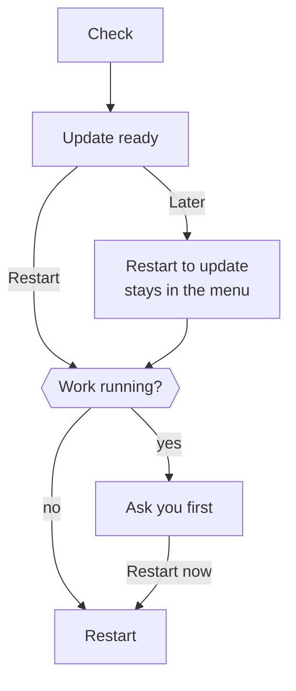

import { Badge, Steps, TabItem, Tabs } from '@astrojs/starlight/components';

This page explains what the desktop app runs on your computer, where it keeps your data and how it updates.

The desktop app is the same Otto as a source install. It starts the same server and web app, and adds installation, credential storage and a native window. You don't need Node.js, Docker Desktop or PostgreSQL.

## What runs on your computer


<Tabs syncKey="os">
<TabItem label="Mac" icon="apple">

- Electron runs the app window and the Otto server.
- Lima and Apple's Virtualization framework run a private Ubuntu virtual machine. It gets half your memory, between 3 and 6 GiB, and a 24 GiB disk that grows as it's used. Its first boot installs the firewall packages it needs from the runtime pack, and uses Ubuntu's package servers only if that installation fails.
- The VM holds PostgreSQL and separate workspace and browser containers. Docker runs only inside the VM.

</TabItem>
<TabItem label="Windows" icon="seti:windows">

- Electron runs the app window and the Otto server.
- A private WSL 2 distribution named `Otto-<profile>` holds PostgreSQL and separate workspace and browser containers. Docker runs only inside it.
- Otto doesn't change your default WSL distribution or global WSL settings.

</TabItem>
</Tabs>

The workspace and browser have separate networks, no access to your home folder, no Docker socket and no model keys. Model requests go to the provider you connect, or to a [local model](/connect/local-models/) server you run.

## Onboarding during startup

On a new desktop profile, the native window shows the same Welcome screen and analytics choice as the web app immediately. The private computer starts in the background. Once PostgreSQL is ready, the normal Otto server opens the remaining onboarding steps while the workspace and browser finish starting. A model and Gmail are required; Telegram, analytics sharing, notifications and Open at login are optional.

Before the server starts, the native window saves only the analytics choice and whether Welcome was completed. After the ordinary account API accepts that choice, Otto records its acknowledgment and opens the main Otto window for the remaining onboarding. A restart does not repeat Welcome or overwrite the saved analytics choice; the temporary marker is removed when onboarding completes. Sign-ins, keys, connections and introduction answers use the normal server and storage from the beginning; there is no separate setup backend or credential transfer.

Desktop setup also asks whether to enable notifications and open Otto at login. Each choice is saved before continuing. The web app uses the same onboarding without those native steps. A completed installation keeps its choices and skips onboarding after an update.

If the user finishes first, an animated Otto logo stays visible until the workspace and browser are ready. Chat stays unavailable during that wait. Runtime failures offer an explicit retry without clearing saved connections. If notifications are enabled and Otto is not focused, a single notification announces when setup is ready.

## The runtime pack

The app download is small. On first launch, Otto downloads a matching runtime pack with the container images, the base VM image and the tools that run them.

- Otto unpacks the archive while it downloads. It uses each file only after that file matches its SHA-256 in the release, and treats the pack as installed only once the archive size and SHA-256 match too. On a Mac, the private computer starts while the container images are still downloading.
- On a Mac, before it installs, Otto checks free space for the extracted files plus 512 MiB.
- A slow download keeps going for as long as data arrives. If no data arrives for five minutes, the download stops and you can retry.
- On a Mac, Otto checks every extracted file. Verified packs live in `~/Library/Application Support/Otto/runtime/<release>`. The VM mounts them read-only. After the VM starts, Otto deletes packs that no Otto VM mounts and that are more than a day old, so a downloaded update waits for its restart.
- After its containers start, Otto removes container images from earlier runtimes. On a Mac, the freed space returns to your disk.
- On Windows, Otto imports the pack into its WSL distribution, then deletes the archive.
- An app update reuses the runtime when it hasn't changed.

If a download isn't available, you can import the matching `Otto-Runtime-darwin-<arch>-<id>.tar.gz` from the release page by hand. On Windows, put `Otto-Runtime-win32-x64.tar.gz` from the same release next to the installer and run it again.

## Access and keys

The server listens on a loopback port that needs a token, created again at every launch. Only the app's own windows receive it, so a website in your normal browser can't reach Otto. The app sends the token only after the server it started reports that port, so another program that takes the port first never gets it.

Electron `safeStorage` encrypts the Vault key. It uses the macOS key store on a Mac and DPAPI on Windows. Model connections and saved logins are encrypted with the Vault key. None of them enter the containers.

App connections use Otto's connection by default, without a Composio key. You can use your own Composio key instead. Notion and Linear connect directly to their hosted MCP servers. See [Apps](/connect/apps/).

## Where your data lives

<Tabs syncKey="os">
<TabItem label="Mac" icon="apple">

| What                            | Where                                                  |
| ------------------------------- | ------------------------------------------------------ |
| App settings and profile        | `~/Library/Application Support/Otto/profiles/local`    |
| Private VM, database, workspace | `~/.otto-desktop/<profile>`                            |
| Runtime packs                   | `~/Library/Application Support/Otto/runtime/<release>` |

</TabItem>
<TabItem label="Windows" icon="seti:windows">

| What                          | Where                             |
| ----------------------------- | --------------------------------- |
| App settings and profile      | `%APPDATA%\Otto\profiles\local`   |
| Private computer and database | WSL distribution `Otto-<profile>` |

Windows file permissions protect the profile folder. Uninstalling removes the app but keeps the profile and the distribution.

</TabItem>
</Tabs>

**Remove all data** in **Settings → General**, or in the **Otto** menu when setup can't finish, stops Otto and its private computer, then deletes the private computer, the profile and the app's browser storage, and quits. On a Mac it keeps the runtime packs and the key store entry. See [Remove Otto](/get-started/install-desktop/#remove-otto).

The profile holds the only key to the private computer's database. When Otto starts and finds a private computer but no profile, it deletes that private computer and sets up a new one.

Your installation is the VM disks, database, workspace files, browser profiles, Otto sessions and encrypted settings together. Copying only the database isn't a backup.

:::caution[No tested backup yet]
There's no supported backup, restore or downgrade. Don't delete the profile, VM or runtime cache to fix a problem. Retry first, then [send feedback](/deploy/troubleshooting/#send-feedback-with-a-diagnostic-report).
:::

## Updates

Otto checks for updates when it starts, every six hours while open, and after your computer wakes if a check is due. **Check for Updates…** in the Otto menu, menu bar or tray checks now.



Restarting stops a running reply, scheduled task or background check, and you can ask Otto to continue afterwards. Queued messages, schedules and app checks resume. Unsent text in the message box isn't kept.

Otto downloads the new app or installer and, when it changed, the new runtime pack in the background before it offers the restart. On a Mac, it also loads the new container images into the running computer, so Otto is ready soon after the restart. An update found by an automatic check shows a notification when notifications are on and quiet hours allow it. The menu offers **Restart to update**, and background checks never open a dialog. On a Mac, an update must be signed by n8n, and Otto refuses one with a lower version number, so an update feed can't roll Otto back to an older build. On Windows, the restart runs the installer in the background and opens Otto again.

Otto keeps its profile, credentials and container volumes. A runtime update replaces tools and images without resetting the database.

If a manual update check fails, choose **Try again** or **Not now** and keep using Otto. Background check failures stay quiet. If restarting fails before shutdown begins, **Retry restart** uses the update already downloaded. Once shutdown begins, Otto keeps its separate shutdown recovery prompt.

## Windows preview

<Badge text="Preview" variant="caution" /> The Windows app is a preview with a few extra needs.

| Need    | Detail                                                                                       |
| ------- | -------------------------------------------------------------------------------------------- |
| System  | Windows 11 x64 with hardware virtualization                                                  |
| WSL     | WSL 2 with default localhost forwarding or mirrored networking. Otto offers **Install WSL**. |
| Disk    | At least 20 GB free                                                                          |
| Signing | Unsigned. Check the installer against `SHA256SUMS` before you install.                       |

Inside Otto's distribution, drive mounts and Windows process access are turned off. Closing the window keeps Otto in the tray. **Quit Otto** stops only its own distribution.

## Current limits

- Builds exist for Mac with Apple silicon or Intel, and Windows 11 x64. There are no Linux or Windows ARM builds.
- Tasks run only while Otto is open and the computer is awake.
- WhatsApp needs a public HTTPS callback. The app doesn't relay webhooks to your computer.
- A new installation starts with a fresh profile. There's no sync between devices or migration from a source install.

## Build the app

These commands are for developers. Use the Node.js version in the root `package.json` and a local Docker builder.

<Steps>

1. Install dependencies and prepare the runtime.

   ```sh title="Terminal"
   pnpm install --frozen-lockfile
   pnpm --dir desktop install --frozen-lockfile
   pnpm run desktop:prepare
   node desktop/scripts/runtime-pack.mjs --seed-cache
   ```

2. Build, test and package the app.

   ```sh title="Terminal"
   pnpm run build
   pnpm run desktop:test
   pnpm run desktop:build
   ```

</Steps>

The app, DMG and matching runtime archive land in `dist/desktop`. `--seed-cache` installs the runtime on your Mac, and you can skip it.

The packaged engine includes only the packages in `dependencies` and what they depend on. Keep web-only packages and build tools in `devDependencies`. A desktop test fails if engine code imports one of them, other than Vite for the local development server.

| To                                  | Run                                                                                        |
| ----------------------------------- | ------------------------------------------------------------------------------------------ |
| Build a DMG with the runtime inside | `pnpm --dir desktop run build --full`                                                      |
| Inspect the packaged engine only    | `pnpm --dir desktop run build --stage-only`, then look in `dist/desktop-staging/engine`    |
| Run the app without packaging       | `pnpm run desktop:dev`                                                                     |
| Replay onboarding                   | `pnpm --dir desktop start --onboarding`                                                    |
| Use a fresh, throwaway profile      | `OTTO_DESKTOP_USER_DATA=/tmp/otto-onboarding-review pnpm --dir desktop start --onboarding` |

`OTTO_DESKTOP_USER_DATA` works in development and in the deliberately marked [isolated test build](/contribute/desktop-releases/#test-a-local-mac-build). Normal packaged apps always use their own profile.

To test a local connection service, run the unpackaged app with a new, absolute profile path and a proxy origin:

```sh title="Terminal"
OTTO_DESKTOP_USER_DATA=/tmp/otto-proxy-review \
OTTO_COMPOSIO_PROXY_URL=http://127.0.0.1:8787 \
pnpm run desktop:dev
```

For OAuth callbacks, use your development service's public HTTPS origin instead. The address must have no path, query, fragment or user credentials; HTTP is allowed only for loopback. Packaged apps and source launches without an explicit development profile ignore this override. Never use your normal Otto profile for this test.

<details>
<summary>Build for Windows</summary>

Run `pnpm run desktop:windows:prepare` on a Linux x64 Docker builder. Then, on Windows x64 with Go 1.26.8 and NSIS, install the root and desktop dependencies from their lockfiles and run `pnpm run build` and `pnpm run desktop:windows:build`.

</details>

## Related resources

- [Install the desktop app](/get-started/install-desktop/)
- [Configuration reference](/deploy/configuration/)
- [Troubleshooting](/deploy/troubleshooting/)
- [Desktop releases](/contribute/desktop-releases/)
- [Sandbox and browser](/how-it-works/sandbox-and-browser/)
