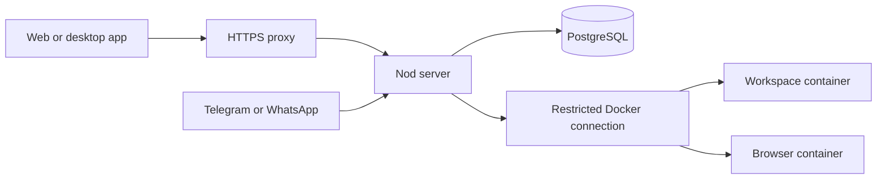

import { Aside, Steps } from '@astrojs/starlight/components';

Run Nod on a Linux server or Mac mini, then use the same assistant from your other devices.

One server belongs to one person. Its access token grants full access to that person's assistant and connected accounts. There is no registration or multi-user setup.

<Aside type="caution" title="Cloud hosting">
  Cloud VM metadata services can provide cloud credentials to workspace commands. Keep Nod's
  workspace firewall enabled and configure your provider's metadata access controls, such as [AWS
  instance metadata
  options](https://docs.aws.amazon.com/AWSEC2/latest/UserGuide/configuring-instance-metadata-options.html).
</Aside>

## What you need

| Requirement   | Detail                                                                                                           |
| ------------- | ---------------------------------------------------------------------------------------------------------------- |
| Computer      | Linux AMD64 or ARM64, or a Mac with Docker Desktop. Start with two CPU cores, 8 GB of memory, and 50 GB of disk. |
| Tools         | Docker Engine 25 or newer with Compose v2, OpenSSL, and `sha256sum` or `shasum`. Source builds also need Git.    |
| Remote access | An SSH tunnel, or a domain and inbound ports 80 and 443 for HTTPS.                                               |
| Model         | Connect one after startup. No model key is needed to install the server.                                         |

Choose a [cloud server](/deploy/providers/) or prepare a [Mac mini](/deploy/mac-mini/). The suggested size is a starting point; simultaneous browser tasks and local models need more capacity.

## Install a prebuilt bundle

Download a `server-<commit>` release from the private [Nod releases](https://github.com/n8n-io/nod/releases), when one is available. Choose `amd64` for Intel or AMD servers, or `arm64` for Apple Silicon and ARM servers. The Docker Engine must use Linux containers.

For a revision without a server release, use a successful **Self-host bundle** [workflow run](https://github.com/n8n-io/nod/actions/workflows/self-host-bundle.yml). Workflow artifacts expire after 14 days; approved release assets remain available beyond that window. Both paths check each architecture natively and validate its standalone installer. Keep the downloaded bundle with your backups.

Check the full source commit in the release tag or workflow run before downloading. Download only from authenticated GitHub; the bundle's checksums detect transfer corruption. Repository access is needed on the computer downloading the files. Maintainers can [prepare a private server release](/deploy/server-operations/#prepare-a-private-server-release) after approval; this does not make the repository public.

<Steps>

1. Download the `.tar.gz` bundle and matching `.sha256` file from the server release. If you use a workflow run, download the artifact named `nod-server-linux-<architecture>-<commit>` and extract its ZIP to get those two files.
2. Transfer those two files to your server using SCP, SFTP, or your provider's file transfer. On a Mac mini, copy them to the Mac.
3. Check the archive and unpack it. Replace the placeholders with the downloaded filename.

   ```sh title="Server"
   sha256sum -c nod-server-linux-<architecture>-<commit>.tar.gz.sha256
   tar -xzf nod-server-linux-<architecture>-<commit>.tar.gz
   cd nod-server-linux-<architecture>
   sh install.sh
   ```

   On macOS, use `shasum -a 256 -c` instead of `sha256sum -c`.

4. If the server is on another computer, first [open an SSH tunnel](#open-a-remote-server-without-a-domain). Open the address printed by the installer and enter `NOD_AUTH_TOKEN` from the server's private `.env`. Finish onboarding to connect a model.

</Steps>

The installer checks the bundle and Docker architecture, loads its exact application images, generates private keys, and waits for a healthy stack. Each fresh installation gets its own Compose project name and data volumes. An existing `.env` keeps its keys, project name, and settings. PostgreSQL and the runtime helpers download from pinned public images, so installation needs internet access. The server needs no Node.js, Git, registry login, or GitHub credentials.

For another independent assistant on the same computer, use a fresh folder and a different `PORT` for each loopback installation. Run `sh setup.sh` before editing the new `.env`. Keep each installation's `COMPOSE_PROJECT_NAME` unchanged after its first start. Use [Restore](/deploy/server-operations/#restore-into-a-fresh-installation) to move saved data into a new project.

Multiple HTTPS installations on one computer need a [shared reverse proxy](#use-an-existing-proxy) instead of the bundled HTTPS profile. That profile always uses host ports 80 and 443, regardless of `PORT`.

To configure a domain before the first start, run `sh setup.sh`, set `NOD_PUBLIC_URL` in `.env`, then run `sh install.sh --https`. See [Add public HTTPS](#add-public-https) for DNS and firewall setup.

## Build from source

<Steps>

1. Get Nod's source and open the server folder.

   ```sh title="Terminal"
   git clone https://github.com/n8n-io/nod.git
   cd nod/deployment/self-host
   ```

2. Generate the configuration.

   ```sh title="Terminal"
   sh setup.sh
   ```

   This creates a private `.env` with a server token, a Vault encryption key, and a database password. It preserves an existing `.env` and never prints the secrets. Keep these secrets in `.env`; unset shell overrides before running setup or Compose.

3. Build and start the stack.

   ```sh title="Terminal"
   docker compose up -d --build --wait
   ```

   The first build downloads dependencies and browser tools. Later starts reuse the images. Keep the terminal open until the command completes.

4. If the server is on another computer, first [open an SSH tunnel](#open-a-remote-server-without-a-domain). Then open `http://localhost:4310` on your computer. For a same-computer install, open that address directly. Copy `NOD_AUTH_TOKEN` from the server's `.env` into the access form. Finish onboarding to connect a model.

</Steps>

This option compiles the application and its browser tools on the server. Use a prebuilt bundle to avoid that first build. Neither option needs a separately installed database.

### Open a remote server without a domain

On your own computer, open a tunnel to the server:

```sh title="Your computer"
ssh -L 4310:127.0.0.1:4310 <user>@<server-address>
```

Keep that connection open and visit `http://localhost:4310`. Leave `NOD_PUBLIC_URL` at its local default for this setup. The token is still required.

To use another port, change `PORT` in `.env` and use that port in the tunnel and browser address. The default `NOD_PUBLIC_URL` follows `PORT`.

## Add public HTTPS

<Steps>

1. Point a domain, such as `nod.example.com`, at your server's public address. Allow inbound TCP 80 and 443.
2. Edit the server's `.env`:

   ```sh title=".env"
   NOD_PUBLIC_URL=https://nod.example.com
   ```

3. Start the HTTPS profile. For a bundle, run:

   ```sh title="Bundle installation"
   sh install.sh --https
   ```

   For a source checkout, run:

   ```sh title="Terminal"
   docker compose --profile https up -d --build --wait
   ```

4. Open your HTTPS address and enter the server token.

</Steps>

Caddy obtains and renews the certificate. This profile accepts a DNS or IPv4 host with HTTPS on port 443. Use an existing proxy for a different HTTPS port or an IPv6 URL. Keep using `--profile https` when you operate this installation. If certificate setup fails, check DNS and whether the provider or router blocks ports 80 or 443.

The public URL must be an origin: scheme, hostname, and optional port. Paths, query strings, fragments, and embedded credentials are refused.

### Use an existing proxy

You can use your own HTTPS reverse proxy instead of the HTTPS profile, including an origin with a custom port such as `https://nod.example.com:8443`. Forward requests to the stack's loopback port `4310`, or the port you set in `PORT`.

Preserve the public `Host` header and support WebSockets and streaming responses. Set `NOD_PUBLIC_URL` to that exact HTTPS origin. Nod does not trust forwarded headers to decide which origin is allowed.

Keep the backend port private. Never expose PostgreSQL, the browser, the workspace, or the Docker connection.

Nod allows five minutes to receive a request body. This does not limit the duration of assistant responses or event streams. Configure your proxy's request limits to suit your connection and expected uploads.

## Connect the desktop app

Choose **Connect to a server** on first launch. After setup, open **Replay onboarding…** in the Nod menu (on Windows, from the tray icon), then choose **Connect to a server**. Enter the server address and the value of `NOD_AUTH_TOKEN`.

Use the HTTPS address, or `http://localhost:4310` while your SSH tunnel is open. The app uses the server's conversation, files, models, and connected accounts. Closing the app does not stop the server.

The app verifies the server before saving the token in your operating system's secure storage. It restarts into the remote assistant without starting a local runtime. The server owns the Composio identity and connected accounts, so another device reaches the same assistant without reconnecting those accounts.

The app's local assistant is separate. Connecting does not migrate its data. To return to it, choose **Replay onboarding… → Change server → Use this computer**. Connection changes are also available on the startup recovery screen if the server is unavailable.

Model and app connections run on the server too. Use addresses the server can reach; `localhost` inside a Docker installation refers to its server container, not the device running the client. For ChatGPT subscription sign-in, follow the [remote callback instructions](/connect/models/#connect-a-service).

## Connect apps on the server

Open **Apps** and select **Connect**. For apps connected through Composio, Nod opens a sign-in page at your configured `NOD_PUBLIC_URL`. Select **Continue to sign in** and finish authorization in the window it opens. Keep the first page open until the connection finishes. Allow popups for Nod if your browser blocks the sign-in window.

The sign-in page and callback use Nod's normal address and port. The [SSH tunnel](#open-a-remote-server-without-a-domain) or [HTTPS proxy](#add-public-https) you use to open Nod also carries app sign-in. You don't need to forward another port. With HTTPS, set `NOD_PUBLIC_URL` to the exact address you open, such as `https://nod.example.com`.

After changing that address or restarting the server, start a fresh connection from **Apps**. Old sign-in pages cannot resume it. These steps also apply when your desktop app connects to the server. A desktop app running its own local assistant keeps its local sign-in flow.

## Connect Telegram or WhatsApp

Open **Channels** in Nod and follow [Telegram and WhatsApp](/use/channels/). Leave that channel's environment variables blank or unset to configure it in the app. Both share the server's assistant.

- Telegram polling and the WhatsApp QR connection need outbound internet access. They can work without a public domain.
- Telegram webhooks and Meta's WhatsApp Cloud API need a public HTTPS address.
- Private sign-in and payment steps stay in Nod's web or desktop app.

For environment-managed channels, see the [configuration reference](/deploy/configuration/#channels).

## What runs on the server



The database, workspace, and browser stay private. Model keys and saved credentials stay with the server, outside the workspace and browser containers.

The workspace uses a separate firewall container. It blocks private and reserved IPv4 destinations, including cloud metadata services, and external IPv6 traffic. The workspace starts only after this firewall is ready. Keep the `workspace-network` service and its network settings when you change the Compose file. Its DNS requests use public resolvers at `1.1.1.1` and `8.8.8.8`. These rules do not change the server's own connections to models or apps.

The stack uses named volumes for its persistent data. Recreating a container keeps those volumes. Deleting the volumes removes your data.

## Keep it running

The containers restart when Docker starts. On a Mac, Docker Desktop starts after you sign in when its startup setting is enabled.

Follow [Back up and update a server](/deploy/server-operations/) before your first update. Keep the Vault key with your backup; the database alone cannot recover saved credentials.

## Related resources

- [Deploy and operate](/deploy/)
- [Configuration reference](/deploy/configuration/)
- [Choose a cloud server](/deploy/providers/)
- [Host on a Mac mini](/deploy/mac-mini/)
- [Back up and update a server](/deploy/server-operations/)
