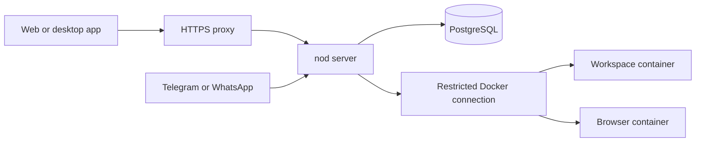

import { Steps } from '@astrojs/starlight/components';

Run nod on a Linux server or Mac mini, then use the same assistant from your other devices.

One server belongs to one person. Its access token grants full access to that person's assistant and connected accounts. There is no registration or multi-user setup.

## What you need

| Requirement   | Detail                                                                                                           |
| ------------- | ---------------------------------------------------------------------------------------------------------------- |
| Computer      | Linux AMD64 or ARM64, or a Mac with Docker Desktop. Start with two CPU cores, 8 GB of memory, and 50 GB of disk. |
| Tools         | Git, Docker Engine 25 or newer with Compose v2, and OpenSSL. Host Node.js is not required.                       |
| Remote access | An SSH tunnel, or a domain and inbound ports 80 and 443 for HTTPS.                                               |
| Model         | Connect one after startup. No model key is needed to install the server.                                         |

Choose a [cloud server](/deploy/providers/) or prepare a [Mac mini](/deploy/mac-mini/). The suggested size is a starting point; simultaneous browser tasks and local models need more capacity.

## Install

<Steps>

1. Get nod's source and open the server folder.

   ```sh title="Terminal"
   git clone https://github.com/n8n-io/nod.git
   cd nod/deployment/self-host
   ```

2. Generate the configuration.

   ```sh title="Terminal"
   sh setup.sh
   ```

   This creates a private `.env` with a server token, a Vault encryption key, and a database password. It preserves an existing `.env` and never prints the secrets. Keep these secrets in `.env`; unset shell overrides before running setup or Compose.

3. Build and start the stack.

   ```sh title="Terminal"
   docker compose up -d --build --wait
   ```

   The first build downloads dependencies and browser tools. Later starts reuse the images. Keep the terminal open until the command completes.

4. If the server is on another computer, first [open an SSH tunnel](#open-a-remote-server-without-a-domain). Then open `http://localhost:4310` on your computer. For a same-computer install, open that address directly. Copy `NOD_AUTH_TOKEN` from the server's `.env` into the access form. Finish onboarding to connect a model.

</Steps>

This setup builds from source. It does not require a registry account or a separately installed database.

### Open a remote server without a domain

On your own computer, open a tunnel to the server:

```sh title="Your computer"
ssh -L 4310:127.0.0.1:4310 <user>@<server-address>
```

Keep that connection open and visit `http://localhost:4310`. Leave `NOD_PUBLIC_URL` at its local default for this setup. The token is still required.

To use another port, change `PORT` in `.env` and use that port in the tunnel and browser address. The default `NOD_PUBLIC_URL` follows `PORT`.

## Add public HTTPS

<Steps>

1. Point a domain, such as `nod.example.com`, at your server's public address. Allow inbound TCP 80 and 443.
2. Edit the server's `.env`:

   ```sh title=".env"
   NOD_PUBLIC_URL=https://nod.example.com
   ```

3. Start the HTTPS profile:

   ```sh title="Terminal"
   docker compose --profile https up -d --build --wait
   ```

4. Open your HTTPS address and enter the server token.

</Steps>

Caddy obtains and renews the certificate. This profile accepts a DNS or IPv4 host with HTTPS on port 443. Use an existing proxy for a different HTTPS port or an IPv6 URL. Keep using `--profile https` when you operate this installation. If certificate setup fails, check DNS and whether the provider or router blocks ports 80 or 443.

The public URL must be an origin: scheme, hostname, and optional port. Paths, query strings, fragments, and embedded credentials are refused.

### Use an existing proxy

You can use your own HTTPS reverse proxy instead of the HTTPS profile, including an origin with a custom port such as `https://nod.example.com:8443`. Forward requests to the stack's loopback port `4310`, or the port you set in `PORT`.

Preserve the public `Host` header and support WebSockets and streaming responses. Set `NOD_PUBLIC_URL` to that exact HTTPS origin. nod does not trust forwarded headers to decide which origin is allowed.

Keep the backend port private. Never expose PostgreSQL, the browser, the workspace, or the Docker connection.

## Connect the desktop app

Open **Server connection** in the nod app menu or tray. On first launch, you can also choose **Connect to a server**. Enter the server address and the value of `NOD_AUTH_TOKEN`.

Use the HTTPS address, or `http://localhost:4310` while your SSH tunnel is open. The app uses the server's conversation, files, models, and connected accounts. Closing the app does not stop the server.

The app verifies the server before saving the token in your operating system's secure storage. It restarts into the remote assistant without starting a local runtime.

The app's local assistant is separate. Connecting does not migrate its data. To return to it, open **Server connection** and choose **Use this computer**.

## Connect Telegram or WhatsApp

Open **Channels** in nod and follow [Telegram and WhatsApp](/use/channels/). Leave that channel's environment variables blank or unset to configure it in the app. Both share the server's assistant.

- Telegram polling and the WhatsApp QR connection need outbound internet access. They can work without a public domain.
- Telegram webhooks and Meta's WhatsApp Cloud API need a public HTTPS address.
- Private sign-in and payment steps stay in nod's web or desktop app.

For environment-managed channels, see the [configuration reference](/deploy/configuration/#channels).

## What runs on the server



The database, workspace, and browser stay private. Model keys and saved credentials stay with the server, outside the workspace and browser containers.

The stack uses named volumes for its persistent data. Recreating a container keeps those volumes. Deleting the volumes removes your data.

## Keep it running

The containers restart when Docker starts. On a Mac, Docker Desktop starts after you sign in when its startup setting is enabled.

Follow [Back up and update a server](/deploy/server-operations/) before your first update. Keep the Vault key with your backup; the database alone cannot recover saved credentials.

## Related resources

- [Deploy and operate](/deploy/)
- [Configuration reference](/deploy/configuration/)
- [Choose a cloud server](/deploy/providers/)
- [Host on a Mac mini](/deploy/mac-mini/)
- [Back up and update a server](/deploy/server-operations/)
