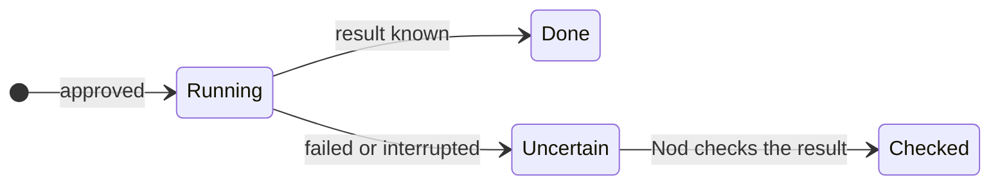

This page lists common problems, why they happen and how to fix them. Headings match the error message where Nod shows one.

If your problem isn't here, [report a bug with a diagnostic report](#report-a-bug-with-a-diagnostic-report).

## Install from source

### Use Node.js 24.21.0 or newer.

`pnpm start` checks your Node.js version first. Install Node.js 24.21.0 or newer, then run `pnpm start` again.

### Docker errors on start

Docker isn't running, or Compose is too old. Start Docker (on a Mac, open Docker Desktop) and check that `docker compose version` reports v2.

### the --chmod option requires BuildKit

Docker cannot build the workspace and browser images when BuildKit is unavailable or disabled. A missing Buildx plugin can cause this error. Docker Desktop includes it. Other setups, such as Colima with a Homebrew Docker CLI or a Linux package without `docker-buildx-plugin`, need it installed separately. [Install Buildx](https://github.com/docker/buildx#installing) and check that `docker buildx version` prints a version.

If `DOCKER_BUILDKIT=0` is set in your environment, remove it or set it to `1` to enable BuildKit. Then run `pnpm start` again.

### NOD_POSTGRES_PASSWORD is missing a value

You ran `docker compose` yourself before Nod created the database password. Run `pnpm start` from the repository root. It generates `NOD_POSTGRES_PASSWORD`, starts the containers, and starts Nod.

### Configure NOD_VAULT_KEY in server settings before saving a connection.

Nod has no key to encrypt saved credentials. Local macOS and Linux web installs normally create a protected key automatically. Other server configurations need an explicit key. If saved encrypted data exists, restore its original key instead of generating a new one. For a fresh server only, add a key to `.env`, then [apply the configuration](/deploy/configuration/#apply-configuration-changes).

```sh title="Terminal"
sed -i.bak "s|^NOD_VAULT_KEY=.*|NOD_VAULT_KEY=$(openssl rand -base64 32)|" .env && rm .env.bak
```

Keep a copy of the key somewhere safe. Saved credentials can't be read without it.

### The port is in use

Another program uses port `4310`. Set another `PORT` in `.env` and [apply the configuration](/deploy/configuration/#apply-configuration-changes). Update your browser address and any SSH tunnel to match. A direct source install also needs database port `54329` on `127.0.0.1`; the self-hosting stack keeps its database port private.

### This host is not permitted.

When `NOD_PUBLIC_URL` is set, Nod answers only at that address. The Docker setup always sets it (by default to `http://localhost:4310`). A request for any other host gets this error. That includes `127.0.0.1`, `localhost` after you set an HTTPS address, and a reverse proxy that changes the `Host` header. Without `NOD_PUBLIC_URL`, Nod answers only at `localhost`, `127.0.0.1` and `[::1]` on its own port.

Open Nod at that exact address, and make sure a reverse proxy passes the public `Host` header through unchanged. To use another address, change `NOD_PUBLIC_URL` and [apply the configuration](/deploy/configuration/#apply-configuration-changes). Nod accepts one address at a time.

### You lost the access link

For a local source install without `NOD_AUTH_TOKEN`, Nod prints a link with `#access=` when it starts, and your browser keeps the cookie. To get a new link, delete `access-key` in your data folder (`.local/` by default) and restart. A server configured with `NOD_AUTH_TOKEN` prints its address without that link; use its configured token, or follow [Rotate access](/deploy/server-operations/#rotate-access).

## Desktop app

### Linux cannot start its private computer

A local Linux desktop assistant requires hardware virtualization and access to `/dev/kvm`. Check that virtualization is enabled in your firmware and that your Linux account can use KVM. On distributions with a `kvm` group, your account must belong to it. Sign out and back in after a group change, then reopen Nod. Nod does not use software emulation as a fallback.

If an older build reported `copy_file_range failed: invalid argument`, install the latest Nod bundle and retry. Nod now uses normal reads and writes to copy its first guest image. It verifies the complete copy before Lima can use it. An older empty disk is replaced only after Nod checks that every byte is zero and stops the computer. Disks with other data are kept.

### Linux cannot save or unlock keys

Start and unlock your desktop's secret store, such as GNOME Keyring or KWallet, then reopen Nod. The Flatpak uses Secret Service for saved keys and server tokens. Nod refuses plain-text storage. Keep your existing profile and secret store entries.

### Linux cannot move a file to the Trash

The Flatpak uses `xdg-desktop-portal` for Trash. Check that your desktop's portal service is installed and running. Headless sessions can lack it. Nod keeps the original file when Trash fails.

### Linux does not find an app update

Nod's update checks are off on Linux. Download and install the next bundle with the [Linux install procedure](/get-started/install-desktop/#linux). The published bundles have no Nod update repository, so `flatpak update` alone does not update Nod.

### macOS blocks the first launch

Every release is notarized by Apple. If macOS still blocks it, open **System Settings → Privacy & Security** and select **Open Anyway**. A managed Mac may need approval from your IT team.

### macOS asks for Keychain access after an update

macOS can ask again after Nod is re-signed. Approve it in the macOS dialog. Never type your Mac password into the Nod chat.

While the keychain unlocks, Nod keeps the startup screen and **Connect to a server** available. If it keeps waiting, check for a macOS prompt, unlock your keychain, then quit and reopen Nod.

### macOS opens the old version after an update

After **Restart to update**, macOS needs a minute or two to install the new app before it opens. Nod 0.8.4 and earlier cancel the update if you open them during that time. Select **Restart to update** again and wait until Nod opens by itself. If it still opens on the old version, quit Nod and run the [Terminal installer](/get-started/install-desktop/#install-nod). It keeps your profile, keys and data.

### Nod could not unlock your saved server token

Select **Reconnect to server** and enter the same server address and `NOD_AUTH_TOKEN`. The app checks the connection before saving the token again in your computer's secure storage. If macOS asks for Keychain access, allow it there.

Your assistant, chats, files and connected accounts are on the server. Reconnecting keeps them and your separate local assistant. Do not delete your local profile or reset the server to fix this error.

On macOS, unlock your Mac keychain, then quit and reopen Nod. On Windows, sign in to the same Windows account that saved the token and retry. Your saved token stays in place.

### Not enough free space to install the runtime

On a Mac, the message says how much free space Nod needs and how much more to free. Nod needs room for the extracted runtime plus 512 MiB. Free that space, then retry. Your conversations and settings are kept.

On Windows, the message reads "Nod needs more free disk space to prepare its private computer." Allow at least 20 GB, then select **Try again**.

### Setup fails or stops partway

Retry first. Do not delete the profile, VM, database, or runtime cache by hand to fix it. If it still fails, [report a bug](#report-a-bug-with-a-diagnostic-report). If the chat cannot open, select **Show startup log** on the error screen. Send that log with a screenshot of the error. When a setup command fails, the message includes the last lines of its output.

On Mac and Linux, Nod records new first setups and marks them complete after the computer passes its startup checks. If a recorded setup fails or is interrupted, the next attempt replaces the unfinished computer. A failed replacement reports its own error and stops the attempt. Computers that completed setup are kept. Missing configuration for an existing computer also stops setup and keeps its files.

An interrupted Mac setup from an older version can lack that record. If retry still fails, keep its files and [report a bug with the startup log](#report-a-bug-with-a-diagnostic-report).

If the background service does not respond within two minutes, the startup log records the elapsed wait and the last health check failure. It also records whether the service reported its port. An unexpected service exit has a separate log entry.

On a Mac, setup keeps runtime files that passed their checks, even if a later download fails. **Try again** checks and reuses those files. It does not remove a verified image while the private computer loads it.

On Windows, database errors show whether PostgreSQL stopped, reached a memory limit, or failed its TCP check inside WSL. If PostgreSQL answers inside WSL, the error names the Windows connection that failed. Open **Technical details** to read the original error, its code, its stack, and available native command output. These details also appear in the startup log. Saved secrets are removed.

On a Mac, **Technical details** and the startup log also show the cause of a runtime download failure. This includes a connection error inside `fetch failed` or a damaged archive error. Select **Try again** after you restore the connection. If Nod can keep the saved part, an interrupted download resumes. Otherwise it starts again.

Quit Nod and open it again. If the error continues, restart Windows. Keep your app data. WSL setup errors also include the original Windows error.

To start over, select **Remove all data…** in the **Nod** menu. Nod deletes your profile and private computer, then restarts and opens setup. See [Remove Nod](/get-started/install-desktop/#remove-nod) for what it keeps.

### Windows keeps offering the same update

Nod versions before 0.7.0 on Windows can't install their own updates. Quit Nod from the tray icon, then run the latest installer as described in [Update Nod](/get-started/install-desktop/#update-nod). It keeps your profile, keys and data. Don't uninstall Nod or delete its folders first.

### Windows says WSL is missing

Select **Install WSL** in Nod, approve the administrator request, restart the PC and open Nod again. A device policy can block WSL installation.

### PostgreSQL fails after a Mac VM kernel update

Ubuntu kernels `7.0.0-42` and `7.0.0-43` can block signals inside containers. The PostgreSQL user-switch process then waits forever, and Nod reports `NOD_DATABASE_CONNECTION_FAILED`.

Install a Nod build with the container profile repair, then quit and reopen Nod. The repair keeps AppArmor active and preserves the database volume. It also prevents further automatic kernel changes and VM restarts. A restart alone does not repair the old profile. Do not delete the VM or database to fix this failure.

If setup still fails, select **Show startup log** and [report a bug](#report-a-bug-with-a-diagnostic-report). This error alone does not show whether the database files are damaged.

## Models and apps

### An app connection fails

Return to **Apps** and select **Connect** again. Keep the sign-in page and any window it opens until authorization finishes. A copied, expired or already used link cannot finish a connection. If the system's encrypted storage is locked, unlock it and restart Nod.

If the connection service refuses the request, the sign-in page names its reason and HTTP status, such as `public_budget_exceeded` and `HTTP 429`. If the connection service is unavailable or reports a limit, try again later. If the problem persists, [report a bug with a diagnostic report](/deploy/troubleshooting/#report-a-bug-with-a-diagnostic-report).

A sign-in link expires after 10 minutes. The diagnostic report then records the step where the sign-in stopped: opening the sign-in page, starting the sign-in, pairing the browser with the connection service, or signing in and approving access in the app. On a server you host, the last two are recorded as one step. A sign-in that expires while Nod is running, or returns after its link expired, is recorded once as a timeout.

### An app tool fails with HTTP 403

If an app tool error shows `HTTP 403` and a UTC time, [report a bug with a diagnostic report](/deploy/troubleshooting/#report-a-bug-with-a-diagnostic-report). Include that time and any Cloudflare Ray ID in your feedback text. The displayed `0x` is a formatting prefix; support removes it before searching Cloudflare.

### An app tool isn't offered or fails with HTTP 404

Nod checks an action name it hasn't looked up against the connection service's list before it asks you anything or sends a request. If the service doesn't list that name, Nod refuses the call and says the action isn't offered. Nothing reaches the app. This happens when Nod calls an action without searching the app's tools first. Ask Nod to search the app's tools for the exact action and try again.

If the check itself can't run, the call goes ahead, and the service may answer an unknown action with `HTTP 404`. If an action Nod found by searching still returns `HTTP 404`, [report a bug with a diagnostic report](/deploy/troubleshooting/#report-a-bug-with-a-diagnostic-report).

### The connection service refused this request

When the connection service refuses a file for an app, the error shows its HTTP status, and its reason when Nod recognizes it. For example: `The connection service refused this request: file_verification_failed. HTTP 502.` The app action doesn't run, so nothing reaches the recipient.

- For `file_too_large` or `invalid_file_data`, send a smaller or different file.
- For `tool_account_mismatch`, pick the account that belongs to that app.
- For other reasons, try again later.

If it keeps failing, [report a bug with a diagnostic report](/deploy/troubleshooting/#report-a-bug-with-a-diagnostic-report).

### App sign-in opens an unreachable address on a remote server

Update the server to a version with [remote app sign-in](/deploy/self-host/#connect-apps-on-the-server). Set `NOD_PUBLIC_URL` to the exact address you open Nod at, then [apply the configuration](/deploy/configuration/#apply-configuration-changes).

For HTTPS, use your public origin, such as `https://nod.example.com`. For an SSH tunnel, keep the tunnel open and use its local Nod address, such as `http://localhost:4310`. App sign-in uses that same port.

Start a fresh connection from **Apps**. Keep its first page open and select **Continue to sign in**. Allow popups for Nod if no sign-in window opens. A page opened before a server restart or URL change cannot complete the connection.

ChatGPT model sign-in uses a separate flow. Follow its [remote callback instructions](/connect/models/#connect-a-service); you don't need to expose its callback port publicly.

## Channels

### WhatsApp Cloud API needs a public HTTPS callback

Meta's WhatsApp Cloud API delivers messages to a public HTTPS address. A local desktop assistant has no public callback, and the desktop app doesn't relay webhooks. Expose only the `/api/webhooks/whatsapp` route if you need that mode. The WhatsApp QR connection uses an outbound connection and does not need a public URL.

Telegram doesn't need one. Leave **Public HTTPS callback** blank and Nod receives Telegram messages locally.

### This Telegram bot already uses a webhook

The bot was set up with a webhook elsewhere. Remove that webhook to use local polling, or enter a public URL in **Public HTTPS callback** to have Nod use a webhook.

## Tasks and actions

### A scheduled task didn't run

For a local desktop assistant, scheduled tasks run only while Nod is open and your computer is awake. Closing the window keeps Nod running in the menu bar or tray, but **Quit Nod** stops it. **Open at login** is on after setup; keep it on in **Settings → General** if you rely on schedules. After a restart or power cut, Nod starts only once you sign in to your computer, and a Mac with FileVault turned on never signs in automatically. For a remote assistant, check that the server is running; closing a desktop client does not stop its schedules.

A run that starts while the computer has no internet connection, such as right after it wakes, fails with "Nod couldn't reach Anthropic because this computer had no internet connection", naming your model provider, with the code (such as `ENOTFOUND`) beside it. The chat shows when the run was due, which runs were skipped and when Nod tried. OpenAI-compatible, Azure OpenAI and Amazon Bedrock connections keep their usual error, because their address or Region may be wrong, and so do providers that report no network code, such as Google. Nod doesn't run it again on its own; select **Run now** once you're online, or wait for the next run. To keep schedules running while your computer sleeps, [run Nod on a server](/deploy/self-host/).

### An action shows as uncertain

An action Nod started failed or was interrupted, so Nod can't tell whether it ran. Nod never runs it again on its own. For a sign-in or payment, **Usage** shows "Result unknown".



Ask Nod to check the result in the app or website before you try again. See [One use, one result](/trust/outcomes/).

## Get help

### Report a bug with a diagnostic report

Select **Report bug** in the chat. When something in Nod itself fails, Nod also drafts a bug report in chat that you send with **Send report**, or by replying "send" in Telegram or WhatsApp. See [Report a bug](/use/chat/#report-a-bug). In the desktop app, **Report bug…** is also in the menu bar menu. The dialog names the recipient before you send: the Nod team at n8n by default, or your operator's configured collector.

If the workspace crashes, use **Report bug** on the error screen before **Reload Nod** to include the captured error.

In the desktop app, if Nod's background service or its window stops, Nod shows its error screen. Select **Report bug** there. A separate report form opens without restarting the failed service. The menu bar **Report bug…** entry opens the same form while startup has failed.

Describe the failure, then select **Review**. The startup report contains only fixed startup states, error classes and codes, versions, counts and event ages. Nod omits startup prose, log text, paths, URLs, account details and message content. It keeps up to 100 technical events and 48 KB in memory. It does not read a log file or earlier disk history for the report. Unknown fields are omitted. Error codes come from structured error fields, never from a message. Your description stays exactly as you wrote it. Review the exact attachment, then select **Send report**. You can untick **Include startup report** to send only your description. Keep the form open until you send it; the startup form does not save an unsent draft.

If the send result is unknown, select **Check status** while the startup form is open. An unknown or rejected result shows the collector's HTTP status when it is available. The code alone does not confirm delivery. If Nod restarts into the startup error screen, reopen **Report bug** to check the saved submission instead of sending it again. **Show startup log** still opens the local log when you need it.

If the description was sent without its diagnostic report, select **Send the report again** to add the same reviewed attachment to the same report. This option needs the original bytes, which the helper keeps for up to one hour. After a restart, those bytes are gone. Check the saved status or start a new report; Nod does not rebuild an attachment under the old submission reference.

If Nod cannot read the saved submission status, select **Retry saved status**. Nod keeps sending blocked while that status is unknown. For a corrupt regular file, **Start a new report** warns that the previous report may already have been sent and a new one can be a duplicate. Nod first saves the original bytes in a local `startup-feedback-recovered-*.bin` file. If it cannot preserve them, sending stays blocked. After recovery, review the new report and select **Send report** yourself.

Choose a feedback category and describe what happened. Include what you expected, what actually happened, and the steps that trigger the problem. **Include diagnostic report** starts selected for every category until you change it. Nod remembers your choice for your account on this device after sending or discarding a draft.

Select **Review** to inspect the exact attachment, or untick the checkbox to omit it. The report masks known secrets and recognized personal details, but can miss information. If preparation fails, select **Continue without report**. Your Nod runtime prepares the report from recent messages, logs, and app activity. Only **Send feedback** sends it to the configured feedback recipient.

A new desktop draft includes a screenshot when capture is available. Private screens, embedded browsers, open dialogs, and unsent text or files prevent capture. Review, annotate, or remove the screenshot before sending. Check your feedback text and attachments for personal information. Never add API keys, passwords, or your settings file.

To report a bug, use the [bug report form](https://github.com/n8n-io/nod/issues/new/choose). Report a vulnerability privately, as the [security policy](https://github.com/n8n-io/nod/blob/main/SECURITY.md) describes.

### Report contents and limits

The `nod-feedback-report-v3` JSON attachment connects the steps before a failure with the affected chat, agent work, app usage, and connections. It helps with support, debugging, and product improvement. It combines technical metadata with recent content after best-effort redaction.

| Section                 | What it shows                                                                                                                                                                                          |
| ----------------------- | ------------------------------------------------------------------------------------------------------------------------------------------------------------------------------------------------------ |
| Runtime                 | App version, release, platform, known model provider, model family, selected model ID, reasoning effort, model routes, and the trust check mode.                                                       |
| System                  | The time the report was prepared, time zone, operating system and its version, CPU count, memory, Node.js, Electron and database versions, runtime uptime, and whether Nod runs in a container.        |
| Settings                | Locale, time zone, quiet hours, whether automatic preparation, local files, a notification rule or rules are set, spending limits, and each chat app's mode and link state. Rule text isn't included.  |
| Chat                    | Recent user and assistant message text, roles, character and attachment counts, and reply metadata.                                                                                                    |
| Turns and agent work    | Request source, channel, outcome, waiting state, queue and run duration, tool category, parent-child relationships, and whether a background check stopped at screening (its outcome shows the rest).  |
| Model usage             | Request outcomes, duration, token counts, recorded cost and estimates, model IDs, known model categories and operations, and a 24-hour summary by model and operation.                                 |
| Tasks and schedules     | State, progress counts, enabled state, overdue work, and recent run and failure counts.                                                                                                                |
| Connections             | Managed app, browser, direct connection, and model connection state, plus reconnect and event-delivery health.                                                                                         |
| Channels                | Receiving and delivery states, with a permitted failure reason.                                                                                                                                        |
| Runtime logs            | Recent tool inputs and results, and connection activity.                                                                                                                                               |
| Failures                | Application and background failures with error class, message, stack with source file names, status, exit code and process output. A repeated failure appears once with a count.                       |
| Startup log             | Desktop startup, runtime preparation and update steps: versions, update check, download, install and restart results, and exit codes.                                                                  |
| App activity and errors | Recent screen categories, API failure categories and status codes, UI errors, failed requests with the server's reason, live update disconnects, and captured app error messages and stacks.           |
| App window              | Whether the window was online and visible, the live update connection state, the age of the last update, saved and displayed message counts, window size, locale, and clock difference to the runtime. |

Database activity covers the latest 24 hours for your account across its conversations and background work. Each database section includes at most 200 entries, or 400 for agent execution events. Connection and schedule sections show current state. Report-local labels preserve execution relationships without exporting their original IDs. Activity uses relative ages and durations. The report carries one absolute time: when it was prepared.

The runtime journal uses three rotating files of at most 1 MiB each in Nod's private data folder. Data is redacted before it is written and again when it is exported. Failures have their own journal with the same limits, so tool activity can't push them out. Reports include up to 200 runtime log entries from the latest 24 hours. Identical failures are merged into one entry with a count and the age of the first one, and a report includes up to 150 merged failures. A failure that repeats within 10 minutes is counted and written with the next one, so its count can lag by that long. A tool result longer than 6,000 characters keeps its start and end. An entry larger than 64 KiB is replaced with an omission marker. Expired records are removed on startup, report preparation, subsequent journal writes, and a one-minute cleanup timer. Files can remain while Nod is stopped. Dropped entries and unavailable journal data are identified in the report.

The separate app activity buffer holds up to 100 recent entries for 30 minutes in the current runtime and app window. The app window also keeps up to 10 recent error messages and stacks for 30 minutes. These buffers don't depend on usage analytics being enabled. Closing the app window or restarting the runtime clears that source's buffer. Dropped or expired activity entries aren't marked. A bug report sent by replying in Telegram or WhatsApp carries only its summary, without a diagnostic report. Activity categories contain no raw request URLs or response bodies. App error messages and stacks reach the runtime for redaction when a report is prepared and aren't written to its journal. After an account change, error capture pauses until the app window reloads, and the report marks that source unavailable.

The redactor omits individual strings longer than 32,000 characters before scanning them. Database reads separately omit message and error text larger than 64 KiB. When content is included, absent message text and turn errors have no field; a content-limit marker means a stored value exceeded that read limit. App error messages and stacks each have an 8,192-character capture limit. Structured values also have depth, entry-count, and size limits. These limits can remove details from long messages and tool results.

The report includes a coverage record for each database section and the runtime journal: collection status, entry count, and omitted-entry indicators. These markers do not count entries dropped or expired from the app activity and error buffers. The final attachment is capped at 512 KiB. Older entries are removed if needed, and their sections mark that truncation. Failures, the startup log and settings are removed last. An empty or incomplete section doesn't prove that no problem occurred.

A model ID is included only when every word in it is a known public model, vendor or variant name. Any other ID is left out, and the model family stays. A stack frame keeps its file only when the file is inside Nod's own source folders or a dependency. Every other file path is masked, including paths on removable drives. A web address with a scheme, such as `https://`, `wss://`, `ftp://` or `file://`, is masked in full, including its query and fragment. An address without a scheme is masked in full, with its port, path, query and fragment, when Nod recognizes its domain. Encoded text that contains such a link is masked before decoded spaces, tabs or line breaks can split it. Phone numbers written without a country code are recognized by the region of your locale, or of your time zone when no locale is set.

The desktop app writes the startup log to `logs/startup.log` in its profile folder. When the file passes 64 KiB, the app keeps its newest half before the next entry. Reports read the final 48 KB and include up to its last 200 lines after redaction. The section is marked when older lines were left out.

The report excludes credential fields, screenshots, binary data, system prompts, model thinking, the computer name, and account names. Text returned by a file, browser, or app tool can be included after redaction. Redaction can miss personal details, so review the complete attachment and leave it out if needed. A report also cannot recover details outside its time or size limits.

The report setting does not enable [usage analytics or conversation traces](/trust/privacy/).

## Related resources

- [Configuration reference](/deploy/configuration/)
- [Desktop app internals](/deploy/desktop-app/)
- [Install from source](/get-started/install-from-source/)
- [Install the desktop app](/get-started/install-desktop/)
