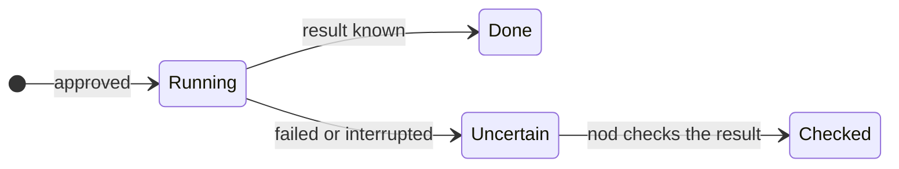

This page lists common problems, why they happen and how to fix them. Headings match the error message where nod shows one.

If your problem isn't here, [send feedback with a diagnostic report](#send-feedback-with-a-diagnostic-report).

## Install from source

### Use Node.js 24.21.0 or newer.

`pnpm start` checks your Node.js version first. Install Node.js 24.21.0 or newer, then run `pnpm start` again.

### Docker errors on start

Docker isn't running, or Compose is too old. Start Docker (on a Mac, open Docker Desktop) and check that `docker compose version` reports v2.

### Run npm run dev to prepare the local database

You ran `docker compose` yourself before nod created the database password. Run `pnpm start` once. It generates `NOD_POSTGRES_PASSWORD` and starts the containers for you.

### Configure NOD_VAULT_KEY in server settings before saving a connection.

nod has no key to encrypt saved credentials. Local macOS and Linux web installs normally create a protected key automatically. Other server configurations need an explicit key. If saved encrypted data exists, restore its original key instead of generating a new one. For a fresh server only, add a key to `.env`, then restart nod.

```sh title="Terminal"
sed -i.bak "s|^NOD_VAULT_KEY=.*|NOD_VAULT_KEY=$(openssl rand -base64 32)|" .env && rm .env.bak
```

Keep a copy of the key somewhere safe. Saved credentials can't be read without it.

### The port is in use

Another program uses port `4310`. Set another `PORT` in `.env` and restart. nod's database container also needs port `54329` on `127.0.0.1`.

### You lost the access link

nod prints a link with `#access=` when it starts, and your browser keeps the cookie. To get a new link, delete `access-key` in your data folder (`.local/` by default) and restart.

## Desktop app

### macOS blocks the first launch

Every release is notarized by Apple. If macOS still blocks it, open **System Settings → Privacy & Security** and select **Open Anyway**. A managed Mac may need approval from your IT team.

### macOS asks for Keychain access after an update

macOS can ask again after nod is re-signed. Approve it in the macOS dialog. Never type your Mac password into the nod chat.

### Not enough free space to install the runtime

On a Mac, the message says how much free space nod needs and how much more to free. nod needs room for the extracted runtime plus 512 MiB. Free that space, then retry. Your conversations and settings are kept.

On Windows, the message reads "nod needs more free disk space to prepare its private computer." Allow at least 20 GB, then select **Try again**.

### Setup fails or stops partway

Retry first. Don't delete the profile, VM, database or runtime cache by hand to fix it. If it still fails, [send feedback](#send-feedback-with-a-diagnostic-report). If the chat can't open, send a screenshot of the setup error instead. When a setup command exits with an error, the message ends with the last lines it printed, which show the cause. When nod can't connect to its local storage, the message names the connection error.

To start over, select **Remove all data…** in the **nod** menu, then open nod again. It deletes your profile and private computer. See [Remove nod](/get-started/install-desktop/#remove-nod) for what it keeps.

### Windows says WSL is missing

Select **Install WSL** in nod, approve the administrator request, restart the PC and open nod again. A device policy can block WSL installation.

## Models and apps

### Port 1455 is already in use

ChatGPT sign-in receives its callback on port 1455. Another nod app or another sign-in is using it. Close it, then try again.

### An app connection fails

Return to **Apps** and select **Connect** again. Complete the authorization in the same browser tab; a copied, expired or already used link cannot finish a connection. If the system's encrypted storage is locked, unlock it and restart nod.

If the connection service is unavailable or reports a limit, try again later. If the problem persists, [send feedback with a diagnostic report](/deploy/troubleshooting/#send-feedback-with-a-diagnostic-report).

## Channels

### WhatsApp needs a public HTTPS callback

Meta delivers WhatsApp messages to a public HTTPS address. nod on your computer has none, and the desktop app doesn't relay webhooks. Expose only the `/api/webhooks/whatsapp` route and keep the rest of nod private.

Telegram doesn't need one. Leave **Public HTTPS callback** blank and nod receives Telegram messages locally.

### This Telegram bot already uses a webhook

The bot was set up with a webhook elsewhere. Remove that webhook to use local polling, or enter a public URL in **Public HTTPS callback** to have nod use a webhook.

## Tasks and actions

### A scheduled task didn't run

Scheduled tasks run only while nod is open and your computer is awake. Closing the window keeps nod running in the menu bar or tray, but **Quit nod** stops it. Turn on **Open at login** in **Settings → General** if you rely on schedules.

### An action shows as uncertain

An action nod started failed or was interrupted, so nod can't tell whether it ran. nod never runs it again on its own. For a sign-in or payment, **Usage** shows "Result unknown".



Ask nod to check the result in the app or website before you try again. See [One use, one result](/trust/outcomes/).

## Get help

### Send feedback with a diagnostic report

Select **Send feedback** in the chat. In the desktop app, it's also in the menu bar menu. The dialog names the recipient before you send: the nod team at n8n by default, or your operator's configured collector.

Tick **Include diagnostic report** to add your recent chat, actions and their results, then select **Review** to read it before you send. nod removes known secrets and the personal details it recognizes first, but can miss others. Never add API keys, passwords or your settings file.

To report a bug, use the [bug report form](https://github.com/n8n-io/nod/issues/new/choose). Report a vulnerability privately, as the [security policy](https://github.com/n8n-io/nod/blob/main/SECURITY.md) describes.

## Related resources

- [Configuration reference](/deploy/configuration/)
- [Desktop app internals](/deploy/desktop-app/)
- [Install from source](/get-started/install-from-source/)
- [Install the desktop app](/get-started/install-desktop/)
